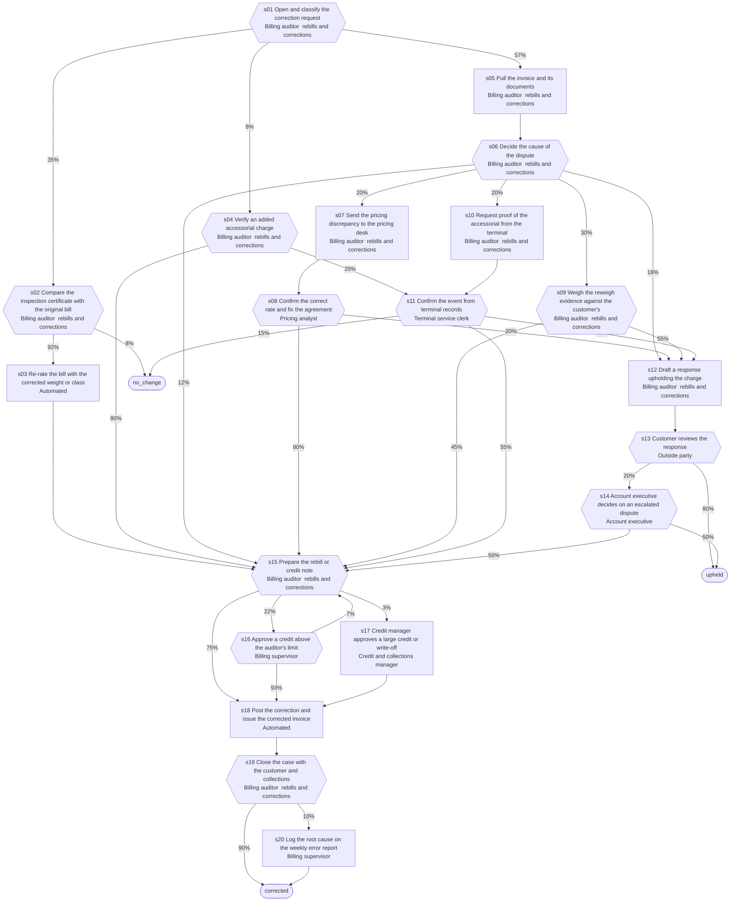

# Correct bills and resolve billing disputes

`frt-fin-billing-corrections` · trucking and freight transportation · finance (billing centre) · part of `freight-carrier-co`

After an invoice goes out, some charges have to change. Terminals reweigh or inspect freight and find it heavier or in a higher class than the bill said, refused or redelivered freight earns extra charges, and customers dispute rates, reweighs and accessorials. Billing auditors check the evidence, get rate answers from the pricing desk and proof from terminals, and issue rebills or credit notes that supervisors approve above a limit. Disputes wait days for pricing and for customers, and the invoice stays unpaid until they are settled.

| | |
|---|---|
| Unit of work | one billing correction |
| Starts when | A weight and inspection certificate, a refused-freight or redelivery charge, or a billing dispute from a customer or from collections reaches the corrections queue. |
| Done when | A rebill or credit note is posted and sent, the charge is upheld and accepted, or the request is closed with no change. |
| Organisation | A Canadian LTL and truckload carrier of about 3,000 employees with a central billing centre whose auditors handle rebills, credit notes and billing disputes. (3,000 employees, 2019-2022) |
| Volume | 9,000 cases a month (range 7,500 to 11,500) |

## Where it sits

- Starts with **reweigh_correction** from ltl-reweigh-inspection (35% of cases)
- Starts with **accessorial_charge** from ltl-refused-freight (8% of cases)
- Starts with **billing_dispute** from shipper (37% of cases)
- Starts with **billing_dispute** from fin-collections (20% of cases)
- Sends **corrected_invoice** to shipper (outcome: corrected)
- Sends **ledger_postings** to fin-month-end-close (outcome: corrected)
- Sends **pricing_error_report** to sls-pricing-quotes (outcome: corrected)

## Flow

## Roles

| Role | Department | Layer | FTE on this process | Loaded cost per hour | Evidence |
|---|---|---|---:|---:|---|
| Billing auditor (rebills and corrections) | Billing centre | individual contributor | 10 | 34 CAD | B [src-rateclerk] |
| Billing supervisor | Billing centre | supervisor | 0.7 | 49 CAD | C |
| Pricing analyst | Sales and customer service | senior specialist | 2.5 | 54 CAD | C |
| Terminal service clerk | LTL terminal network | individual contributor | 1.5 | 32 CAD | C |
| Account executive | Sales and customer service | individual contributor | 1.5 | 62 CAD | C |
| Credit and collections manager | Finance | manager | 0.1 | 76 CAD | C |

## Steps

Hands-on time and the wait before each step show the most common value. Evidence tier A is a sourced number, B a sourced description, C the author's estimate.

| Step | Who | Kind | Hands-on | Wait before | Control | Evidence |
|---|---|---|---:|---:|---|---|
| **s01 Open and classify the correction request.** A billing auditor opens the next item in the corrections queue: a weight and inspection certificate from a terminal, a refused-freight or redelivery charge, a customer's dispute email or portal message, or a dispute passed on by collections. The auditor links it to the PRO number and sorts it by type. | Billing auditor (rebills and corrections) | intake | 1.5 min | 12.0 h |  | C |
| **s02 Compare the inspection certificate with the original bill.** The auditor compares the weight, dimensions and class on the terminal's weight and inspection certificate with the original bill and the shipper's figures, checks that the change is outside the tolerance and that the scale or dimensioner record is attached. | Billing auditor (rebills and corrections) | validation | 3 min | 0 min |  | B [src-rateclerk], [src-dayross] |
| **s03 Re-rate the bill with the corrected weight or class.** The rating engine re-prices the bill with the corrected weight, dimensions or class under the customer's agreement and shows the difference from the original charge. | Automated | system auto | 0 min | 5 min |  | C |
| **s04 Verify an added accessorial charge.** For a refused, redelivered or stored shipment, the auditor checks the terminal's notes, delivery attempt scans and the rules tariff item to confirm that the charge applies and that the right party will be billed. | Billing auditor (rebills and corrections) | validation | 4 min | 0 min |  | B [src-transflo] |
| **s05 Pull the invoice and its documents.** The auditor gathers the invoice, the signed bill of lading and delivery receipt images, any inspection certificate, the pricing agreement or quote and the customer's own calculation, and records the disputed amount on the dispute log so collections holds the invoice. | Billing auditor (rebills and corrections) | lookup | 4 min | 1.0 h |  | C |
| **s06 Decide the cause of the dispute.** The auditor compares the customer's claim with the documents and decides which kind of problem it is: a pricing or discount error, a contested reweigh or reclassification, a contested accessorial, a bill sent to the wrong party or terms, or a charge that is correct. | Billing auditor (rebills and corrections) | judgment | 4 min | 0 min |  | B [src-transflo] |
| **s07 Send the pricing discrepancy to the pricing desk.** The auditor sends the pricing analyst the PRO numbers, the agreement item the customer quotes and the rate the engine applied, and asks which price is right. | Billing auditor (rebills and corrections) | communication | 3 min | 0 min |  | C |
| **s08 Confirm the correct rate and fix the agreement.** The pricing analyst checks the signed agreement, quote and renewal history, confirms with the account executive what was promised, corrects the agreement in the rating engine and lists any other bills affected by the same error. | Pricing analyst | judgment | 15 min | 2.0 d |  | C |
| **s09 Weigh the reweigh evidence against the customer's.** The auditor compares the carrier's scale ticket, dimensioner record and inspection photos with the customer's packing list, product specifications or own scale record, and decides whether to keep or reverse the correction. | Billing auditor (rebills and corrections) | judgment | 8 min | 0 min |  | B [src-fw-ltl], [src-dayross] |
| **s10 Request proof of the accessorial from the terminal.** The auditor asks the terminal that performed the service for proof: the driver's notes, handheld arrival and departure times, appointment records or photos of a residential or limited-access delivery. | Billing auditor (rebills and corrections) | communication | 3 min | 0 min |  | C |
| **s11 Confirm the event from terminal records.** The terminal service clerk looks up the delivery attempt, the driver's handheld times and notes, and asks the driver or dock supervisor if records are thin, then replies with what happened and any photos or signed documents. | Terminal service clerk | lookup | 6 min | 1.0 d |  | C |
| **s12 Draft a response upholding the charge.** The auditor writes to the customer explaining why the charge stands, attaching the scale ticket, inspection photos, delivery notes or agreement item, and tells collections the dispute is answered. | Billing auditor (rebills and corrections) | drafting | 8 min | 1.0 h |  | C |
| **s13 Customer reviews the response.** The customer's accounts payable team or freight audit provider reviews the explanation and either pays the invoice or comes back with more evidence or a request for a goodwill credit. | Outside party | external wait | 0 min | 3.0 d |  | C |
| **s14 Account executive decides on an escalated dispute.** The account executive reviews the disputed charge, the account's revenue and the relationship, talks to the customer and decides whether to keep the charge or give a goodwill credit, often agreeing a fix to the customer's agreement for future shipments. | Account executive | judgment | 30 min | 3.0 d |  | C |
| **s15 Prepare the rebill or credit note.** The auditor enters the correction in the TMS: a rebill at the corrected charge, a credit note for the difference, or a cancel-and-rebill to the right bill-to party, with a reason code that feeds the error report. | Billing auditor (rebills and corrections) | data entry | 4 min | 30 min |  | C |
| **s16 Approve a credit above the auditor's limit.** The billing supervisor reviews the credit note with its reason and documents and approves it in the TMS or sends it back for correction. Approval keeps the person who agrees a credit separate from the person who enters it. | Billing supervisor | approval | 3 min | 12.0 h | Credit note approval limits in the finance delegation of authority | C |
| **s17 Credit manager approves a large credit or write-off.** For a large credit or a write-off of a disputed balance, the credit and collections manager reviews the account's history and the dispute file and approves or refuses it. | Credit and collections manager | approval | 10 min | 2.0 d | Finance delegation of authority for credits and write-offs | C |
| **s18 Post the correction and issue the corrected invoice.** The nightly run posts the rebill or credit note to accounts receivable and revenue and sends the corrected invoice by the customer's usual channel. | Automated | system auto | 0 min | 6.0 h |  | C |
| **s19 Close the case with the customer and collections.** The auditor tells the customer and the collections clerk that the correction is issued, asks collections to release the dispute hold on the invoice and closes the case on the dispute log. | Billing auditor (rebills and corrections) | communication | 1.5 min | 2.0 h |  | C |
| **s20 Log the root cause on the weekly error report.** The billing supervisor adds pricing and bill entry errors to the weekly error report sent to the pricing manager and billing team leads, so that agreements are fixed and clerks are coached. | Billing supervisor | data entry | 2 min | 2.5 d |  | C |

## Exceptions

| Exception | Share of cases | What happens |
|---|---:|---|
| Reweigh within tolerance | 3% | The inspection certificate shows a change too small or unsupported, so no rebill is issued. |
| Pricing error dispute | 11% | The customer quotes an agreement item the engine did not apply; the case waits two to seven days for the pricing desk. |
| Contested reweigh | 17% | The customer sends product specifications or its own scale record; the auditor reverses or upholds the correction. |
| Escalated to the account executive | 4% | The customer rejects the explanation and the account executive decides on a goodwill credit. |
| Large credit or write-off | 2% | The credit is above the supervisor's limit and goes to the credit and collections manager. |

## Benchmarks

| Metric | Value | Unit | Population | Evidence |
|---|---|---|---|---|
| cycle_time_days | p50 3, p90 10 | calendar days from request in the corrections queue to correction posted or charge upheld | Canadian LTL carrier billing corrections, 2019-2022 | C |
| corrections_share_of_bills | 0.06 | share of LTL freight bills | Carrier-side corrections and disputes opened | B [src-fw-ltl], [src-transflo] |

## Pain points

- Reweighs and reclassifications are the largest single cause of corrections and of disputes, and each contested one needs evidence from the terminal scale or dimensioner. (steps s02, s09; B [src-fw-ltl], [src-transflo])
- Pricing disputes wait days for the pricing desk, while the invoice sits unpaid and on dispute hold in collections. (steps s07, s08; C)
- Small accessorial disputes cost more to investigate than the charge is worth. (steps s10, s11; B [src-transflo])

## Assumptions

- The mix of request types follows the organisation file's triggers: 35% reweigh and inspection corrections, 8% refused-freight charges, 37% customer disputes and 20% disputes passed on by collections.
- Accessorials found at delivery (liftgate, appointment, waiting time) are added before invoicing in the rating process; the organisation file has no link from delivery execution to this process.
- Pricing analysts, terminal service clerks, account executives and the credit manager take part although the organisation file's process entry lists only billing auditors and the billing supervisor.
- Hands-on time is about 19 auditor minutes per case (about 6 for a reweigh correction, about 30 for a dispute), which implies about 22 billing auditor FTE at 9,000 cases a month against 10 in the organisation file. Either the auditor headcount is too low or the case count is closer to 4,000 a month; in practice customer service and collections clerks also do part of the dispute research. The gap is left visible rather than hidden by shortening step times.
- The pricing error report is produced only for the about 10% of corrected cases with a pricing or entry error, although the interface lists it under every corrected outcome.
- Loaded costs come from the organisation file.

## Sources

- [src-rateclerk] [Night Rate Clerk (Roadrunner Freight, Milwaukee) job posting](https://simplify.jobs/p/5dd0e25a-bd17-40b2-a9b7-93ada5a9b55e/Night-Rate-Clerk) (Roadrunner Freight, listed on Simplify Jobs, 2025). LTL rate clerks use a central auto-rating system to calculate and verify rates on freight bills, hand-rate bills the system cannot rate by applying published pricing agreements and calculating accessorials, process reweighs and inspections from terminals, talk to terminal staff about problem freight bills, help billing staff classify commodities under the NMFC, and finish rating before a daily revenue cut-off of about 5 a.m.; requires experience with bills of lading, freight bills and tariffs and 40 words-per-minute typing and ten-key skills.
- [src-dayross] [Tariff Update: Reweigh Administrative Fee & QC Fuel Surcharge](https://dayross.com/en/2025-QC-Fuel-Surcharge-and-Reweigh-Fee) (Day & Ross, 2025). A Canadian LTL carrier reweighs shipments when there is a significant weight difference and corrects the freight charges to the actual weight; from October 2025 it adds a $20 administrative fee when the reweigh is 35 lb or more above the documented weight.
- [src-fw-ltl] [How Accurate Shipping Data Is Transforming LTL Outcomes](https://www.freightwaves.com/?p=572201) (FreightWaves (sponsored content, Matt Herr), 2026). Shippers report that up to one in four LTL shipments came back reweighed or reclassified before they measured freight themselves (one fell to 1% re-rates after using a dimensioner); NMFTA estimates 70 to 80% of LTL freight is classified by density alone; measurements should flow into the bill of lading digitally rather than on paper. Sponsored article promoting one carrier.
- [src-transflo] [Common LTL Invoicing Challenges and How to Address Them](https://www.transflo.com/blog/common-ltl-invoicing-challenges-and-how-to-address-them/) (Transflo (vendor blog), 2024). Vendor claim, from industry veterans, that 30 to 40% of LTL invoices contain discrepancies, about half from location-related accessorial fees (residential, limited access) and half from reweigh and reclassification; manual data entry leads to inaccuracies, delays and disputes, and auditors may spend an hour on a $10 issue. Year of publication not shown on the page; 2024 is the author's estimate.

Written by claude-opus on 2026-11-24.
