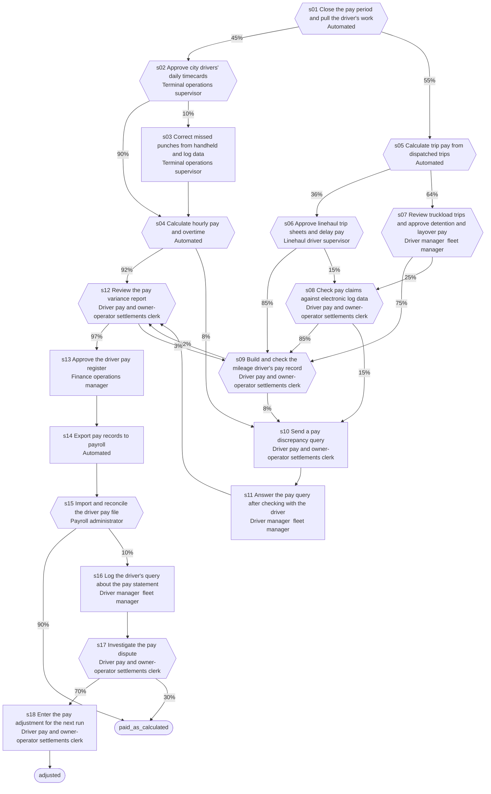

# Calculate company driver pay

`frt-fin-driver-pay` · trucking and freight transportation · finance (settlements) · part of `freight-carrier-co`

Every two weeks the carrier works out what each of its roughly 1,200 company drivers earned. City pickup and delivery drivers are paid by the hour from timecards that terminal supervisors approve; linehaul and truckload drivers are paid by the mile with extra pay for stops, delays, detention and layovers that supervisors and driver managers approve. Settlements clerks check claims against electronic log data, build the pay record, and send an approved file to payroll. Pay rules are complex and claims arrive by message and phone, so missing trips and unpaid waiting time come back as driver complaints after payday.

| | |
|---|---|
| Unit of work | one driver pay record (one driver for one biweekly pay period) |
| Starts when | The biweekly pay period closes with the driver's trips, timecards and claims recorded in the TMS. |
| Done when | The driver's pay record is approved and in the payroll run, or a later pay dispute is explained or adjusted. |
| Organisation | A Canadian LTL and truckload carrier of about 3,000 employees, federally regulated for its extra-provincial trucking, with about 540 hourly city drivers, 240 linehaul drivers and 430 truckload drivers paid biweekly. (3,000 employees, 2019-2022) |
| Volume | 3,250 cases a month (range 2,900 to 3,600) |

## Where it sits

- Starts with **trip_record** from ltl-linehaul-dispatch (20% of cases)
- Starts with **trip_record** from tl-trip-execution (30% of cases)
- Starts with **accessorial_charge** from tl-detention-accessorials (5% of cases)
- Starts with **driver_timecard** from ltl-pd-dispatch (45% of cases)
- Sends **driver_pay_record** to hr-payroll-run (outcome: paid_as_calculated)
- Sends **driver_pay_record** to hr-payroll-run (outcome: adjusted)

## Flow

## Roles

| Role | Department | Layer | FTE on this process | Loaded cost per hour | Evidence |
|---|---|---|---:|---:|---|
| Driver pay and owner-operator settlements clerk | Finance | individual contributor | 3.7 | 33 CAD | C |
| Driver manager (fleet manager) | Truckload fleet operations | individual contributor | 1.9 | 43 CAD | C |
| Terminal operations supervisor | LTL terminal network | supervisor | 1.1 | 54 CAD | C |
| Linehaul driver supervisor | Linehaul driver pool | supervisor | 0.5 | 58 CAD | C |
| Finance operations manager | Finance | manager | 0.1 | 82 CAD | C |
| Payroll administrator | Human resources | individual contributor | 0.2 | 38 CAD | C |

## Steps

Hands-on time and the wait before each step show the most common value. Evidence tier A is a sourced number, B a sourced description, C the author's estimate.

| Step | Who | Kind | Hands-on | Wait before | Control | Evidence |
|---|---|---|---:|---:|---|---|
| **s01 Close the pay period and pull the driver's work.** At the end of the two-week pay period the TMS closes the period and gathers, for each company driver, the dispatched trips with their miles, stops and border crossings, the city drivers' daily timecards and the electronic log on-duty totals, and opens a pay record for the driver. | Automated | system auto | 0 min | 2.0 h |  | C |
| **s02 Approve city drivers' daily timecards.** The terminal operations supervisor reviews each city driver's punches for the period against the route start and finish times on the dispatch board, approves normal days and marks days with missed punches or unusually long hours for correction. | Terminal operations supervisor | approval | 5 min | 12.0 h | Terminal timecard approval before payroll | C |
| **s03 Correct missed punches from handheld and log data.** The supervisor compares the driver's handheld first and last scans and electronic log on-duty times with the timecard, talks to the driver, and enters the corrected start or end time with a note. | Terminal operations supervisor | validation | 10 min | 4.0 h |  | C |
| **s04 Calculate hourly pay and overtime.** The TMS pay module multiplies approved hours by the driver's rate and applies the overtime thresholds for city operators (over 9 hours a day or 45 a week) or, for drivers who also drove highway trips that week, the 60-hour threshold of the class worked most. | Automated | system auto | 0 min | 10 min | Canada Labour Code Part III and Motor Vehicle Operators Hours of Work Regulations, ss. 5 to 7 (standard hours for city and highway operators) | A [src-mvohwr] |
| **s05 Calculate trip pay from dispatched trips.** The pay module prices each trip in the period from the driver's pay scale: miles from the carrier's mileage table between dispatched points, extra stops, drops and hooks, border crossings and any hourly pay codes already entered by dispatch. | Automated | system auto | 0 min | 10 min |  | B [src-fleetowner], [src-tn-2025] |
| **s06 Approve linehaul trip sheets and delay pay.** The linehaul driver supervisor reviews the driver's runs for the period, approves hourly pay claimed for delays at hubs, breakdowns, weather holds and road closures, and rejects claims the dispatch notes do not support. | Linehaul driver supervisor | approval | 6 min | 12.0 h | Supervisor approval of non-mileage pay codes | C |
| **s07 Review truckload trips and approve detention and layover pay.** The driver manager reviews each of the driver's loads for the period and approves detention after the free time at shippers and receivers, layover days, extra stops, tarping and breakdown pay that the driver claimed by in-cab message, checking them against what dispatch recorded. | Driver manager (fleet manager) | approval | 8 min | 12.0 h | Driver manager approval of accessorial pay | B [src-tn-2020], [src-tn-2025] |
| **s08 Check pay claims against electronic log data.** The settlements clerk opens the driver's electronic log and telematics stop history for the claimed delay, confirms arrival and departure times at the site and the on-duty status, and approves, reduces or rejects the claim with a note. | Driver pay and owner-operator settlements clerk | validation | 6 min | 8.0 h | Pay claims verified against ELD records before payment | B [src-fleetowner] |
| **s09 Build and check the mileage driver's pay record.** The settlements clerk reviews the calculated trips and approved add-ons, applies any guaranteed minimum, overtime past 60 hours for highway operators, advances taken on the fuel card and other deductions, and checks that every dispatched trip in the period is on the record. | Driver pay and owner-operator settlements clerk | analysis | 7 min | 6.0 h | Motor Vehicle Operators Hours of Work Regulations, s. 6 and s. 7 (60-hour standard for highway operators) | B [src-mvohwr], [src-fleetowner] |
| **s10 Send a pay discrepancy query.** The settlements clerk sends the driver manager or supervisor the driver's name, the trip or day in question and what does not match, such as a trip missing from the period, hours above the log total or a pay rate not set up. | Driver pay and owner-operator settlements clerk | communication | 5 min | 0 min |  | C |
| **s11 Answer the pay query after checking with the driver.** The driver manager or supervisor checks dispatch notes and, if needed, messages the driver, then replies with the corrected trip, hours or rate so the clerk can finish the record before the payroll cut-off. | Driver manager (fleet manager) | communication | 10 min | 12.0 h |  | C |
| **s12 Review the pay variance report.** The settlements clerk runs the variance report that compares each driver's gross pay with recent periods and flags negative pay, very large add-ons or a driver with no pay, and rechecks the flagged records. | Driver pay and owner-operator settlements clerk | review | 1 min | 2.0 h |  | C |
| **s13 Approve the driver pay register.** The finance operations manager reviews the pay register totals by terminal and division against the previous period and the trip and hour statistics, and approves the register for export. One approval covers all drivers in the run. | Finance operations manager | approval | 0.1 min | 8.0 h | Payroll register approved by someone other than the clerks who calculate pay | C |
| **s14 Export pay records to payroll.** The TMS creates the pay file with each driver's earnings by pay code and sends it to the payroll system before the payroll cut-off. | Automated | system auto | 0 min | 1.0 h |  | C |
| **s15 Import and reconcile the driver pay file.** The payroll administrator imports the file, reconciles the record count and gross totals to the approved register and resolves employees whose numbers do not match the payroll master, before the payroll run calculates deductions and deposits. | Payroll administrator | review | 0.4 min | 6.0 h | Payroll interface reconciliation (financial reporting controls) | C |
| **s16 Log the driver's query about the pay statement.** After payday the driver calls or messages the driver manager or terminal supervisor that a trip, stop, detention or overtime is missing or wrong; the manager logs the query with the trip details and sends it to settlements. | Driver manager (fleet manager) | communication | 5 min | 5.0 d |  | B [src-fleetowner], [src-tn-2025] |
| **s17 Investigate the pay dispute.** The settlements clerk reopens the period, compares the statement with dispatch, the log and the pay scale, and decides whether the driver was underpaid, overpaid or paid correctly, writing back to the manager with the reason. | Driver pay and owner-operator settlements clerk | analysis | 20 min | 1.0 d |  | C |
| **s18 Enter the pay adjustment for the next run.** The settlements clerk enters the adjustment with its reason code so it is paid on the next pay date, or flags it for an off-cycle payment when the amount is large. | Driver pay and owner-operator settlements clerk | data entry | 5 min | 1.0 h |  | C |

## Exceptions

| Exception | Share of cases | What happens |
|---|---:|---|
| Missed punch on a city driver's timecard | 4% | The supervisor rebuilds the start or end time from handheld scans and the log before pay can be calculated. |
| Delay or detention claim checked against the log | 12% | A claim for detention, breakdown or weather delay is checked against ELD and telematics stop times before it is paid. |
| Pay discrepancy before cut-off | 10% | A missing trip, hours above the log or a missing rate is queried with the driver manager before the payroll cut-off. |
| Driver disputes the pay statement | 10% | After payday the driver reports a missing trip or unpaid waiting time; settlements investigates and adjusts the next pay. |

## Benchmarks

| Metric | Value | Unit | Population | Evidence |
|---|---|---|---|---|
| cycle_time_days | p50 2, p90 4 | calendar days from pay period close to driver pay in the payroll run | Canadian carrier paying company drivers biweekly, 2019-2022 | C |
| drivers_receiving_detention_pay | 0.453 | share of surveyed drivers and carriers | Trucknews.com reader survey of 401 respondents, 2025 | B [src-tn-2025] |

## Pain points

- Mileage pay with many add-on codes is hard for drivers to check, and claims sent by message are missed, so pay complaints arrive after payday. (steps s05, s07, s16, s17; B [src-fleetowner])
- Waiting time and detention are paid unevenly and each claim has to be checked against log data. (steps s07, s08; B [src-tn-2025], [src-fleetowner])
- Approvals by supervisors and driver managers who are busy dispatching hold up the payroll cut-off. (steps s02, s06, s07, s11; C)

## Assumptions

- Company drivers are paid biweekly; city pickup and delivery drivers by the hour, linehaul and truckload drivers by the mile with hourly or flat add-ons, following the hybrid pay that Trucking HR Canada describes.
- The carrier is federally regulated, so overtime follows the Canada Labour Code and the Motor Vehicle Operators Hours of Work Regulations (45 hours a week for city operators, 60 for highway operators) rather than provincial employment standards.
- Hands-on time is about 11 settlements clerk minutes per record (about 3.7 FTE), plus supervisor and driver manager approvals; the organisation file's 10 settlements clerks also handle about 1,650 owner-operator settlements a month.
- Terminal operations supervisors, linehaul supervisors, the finance operations manager and payroll administrators take part although the organisation file's process entry lists only settlements clerks and driver managers.
- Before the ELD mandate took effect in June 2021 many claims were checked against paper logs, which took longer than the times shown.
- Shares of the triggers follow the driver mix: 45% city drivers (split between pickup and delivery timecards), 20% linehaul, 30% truckload trips and 5% records started by a detention record.
- The cycle-time benchmark covers period close to payroll; the simulated p90 (about 8 days) is longer because it includes the 10% of records disputed by the driver after payday.
- Loaded costs come from the organisation file.
- Organisation file corrected on 2026-11-24: driver_timecard now comes from ltl-pd-dispatch, once per driver-day, as the pickup and delivery workflows record; it previously came from each pickup and delivery stop.
- Organisation file corrected on 2026-11-24: driver pay records now follow the 1510 employed drivers paid every two weeks, about 3250 a month (previously 2,650, which fitted about 1,210 drivers).

## Sources

- [src-mvohwr] [Motor Vehicle Operators Hours of Work Regulations (C.R.C., c. 990)](https://laws-lois.justice.gc.ca/eng/regulations/C.R.C.,_c._990/FullText.html) (Government of Canada, Justice Laws Website, 2024). For federally regulated (extra-provincial) carriers: a city motor vehicle operator works exclusively within 10 miles of the home terminal and has standard hours of no more than 9 a day and 45 a week (s. 5); a highway motor vehicle operator has standard hours of no more than 60 a week (s. 6); an employee who works in more than one class in a week takes the standard hours of the class worked most, and hours over 60 count as overtime (s. 7).
- [src-fleetowner] [Dynamics of truck driver pay](https://www.fleetowner.com/fleet-management/article/21164046/dynamics-of-truck-driver-pay) (FleetOwner (Cristina Commendatore), 2021). Per-mile activity-based pay is the trucking norm and is inconsistent and confusing for drivers; detention pay usually starts after a two-hour window; ELD and telematics data give an audit trail for detention that ended 'he said, she said' disputes; drivers' pay complaints come from complex pay systems and uncompensated work; consistency of pay matters for retention.
- [src-tn-2020] [What drives trucker compensation low?](https://www.trucknews.com/transportation/what-drives-trucker-compensation-low/1003146047) (Trucknews.com, 2020). Trucking HR Canada says most employers in its Top Fleet Employer programme pay long-haul drivers a hybrid of mileage pay and hourly pay for wait time, and its 2019 employer survey showed a trend away from mileage pay; drivers say they are not paid for all their work.
- [src-tn-2025] [Pulse Survey: Readers speak out on unpaid on-duty tasks](https://www.trucknews.com/transportation/pulse-survey-readers-speak-out-on-unpaid-on-duty-tasks/1003201880) (Trucknews.com, 2025). Reader survey of 401 Canadian drivers and carriers: 45.3% receive detention pay; over half face detention frequently; 35% typically wait one to two hours and 24% two hours or more; pay structures mix mileage, hourly pay for non-driving tasks, percentage of revenue and small add-ons for delays or border crossings; 42% say their company has no policy for paying non-driving tasks.

Written by claude-opus on 2026-11-24.
