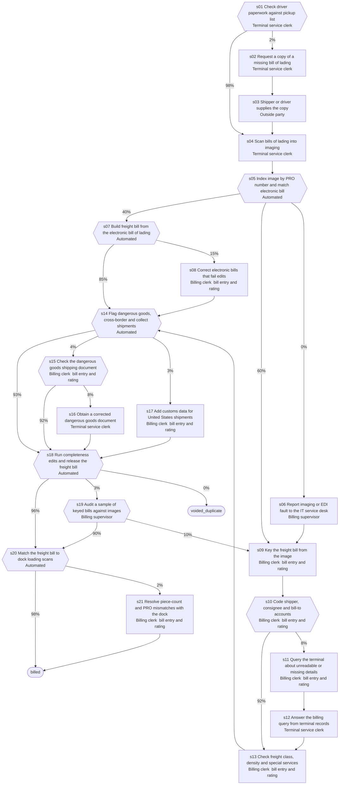

# Enter bills of lading as freight bills

`frt-fin-freight-bill-entry` · trucking and freight transportation · finance (billing centre) · part of `freight-carrier-co`

Every LTL shipment starts as a paper or electronic bill of lading signed at the shipper's dock. Each evening terminal clerks scan the paper bills and central billing clerks key them into the transportation management system, or check the electronic ones, so that a freight bill exists before linehaul planners build the night's trailers and before the rating engine prices it. About 60% of bills are still paper in 2019-2022, many handwritten, so the work is a high-volume keying job against a hard overnight cut-off. Illegible addresses, missing bill-to parties and wrong freight classes cause queries the same night and rebills weeks later.

| | |
|---|---|
| Unit of work | one bill of lading |
| Starts when | A city driver hands in the signed bill of lading at the end of the route, or the shipper's electronic bill arrives and its signed paper copy is scanned. |
| Done when | A complete freight bill is released in the TMS and matched to the dock loading scans, or the bill is voided as a duplicate. |
| Organisation | A Canadian LTL and truckload carrier of about 3,000 employees with 38 terminals, five hubs and a central billing centre that keys bills of lading from images on an evening shift. (3,000 employees, 2019-2022) |
| Volume | 150,000 cases a month (range 130,000 to 175,000) |

## Where it sits

- Starts with **bill_of_lading** from ltl-pickup-execution (100% of cases)
- Relies on **edi_connection** from it-edi-integration (a standing input; it does not start a case)
- Sends **freight_bill** to fin-rating-invoicing (outcome: billed)
- Sends **freight_bill** to ltl-linehaul-planning (outcome: billed)
- Sends **freight_bill** to tl-customs-emanifest (outcome: billed)
- Sends **it_ticket** to it-service-desk (outcome: any)

## Flow

## Roles

| Role | Department | Layer | FTE on this process | Loaded cost per hour | Evidence |
|---|---|---|---:|---:|---|
| Billing clerk (bill entry and rating) | Billing centre | individual contributor | 33 | 29 CAD | B [src-rateclerk] |
| Billing supervisor | Billing centre | supervisor | 2 | 49 CAD | C |
| Terminal service clerk | LTL terminal network | individual contributor | 18 | 32 CAD | C |

## Steps

Hands-on time and the wait before each step show the most common value. Evidence tier A is a sourced number, B a sourced description, C the author's estimate.

| Step | Who | Kind | Hands-on | Wait before | Control | Evidence |
|---|---|---|---:|---:|---|---|
| **s01 Check driver paperwork against pickup list.** When a city driver returns from the route, the terminal service clerk opens the driver's envelope and checks that every pickup on the route manifest has a signed bill of lading with a PRO label attached. Missing bills are listed against the driver and the shipper. | Terminal service clerk | intake | 0.3 min | 20 min |  | C |
| **s02 Request a copy of a missing bill of lading.** The terminal service clerk calls the driver and, if the driver does not have it, the shipper's shipping office to ask for a copy of the signed bill of lading by fax or email. The pickup stays open on the missing-paperwork list until the copy arrives. | Terminal service clerk | coordination | 6 min | 30 min |  | C |
| **s03 Shipper or driver supplies the copy.** The shipper's shipping office finds its copy of the bill of lading and faxes or emails it, or the driver finds it in the truck on the next shift. Copies often arrive the next morning when the shipper's office opens. | Outside party | external wait | 0 min | 12.0 h |  | C |
| **s04 Scan bills of lading into imaging.** The terminal service clerk feeds the stack of bills of lading through the document scanner in batches. Each page is imaged and sent to the central billing queue, where the PRO barcode label identifies the shipment. | Terminal service clerk | data entry | 0.2 min | 15 min |  | C |
| **s05 Index image by PRO number and match electronic bill.** The imaging system reads the PRO barcode, attaches the image to the shipment record and checks whether the shipper already sent the same bill electronically by EDI 211 or through the customer portal. Matched bills go to automatic creation; the rest go to the keying queue. | Automated | system auto | 0 min | 5 min |  | B [src-x12-211] |
| **s06 Report imaging or EDI fault to the IT service desk.** When the image queue stops filling or EDI bills stop arriving, the billing supervisor raises a ticket with the IT service desk, tells the terminals to send images by email and moves the affected bills to manual keying so the night's cut-off is met. | Billing supervisor | communication | 10 min | 30 min |  | C |
| **s07 Build freight bill from the electronic bill of lading.** The TMS creates the freight bill from the EDI 211 or portal data and runs edits: valid shipper and consignee codes, bill-to party, postal codes in the service area, pieces and weight present, freight class or dimensions present and dangerous goods flags consistent. | Automated | system auto | 0 min | 5 min |  | B [src-x12-211] |
| **s08 Correct electronic bills that fail edits.** A billing clerk opens the failed electronic bill beside the signed paper image, corrects the consignee address, bill-to party or missing class, and keeps the signed paper figures where the two disagree because the signed bill is the contract of carriage. | Billing clerk (bill entry and rating) | validation | 2 min | 1.0 h |  | C |
| **s09 Key the freight bill from the image.** A billing clerk on the evening shift opens the next image in the queue and types the shipper, consignee, bill-to party, payment terms, pieces, packaging, weight, commodity description, class or dimensions and special instructions such as liftgate or appointment into the TMS freight bill screen. | Billing clerk (bill entry and rating) | data entry | 0.9 min | 1.5 h |  | B [src-rateclerk] |
| **s10 Code shipper, consignee and bill-to accounts.** The clerk searches the customer file by name and postal code to attach existing account codes for the shipper, consignee and the party paying the freight, and picks the correct location when a customer has several. A new consignee is added with the address from the bill. | Billing clerk (bill entry and rating) | lookup | 0.15 min | 0 min |  | C |
| **s11 Query the terminal about unreadable or missing details.** The clerk messages or calls the origin terminal service clerk with the PRO number and the missing field, such as an illegible consignee street, a missing weight or no bill-to party on a third-party shipment. The bill is saved on hold so linehaul planning still sees it. | Billing clerk (bill entry and rating) | communication | 3 min | 0 min |  | C |
| **s12 Answer the billing query from terminal records.** The terminal service clerk checks the freight on the dock, the pickup request or the shipper's customer record, or calls the shipper, and replies with the missing detail. Queries raised after the shipper's office closes are answered the next morning. | Terminal service clerk | lookup | 3 min | 2.0 h |  | C |
| **s13 Check freight class, density and special services.** The clerk checks the class against the commodity description and, where dimensions are given, the density; flags shipments that are over-length, need an appointment, a liftgate or inside delivery; and enters any collect-on-delivery amount so rating and delivery planning see it. | Billing clerk (bill entry and rating) | validation | 0.15 min | 0 min |  | B [src-rateclerk], [src-fw-ltl] |
| **s14 Flag dangerous goods, cross-border and collect shipments.** The TMS reads the commodity, destination and service fields and routes bills with dangerous goods, a United States destination or missing customs data to the clerks who handle them. All other bills go straight to release. | Automated | system auto | 0 min | 0 min |  | C |
| **s15 Check the dangerous goods shipping document.** The clerk compares the bill with the shipper's dangerous goods shipping document: UN number, shipping name, class, packing group, quantity, the 24-hour emergency number and any ERAP reference, and sets the hazard flags that load planners use to keep incompatible classes apart. | Billing clerk (bill entry and rating) | validation | 2 min | 10 min | Transportation of Dangerous Goods Regulations, Part 3 (shipping document) and Part 1 compatibility rules used in load planning | C |
| **s16 Obtain a corrected dangerous goods document.** The terminal service clerk tells the dock to hold the freight and calls the shipper for a corrected shipping document. The freight moves only once a complete document is with it and the billing record is updated. | Terminal service clerk | coordination | 10 min | 4.0 h |  | C |
| **s17 Add customs data for United States shipments.** For a shipment going to the United States, the clerk enters the customs broker, the PAPS barcode number, commodity description and value from the commercial invoice so the cross-border desk can file the ACE manifest before the trailer reaches the border. | Billing clerk (bill entry and rating) | data entry | 4 min | 15 min | US CBP ACE e-Manifest advance data requirement for trucks (filed by the customs desk from the freight bill) | C |
| **s18 Run completeness edits and release the freight bill.** The TMS runs final edits (duplicate PRO, bill-to present, weight and pieces present) and releases the freight bill so linehaul planners see it on the trailer plan, the destination terminal sees it for delivery and the rating engine can price it. Duplicate or cancelled bills are voided. | Automated | system auto | 0 min | 5 min |  | C |
| **s19 Audit a sample of keyed bills against images.** The billing supervisor opens a random sample of each clerk's bills beside the images and checks every field. Errors are returned to the clerk for correction and counted in the clerk's accuracy score. | Billing supervisor | review | 2 min | 3.0 h | Billing department keying accuracy standard and sample audit | C |
| **s20 Match the freight bill to dock loading scans.** As the dock loads outbound trailers, handheld scans of each PRO label are matched against freight bills. The night report lists freight scanned with no bill and bills whose piece count differs from the pieces scanned. | Automated | system auto | 0 min | 2.0 h |  | C |
| **s21 Resolve piece-count and PRO mismatches with the dock.** A billing clerk works the night mismatch report, calling the dock supervisor to recount pieces or read the label, then corrects the freight bill or leaves a note for the overage, shortage and damage clerk when freight is genuinely short or over. | Billing clerk (bill entry and rating) | coordination | 4 min | 3.0 h |  | C |

## Exceptions

| Exception | Share of cases | What happens |
|---|---:|---|
| Missing bill of lading | 2% | The driver comes back without the signed bill; the terminal asks the shipper for a copy and the bill is keyed next morning. |
| Electronic bill fails edits | 6% | The shipper's EDI or portal data has a bad consignee address, no bill-to or no class; a clerk corrects it against the signed image. |
| Unreadable or incomplete paper bill | 5% | Handwriting, a missing weight or no bill-to party; the clerk queries the terminal and holds the bill until it answers. |
| Dangerous goods document incomplete | 0% | The shipping document lacks a UN number or emergency number; freight is held until the shipper sends a corrected document. |
| Piece count does not match dock scans | 2% | The bill says 6 pieces and the dock scanned 5; the clerk and dock supervisor reconcile and refer real shortages to OS&D. |

## Benchmarks

| Metric | Value | Unit | Population | Evidence |
|---|---|---|---|---|
| cycle_time_days | p50 0.25, p90 0.6 | calendar days from the driver handing in paperwork to the freight bill released and matched | Canadian LTL carrier central billing, 2019-2022 | B [src-rateclerk] |
| keying_time_per_paper_bill | 1.7 | minutes | Paper bills with one or two line items | C |

## Pain points

- Handwritten bills with incomplete consignee or bill-to details cause queries the same night and wrong-party invoices later. (steps s09, s10, s11, s12; B [src-transflo])
- Class and weight are copied as the shipper wrote them; errors surface days later as reweighs and reclassifications that need rebills. (steps s13; B [src-fw-ltl])
- The evening queue peaks between 18:00 and 22:00 as terminals scan, and Monday and peak-season volume needs overtime to meet the overnight cut-off. (steps s09; B [src-rateclerk])

## Assumptions

- About 40% of bills arrive electronically (EDI 211 or customer portal) and 60% only on paper; the signed paper bill is scanned in both cases. The share is the author's estimate for 2019-2022.
- Bill entry is done in-house at a central billing centre on an evening shift; some carriers send keying to outsourced data-entry firms, which would change roles and costs but not the steps.
- Hands-on time is about 1.7 minutes per bill for billing clerks and about 1.1 minutes for terminal service clerks; this supports about 33 billing clerk FTE on entry, leaving 12 of the organisation file's 45 billing clerks for rating exceptions, where hands-on time implies about 15; the total need of about 48 is slightly above the 45 in the organisation file.
- The IT ticket is raised for a whole batch when imaging or EDI fails, a few times a month, not once per bill; the 'any' outcome on that output should be read that way.
- The cycle time ignores the hours between signing at the shipper and the driver returning, which belong to pickup execution.
- Loaded costs come from the organisation file (wage times 1.30 for hourly staff, 1.35 for salaried).

## Sources

- [src-rateclerk] [Night Rate Clerk (Roadrunner Freight, Milwaukee) job posting](https://simplify.jobs/p/5dd0e25a-bd17-40b2-a9b7-93ada5a9b55e/Night-Rate-Clerk) (Roadrunner Freight, listed on Simplify Jobs, 2025). LTL rate clerks use a central auto-rating system to calculate and verify rates on freight bills, hand-rate bills the system cannot rate by applying published pricing agreements and calculating accessorials, process reweighs and inspections from terminals, talk to terminal staff about problem freight bills, help billing staff classify commodities under the NMFC, and finish rating before a daily revenue cut-off of about 5 a.m.; requires experience with bills of lading, freight bills and tariffs and 40 words-per-minute typing and ten-key skills.
- [src-x12-211] [EDI 211 Motor Carrier Bill of Lading (X12 005010)](https://www.stedi.com/edi/x12-005010/211) (Stedi (X12 reference), 2024). The X12 211 transaction lets shippers give a motor carrier a legal bill of lading electronically, with line items for quantity, weight and commodity classification; rates and charges on the bill of lading are subject to audit, and accessorial charges usually cannot be determined until the shipment is delivered, so the 210 invoice is still needed.
- [src-fw-ltl] [How Accurate Shipping Data Is Transforming LTL Outcomes](https://www.freightwaves.com/?p=572201) (FreightWaves (sponsored content, Matt Herr), 2026). Shippers report that up to one in four LTL shipments came back reweighed or reclassified before they measured freight themselves (one fell to 1% re-rates after using a dimensioner); NMFTA estimates 70 to 80% of LTL freight is classified by density alone; measurements should flow into the bill of lading digitally rather than on paper. Sponsored article promoting one carrier.
- [src-transflo] [Common LTL Invoicing Challenges and How to Address Them](https://www.transflo.com/blog/common-ltl-invoicing-challenges-and-how-to-address-them/) (Transflo (vendor blog), 2024). Vendor claim, from industry veterans, that 30 to 40% of LTL invoices contain discrepancies, about half from location-related accessorial fees (residential, limited access) and half from reweigh and reclassification; manual data entry leads to inaccuracies, delays and disputes, and auditors may spend an hour on a $10 issue. Year of publication not shown on the page; 2024 is the author's estimate.

Written by claude-opus on 2026-11-24.
