# Settle owner-operators weekly

`frt-fin-oo-settlements` · trucking (truckload) · finance · part of `freight-carrier-co`

Every week the carrier pays each of its leased owner-operators for the trips they completed, net of what they owe the carrier. Settlements clerks check that each trip has its delivery paperwork, verify miles or revenue against the lease, add accessorials and the fuel surcharge pass-through, deduct fuel card purchases, advances, insurance, plates, escrow and one-off chargebacks, and the finance operations manager approves the payment batch. Missing paperwork, accessorial claims that need approval and disputed deductions cause most of the manual work, and lease rules require chargebacks to be listed and itemised.

| | |
|---|---|
| Unit of work | one weekly settlement statement |
| Starts when | The settlement week closes on Sunday night with the owner-operator's completed trips in the TMS. |
| Done when | The owner-operator is paid by direct deposit and accepts the statement, or a disputed line is corrected on the next settlement or explained. |
| Organisation | A Canadian LTL and truckload carrier of about 3,000 employees paying about 380 leased owner-operators by weekly settlement. (3,000 employees, 2019-2022) |
| Volume | 1,650 cases a month (range 1,500 to 1,800) |

## Where it sits

- Starts with **trip_record** from tl-trip-execution (90% of cases)
- Starts with **trip_record** from ltl-linehaul-dispatch (10% of cases)
- Relies on **owner_operator_agreement** from tl-oo-contracting (a standing input; it does not start a case)
- Relies on **fuel_transaction** from mnt-fuel-management (a standing input; it does not start a case)
- Relies on **fuel_surcharge_table** from fin-fuel-surcharge (a standing input; it does not start a case)
- Sends **settlement_statement** to owner-operator-business (outcome: any)
- Sends **settlement_payment** to owner-operator-business (outcome: any)
- Sends **ledger_postings** to fin-month-end-close (outcome: any)

## Flow

```mermaid
flowchart TD
    s01["s01 Close the settlement week and pull completed trips<br/>Automated"]
    s02["s02 Index scanned trip documents to trips<br/>Automated"]
    s03["s03 Open the owner-operator's pre-settlement<br/>Driver pay and owner-operator settlements clerk"]
    s04{{"s04 Check that every trip has delivery paperwork<br/>Driver pay and owner-operator settlements clerk"}}
    s05{{"s05 Chase missing paperwork<br/>Driver pay and owner-operator settlements clerk"}}
    s06["s06 Owner-operator scans the missing documents<br/>Owner-operator, truckload  contracted, not an employee"]
    s07{{"s07 Verify the pay on each trip<br/>Driver pay and owner-operator settlements clerk"}}
    s08{{"s08 Key accessorial pay claims<br/>Driver pay and owner-operator settlements clerk"}}
    s09["s09 Driver manager approves accessorial pay<br/>Driver manager  fleet manager"]
    s10["s10 Calculate the fuel surcharge pass-through<br/>Automated"]
    s11["s11 Import fuel card purchases and cash advances<br/>Driver pay and owner-operator settlements clerk"]
    s12{{"s12 Apply recurring deductions<br/>Automated"}}
    s13["s13 Key one-off chargebacks with itemisation<br/>Driver pay and owner-operator settlements clerk"]
    s14{{"s14 Review the statement for reasonableness<br/>Driver pay and owner-operator settlements clerk"}}
    s15["s15 Decide on a negative or unusual settlement<br/>Finance operations manager"]
    s16["s16 Approve the weekly settlement batch<br/>Finance operations manager"]
    s17["s17 Generate payments, post to the ledger and publish statements<br/>Automated"]
    s18["s18 Funds reach the owner-operator's bank<br/>Outside party"]
    s19{{"s19 Owner-operator reviews the statement<br/>Owner-operator, truckload  contracted, not an employee"}}
    s20{{"s20 Investigate the disputed line<br/>Driver pay and owner-operator settlements clerk"}}
    s21["s21 Driver manager confirms the trip facts<br/>Driver manager  fleet manager"]
    s22{{"s22 Key the adjustment and reply to the owner-operator<br/>Driver pay and owner-operator settlements clerk"}}
    s01 --> s02
    s02 --> s03
    s03 --> s04
    s04 -->|"82%"| s07
    s04 -->|"18%"| s05
    s05 -->|"60%"| s06
    s05 -->|"40%"| s07
    s06 --> s07
    s07 -->|"60%"| s08
    s07 -->|"40%"| s10
    s08 -->|"40%"| s09
    s08 -->|"60%"| s10
    s09 --> s10
    s10 --> s11
    s11 --> s12
    s12 -->|"35%"| s13
    s12 -->|"65%"| s14
    s13 --> s14
    s14 -->|"96%"| s16
    s14 -->|"4%"| s15
    s15 --> s16
    s16 --> s17
    s17 --> s18
    s18 --> s19
    s19 -->|"90%"| end0
    s19 -->|"10%"| s20
    s20 -->|"50%"| s21
    s20 -->|"50%"| s22
    s21 --> s22
    s22 -->|"75%"| end1
    s22 -->|"25%"| end2
    end0(["settled"])
    end1(["adjusted_next_week"])
    end2(["dispute_rejected"])
```

## Roles

| Role | Department | Layer | FTE on this process | Loaded cost per hour | Evidence |
|---|---|---|---:|---:|---|
| Driver pay and owner-operator settlements clerk | Finance | individual contributor | 5.5 | 33 CAD | C |
| Finance operations manager | Finance | manager | 0.15 | 82 CAD | C |
| Driver manager (fleet manager) | Truckload fleet operations | individual contributor | 0.5 | 43 CAD | C |
| Owner-operator, truckload (contracted, not an employee) | Truckload fleet operations | external party | 0 | 65 CAD | C |

## Steps

Hands-on time and the wait before each step show the most common value. Evidence tier A is a sourced number, B a sourced description, C the author's estimate.

| Step | Who | Kind | Hands-on | Wait before | Control | Evidence |
|---|---|---|---:|---:|---|---|
| **s01 Close the settlement week and pull completed trips.** At midnight on Sunday the TMS closes the settlement week and lists, for each owner-operator, the trips delivered in the week with loaded and empty miles, revenue and the accessorials already entered by dispatch. | Automated | system auto | 0 min | 0 min |  | C |
| **s02 Index scanned trip documents to trips.** The imaging system matches the bills of lading, proofs of delivery and receipts that owner-operators scanned at truck-stop kiosks or with a phone app to trip numbers, and leaves unmatched images in an exception queue. | Automated | system auto | 0 min | 1.0 h |  | C |
| **s03 Open the owner-operator's pre-settlement.** On Monday the settlements clerk opens the owner-operator's pre-settlement in the TMS settlement module, with the trips, miles, revenue and the deductions schedule from the lease. | Driver pay and owner-operator settlements clerk | lookup | 2 min | 1.0 d |  | C |
| **s04 Check that every trip has delivery paperwork.** The clerk checks that each trip has a signed bill of lading and proof of delivery in the imaging system. Company policy pays a trip only when its paperwork is in, because the customer cannot be billed without it. | Driver pay and owner-operator settlements clerk | validation | 2 min | 0 min | Company pay-on-paperwork policy: trips are settled only when delivery documents are received | B [src-cfr376] |
| **s05 Chase missing paperwork.** The clerk messages the owner-operator and the driver manager listing the trips with missing or unreadable documents and the cut-off time for this week's settlement. | Driver pay and owner-operator settlements clerk | communication | 10 min | 1.0 h |  | C |
| **s06 Owner-operator scans the missing documents.** The owner-operator finds the paperwork in the truck, or gets a copy from the consignee, and scans it in at the next stop. | Owner-operator, truckload (contracted, not an employee) | data entry | 5 min | 8.0 h |  | C |
| **s07 Verify the pay on each trip.** For owner-operators paid by the mile, the clerk compares paid miles with the practical route miles and the rate in the lease; for those paid a percentage of revenue, the clerk checks the rated freight bill and attaches a copy to the statement. | Driver pay and owner-operator settlements clerk | validation | 3 min | 0 min | 49 CFR 376.12(d) and (g): pay as stated in the lease, with the rated freight bill shown for percentage pay | B [src-cfr376] |
| **s08 Key accessorial pay claims.** The clerk enters detention, layover, extra stops, tarping and border-crossing pay claimed by the owner-operator on the trip envelope or in a message, checking each against the times in the ELD and the customer's detention record. | Driver pay and owner-operator settlements clerk | data entry | 3 min | 0 min |  | C |
| **s09 Driver manager approves accessorial pay.** The driver manager checks the claimed detention or layover against what happened on the trip and approves or cuts the amount in the TMS. | Driver manager (fleet manager) | approval | 4 min | 4.0 h | Company accessorial pay policy: operations approval for claims not matched to a customer charge | C |
| **s10 Calculate the fuel surcharge pass-through.** The TMS multiplies the week's miles, or the fuel surcharge billed to the customer, by the rate in the weekly fuel surcharge table and adds the pass-through to the statement. | Automated | system auto | 0 min | 0 min |  | C |
| **s11 Import fuel card purchases and cash advances.** The clerk imports the week's fuel card file from the fuel card portal, checks that each purchase is matched to the right unit, and adds cash advances and money codes issued during the week as deductions. | Driver pay and owner-operator settlements clerk | data entry | 2 min | 0 min |  | C |
| **s12 Apply recurring deductions.** The settlement module applies the deductions scheduled in the lease: cargo and liability insurance share, plates, escrow or maintenance reserve, ELD and communications fee, trailer rental and any lease-purchase payment. | Automated | system auto | 0 min | 0 min |  | B [src-cfr376] |
| **s13 Key one-off chargebacks with itemisation.** The clerk enters one-off charges such as tolls, roadside fines, company shop repairs, a cargo claim deductible or a lost fuel card fee, attaching the invoice or a written itemisation so the owner-operator can see how each was computed. | Driver pay and owner-operator settlements clerk | data entry | 6 min | 0 min | 49 CFR 376.12(h) and (j): only chargebacks listed in the lease, with itemised support | B [src-cfr376] |
| **s14 Review the statement for reasonableness.** The clerk compares the statement's gross, deductions and net with the owner-operator's recent weeks and looks for a negative net or an unusual deduction before marking it complete. | Driver pay and owner-operator settlements clerk | review | 2 min | 0 min |  | C |
| **s15 Decide on a negative or unusual settlement.** The finance operations manager decides whether to carry a deficit to next week, spread a large chargeback over several weeks, or release a cash advance, following the lease and the owner-operator's history. | Finance operations manager | approval | 10 min | 8.0 h | Finance delegation of authority for deficits and spread chargebacks | C |
| **s16 Approve the weekly settlement batch.** On Tuesday or Wednesday the finance operations manager reviews the batch totals, exception list and the largest statements and approves the payment file; the time shown is each statement's share of that review. | Finance operations manager | approval | 0.2 min | 1.0 d | Internal control over financial reporting: payment batch approved by a manager who did not prepare the statements | C |
| **s17 Generate payments, post to the ledger and publish statements.** The system creates the direct deposit file for the bank, posts the settlement expense, deductions and escrow balances to the ERP, and emails or posts each statement to the owner-operator portal. | Automated | system auto | 0 min | 1.0 h |  | C |
| **s18 Funds reach the owner-operator's bank.** The bank processes the direct deposit file and the money lands in the owner-operator's account, usually on Thursday or Friday. | Outside party | external wait | 0 min | 1.0 d |  | B [src-cfr376] |
| **s19 Owner-operator reviews the statement.** The owner-operator reads the statement line by line, comparing paid miles, accessorials, fuel and deductions with his or her own records. | Owner-operator, truckload (contracted, not an employee) | review | 10 min | 4.0 h |  | C |
| **s20 Investigate the disputed line.** The settlements clerk pulls the trip, the ELD times, the fuel transaction or the chargeback invoice behind the disputed line and decides whether it was paid correctly. | Driver pay and owner-operator settlements clerk | analysis | 25 min | 1.0 d |  | C |
| **s21 Driver manager confirms the trip facts.** The driver manager confirms what happened on the trip, such as an extra stop, a reroute or a wait at a customer, and tells the clerk whether the claim stands. | Driver manager (fleet manager) | lookup | 10 min | 4.0 h |  | C |
| **s22 Key the adjustment and reply to the owner-operator.** The clerk enters a correction on next week's settlement or explains why the original amount stands, and replies to the owner-operator in writing. | Driver pay and owner-operator settlements clerk | data entry | 10 min | 2.0 h |  | C |

## Exceptions

| Exception | Share of cases | What happens |
|---|---:|---|
| Missing trip paperwork | 18% | A trip lacks its proof of delivery; the clerk chases it and the trip is paid this week or held to the next. |
| Accessorial needs approval | 24% | Detention or layover claimed by the owner-operator does not match a customer charge and goes to the driver manager. |
| Negative settlement | 4% | Deductions exceed earnings and the finance manager decides how to treat the deficit. |
| Disputed deduction or pay line | 10% | The owner-operator disputes a line; the clerk investigates and adjusts the next settlement or explains. |

## Benchmarks

| Metric | Value | Unit | Population | Evidence |
|---|---|---|---|---|
| cycle_time_days | p50 5, p90 8 | calendar days from week close to statement accepted | Weekly owner-operator settlements at a Canadian truckload carrier | C |
| max_days_to_pay_after_documents | 15 | days | Owner-operator leases under US Truth-in-Leasing rules | A [src-cfr376] |

## Pain points

- Trips without scanned delivery paperwork are held, so owner-operators are paid late and call to chase. (steps s04, s05, s06; B [src-cfr376])
- Accessorial claims arrive as notes and messages and need driver-manager approval, delaying statements. (steps s08, s09; C)
- Chargebacks and fuel deductions are the main source of disputes; each needs records pulled from several systems. (steps s11, s13, s20; B [src-cfr376])

## Assumptions

- Volume is one statement per owner-operator per week (about 380 owner-operators), as in the organisation file.
- US Truth-in-Leasing rules (49 CFR 376.12) are assumed to shape the lease and settlement for all owner-operators because many run cross-border under the carrier's authority; no Canadian federal equivalent applies.
- The cycle starts at the Sunday week close; days between a trip's delivery and the week close are outside the case.
- About 10% of statements are assumed to belong to owner-operators pulling LTL linehaul, as the organisation file's trigger from linehaul dispatch implies.
- Owner-operator time adds to the simulated hands-on hours but is not company labour; its fte_on_process is 0.
- Settlements are built Monday and Tuesday by about five or six clerks working through 380 statements, so a statement waits up to two days after the Sunday close before a clerk opens it.
- Loaded costs come from the organisation file.

## Sources

- [src-cfr376] [49 CFR 376.12 - Written lease requirements](https://www.law.cornell.edu/cfr/text/49/376.12) (Legal Information Institute, Cornell Law School (US Code of Federal Regulations), 2024). Lease of owner-operator equipment to an authorized carrier: written lease signed by both parties stating start and end, exclusive possession and control by the carrier, compensation stated before any trip, chargeback items listed with how each is computed, payment within 15 days after submission of the delivery documents, a copy of the rated freight bill when pay is a percentage of revenue, written itemisation before cargo or damage deductions, escrow terms with interest and return within 45 days of termination.

Written by claude-opus on 2026-11-24.
