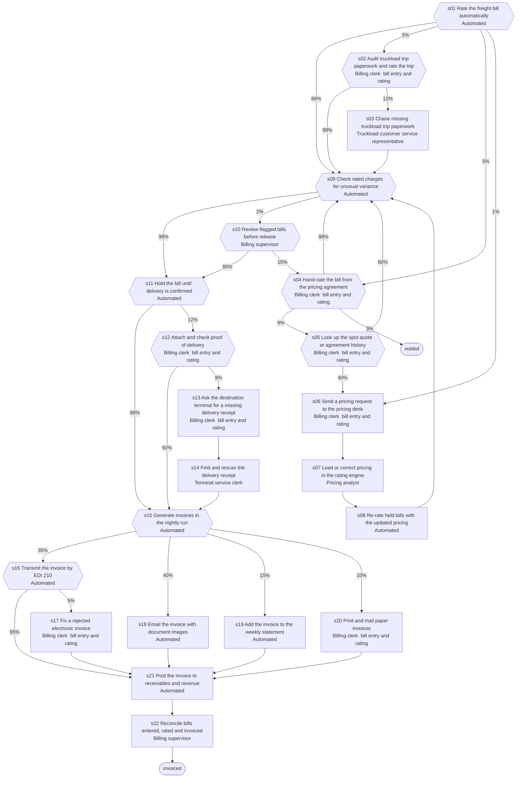

# Rate freight bills and invoice customers

`frt-fin-rating-invoicing` · trucking and freight transportation · finance (billing centre) · part of `freight-carrier-co`

After a freight bill is entered or a truckload trip closes, the carrier has to price it and send the customer an invoice. A rating engine applies the customer's negotiated agreement, the weekly fuel surcharge and accessorial charges to most bills; billing clerks hand-rate the rest, chase missing pricing from the pricing desk and collect proof of delivery for customers who require it. Invoices go out after delivery by EDI, email, weekly statement or mail and post to receivables. Missing or out-of-date pricing agreements and missing paperwork are what hold invoices back and delay cash.

| | |
|---|---|
| Unit of work | one freight bill rated and invoiced |
| Starts when | A freight bill is released by bill entry, or a truckload, brokerage or dedicated trip record closes, or a detention charge is added. |
| Done when | The invoice is sent to the customer and posted to accounts receivable and revenue, or the bill is voided. |
| Organisation | A Canadian LTL and truckload carrier of about 3,000 employees with a central billing centre, a rating engine in its transportation management system and a pricing desk in sales. (3,000 employees, 2019-2022) |
| Volume | 158,000 cases a month (range 140,000 to 185,000) |

## Where it sits

- Starts with **freight_bill** from fin-freight-bill-entry (94% of cases)
- Starts with **trip_record** from tl-trip-execution (4% of cases)
- Starts with **trip_record** from tl-brokerage (1% of cases)
- Starts with **trip_record** from tl-dedicated-ops (0% of cases)
- Starts with **accessorial_charge** from tl-detention-accessorials (0% of cases)
- Relies on **rate_agreement** from sls-pricing-quotes (a standing input; it does not start a case)
- Relies on **rate_agreement** from sls-contract-renewal (a standing input; it does not start a case)
- Relies on **customer_account** from sls-customer-onboarding (a standing input; it does not start a case)
- Relies on **delivery_receipt** from ltl-pod-capture (a standing input; it does not start a case)
- Relies on **fuel_surcharge_table** from fin-fuel-surcharge (a standing input; it does not start a case)
- Relies on **system_release** from it-system-change (a standing input; it does not start a case)
- Sends **customer_invoice** to shipper (outcome: invoiced)
- Sends **customer_invoice** to fin-collections (outcome: invoiced)
- Sends **ledger_postings** to fin-month-end-close (outcome: invoiced)

## Flow

## Roles

| Role | Department | Layer | FTE on this process | Loaded cost per hour | Evidence |
|---|---|---|---:|---:|---|
| Billing clerk (bill entry and rating) | Billing centre | individual contributor | 12 | 29 CAD | B [src-rateclerk] |
| Billing supervisor | Billing centre | supervisor | 1.5 | 49 CAD | C |
| Pricing analyst | Sales and customer service | senior specialist | 2 | 54 CAD | C |
| Truckload customer service representative | Truckload customer service and brokerage | individual contributor | 1 | 36 CAD | C |
| Terminal service clerk | LTL terminal network | individual contributor | 1.5 | 32 CAD | C |

## Steps

Hands-on time and the wait before each step show the most common value. Evidence tier A is a sourced number, B a sourced description, C the author's estimate.

| Step | Who | Kind | Hands-on | Wait before | Control | Evidence |
|---|---|---|---:|---:|---|---|
| **s01 Rate the freight bill automatically.** When a freight bill is released or a truckload trip record closes, the rating engine finds the bill-to customer's pricing agreement or the base tariff, applies the discount, minimum charge, the week's fuel surcharge percentage and coded accessorials, and writes the charges to the bill. Bills it cannot price go to an exception queue. | Automated | system auto | 0 min | 10 min |  | B [src-rateclerk] |
| **s02 Audit truckload trip paperwork and rate the trip.** A billing clerk opens the closed truckload trip, checks the signed bill of lading and proof of delivery scanned by the driver, the stops, detention and lumper receipts against the customer's load confirmation, and enters the line-haul rate, stop-offs and accessorials from the rate confirmation. | Billing clerk (bill entry and rating) | validation | 4 min | 12.0 h |  | C |
| **s03 Chase missing truckload trip paperwork.** The truckload customer service representative asks the driver through the in-cab messaging or by phone to scan the missing proof of delivery or receipt, or asks the consignee for a copy, and attaches it to the trip when it arrives. | Truckload customer service representative | communication | 6 min | 8.0 h |  | C |
| **s04 Hand-rate the bill from the pricing agreement.** A billing clerk opens the exception, reads the reason (lane not in the agreement, class or weight outside its breaks, an unusual accessorial or a cross-border leg with a partner carrier), finds the governing agreement or tariff item and calculates and enters the charges by hand. | Billing clerk (bill entry and rating) | judgment | 3 min | 2.0 h |  | B [src-rateclerk] |
| **s05 Look up the spot quote or agreement history.** The clerk searches the quote number on the bill of lading in the quote system, the customer's agreement history and the account executive's notes in the CRM to find which price the customer was promised. | Billing clerk (bill entry and rating) | lookup | 4 min | 0 min |  | C |
| **s06 Send a pricing request to the pricing desk.** The clerk puts the bill on rating hold and emails or logs a request to the pricing desk with the PRO number, bill-to account, lane and the reason no price applies, so pricing can load or correct the agreement. | Billing clerk (bill entry and rating) | communication | 3 min | 10 min |  | C |
| **s07 Load or correct pricing in the rating engine.** A pricing analyst checks the agreement, quote or renewal that should apply, confirms with the account executive if needed, and loads or corrects the discount, lanes or accessorial terms in the rating engine. One fix often releases several held bills for the same account. | Pricing analyst | data entry | 8 min | 1.0 d |  | C |
| **s08 Re-rate held bills with the updated pricing.** The rating engine re-runs every bill on rating hold for the account after the pricing change and writes the new charges. | Automated | system auto | 0 min | 30 min |  | C |
| **s09 Check rated charges for unusual variance.** The TMS compares the charges with the customer's quote and recent bills on the same lane and flags bills that are far above or below them, have a very high value, or carry an unusual accessorial, for supervisor review before release. | Automated | system auto | 0 min | 0 min |  | C |
| **s10 Review flagged bills before release.** The billing supervisor opens each flagged bill with its image and agreement, decides whether the charge is right, and either releases it or sends it back to a clerk to re-rate. | Billing supervisor | review | 2.5 min | 4.0 h | Billing department revenue assurance review of high-variance bills | C |
| **s11 Hold the bill until delivery is confirmed.** The rated bill waits in the TMS until the destination terminal scans the delivery and the driver's delivery receipt is imaged. Invoicing on delivery lets delivery-time accessorials such as waiting time, appointments or redelivery be added before the invoice goes out. | Automated | system auto | 0 min | 1.5 d |  | B [src-x12-211] |
| **s12 Attach and check proof of delivery.** For accounts that require proof of delivery with the invoice, a billing clerk checks that the imaged delivery receipt is attached, legible and signed, and notes any exceptions the consignee wrote on it, such as damage or a short piece. | Billing clerk (bill entry and rating) | validation | 0.5 min | 10.0 h |  | C |
| **s13 Ask the destination terminal for a missing delivery receipt.** The clerk messages the destination terminal with the PRO number and asks it to find the driver's signed delivery receipt and scan it again. | Billing clerk (bill entry and rating) | communication | 3 min | 0 min |  | C |
| **s14 Find and rescan the delivery receipt.** The terminal service clerk searches the driver's returned paperwork for the date, or asks the driver, and rescans the delivery receipt. If it cannot be found the consignee is asked to confirm delivery by email. | Terminal service clerk | lookup | 6 min | 1.0 d |  | C |
| **s15 Generate invoices in the nightly run.** The TMS invoice run creates an invoice for every ready bill and routes it by each customer's billing preference: EDI 210, emailed PDF with document images, a weekly statement, or paper by mail. | Automated | system auto | 0 min | 8.0 h |  | B [src-x12-210] |
| **s16 Transmit the invoice by EDI 210.** The EDI gateway sends the invoice to the customer or its freight payment provider and waits for the functional acknowledgement and any application rejection. | Automated | system auto | 0 min | 10 min |  | B [src-x12-210] |
| **s17 Fix a rejected electronic invoice.** A billing clerk reads the rejection (missing purchase order or shipment reference, wrong bill-to code, charges that do not match the customer's own rating) and corrects and resends the invoice, or uploads it to the payment provider's portal. | Billing clerk (bill entry and rating) | validation | 4 min | 1.0 d |  | C |
| **s18 Email the invoice with document images.** The TMS emails a PDF invoice with the bill of lading and delivery receipt images attached to the customer's accounts payable address. | Automated | system auto | 0 min | 10 min |  | C |
| **s19 Add the invoice to the weekly statement.** For customers billed by statement, the invoice is held and listed on the weekly statement that the TMS produces and sends at the start of the next week. | Automated | system auto | 0 min | 2.5 d |  | C |
| **s20 Print and mail paper invoices.** A billing clerk prints the night's paper invoices with copies of the bills of lading, folds and envelopes them for the morning mail. | Billing clerk (bill entry and rating) | physical | 0.3 min | 10.0 h |  | C |
| **s21 Post the invoice to receivables and revenue.** The nightly interface posts each invoice to accounts receivable and the revenue and fuel surcharge accounts in the ERP general ledger by terminal and business line. | Automated | system auto | 0 min | 1.0 h | Internal control over revenue recognition and completeness of billing (parent company's financial reporting controls) | C |
| **s22 Reconcile bills entered, rated and invoiced.** Each morning the billing supervisor runs the reconciliation of freight bills entered against bills rated and invoiced, works the aged list of delivered but unbilled shipments and confirms the interface totals to the ERP. | Billing supervisor | review | 0.05 min | 1.0 h | Daily billing completeness reconciliation | C |

## Exceptions

| Exception | Share of cases | What happens |
|---|---:|---|
| Hand-rated bill | 5% | The lane, weight break or accessorial is not in the customer's agreement; a clerk prices it by hand. |
| Missing pricing | 1% | No agreement or quote covers the bill; the bill waits on rating hold for the pricing desk, usually a day. |
| Truckload paperwork missing | 1% | The driver has not scanned the proof of delivery or detention receipt; the trip cannot be invoiced until it arrives. |
| Missing delivery receipt | 1% | A customer that requires proof of delivery gets no invoice until the terminal finds and rescans the receipt. |
| Rejected EDI invoice | 2% | The customer's freight payment provider rejects the 210 for a missing reference or a charge mismatch; a clerk fixes and resends it. |

## Benchmarks

| Metric | Value | Unit | Population | Evidence |
|---|---|---|---|---|
| cycle_time_days | p50 3, p90 6 | calendar days from freight bill released to invoice sent and posted | Canadian LTL carrier invoicing on delivery, 2019-2022 | C |
| auto_rated_share | 0.89 | share of LTL bills rated without a person | Canadian LTL carrier with negotiated agreements loaded in a rating engine | B [src-rateclerk] |

## Pain points

- Agreements and quotes that were never loaded, or loaded wrongly, stop bills from rating and create overcharges that come back as disputes. (steps s04, s05, s06, s07; B [src-rateclerk])
- Customers that require proof of delivery or truckload paperwork are not invoiced until missing documents are found, which delays cash. (steps s03, s12, s13, s14; C)
- Freight payment providers reject electronic invoices whose charges or references do not match their own audit, adding days to payment. (steps s16, s17; B [src-x12-211], [src-transflo])

## Assumptions

- The carrier invoices after delivery so delivery-time accessorials can be added; carriers that invoice prepaid bills at pickup would have a cycle about two days shorter.
- About 89% of LTL bills rate automatically, 5% need hand-rating and under 1% have no pricing at all; these shares are the author's estimates.
- Pricing analysts, truckload customer service representatives and terminal service clerks take part although the organisation file's process entry lists only billing clerks and the billing supervisor.
- The morning reconciliation reviews the previous night's invoices after they are sent, so only a short wait is counted for it.
- Hands-on time implies about 15 billing clerk FTE on rating and 33 on entry, about 48 in total against 45 in the organisation file; the difference is within the precision of the estimates and is covered by overtime in the autumn peak.
- The truckload trip record arrives after delivery, so for truckload trips the delivery hold is shorter than the simulated LTL transit wait; truckload is 5% of cases and does not change the median.
- Delivery-method shares (35% EDI, 40% email, 15% statement, 10% paper) are the author's estimates.
- Loaded costs come from the organisation file.

## Sources

- [src-rateclerk] [Night Rate Clerk (Roadrunner Freight, Milwaukee) job posting](https://simplify.jobs/p/5dd0e25a-bd17-40b2-a9b7-93ada5a9b55e/Night-Rate-Clerk) (Roadrunner Freight, listed on Simplify Jobs, 2025). LTL rate clerks use a central auto-rating system to calculate and verify rates on freight bills, hand-rate bills the system cannot rate by applying published pricing agreements and calculating accessorials, process reweighs and inspections from terminals, talk to terminal staff about problem freight bills, help billing staff classify commodities under the NMFC, and finish rating before a daily revenue cut-off of about 5 a.m.; requires experience with bills of lading, freight bills and tariffs and 40 words-per-minute typing and ten-key skills.
- [src-x12-211] [EDI 211 Motor Carrier Bill of Lading (X12 005010)](https://www.stedi.com/edi/x12-005010/211) (Stedi (X12 reference), 2024). The X12 211 transaction lets shippers give a motor carrier a legal bill of lading electronically, with line items for quantity, weight and commodity classification; rates and charges on the bill of lading are subject to audit, and accessorial charges usually cannot be determined until the shipment is delivered, so the 210 invoice is still needed.
- [src-x12-210] [EDI 210 Motor Carrier Freight Details and Invoice (X12 004040)](https://www.stedi.com/edi/x12-004040/210) (Stedi (X12 reference), 2024). The X12 210 transaction gives detail of charges for services rendered by a motor carrier and is used as the motor carrier invoice requesting payment.
- [src-transflo] [Common LTL Invoicing Challenges and How to Address Them](https://www.transflo.com/blog/common-ltl-invoicing-challenges-and-how-to-address-them/) (Transflo (vendor blog), 2024). Vendor claim, from industry veterans, that 30 to 40% of LTL invoices contain discrepancies, about half from location-related accessorial fees (residential, limited access) and half from reweigh and reclassification; manual data entry leads to inaccuracies, delays and disputes, and auditors may spend an hour on a $10 issue. Year of publication not shown on the page; 2024 is the author's estimate.

Written by claude-opus on 2026-11-24.
