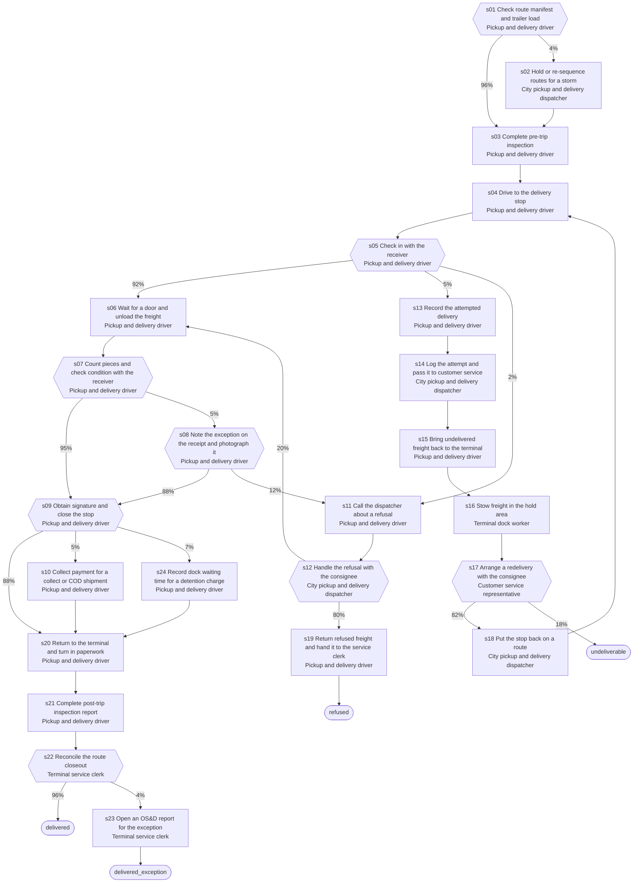

# Deliver LTL freight to consignees

`frt-ltl-delivery-execution` · trucking and freight transportation · LTL terminal operations · part of `freight-carrier-co`

City drivers from each LTL terminal take a trailer of staged freight out on a route of about 20 pickup and delivery stops and deliver each shipment to its consignee, counting pieces, noting shortages or damage on the delivery receipt and getting a signature. Dispatchers, customer service and terminal clerks handle the stops that fail: closed receivers, appointments that were never booked, refusals and damaged freight. Delays come from waiting at receivers' docks, traffic and winter storms, and every failed stop costs a second trip and an extra day.

| | |
|---|---|
| Unit of work | one delivery stop |
| Starts when | Freight for the consignee is staged on the destination terminal dock and loaded onto a P&D trailer for the day's route. |
| Done when | The shipment is delivered with a signed receipt and the route is closed out, or it is back in terminal custody as refused or undeliverable. |
| Organisation | A Canadian LTL and truckload carrier of about 3,000 employees with 38 LTL terminals, five hub cross-docks, a TMS with handheld scanning and a separate document imaging system. (3,000 employees, 2019-2022) |
| Volume | 140,000 cases a month (range 120,000 to 165,000) |

## Where it sits

- Starts with **staged_freight** from ltl-dest-dock (96% of cases)
- Starts with **recovered_freight** from ltl-osd-exceptions (4% of cases)
- Relies on **pd_route** from ltl-pd-dispatch (a standing input; it does not start a case)
- Sends **delivered_freight** to consignee (outcome: delivered)
- Sends **delivered_freight** to consignee (outcome: delivered_exception)
- Sends **delivery_receipt** to ltl-pod-capture (outcome: delivered)
- Sends **delivery_receipt** to ltl-pod-capture (outcome: delivered_exception)
- Sends **osd_report** to ltl-osd-exceptions (outcome: delivered_exception)
- Sends **refused_shipment** to ltl-refused-freight (outcome: refused)
- Sends **refused_shipment** to ltl-refused-freight (outcome: undeliverable)
- Sends **terminal_kpi_data** to ltl-terminal-performance (outcome: any)

## Flow

## Roles

| Role | Department | Layer | FTE on this process | Loaded cost per hour | Evidence |
|---|---|---|---:|---:|---|
| Pickup and delivery driver | LTL terminal network | individual contributor | 385 | 35 CAD | B [src-odfl-10k21] |
| City pickup and delivery dispatcher | LTL terminal network | individual contributor | 10 | 39 CAD | C |
| Customer service representative | Customer service centre | individual contributor | 8 | 32 CAD | C |
| Terminal service clerk | LTL terminal network | individual contributor | 12 | 32 CAD | C |
| Terminal dock worker | LTL terminal network | individual contributor | 3 | 29 CAD | C |

## Steps

Hands-on time and the wait before each step show the most common value. Evidence tier A is a sourced number, B a sourced description, C the author's estimate.

| Step | Who | Kind | Hands-on | Wait before | Control | Evidence |
|---|---|---|---:|---:|---|---|
| **s01 Check route manifest and trailer load.** At the start of the shift the city driver picks up the handheld and the printed route manifest, walks the P&D trailer and checks that the freight for each stop is loaded in delivery order, nose to tail, and that any dangerous goods shipping documents are in the cab pouch within reach. Missing or misloaded freight is reported to the dock supervisor before the truck leaves. | Pickup and delivery driver | validation | 1 min | 4.0 h |  | C |
| **s02 Hold or re-sequence routes for a storm.** The city dispatcher watches road reports and weather warnings and decides whether routes leave on time, are re-sequenced to drop rural or mountain stops, or are held until a highway reopens. Stops that cannot be reached are moved to the next day on the dispatch board. | City pickup and delivery dispatcher | coordination | 5 min | 6.0 h |  | C |
| **s03 Complete pre-trip inspection.** The driver walks around the tractor or straight truck and trailer, checks tires, lights, brakes, air lines, coupling and liftgate, and records the daily trip inspection on the handheld or a paper report. A defect that makes the unit unsafe sends the driver to the shop for another unit. | Pickup and delivery driver | physical | 1 min | 5 min | National Safety Code Standard 13 daily trip inspection as adopted in provincial regulations | C |
| **s04 Drive to the delivery stop.** The driver follows the route sequence on the handheld and drives from the previous stop to this consignee, dealing with city traffic, parking and access to the receiving dock. Time spent serving the stops earlier on the route is the wait before this step. | Pickup and delivery driver | travel | 7 min | 2.5 h |  | B [src-parcel-pd] |
| **s05 Check in with the receiver.** The driver finds the receiving office or the person in charge, presents the delivery receipt and asks for a door. The receiver may refuse freight that was not ordered or arrived late, or the business may be closed or demand an appointment the shipment does not have. | Pickup and delivery driver | communication | 1.5 min | 3 min |  | C |
| **s06 Wait for a door and unload the freight.** The driver backs onto the assigned door or parks curbside, then unloads the pallets and cartons with a pallet jack or the liftgate, sometimes bringing them inside. Waiting for a free door at busy receivers and distribution centres is common. | Pickup and delivery driver | physical | 6 min | 8 min |  | B [src-parcel-pd] |
| **s07 Count pieces and check condition with the receiver.** The driver and receiver count the pieces against the delivery receipt and look at the shrink-wrap and cartons for crushing, punctures or wet freight. A count that does not match or visible damage must be written on the receipt, because the consignee's later claim depends on it. | Pickup and delivery driver | validation | 1.5 min | 0 min |  | C |
| **s08 Note the exception on the receipt and photograph it.** The driver writes the exception on the delivery receipt or keys an exception code on the handheld (for example two cartons short or one pallet crushed) and takes photos of the damage. The consignee either accepts the shipment with the exception noted or refuses the damaged freight. | Pickup and delivery driver | data entry | 6 min | 0 min | Carrier delivery procedure: exceptions noted on the delivery receipt support claims under the bill of lading notice rules (written notice within 60 days of delivery) | B [src-dayross-bol], [src-manitoulin-terms] |
| **s09 Obtain signature and close the stop.** The receiver prints a name and signs on the handheld screen or the paper delivery receipt; the driver scans the stop closed, which time-stamps the delivery and updates tracing in the TMS. Paper receipts are kept for imaging at the terminal. | Pickup and delivery driver | data entry | 1.5 min | 0 min |  | C |
| **s10 Collect payment for a collect or COD shipment.** For collect and cash-on-delivery shipments the driver collects a cheque or certified funds before releasing the freight, records the amount on the receipt and keeps the payment in the cab envelope for the terminal. | Pickup and delivery driver | data entry | 4 min | 0 min | Bill of lading condition that freight and charges are paid before delivery on collect shipments | B [src-manitoulin-terms] |
| **s11 Call the dispatcher about a refusal.** The driver calls or messages the city dispatcher with the reason the consignee gives for refusing (not ordered, duplicate, damaged, late, wrong address) and the receiver's name. | Pickup and delivery driver | communication | 4 min | 2 min |  | C |
| **s12 Handle the refusal with the consignee.** The dispatcher checks the shipment in the TMS, may phone the consignee or the shipper's contact to resolve a misunderstanding, and tells the driver to deliver after all or to take the freight back. A refusal is recorded with its reason so that customer service can ask the shipper for instructions. | City pickup and delivery dispatcher | coordination | 6 min | 5 min |  | C |
| **s13 Record the attempted delivery.** When the business is closed, nobody can receive, or an appointment is demanded, the driver photographs the closed door or notes the receiver's name, keys an attempt code on the handheld and leaves a notice if possible. | Pickup and delivery driver | data entry | 3 min | 0 min |  | C |
| **s14 Log the attempt and pass it to customer service.** The dispatcher sees the attempt code on the board, confirms whether a redelivery or storage charge applies, and sends the shipment to the customer service queue to arrange a new delivery. | City pickup and delivery dispatcher | coordination | 4 min | 20 min |  | C |
| **s15 Bring undelivered freight back to the terminal.** The undelivered freight rides on the truck for the rest of the route; at the terminal the driver unloads it at the dock and scans it back into terminal inventory. | Pickup and delivery driver | physical | 4 min | 4.0 h |  | C |
| **s16 Stow freight in the hold area.** A terminal dock worker moves the returned freight with a forklift to the will-call or hold area, labels the location and scans it so it can be found for the redelivery. | Terminal dock worker | physical | 4 min | 30 min |  | C |
| **s17 Arrange a redelivery with the consignee.** A customer service representative phones or emails the consignee to book a redelivery date or appointment and confirms the accessorial charge; if the consignee cannot be reached or will not take the freight, the shipper is notified, as the bill of lading conditions require, for disposal instructions. | Customer service representative | communication | 10 min | 10.0 h |  | B [src-manitoulin-terms] |
| **s18 Put the stop back on a route.** The dispatcher adds the shipment to the route for the booked day and asks the dock to load it in sequence; the freight waits on the dock until that day. | City pickup and delivery dispatcher | coordination | 3 min | 1.0 d |  | C |
| **s19 Return refused freight and hand it to the service clerk.** The driver brings the refused shipment back at the end of the route, unloads it and gives the refused delivery receipt with the reason to the terminal service clerk, who opens a refused-freight file. | Pickup and delivery driver | physical | 6 min | 4.0 h |  | C |
| **s20 Return to the terminal and turn in paperwork.** After the last stop the driver drives back to the terminal, drops off signed paper receipts and any collected payments at the service counter, and records end-of-day on-duty time on the timecard or handheld. | Pickup and delivery driver | travel | 2.5 min | 3.3 h | Hours of Service Regulations s. 81(2): drivers within 160 km of the home terminal need no logbook if the carrier keeps daily on-duty records for 6 months | B [src-hos] |
| **s21 Complete post-trip inspection report.** The driver records any defects found during the day on the post-trip report so the shop can repair the unit overnight; a clean report is signed off on the handheld. | Pickup and delivery driver | physical | 0.6 min | 0 min | National Safety Code Standard 13 trip inspection and defect reporting | C |
| **s22 Reconcile the route closeout.** The terminal service clerk checks that every stop on the manifest has a status, matches paper receipts and COD payments to the stops, keys exception codes the handheld missed and sends receipts to imaging. Stops delivered with an exception are passed to the OS&D clerk. | Terminal service clerk | validation | 0.5 min | 45 min |  | C |
| **s23 Open an OS&D report for the exception.** The clerk creates the OS&D record in the TMS from the driver's exception notation and photos so the OS&D clerk can start a search or a damage inspection. | Terminal service clerk | data entry | 4 min | 10 min |  | C |
| **s24 Record dock waiting time for a detention charge.** When the wait at the receiver exceeded the free time in the tariff, the driver records arrival and departure times and the receiver's name on the receipt so billing can add the waiting-time accessorial. | Pickup and delivery driver | data entry | 2 min | 0 min |  | C |

## Exceptions

| Exception | Share of cases | What happens |
|---|---:|---|
| Closed receiver or missing appointment | 5% | The stop cannot be completed, the freight rides back to the terminal and customer service books a redelivery, usually the next working day. |
| Refused shipment | 3% | The consignee refuses at the door or because of damage; most refusals stand and the freight goes to the refused-freight process. |
| Delivered with exception | 4% | Short or damaged freight is noted on the receipt and an OS&D report is opened. |
| Storm hold | 4% | Routes are held or re-sequenced for weather and stops move to a later day. |

## Benchmarks

| Metric | Value | Unit | Population | Evidence |
|---|---|---|---|---|
| cycle_time_days | p50 0.6, p90 0.9 | calendar days from freight staged for the route to route closeout | Canadian LTL city delivery stops, 2019-2022 | C |
| stops_per_route_day | 20 | pickup and delivery stops per route | US LTL carriers (route design) | B [src-parcel-pd] |
| pd_unit_cost_per_hour | low 120, high 130 | USD per hour on the street | US LTL carriers, 2013 | A [src-parcel-pd] |
| on_time_service | 99 | percent of shipments | Old Dominion Freight Line, fourth quarter 2022 (best-in-class US LTL) | A [src-odfl-q422] |
| shipments_per_pd_driver_day | 18 | pickups plus deliveries per P&D driver | Old Dominion Freight Line, 2021 | B [src-odfl-10k21] |

## Pain points

- Waiting for a door at large receivers and distribution centres ties up the truck and pushes later stops past closing time. (steps s05, s06; B [src-parcel-pd])
- Closed receivers and missing appointments cause a second trip, an extra day and a storage or redelivery charge the consignee often disputes. (steps s13, s14, s17, s18; C)
- Paper receipts and vague exception notes make it hard to prove the condition of freight at delivery when a claim arrives weeks later. (steps s08, s22; B [src-dayross-bol])
- Winter storms and highway closures hold routes and create a backlog over the following days. (steps s02; C)

## Assumptions

- A case is one delivery stop. Route-level work (manifest check, pre-trip and post-trip inspection, drive back) is divided over about 13 delivery stops per route, so those steps show one or two minutes.
- The wait before driving to a stop is the time spent on earlier stops on the route; the wait before the drive back is the rest of the route. Together they make most of the same-day cycle time.
- The stop is triggered by staged freight; the day's route from ltl-pd-dispatch is treated as a standing input. Redelivery attempts loop back to the drive step rather than starting a new case.
- The branch to the OS&D report at closeout uses the share of stops with exceptions; the simulation cannot remember the earlier branch, so a few clean stops pass through it and a few exception stops skip it.
- Staffing check: drivers work about 205 paid hours a month, not the 130 productive hours the validator uses, so 385 driver FTE cover hands-on time that the validator converts to more FTE.
- Collision reports and IT tickets from handheld faults are rare by-products of the route and are left out of the outcome links.
- Loaded costs come from the organisation file (wage times 1.30 for hourly staff, 1.35 for salaried).
- Times reflect handheld scanning with paper delivery receipts still common in 2019-2022; electronic signature capture spread during COVID-19 contactless delivery in 2020.
- Organisation file corrected on 2026-11-24: dvir and driver_timecard are produced once per driver-day by ltl-pd-dispatch, not by each stop, so they are no longer outputs of this workflow.

## Sources

- [src-hos] [Commercial Vehicle Drivers Hours of Service Regulations (SOR/2005-313)](https://laws-lois.justice.gc.ca/eng/regulations/SOR-2005-313/FullText.html) (Government of Canada, Justice Laws, 2005 (consolidated)). Section 81(2): no record of duty status needed within a 160 km radius of the home terminal when the driver returns daily and the carrier keeps daily on-duty records for 6 months; 13 hours driving and 14 hours on duty per day.
- [src-dayross-bol] [Bill of Lading Terms & Conditions](https://dayross.com/BOLTerms) (Day & Ross, 2026). Canadian LTL bill of lading conditions: written notice of claim within 60 days of delivery (9 months for non-delivery), final claim within 9 months of shipment, liability of CAD 4.41 per kg for Canadian origin, undisclosed dangerous goods may be warehoused at the consignor's expense. Current version; the claim limits match the long-standing provincial uniform conditions.
- [src-manitoulin-terms] [Terms and Conditions](https://manitoulintransport.com/?page_id=88) (Manitoulin Transport, n.d.). Carrier may correct the weight on the bill of lading (III.19); right to open and inspect packages (B.5); notice to consignor and consignee when delivery cannot be made, storage, return after ten days without instructions (III.16-17); 60-day notice and 9-month claim limits; CAD 4.41 per kg liability.
- [src-parcel-pd] [Insights on LTL Carrier Pickup and Delivery Operations](https://parcelindustry.com/article-3541-Insights-on-LTL-Carrier-Pickup-and-Delivery-Operations.html) (PARCEL Industry (Joe Heilig), 2013). Routes of up to 20 or more stops a day; urban routes 50-60 miles, metro 90-100, peddle 150-200; USD 120-130 an hour to keep a P&D unit on the street; a 30-minute stop costs about USD 60; carriers measure time at stop, delays, stops per hour, miles per stop and shipments per stop.
- [src-odfl-q422] [Old Dominion Freight Line Reports Fourth Quarter 2022 Earnings Per Diluted Share of $2.92](https://ir.odfl.com/news-events/press-releases/detail/280/old-dominion-freight-line-reports-fourth-quarter-2022/) (Old Dominion Freight Line, 2023). 99% on-time service in the fourth quarter of 2022 with a cargo claims ratio of 0.1%.
- [src-odfl-10k21] [Old Dominion Freight Line Form 10-K for the year ended December 31, 2021](https://www.sec.gov/Archives/edgar/data/878927/000156459022006303/odfl-10k_20211231.htm) (US Securities and Exchange Commission (EDGAR), 2022). 251 service centres responsible for pickup and delivery in their area; 5,644 P&D drivers; 12,880 thousand LTL shipments in 2021; weight per shipment 1,571 lb.

Written by claude-opus on 2026-11-24.
