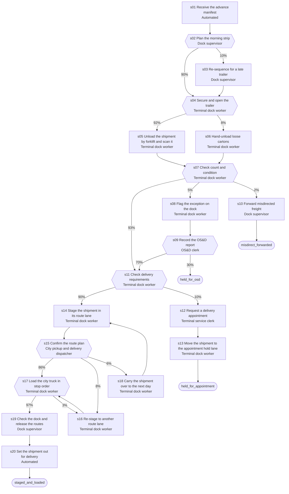

# Strip and stage freight at the destination terminal

`frt-ltl-dest-dock` · trucking (less-than-truckload freight) · LTL terminal operations · part of `freight-carrier-co`

In the early morning, dock workers at the destination terminal unload the linehaul trailers that arrived overnight, scan each shipment, flag shortages and damage, and stage the freight by city route in stop order before loading the city trucks. The dock supervisor sets the strip order and the city dispatcher confirms routes from what has been staged. Late trailers, missed scans, appointment requirements found at the last minute and freight staged in the wrong lane delay the day's deliveries.

| | |
|---|---|
| Unit of work | one shipment |
| Starts when | A linehaul trailer carrying the shipment arrives at the destination terminal overnight. |
| Done when | The shipment is loaded in stop order on its city truck and set out for delivery, or held for an appointment, an OS&D exception or forwarding. |
| Organisation | A Canadian LTL carrier of about 3,000 employees with 38 terminals, 33 of them satellite terminals running two weekday shifts. (3,000 employees, 2019-2022) |
| Volume | 150,000 cases a month (range 130,000 to 175,000) |

## Where it sits

- Starts with **loaded_trailer** from ltl-linehaul-dispatch (100% of cases)
- Relies on **labour_schedule** from ltl-dock-labour-scheduling (a standing input; it does not start a case)
- Relies on **freight_bill** from fin-freight-bill-entry (a standing input; it does not start a case)
- Sends **staged_freight** to ltl-pd-dispatch (outcome: staged_and_loaded)
- Sends **staged_freight** to ltl-delivery-execution (outcome: staged_and_loaded)
- Sends **appointment_request** to ltl-appointment-scheduling (outcome: held_for_appointment)
- Sends **osd_report** to ltl-osd-exceptions (outcome: any)
- Sends **shipment_scan_data** to ltl-linehaul-planning (outcome: misdirect_forwarded)
- Sends **terminal_kpi_data** to ltl-terminal-performance (outcome: any)

## Flow

## Roles

| Role | Department | Layer | FTE on this process | Loaded cost per hour | Evidence |
|---|---|---|---:|---:|---|
| Terminal dock worker | LTL terminal network | individual contributor | 130 | 29 CAD | C |
| Hub dock worker and forklift operator | LTL terminal network | individual contributor | 55 | 30 CAD | C |
| Dock supervisor | LTL terminal network | supervisor | 18 | 47 CAD | C |
| City pickup and delivery dispatcher | LTL terminal network | individual contributor | 8 | 39 CAD | C |
| OS&D clerk | LTL terminal network | individual contributor | 8 | 33 CAD | C |
| Terminal service clerk | LTL terminal network | individual contributor | 10 | 32 CAD | C |

## Steps

Hands-on time and the wait before each step show the most common value. Evidence tier A is a sourced number, B a sourced description, C the author's estimate.

| Step | Who | Kind | Hands-on | Wait before | Control | Evidence |
|---|---|---|---:|---:|---|---|
| **s01 Receive the advance manifest.** When the inbound trailer was closed at the hub or origin terminal, the TMS sent its manifest ahead. The destination terminal's inbound list and the city dispatcher's preliminary route plan now show the shipment, its consignee and any delivery requirements. | Automated | system auto | 0 min | 0 min |  | B [src-heilig] |
| **s02 Plan the morning strip.** At the start of the early shift the dock supervisor checks which linehaul trailers have arrived and which are still on the road, and sets the strip order: trailers with appointment and guaranteed freight and those feeding the first routes go first. Each trailer is assigned a strip door near the route lanes. | Dock supervisor | coordination | 0.4 min | 10 min |  | B [src-ttnews-dock] |
| **s03 Re-sequence for a late trailer.** When a trailer delayed by weather, a breakdown or a late hub departure finally arrives, the supervisor puts it on the first free door as a hot strip and warns the city dispatcher which routes will leave late or need freight added after departure. | Dock supervisor | coordination | 1 min | 3.0 h |  | C |
| **s04 Secure and open the trailer.** A dock worker checks the trailer is chocked or restrained, positions the dock plate, breaks the seal and compares its number with the manifest, and checks for shifted freight and floor damage before driving in. Trailers dropped overnight at a satellite terminal wait until the dock shift starts. | Terminal dock worker | physical | 0.5 min | 1.5 h | Provincial OHS regulations and carrier dock safety procedure: wheels chocked or trailer restrained and dock plate secured before forklift entry (CCOHS guidance) | B [src-ccohs-forklift] |
| **s05 Unload the shipment by forklift and scan it.** The dock worker lifts the shipment's pallets out of the trailer and scans the PRO label; the handheld shows the shipment's route lane or a hold location. | Terminal dock worker | physical | 3 min | 2 min |  | B [src-heilig] |
| **s06 Hand-unload loose cartons.** Two dock workers hand-stack floor-loaded cartons onto pallets, scanning each piece, and wrap them so they can be staged as one unit. | Terminal dock worker | physical | 6 min | 2 min |  | B [src-heilig] |
| **s07 Check count and condition.** The dock worker compares the pieces scanned with the manifest count and looks for damage. A shortage, overage or damage is flagged for OS&D; freight that belongs to another terminal is set aside as a misdirect. | Terminal dock worker | validation | 0.5 min | 0 min |  | B [src-ttnews-dock] |
| **s08 Flag the exception on the dock.** The dock worker photographs the damage or notes missing pieces, scans an exception code and moves badly damaged freight to the OS&D area. | Terminal dock worker | data entry | 4 min | 2 min |  | C |
| **s09 Record the OS&D report.** The OS&D clerk opens the exception in the TMS, checks the origin and hub manifests for where pieces went missing, sends a trace request to other terminals and decides with the supervisor whether the shipment goes out for delivery with an exception note or is held. | OS&D clerk | data entry | 10 min | 1.0 h |  | C |
| **s10 Forward misdirected freight.** The dock supervisor re-labels the misdirected shipment, books it on the next linehaul to the correct terminal and notes the misload against the terminal that loaded it. | Dock supervisor | coordination | 10 min | 30 min |  | B [src-ttnews-dock] |
| **s11 Check delivery requirements.** The dock worker reads the delivery notes the handheld shows from the freight bill: appointment required, liftgate, inside delivery, collect on delivery or a residential address. Freight needing an appointment that has not been booked is moved to a hold lane. | Terminal dock worker | lookup | 0.4 min | 0 min |  | C |
| **s12 Request a delivery appointment.** The terminal service clerk creates an appointment request in the TMS and calls or emails the consignee for a slot; the request passes to appointment scheduling and the shipment stays in hold until a slot is confirmed. | Terminal service clerk | communication | 6 min | 1.5 h |  | C |
| **s13 Move the shipment to the appointment hold lane.** The dock worker moves the shipment to the hold lane for appointment freight and scans it to that location so it can be found when the appointment is set. | Terminal dock worker | physical | 1 min | 10 min |  | C |
| **s14 Stage the shipment in its route lane.** The dock worker moves the shipment to the floor lane for its city route and sets it in stop order, so the loader can put the last stop in the nose of the truck. The staging scan updates the route plan. | Terminal dock worker | physical | 2 min | 3 min |  | B [src-heilig], [src-ttnews-dock] |
| **s15 Confirm the route plan.** The city dispatcher finalises the morning routes from the staged freight, balancing stops, weight and appointment windows across drivers, and moves shipments between routes where a truck is overloaded. Freight from trailers that arrive after the cut-off is left for the next day. | City pickup and delivery dispatcher | coordination | 0.4 min | 30 min |  | B [src-ttnews-dock] |
| **s16 Re-stage to another route lane.** The dock worker moves the shipment to the lane of the route it was moved to, or to the right place in the stop order, and rescans it. | Terminal dock worker | physical | 1 min | 5 min |  | C |
| **s17 Load the city truck in stop order.** The dock worker loads the shipment onto the P&D truck or city trailer at the route's door, last stop first, scans it to the unit so the handheld can warn of a wrong route, and secures the load. | Terminal dock worker | physical | 3 min | 10 min |  | B [src-ttnews-dock] |
| **s18 Carry the shipment over to the next day.** Freight that missed the route cut-off stays staged on the floor; the next morning a dock worker moves it into the new day's route lane and it is routed again. | Terminal dock worker | physical | 1 min | 21.7 h |  | C |
| **s19 Check the dock and release the routes.** Before drivers leave, the dock supervisor runs the report of freight on the dock not loaded or not scanned, sends workers to find stray shipments and releases the loaded units to the drivers. | Dock supervisor | review | 0.3 min | 20 min |  | C |
| **s20 Set the shipment out for delivery.** The TMS marks the shipment as out for delivery, sends the status to the customer by EDI and the portal, and hands the loaded route to delivery execution. | Automated | system auto | 0 min | 2 min |  | C |

## Exceptions

| Exception | Share of cases | What happens |
|---|---:|---|
| Late linehaul trailer | 10% | The trailer arrives after the strip has started; it is stripped hot and some freight misses its route. |
| Over, short or damaged | 5% | The exception is flagged and recorded; about three in ten are held instead of going out. |
| Appointment not booked | 9% | Freight that needs an appointment goes to a hold lane and an appointment request. |
| Missed route cut-off | 6% | Freight is carried over a day on the dock floor. |

## Benchmarks

| Metric | Value | Unit | Population | Evidence |
|---|---|---|---|---|
| cycle_time_days | p50 0.17, p90 0.35 | calendar days from the inbound trailer's arrival to the shipment loaded on its city truck | Early-morning destination docks at a regional Canadian LTL carrier | C |

## Pain points

- Late linehaul trailers compress the strip into the last hour before routes leave, so freight misses its route or the truck leaves late. (steps s03, s15, s18; C)
- Freight staged in the wrong lane or out of stop order is re-handled and slows drivers at delivery. (steps s14, s16, s17; B [src-ttnews-dock])
- Appointment requirements found only at the strip hold freight a day or more. (steps s11, s12, s13; C)

## Assumptions

- The unit of work is one shipment. Trailer-level work (opening, planning the strip) is spread across about 12 to 15 shipments per trailer, and route-level work across about 15 to 20 stops per route.
- At the five hub cities the destination strip is done by hub dock workers; the steps name terminal-dock-worker and the hub-dock-worker role carries its share of the FTE.
- City dispatchers, OS&D clerks and terminal service clerks take part although the organisation file's process map lists only dock workers and dock supervisors.
- Loading the city truck in stop order is included here because staging and loading are done by the same early-shift dock crew before drivers arrive; driver pre-trip and departure belong to ltl-delivery-execution.
- The case ends at load or at a hold; appointment freight continues in ltl-appointment-scheduling and held OS&D freight in ltl-osd-exceptions.
- Dock headcount looks tight across the dock processes: this workflow implies about 230 dock-worker FTE at the validator's 130 productive hours a month (about 185 at 160 hours), and with the hub cross-dock (about 220) and the origin dock (about 150 to 190) the five dock processes need about 550 to 640 dock workers against 560 (330 hub plus 230 terminal) in the organisation file, leaving no allowance for absence, training or the autumn peak.
- Loaded costs come from the organisation file: wage x 1.30 for hourly staff and x 1.35 for salaried staff.

## Sources

- [src-heilig] [A look at LTL carrier dock operations](https://parcelindustry.com/print-article-3642-permanent.html) (PARCEL Industry (Joe Heilig), None). Most shipments cross-docked from pickup unit to linehaul trailer; headloading of large shipments; planning systems project linehaul trailer loads; breakbulks often over 100 doors; unload doors assigned from each shipment's next scheduled door; inbound floor staging to sequence P&D loads; dock metrics such as shipments per hour; bar-code scans record each dock move. The page gives no publication date
- [src-ttnews-dock] [Better planning, equipment maintenance are key to improved loading dock efficiency](https://ttnews.com/articles/better-planning-equipment-maintenance-are-key-improved-loading-dock-efficiency) (Transport Topics (Mindy Long), 2021). LTL carriers measure dock productivity in pounds per hour and feet travelled per shipment; dock work only as good as the load plan; staging congestion and understaffing cause delays; handheld scanning reduces misdirects; trailer creep, pop-up, landing-gear collapse and early departure are forklift hazards
- [src-ccohs-forklift] [Forklift trucks: loading and unloading](https://www.ccohs.ca/oshanswers/safety_haz/forklift/loading.html) (Canadian Centre for Occupational Health and Safety, 2022). Before a forklift enters a trailer: brakes set, wheels chocked, trailer restraint engaged where available, trailer floor inspected, dock plate positioned and secured, landing gear supporting an uncoupled trailer; stop if the trailer tilts or a gap opens

Written by claude-opus on 2026-11-24.
