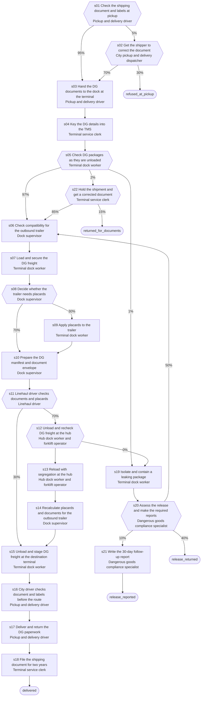

# Handle dangerous goods shipments

`frt-ltl-dg-handling` · trucking and freight transportation · LTL terminal operations and safety compliance · part of `freight-carrier-co`

About one LTL shipment in twenty contains dangerous goods such as paints, solvents, aerosols, batteries or corrosive cleaners. Federal Transportation of Dangerous Goods rules require a correct shipping document that travels in the cab, labels on the packages, placards on trailers above 500 kg, segregation from incompatible freight and a training certificate for everyone who handles them. Drivers, dock workers and dock supervisors repeat these checks at pickup, the origin dock, the hub and the destination, and missing paperwork or a leaking package stops the shipment.

| | |
|---|---|
| Unit of work | one dangerous goods shipment |
| Starts when | A shipper tenders a shipment with a dangerous goods shipping document at pickup. |
| Done when | The shipment is delivered with its document retained, or it is refused, returned or held after a release has been reported. |
| Organisation | A Canadian LTL and truckload carrier of about 3,000 employees with 38 LTL terminals, five hub cross-docks, a TMS with handheld scanning and a separate document imaging system. (3,000 employees, 2019-2022) |
| Volume | 7,500 cases a month (range 6,000 to 9,000) |

## Where it sits

- Starts with **dg_shipping_document** from ltl-origin-dock (100% of cases)
- Relies on **training_record** from saf-driver-training (a standing input; it does not start a case)
- Sends **dg_shipping_document** to ltl-linehaul-planning (outcome: delivered)
- Sends **dg_shipping_document** to ltl-linehaul-planning (outcome: release_reported)
- Sends **dg_shipping_document** to shipper (outcome: refused_at_pickup)
- Sends **dg_shipping_document** to shipper (outcome: returned_for_documents)

## Flow

## Roles

| Role | Department | Layer | FTE on this process | Loaded cost per hour | Evidence |
|---|---|---|---:|---:|---|
| Pickup and delivery driver | LTL terminal network | individual contributor | 5 | 35 CAD | B [src-tdg-training] |
| Terminal dock worker | LTL terminal network | individual contributor | 10 | 29 CAD | B [src-tdg-training] |
| Hub dock worker and forklift operator | LTL terminal network | individual contributor | 3 | 30 CAD | B [src-tdg-training] |
| Dock supervisor | LTL terminal network | supervisor | 8 | 47 CAD | C |
| Terminal service clerk | LTL terminal network | individual contributor | 3 | 32 CAD | C |
| Linehaul driver | Linehaul driver pool | individual contributor | 1 | 39 CAD | C |
| City pickup and delivery dispatcher | LTL terminal network | individual contributor | 0.3 | 39 CAD | C |
| Dangerous goods compliance specialist | Safety, compliance and driver services | senior specialist | 0.5 | 53 CAD | C |

## Steps

Hands-on time and the wait before each step show the most common value. Evidence tier A is a sourced number, B a sourced description, C the author's estimate.

| Step | Who | Kind | Hands-on | Wait before | Control | Evidence |
|---|---|---|---:|---:|---|---|
| **s01 Check the shipping document and labels at pickup.** At the shipper's dock the city driver reads the dangerous goods shipping document (UN number, shipping name, class, packing group, quantity, 24-hour number and the consignor's certification), checks that the packages carry matching labels and are not leaking, and puts the document in the cab pouch within reach. A missing or incomplete document is grounds to refuse the freight. | Pickup and delivery driver | validation | 2 min | 0 min | TDG Regulations Part 3: consignor completes the shipping document before the carrier takes possession; copy kept within the driver's reach | B [src-tdg-shipdoc] |
| **s02 Get the shipper to correct the document.** The driver calls the city dispatcher, who phones the shipper's contact to have the document corrected or reprinted while the driver waits or moves to the next stop and returns; if it cannot be fixed the freight stays with the shipper. | City pickup and delivery dispatcher | coordination | 6 min | 30 min |  | B [src-tdg-shipdoc] |
| **s03 Hand the DG documents to the dock at the terminal.** Back at the terminal the driver hands the dangerous goods documents to the dock supervisor or drops them in the DG tray before the trailer is unloaded, so the dock knows which pieces need special handling. | Pickup and delivery driver | communication | 1 min | 3.0 h |  | C |
| **s04 Key the DG details into the TMS.** The terminal service clerk enters the UN numbers, classes, packing groups and quantities from the document into the shipment record, which sets the DG flag the load planners and dock see. | Terminal service clerk | data entry | 2 min | 1.0 h |  | C |
| **s05 Check DG packages as they are unloaded.** A certified dock worker unloads the dangerous goods pieces, checks labels and marks against the document, looks for leaks, damage or wet packaging and sets them in the DG staging area away from food and incompatible freight. | Terminal dock worker | physical | 2 min | 30 min | TDG Regulations s. 6.1: only a person holding a valid TDG training certificate, or working under the direct supervision of one, handles or transports dangerous goods | B [src-tdg-training] |
| **s06 Check compatibility for the outbound trailer.** The dock supervisor looks at the other dangerous goods and food loads planned for the outbound trailer and uses the company segregation chart to keep incompatible classes apart (for example oxidizers away from flammable liquids, poisons away from foodstuffs), choosing the trailer and position. | Dock supervisor | judgment | 2 min | 30 min | Company DG segregation chart (based on the US 49 CFR segregation table for cross-border loads) | C |
| **s07 Load and secure the DG freight.** A dock worker loads the dangerous goods at the chosen position, usually near the tail for access, blocks and braces it so it cannot shift, and scans it onto the trailer. | Terminal dock worker | physical | 2 min | 1.0 h | TDG Regulations s. 6.1: only a person holding a valid TDG training certificate, or working under the direct supervision of one, handles or transports dangerous goods | B [src-tdg-training] |
| **s08 Decide whether the trailer needs placards.** Before the trailer closes the dock supervisor totals the gross mass of dangerous goods on it by class and checks the exclusions (ERAP goods, certain classes) to decide whether primary class placards, a DANGER placard or none are required. | Dock supervisor | judgment | 2 min | 1.0 h | TDG Regulations s. 4.15 placards on each side and end; s. 4.16.1 500 kg exemption and its exclusions | B [src-tdg-placards] |
| **s09 Apply placards to the trailer.** A dock worker fixes the required placards on both sides and both ends of the trailer, with the UN number where the goods need an ERAP. | Terminal dock worker | physical | 4 min | 10 min | TDG Regulations s. 4.15 and s. 4.15.2 | B [src-tdg-placards] |
| **s10 Prepare the DG manifest and document envelope.** The dock supervisor prints the trailer's dangerous goods list from the TMS, puts the shipping documents in the envelope for the linehaul driver and confirms the DG details on the load record the linehaul planners use. | Dock supervisor | data entry | 2 min | 10 min |  | C |
| **s11 Linehaul driver checks documents and placards.** Before hooking the trailer the linehaul driver checks that the DG envelope matches the manifest and that placards are in place, and keeps the documents within reach in the cab for the trip. | Linehaul driver | validation | 2 min | 4.0 h | TDG Regulations Part 3: shipping document within the driver's reach during transport | B [src-tdg-shipdoc] |
| **s12 Unload and recheck DG freight at the hub.** At the hub cross-dock a dock worker unloads the DG pieces, checks labels and condition again and moves them to the outbound door, keeping incompatible classes apart in staging. | Hub dock worker and forklift operator | physical | 2 min | 8.0 h | TDG Regulations s. 6.1: only a person holding a valid TDG training certificate, or working under the direct supervision of one, handles or transports dangerous goods | C |
| **s13 Reload with segregation at the hub.** The hub dock worker loads the pieces on the outbound trailer at a position the hub supervisor has checked for compatibility, blocking and bracing them. | Hub dock worker and forklift operator | physical | 2 min | 1.0 h | TDG Regulations s. 6.1: only a person holding a valid TDG training certificate, or working under the direct supervision of one, handles or transports dangerous goods | C |
| **s14 Recalculate placards and documents for the outbound trailer.** The hub dock supervisor totals the DG on the new trailer, decides on placards, updates the manifest and moves the shipping documents into the new envelope. | Dock supervisor | judgment | 2 min | 30 min | TDG Regulations s. 4.15 and s. 4.16.1 | B [src-tdg-placards] |
| **s15 Unload and stage DG freight at the destination terminal.** At the destination terminal a dock worker unloads the DG pieces, checks them and stages them for the city route, keeping the shipping documents with the freight. | Terminal dock worker | physical | 2 min | 10.0 h | TDG Regulations s. 6.1: only a person holding a valid TDG training certificate, or working under the direct supervision of one, handles or transports dangerous goods | C |
| **s16 City driver checks document and labels before the route.** At the start of the shift the city driver confirms that the DG document for each DG shipment on the trailer is in the cab pouch and that the trailer needs no placards for what it carries. | Pickup and delivery driver | validation | 1 min | 6.0 h | TDG Regulations Part 3: document within the driver's reach | B [src-tdg-shipdoc] |
| **s17 Deliver and return the DG paperwork.** After delivering the shipment the driver returns the shipping document copy with the signed delivery receipt at the end of the route. | Pickup and delivery driver | data entry | 0.5 min | 4.0 h |  | C |
| **s18 File the shipping document for two years.** The terminal service clerk scans the shipping document with the delivery receipt into imaging so a copy can be produced for an inspector for at least two years. | Terminal service clerk | data entry | 0.5 min | 1.0 h | TDG Regulations s. 3.11: carrier keeps a copy of the shipping document for at least two years | A [src-tdg-shipdoc] |
| **s19 Isolate and contain a leaking package.** Two certified dock workers clear the area, put on gloves and goggles, overpack the leaking package or contain the spill with the spill kit following the emergency guide, and keep other freight away. | Terminal dock worker | physical | 30 min | 5 min | Terminal spill response procedure and TDG training for handlers | C |
| **s20 Assess the release and make the required reports.** The dangerous goods specialist is called, reads the shipping document, phones the 24-hour number, decides against the quantity table whether the release must be reported to CANUTEC, local authorities and the consignor, and decides whether the freight can continue once overpacked or must go back. | Dangerous goods compliance specialist | judgment | 45 min | 1.0 h | TDG Regulations Part 8: emergency report above the quantity table (s. 8.2) and release report to CANUTEC and the consignor (s. 8.4) | B [src-tdg-reporting] |
| **s21 Write the 30-day follow-up report.** For a reportable release the specialist drafts the 30-day follow-up report on form TP16-0086 with the quantities, cause and corrective actions, and files it. | Dangerous goods compliance specialist | drafting | 2.0 h | 7.0 d | TDG Regulations Part 8: 30-day follow-up report | B [src-tdg-reporting] |
| **s22 Hold the shipment and get a corrected document.** When the packages and the document do not match, the service clerk holds the shipment in the DG area and asks the shipper, through customer service or directly, for a corrected document before it can move. | Terminal service clerk | communication | 10 min | 1.0 d | TDG Regulations Part 3: shipment does not move without a compliant shipping document | B [src-dayross-bol], [src-tdg-shipdoc] |

## Exceptions

| Exception | Share of cases | What happens |
|---|---:|---|
| Faulty shipping document at pickup | 5% | The driver will not take the freight until the shipper corrects the document; about a third stay behind. |
| Document and packages do not match at the dock | 2% | The shipment is held until the shipper sends a corrected document, usually a day or two. |
| Leaking or damaged package | 1% | Dock workers contain the package and the DG specialist decides on reports and whether the freight continues. |

## Benchmarks

| Metric | Value | Unit | Population | Evidence |
|---|---|---|---|---|
| cycle_time_days | p50 2.0, p90 3.5 | calendar days from pickup to delivery and filing | Canadian LTL dangerous goods shipments, 2019-2022 | C |
| tdg_certificate_validity | 36 | months for road transport | Canadian TDG training certificates | A [src-tdg-training] |
| placard_exemption_threshold | 500 | kg gross mass of DG in small containers | Canadian road vehicles (TDG s. 4.16.1) | A [src-tdg-placards] |
| shipping_document_retention | 2 | years | Consignors, carriers and importers in Canada (TDG s. 3.11) | A [src-tdg-shipdoc] |

## Pain points

- Shippers tender incomplete or wrong shipping documents, which stops the freight at pickup or at the dock while someone chases a correction. (steps s01, s02, s22; B [src-tdg-shipdoc])
- Placard and compatibility decisions are repeated by hand at every terminal where the freight changes trailers. (steps s06, s08, s14; C)
- Only certified workers may handle DG, so freight waits when the certified person on the shift is busy, and certificates must be renewed every three years. (steps s05, s07, s12; B [src-tdg-training])

## Assumptions

- Step times are the dangerous-goods work added to normal pickup, dock, linehaul and delivery handling; the elapsed time includes the shipment's normal transit, so the cycle time follows LTL transit times.
- About 70% of DG shipments pass through a hub and 30% move directly between terminals; about 30% of trailers carrying DG exceed the 500 kg placard exemption. Author's estimates.
- The segregation chart is described from general knowledge; the TDG text on segregation and the US segregation table were not opened.
- linehaul-driver and city-dispatcher are added to this process; the organisation file lists hub and terminal dock workers, the DG specialist and city drivers but not the dock supervisors who make placard and compatibility decisions or the linehaul drivers who carry the documents. dock-supervisor and terminal-service-clerk are also missing from the organisation file's role list for this process.
- The organisation file says the process produces DG documents for ltl-linehaul-planning; refused and returned shipments also go back to the shipper.
- Loaded costs come from the organisation file (wage times 1.30 for hourly staff, 1.35 for salaried).

## Sources

- [src-tdg-training] [TDG Bulletin: TDG Training](https://tc.canada.ca/en/dangerous-goods/tdg-bulletin-tdg-training) (Transport Canada, n.d.). Section 6.1 training certificate for anyone who handles, offers or transports dangerous goods; untrained person only under direct supervision; certificate expires 36 months after issue for road; records kept until two years after expiry; certificate produced immediately on request.
- [src-tdg-shipdoc] [TDG Bulletin: Shipping documents](https://tc.canada.ca/en/dangerous-goods/tdg-bulletin-shipping-documents) (Transport Canada, n.d.). Minimum shipping document contents (UN number, shipping name, class, packing group, quantity, 24-hour number, consignor certification); copy within the driver's reach or in the door pocket; carrier may refuse a shipment whose document is incomplete; copies kept two years (s. 3.11).
- [src-tdg-placards] [Dangerous goods placards](https://tc.canada.ca/en/dangerous-goods/dangerous-goods-placards) (Transport Canada, n.d.). Placards on each side and each end of a large means of containment (s. 4.15); 500 kg exemption for small containers (s. 4.16.1) and its exclusions; optional DANGER placard limits (s. 4.16); UN number display for ERAP goods.
- [src-tdg-reporting] [Guide for reporting dangerous goods incidents: reports for road, rail and marine](https://tc.canada.ca/en/dangerous-goods/canutec/reporting-requirements/guide-reporting-dangerous-goods-incidents/reports-tdg-road-rail-marine) (Transport Canada, n.d.). Emergency report to local authorities above the quantity table (s. 8.2); release report to CANUTEC and the consignor (s. 8.4); 30-day follow-up report form TP16-0086; thresholds such as any quantity for PG I or II and 30 L or 30 kg for PG III.
- [src-dayross-bol] [Bill of Lading Terms & Conditions](https://dayross.com/BOLTerms) (Day & Ross, 2026). Canadian LTL bill of lading conditions: written notice of claim within 60 days of delivery (9 months for non-delivery), final claim within 9 months of shipment, liability of CAD 4.41 per kg for Canadian origin, undisclosed dangerous goods may be warehoused at the consignor's expense. Current version; the claim limits match the long-standing provincial uniform conditions.

Written by claude-opus on 2026-11-24.
