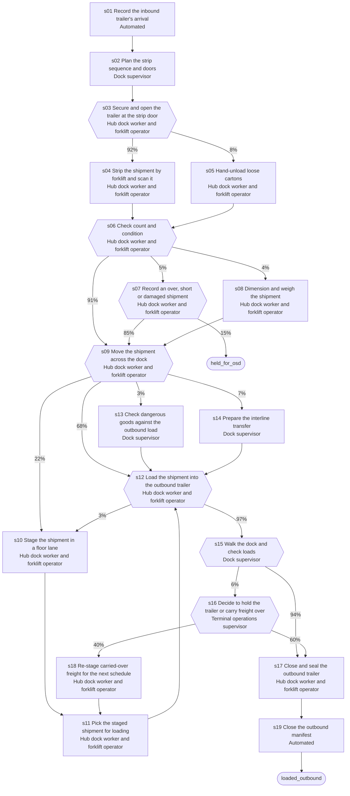

# Cross-dock freight at hub terminals

`frt-ltl-hub-crossdock` · trucking (less-than-truckload freight) · LTL terminal operations · part of `freight-carrier-co`

Overnight at the five hubs, dock workers strip inbound linehaul trailers, scan each shipment and move it across the dock to the outbound trailer for its next terminal or partner carrier. Dock supervisors plan the strip order and door assignments, check loads and decide what to do with freight that will miss its departure. The work is labour-heavy and time-pressed: forklift travel, crowded floor lanes, loose cartons and a midnight arrival peak all push against fixed outbound cut-offs, and every misload or damaged shipment creates work downstream.

| | |
|---|---|
| Unit of work | one shipment handled at a hub |
| Starts when | An inbound linehaul trailer checks in at the hub gate with the shipment aboard. |
| Done when | The shipment is loaded and scanned into its closed outbound trailer, handed to a partner carrier, or held in the OS&D cage. |
| Organisation | A Canadian LTL carrier of about 3,000 employees with 38 terminals, including hub cross-docks of 120 to 220 doors in the GTA, Montreal, Winnipeg, Calgary and Metro Vancouver. (3,000 employees, 2019-2022) |
| Volume | 105,000 cases a month (range 90,000 to 125,000) |

## Where it sits

- Starts with **loaded_trailer** from ltl-linehaul-dispatch (95% of cases)
- Starts with **interline_shipment** from us-partner-carrier (5% of cases)
- Relies on **trailer_move** from ltl-yard-management (a standing input; it does not start a case)
- Relies on **labour_schedule** from ltl-dock-labour-scheduling (a standing input; it does not start a case)
- Relies on **equipment_availability** from mnt-yard-equipment (a standing input; it does not start a case)
- Relies on **linehaul_load_plan** from ltl-linehaul-planning (a standing input; it does not start a case)
- Sends **loaded_trailer** to ltl-linehaul-dispatch (outcome: loaded_outbound)
- Sends **shipment_scan_data** to ltl-linehaul-planning (outcome: loaded_outbound)
- Sends **interline_shipment** to us-partner-carrier (outcome: loaded_outbound)
- Sends **interline_shipment** to ltl-interline-transfer (outcome: loaded_outbound)
- Sends **osd_report** to ltl-osd-exceptions (outcome: any)
- Sends **wi_referral** to ltl-reweigh-inspection (outcome: any)
- Sends **terminal_kpi_data** to ltl-terminal-performance (outcome: any)
- Sends **injury_report** to saf-workplace-safety (outcome: any)
- Sends **forklift_fault** to mnt-yard-equipment (outcome: any)

## Flow

## Roles

| Role | Department | Layer | FTE on this process | Loaded cost per hour | Evidence |
|---|---|---|---:|---:|---|
| Hub dock worker and forklift operator | LTL terminal network | individual contributor | 220 | 30 CAD | B [src-heilig] |
| Dock supervisor | LTL terminal network | supervisor | 18 | 47 CAD | C |
| Terminal operations supervisor | LTL terminal network | supervisor | 2 | 54 CAD | C |

## Steps

Hands-on time and the wait before each step show the most common value. Evidence tier A is a sourced number, B a sourced description, C the author's estimate.

| Step | Who | Kind | Hands-on | Wait before | Control | Evidence |
|---|---|---|---:|---:|---|---|
| **s01 Record the inbound trailer's arrival.** When the linehaul driver checks the trailer in at the hub gate, the TMS matches it to the advance manifest sent at close and adds every shipment aboard to the hub's inbound plan with its next destination. | Automated | system auto | 0 min | 0 min |  | B [src-heilig] |
| **s02 Plan the strip sequence and doors.** The dock supervisor reviews arriving trailers and their manifests and decides the order to strip them, putting first those with expedited freight and those feeding the earliest outbound departures. Each trailer gets a strip door close to the outbound doors most of its freight is bound for, and the yard is asked to shunt it in. | Dock supervisor | coordination | 0.4 min | 20 min |  | B [src-bartholdi-gue], [src-heilig] |
| **s03 Secure and open the trailer at the strip door.** Once the trailer is shunted to the door, a dock worker checks the wheels are chocked or the trailer restraint is engaged, lowers the dock plate, breaks the seal and compares its number with the manifest, and looks inside for shifted freight or a weak floor before driving a forklift in. | Hub dock worker and forklift operator | physical | 0.5 min | 1.5 h | Provincial OHS regulations and carrier dock safety procedure: wheels chocked or trailer restrained and dock plate secured before forklift entry (CCOHS guidance) | B [src-ccohs-forklift], [src-ttnews-dock] |
| **s04 Strip the shipment by forklift and scan it.** The dock worker lifts the shipment's pallets out of the trailer, scans the PRO label with the handheld, which shows the outbound door for its next terminal, and sets it on the dock. Shipments with several pallets take several trips. | Hub dock worker and forklift operator | physical | 3.5 min | 2 min |  | B [src-heilig], [src-ttnews-dock] |
| **s05 Hand-unload loose cartons.** Two dock workers hand-stack floor-loaded cartons onto pallets in the trailer, scan each piece and shrink-wrap the pallet so it can be moved as one unit. This takes much longer than palletised freight and causes most strip delays. | Hub dock worker and forklift operator | physical | 8 min | 2 min |  | B [src-heilig] |
| **s06 Check count and condition.** The dock worker compares the pieces scanned with the count on the manifest and looks at the freight for crushed cartons, broken wrap or leaks. Most shipments are clean; an overage, shortage or damage goes to an exception record, and freight with a doubtful weight or size goes to the dimensioner. | Hub dock worker and forklift operator | validation | 0.5 min | 0 min |  | C |
| **s07 Record an over, short or damaged shipment.** The dock worker photographs the damage or notes the missing pieces, scans an exception code, sets badly damaged freight aside in the OS&D cage and tells the supervisor. The exception record starts the OS&D process; most damaged shipments still move on. | Hub dock worker and forklift operator | data entry | 6 min | 5 min |  | C |
| **s08 Dimension and weigh the shipment.** The dock worker carries the pallets to the dimensioning station, which measures and weighs them and attaches the reading to the freight bill; a large difference from the bill of lading goes to reweigh and inspection for a billing correction. | Hub dock worker and forklift operator | physical | 4 min | 5 min |  | C |
| **s09 Move the shipment across the dock.** The dock worker drives the shipment to the outbound door the handheld shows. If that trailer is open and has room it goes straight in; if the trailer is not yet open, is being built around heavy freight or is full, it is set down in a floor lane by the door. | Hub dock worker and forklift operator | physical | 3 min | 2 min |  | B [src-bartholdi-gue], [src-heilig] |
| **s10 Stage the shipment in a floor lane.** The dock worker sets the shipment down in the floor lane for its outbound door and scans it to the staging location so the loader can find it. | Hub dock worker and forklift operator | physical | 1 min | 0 min |  | B [src-heilig] |
| **s11 Pick the staged shipment for loading.** When the outbound trailer is opened or the loader reaches the right place in the load, a dock worker picks the shipment out of the floor lane. Crowded lanes mean moving other freight to reach it. | Hub dock worker and forklift operator | physical | 1 min | 1.5 h |  | B [src-ttnews-dock] |
| **s12 Load the shipment into the outbound trailer.** The dock worker scans the shipment to the outbound trailer, and the handheld warns if it is the wrong trailer. The worker places it to build a tight, stable load, heavy freight low and towards the nose, and adds load bars or decking as the tiers rise. | Hub dock worker and forklift operator | physical | 3.5 min | 3 min |  | B [src-ttnews-dock], [src-heilig] |
| **s13 Check dangerous goods against the outbound load.** The dock supervisor checks the shipping document, that the shipment is not loaded beside an incompatible class, and whether it takes the trailer's dangerous goods over 500 kg so placards are needed on each side and end. | Dock supervisor | validation | 2 min | 5 min | Transportation of Dangerous Goods Regulations, Part 4 (s. 4.15 placards, s. 4.16.1 500 kg exemption) | A [src-tc-placards] |
| **s14 Prepare the interline transfer.** For a shipment handed to a Canadian or US partner carrier, the dock supervisor prints the interline waybill, checks any customs paperwork for cross-border freight, and directs the shipment to the partner's trailer or interline door. | Dock supervisor | data entry | 2 min | 10 min |  | C |
| **s15 Walk the dock and check loads.** While loading goes on, the dock supervisor walks the outbound doors, checks load quality and securement, looks for freight still in the lanes or unscanned near the cut-off, and moves workers between doors. Freight that will miss its departure is raised with operations. | Dock supervisor | review | 0.4 min | 0 min |  | B [src-ttnews-dock] |
| **s16 Decide to hold the trailer or carry freight over.** The terminal operations supervisor, with the linehaul planner, decides whether to hold the outbound trailer past its cut-off for late freight or to send it and carry the shipment to the next schedule. Guaranteed freight usually gets the hold. | Terminal operations supervisor | judgment | 2 min | 10 min |  | C |
| **s17 Close and seal the outbound trailer.** At the departure cut-off a dock worker scans the last shipment, sets the final load bar, closes the door, applies the seal and keys its number, and the yard pulls the trailer for dispatch. | Hub dock worker and forklift operator | physical | 0.4 min | 2.0 h |  | C |
| **s18 Re-stage carried-over freight for the next schedule.** Freight that missed its trailer stays in a floor lane, and on the next operating night a dock worker re-stages it at the door for the next departure. Carry-over takes floor space and is a common source of lost or late shipments. | Hub dock worker and forklift operator | physical | 2 min | 20.0 h |  | C |
| **s19 Close the outbound manifest.** The TMS closes the outbound trailer's manifest, sends it to linehaul dispatch and the next terminal, and records the shipment's hub handling for the terminal's productivity and misload reports. | Automated | system auto | 0 min | 2 min |  | C |

## Exceptions

| Exception | Share of cases | What happens |
|---|---:|---|
| Floor-loaded freight | 8% | Loose cartons are hand-stacked by two workers before they can move, slowing the strip. |
| Over, short or damaged | 5% | An exception is recorded; about one in seven of these is held in the OS&D cage instead of moving on. |
| Floor staging | 25% | The outbound trailer is not open or has no room, so the shipment is set down and handled again later. |
| Carry-over to the next schedule | 2% | Freight misses its outbound departure and waits a day on the floor. |

## Benchmarks

| Metric | Value | Unit | Population | Evidence |
|---|---|---|---|---|
| cycle_time_days | p50 0.25, p90 0.5 | calendar days from inbound trailer check-in to the shipment's outbound trailer closed | Overnight hub cross-docking at a regional Canadian LTL carrier | C |
| productivity_gain_from_door_layout | 11 | percent improvement in dock productivity | An LTL cross-dock terminal in Stockton, California, after reassigning trailers to doors | A [src-bartholdi-gue] |

## Pain points

- Forklift travel between strip and load doors and congestion in floor lanes drive labour cost; a poor door assignment adds minutes to every shipment. (steps s02, s09, s10, s11; B [src-bartholdi-gue], [src-ttnews-dock])
- Trailers arrive in a midnight peak and wait in the yard for strip doors, compressing the time left before outbound cut-offs. (steps s03, s15, s16; C)
- Loose cartons take several times longer to handle than pallets and cause most strip delays and damage. (steps s05, s07; B [src-heilig])

## Assumptions

- The unit of work is one shipment handled at a hub. Trailer-level work (opening, closing, planning doors) is spread across about 12 to 15 shipments per trailer.
- Shunting trailers between the yard and doors belongs to ltl-yard-management; here it shows only as the wait for a free strip door and a shunt.
- About two thirds of hub dock workers work the cross-dock; the rest handle the hub city's own pickups and deliveries in ltl-origin-dock and ltl-dest-dock.
- Interline freight from US partners is about 5% of hub volume; interline shipments to partners follow the same steps with an interline waybill and are delivered to the partner's trailer.
- The hub-dock-door occupancy on loading is the shipment's share of the hours an outbound trailer sits at its door while it is built.
- Loaded costs come from the organisation file: wage x 1.30 for hourly staff and x 1.35 for salaried staff.

## Sources

- [src-bartholdi-gue] [Reducing labor costs in an LTL crossdocking terminal (Operations Research 48(6), 823-832; abstract)](https://ideas.repec.org/a/inm/oropre/v48y2000i6p823-832.html) (INFORMS, abstract via RePEc IDEAS, 2000). Cross-dock labour is driven by travel between inbound and outbound doors and congestion; door assignment of trailers sets labour cost; a layout change at an LTL terminal in Stockton, California raised productivity by more than 11%
- [src-heilig] [A look at LTL carrier dock operations](https://parcelindustry.com/print-article-3642-permanent.html) (PARCEL Industry (Joe Heilig), None). Most shipments cross-docked from pickup unit to linehaul trailer; headloading of large shipments; planning systems project linehaul trailer loads; breakbulks often over 100 doors; unload doors assigned from each shipment's next scheduled door; inbound floor staging to sequence P&D loads; dock metrics such as shipments per hour; bar-code scans record each dock move. The page gives no publication date
- [src-ttnews-dock] [Better planning, equipment maintenance are key to improved loading dock efficiency](https://ttnews.com/articles/better-planning-equipment-maintenance-are-key-improved-loading-dock-efficiency) (Transport Topics (Mindy Long), 2021). LTL carriers measure dock productivity in pounds per hour and feet travelled per shipment; dock work only as good as the load plan; staging congestion and understaffing cause delays; handheld scanning reduces misdirects; trailer creep, pop-up, landing-gear collapse and early departure are forklift hazards
- [src-ccohs-forklift] [Forklift trucks: loading and unloading](https://www.ccohs.ca/oshanswers/safety_haz/forklift/loading.html) (Canadian Centre for Occupational Health and Safety, 2022). Before a forklift enters a trailer: brakes set, wheels chocked, trailer restraint engaged where available, trailer floor inspected, dock plate positioned and secured, landing gear supporting an uncoupled trailer; stop if the trailer tilts or a gap opens
- [src-tc-placards] [Dangerous goods placards (placards flowchart)](https://tc.canada.ca/en/dangerous-goods/dangerous-goods-placards) (Transport Canada, 2022). Placards on each side and each end of a large means of containment (TDG Regulations s. 4.15); exemption when dangerous goods in small containers total 500 kg gross or less (s. 4.16.1), with listed exceptions such as goods needing an ERAP

Written by claude-opus on 2026-11-24.
