# Dispatch linehaul drivers and trailers

`frt-ltl-linehaul-dispatch` · trucking (less-than-truckload freight) · LTL network operations · part of `freight-carrier-co`

Linehaul dispatchers put a driver and tractor on every scheduled departure between terminals and hubs, checking hours remaining under the hours-of-service rules, licences and equipment, and then follow the trucks through the night. Drivers inspect and hook the trailers, drive the leg, drop the trailers and close out the trip on the ELD. Work slows when no driver is free, when a trip inspection finds a defect, and when storms close highways or bar long combinations, and every late trip delays the dock that receives it.

| | |
|---|---|
| Unit of work | one linehaul trip |
| Starts when | The planner releases a departure (closed trailers assigned to a schedule) to the dispatch board. |
| Done when | The trailers are dropped at the hub, destination terminal or relay point and the trip record is reconciled for pay and hours. |
| Organisation | A Canadian LTL carrier of about 3,000 employees with 38 terminals, five hubs, about 240 company linehaul drivers and about 90 owner-operators on LTL linehaul. (3,000 employees, 2019-2022) |
| Volume | 14,000 cases a month (range 12,000 to 16,500) |

## Where it sits

- Starts with **linehaul_load_plan** from ltl-linehaul-planning (93% of cases)
- Starts with **empty_trailer_move** from ltl-trailer-balancing (5% of cases)
- Starts with **customs_release** from tl-customs-emanifest (2% of cases)
- Relies on **loaded_trailer** from ltl-origin-dock (a standing input; it does not start a case)
- Relies on **loaded_trailer** from ltl-hub-crossdock (a standing input; it does not start a case)
- Relies on **equipment_availability** from mnt-defect-repair (a standing input; it does not start a case)
- Relies on **equipment_availability** from mnt-preventive-maintenance (a standing input; it does not start a case)
- Sends **loaded_trailer** to ltl-hub-crossdock (outcome: any)
- Sends **loaded_trailer** to ltl-dest-dock (outcome: any)
- Sends **trailer_move_request** to ltl-yard-management (outcome: any)
- Sends **trip_record** to fin-driver-pay (outcome: any)
- Sends **trip_record** to fin-oo-settlements (outcome: any)
- Sends **hos_record** to saf-hos-log-audit (outcome: any)
- Sends **odometer_data** to mnt-preventive-maintenance (outcome: any)
- Sends **dvir** to mnt-defect-repair (outcome: any)
- Sends **breakdown_call** to mnt-roadside-breakdown (outcome: any)
- Sends **collision_report** to saf-collision-management (outcome: any)

## Flow

```mermaid
flowchart TD
    s01["s01 Departure appears on the dispatch board<br/>Automated"]
    s02["s02 Check driver availability and hours<br/>Linehaul dispatcher"]
    s03{{"s03 Assign driver and tractor<br/>Linehaul dispatcher"}}
    s04["s04 Owner-operator accepts the run<br/>Owner-operator, truckload  contracted, not an employee"]
    s05["s05 Call in an extra-board driver<br/>Linehaul dispatcher"]
    s06["s06 Confirm start time with the driver<br/>Linehaul dispatcher"]
    s07["s07 Report for duty and collect paperwork<br/>Linehaul driver"]
    s08{{"s08 Do the trip inspection<br/>Linehaul driver"}}
    s09["s09 Arrange a replacement unit or repair<br/>Linehaul dispatcher"]
    s10["s10 Swap to the replacement unit<br/>Linehaul driver"]
    s11["s11 Hook the trailers<br/>Linehaul driver"]
    s12["s12 Dispatch the trip in the TMS<br/>Linehaul dispatcher"]
    s13{{"s13 Check road and weather conditions<br/>Linehaul dispatcher"}}
    s14["s14 Hold, reroute or split the run<br/>Linehaul dispatcher"]
    s15["s15 Wait out the closure and depart<br/>Linehaul driver"]
    s16{{"s16 Drive the leg  solo<br/>Linehaul driver"}}
    s17{{"s17 Drive the leg  team<br/>Linehaul driver"}}
    s18["s18 Handle a breakdown or incident<br/>Linehaul dispatcher"]
    s19["s19 Resume the trip after road service<br/>Linehaul driver"]
    s20["s20 Recover a late-running trip<br/>Linehaul dispatcher"]
    s21["s21 Arrive and drop the trailers<br/>Linehaul driver"]
    s22["s22 Close out the trip on the ELD and trip sheet<br/>Linehaul driver"]
    s23["s23 Close the trip record<br/>Automated"]
    s24{{"s24 Reconcile the trip<br/>Linehaul dispatcher"}}
    s25["s25 Review the exception<br/>Linehaul driver supervisor"]
    s01 --> s02
    s02 --> s03
    s03 -->|"72%"| s06
    s03 -->|"20%"| s04
    s03 -->|"8%"| s05
    s04 --> s06
    s05 --> s06
    s06 --> s07
    s07 --> s08
    s08 -->|"93%"| s11
    s08 -->|"7%"| s09
    s09 --> s10
    s10 --> s11
    s11 --> s12
    s12 --> s13
    s13 -->|"92%"| s16
    s13 -->|"2%"| s17
    s13 -->|"6%"| s14
    s14 --> s15
    s15 --> s16
    s16 -->|"88%"| s21
    s16 -->|"3%"| s18
    s16 -->|"9%"| s20
    s17 -->|"90%"| s21
    s17 -->|"3%"| s18
    s17 -->|"7%"| s20
    s18 --> s19
    s19 --> s21
    s20 --> s21
    s21 --> s22
    s22 --> s23
    s23 --> s24
    s24 -->|"92%"| end0
    s24 -->|"8%"| s25
    s25 --> end1
    end0(["trip_closed"])
    end1(["closed_after_review"])
```

## Roles

| Role | Department | Layer | FTE on this process | Loaded cost per hour | Evidence |
|---|---|---|---:|---:|---|
| Linehaul dispatcher | LTL network planning and linehaul control | individual contributor | 14 | 43 CAD | B [src-noc-14404] |
| Linehaul driver | Linehaul driver pool | individual contributor | 235 | 39 CAD | B [src-gardewine-drivers], [src-hos] |
| Owner-operator, truckload (contracted, not an employee) | Truckload fleet operations | external party | 70 | 65 CAD | B [src-gardewine-drivers] |
| Linehaul driver supervisor | Linehaul driver pool | supervisor | 2.5 | 58 CAD | C |

## Steps

Hands-on time and the wait before each step show the most common value. Evidence tier A is a sourced number, B a sourced description, C the author's estimate.

| Step | Who | Kind | Hands-on | Wait before | Control | Evidence |
|---|---|---|---:|---:|---|---|
| **s01 Departure appears on the dispatch board.** When the planner releases a departure, the TMS puts it on the linehaul dispatch board with its schedule number, trailers, departure time, relay point and any hot freight notes. Boards refresh every few minutes. | Automated | system auto | 0 min | 5 min |  | C |
| **s02 Check driver availability and hours.** The linehaul dispatcher opens the driver board and the ELD hours view and lists drivers at the terminal who are rested and have enough driving and on-duty time left for the run and the return leg. The check covers the 13-hour driving, 14-hour on-duty and 16-hour elapsed limits and the 70-hour cycle. | Linehaul dispatcher | lookup | 1 min | 15 min | Commercial Vehicle Drivers Hours of Service Regulations (SOR/2005-313), ss. 12, 13 and 26 | A [src-hos], [src-tc-eld] |
| **s03 Assign driver and tractor.** The dispatcher matches the run to a driver by seniority bid or rotation, checks that the driver holds any certificate the configuration needs, such as an LCV driver certificate, and assigns a tractor. If no company driver is free the run goes to a contracted owner-operator or to the extra board. | Linehaul dispatcher | judgment | 0.8 min | 0 min | Ontario LCV program conditions: only drivers holding an LCV driver certificate may operate an LCV | B [src-noc-14404], [src-mto-lcv], [src-gardewine-drivers] |
| **s04 Owner-operator accepts the run.** The contracted owner-operator receives the run by phone or the ELD tablet message, checks it fits his own hours and truck, and accepts it at the contracted rate per kilometre or per trip. | Owner-operator, truckload (contracted, not an employee) | communication | 2 min | 10 min |  | B [src-gardewine-drivers] |
| **s05 Call in an extra-board driver.** The dispatcher phones drivers on the extra board, or a P&D driver with a Class 1 or AZ licence, until one accepts the run, and records the call-out. Late in the evening this can take several calls. | Linehaul dispatcher | communication | 8 min | 5 min |  | C |
| **s06 Confirm start time with the driver.** The dispatcher tells the driver the start time, trailers, route, relay point and any hot freight or dangerous goods aboard, by phone or tablet message, and gets a confirmation. | Linehaul dispatcher | communication | 0.8 min | 10 min |  | B [src-noc-14404] |
| **s07 Report for duty and collect paperwork.** The driver arrives at the terminal at the start time, logs on duty on the ELD, picks up the manifests and any dangerous goods shipping documents for the trailers and checks the run details with the dispatcher. | Linehaul driver | data entry | 6 min | 1.5 h |  | B [src-tc-eld], [src-gardewine-drivers] |
| **s08 Do the trip inspection.** The driver walks around the tractor, converter dolly and trailers against Schedule 1: brakes, air lines, tires, lights, coupling devices, load securement and placards, and records the result on the trip inspection report in the ELD or on paper. A major defect means the unit cannot leave until it is repaired. | Linehaul driver | physical | 10 min | 5 min | NSC Standard 13 trip inspection, Schedule 1, as adopted in provincial trip inspection regulations | A [src-sgi-trip] |
| **s09 Arrange a replacement unit or repair.** The dispatcher takes the defect report, sends it to the shop as a work order request and finds a spare tractor, dolly or trailer, or asks the shop to repair the unit on the spot. Hot freight may be transferred to another trailer. | Linehaul dispatcher | coordination | 10 min | 5 min |  | C |
| **s10 Swap to the replacement unit.** Once the shop releases a spare or repaired unit, the driver inspects it, moves the trailers or dolly across and updates the unit numbers on the ELD and trip sheet. | Linehaul driver | physical | 20 min | 1.5 h |  | C |
| **s11 Hook the trailers.** The driver couples the lead trailer, the converter dolly and the second trailer, connects air and electrical lines, checks seals against the manifests and that placards are on when required, and pulls the set out of the door. | Linehaul driver | physical | 15 min | 5 min |  | B [src-gardewine-drivers], [src-tc-placards] |
| **s12 Dispatch the trip in the TMS.** While the driver hooks, the dispatcher links driver, tractor and trailers to the schedule in the TMS, which starts the trip and sends an arrival estimate to the destination terminal or hub. | Linehaul dispatcher | data entry | 0.5 min | 0 min |  | B [src-noc-14404] |
| **s13 Check road and weather conditions.** Before release the dispatcher checks road reports and forecasts for the route, highway closures and, for long combinations, whether weather or time-of-day rules bar the run. Most nights the trip leaves as planned; in winter storms it is held, rerouted or split into singles. | Linehaul dispatcher | judgment | 0.6 min | 0 min | Ontario LCV program conditions (no LCV operation in bad weather or slippery conditions) and carrier severe-weather policy | B [src-mto-lcv], [src-noc-14404] |
| **s14 Hold, reroute or split the run.** The dispatcher holds the departure, reroutes it around a closed highway, or splits a long combination into single trailers that need extra drivers. The destination terminal and the next relay point are told the new arrival time. | Linehaul dispatcher | coordination | 10 min | 5 min |  | C |
| **s15 Wait out the closure and depart.** The driver waits at the terminal or a safe stop, on or off duty depending on the hold, until the road reopens or conditions improve, then confirms departure with the dispatcher. | Linehaul driver | communication | 5 min | 5.0 h |  | C |
| **s16 Drive the leg (solo).** The driver drives the combination to the hub, destination terminal or relay point, usually overnight, within the daily driving limits recorded by the ELD. Relay legs are planned so the driver can return home on a turn the same night. | Linehaul driver | travel | 3.0 h | 0 min |  | B [src-gardewine-drivers], [src-hos] |
| **s17 Drive the leg (team).** On the few long legs that cannot be relayed overnight, such as Winnipeg to Calgary, two drivers share the tractor and swap at the wheel so the trailers keep moving while each stays within the hours-of-service limits. | Linehaul driver | travel | 12.0 h | 0 min |  | B [src-hos] |
| **s18 Handle a breakdown or incident.** The driver calls in; the dispatcher logs the location and problem, calls road service or a tow, tells the destination terminal the trailers will be late and, for a collision, starts the collision report and calls the safety department. | Linehaul dispatcher | coordination | 30 min | 5 min |  | C |
| **s19 Resume the trip after road service.** After the road technician repairs the unit, or a rescue tractor arrives, the driver completes the leg and updates the ELD and the dispatcher. | Linehaul driver | travel | 1.5 h | 2.5 h |  | C |
| **s20 Recover a late-running trip.** The dispatcher watches the trip's GPS position, updates the arrival estimate, warns the hub or destination dock so they can re-sequence the strip, and moves the return leg to another driver if the delay would push the driver past the hours limits. | Linehaul dispatcher | communication | 4 min | 10 min |  | B [src-noc-14404], [src-hos] |
| **s21 Arrive and drop the trailers.** The driver checks in at the gate, drops the trailers at the assigned door or yard spot, unhooks the dolly and, on a relay, hooks the return set. At satellite terminals closed overnight and at partner docks the driver may wait for the gate or a door. | Linehaul driver | physical | 15 min | 10 min |  | C |
| **s22 Close out the trip on the ELD and trip sheet.** The driver records arrival time, trailers dropped and any delay or defect on the trip sheet and the ELD, notes defects for the shop and changes duty status for the next leg or the end of the shift. | Linehaul driver | data entry | 6 min | 0 min |  | B [src-tc-eld], [src-sgi-trip] |
| **s23 Close the trip record.** The ELD platform sends the duty-status record and odometer reading; the TMS closes the trip and passes the trip record to driver pay or owner-operator settlement. | Automated | system auto | 0 min | 5 min |  | C |
| **s24 Reconcile the trip.** The dispatcher checks the closed trip: departure and arrival against schedule, the late code and cause for terminal performance, unassigned driving on the ELD, and pay items such as delay time. Most trips close without change. | Linehaul dispatcher | validation | 1 min | 1.0 h |  | B [src-noc-14404] |
| **s25 Review the exception.** The linehaul driver supervisor reviews the exception: an hours-of-service edit or unassigned driving, a late departure the driver caused, a delay-pay claim or a defect not reported. The supervisor approves the pay item, edits the record with the driver's agreement or schedules coaching. | Linehaul driver supervisor | review | 20 min | 12.0 h | Commercial Vehicle Drivers Hours of Service Regulations (SOR/2005-313): carrier monitoring of driver records | B [src-hos] |

## Exceptions

| Exception | Share of cases | What happens |
|---|---:|---|
| Major defect at the trip inspection | 7% | The driver finds a major defect; the dispatcher arranges a spare or a shop repair and the trip leaves late. |
| No driver free | 8% | The dispatcher calls the extra board or a Class 1 P&D driver to cover the run. |
| Storm hold or LCV restriction | 6% | Weather, a closure or LCV time rules hold or split the run; much more common from December to March. |
| Breakdown on the road | 3% | Road service or a rescue tractor is needed before the trailers can complete the leg. |
| Hours or pay exception | 8% | The closed trip has unassigned driving, a delay-pay claim or a late departure that the supervisor reviews. |

## Benchmarks

| Metric | Value | Unit | Population | Evidence |
|---|---|---|---|---|
| cycle_time_days | p50 0.4, p90 0.8 | calendar days from release to dispatch to the trip record reconciled | Overnight linehaul legs of a regional Canadian LTL carrier | C |
| max_driving_hours_per_day | 13 | hours of driving before 8 consecutive hours off | Commercial vehicle drivers south of 60 degrees N in Canada | A [src-hos] |
| typical_linehaul_radius | 800 | km from the driver's home terminal | Gardewine linehaul drivers (Mullen Group LTL) | B [src-gardewine-drivers] |

## Pain points

- Matching drivers to runs depends on hours remaining, seniority rules and certificates, and late call-outs to the extra board delay departures. (steps s02, s03, s05; B [src-hos], [src-mto-lcv])
- Winter storms and highway closures hold or split runs and leave trailers late at hubs and destination terminals for days. (steps s13, s14, s15, s20; B [src-mto-lcv])
- Defects found at the trip inspection at night wait for a spare unit or a shop repair. (steps s08, s09, s10; A [src-sgi-trip])

## Assumptions

- One trip is one tractor moving one set of trailers from one terminal to the next stop (hub, destination or relay point). A relay turn is two trips.
- Owner-operator trips follow the same driving steps as company trips; the driving steps name the company driver role, so labour cost per trip is slightly understated for the fifth of trips run by owner-operators (CAD 65 an hour, truck included, against CAD 39).
- Average leg length of about 200 to 250 km (about 3 hours of driving, 2 to 6 in the ordinary range) is the author's estimate; it is what the organisation file's 14,000 trips a month and about 330 drivers allow.
- The staffing check is expected to show more FTE implied than stated: the validator assumes 130 productive hours a month, while linehaul drivers are on duty about 200 to 240 hours a month within the 70-hour weekly cycle, and owner-operator hours count in hands-on time but not in stated FTE. Even so, 240 company drivers at about 5 on-duty hours per trip and three quarters of 14,000 trips work about 220 hours a month each, which is high; the organisation file may understate linehaul drivers by 15 to 25%.
- A trip starts when the planner releases the departure, so the load plan is the trigger; loaded trailers from origin terminals and hubs, which the organisation file lists as triggers, are recorded here as inputs that the load plan points to.
- Owner-operator tractors are listed under the company linehaul-tractor resource in the steps; the organisation file's oo-tractor resource carries no running cost to the carrier.
- Loaded costs come from the organisation file: wage x 1.30 for hourly staff and x 1.35 for salaried staff.

## Sources

- [src-hos] [Commercial Vehicle Drivers Hours of Service Regulations (SOR/2005-313), full text](https://laws-lois.justice.gc.ca/eng/regulations/SOR-2005-313/FullText.html) (Justice Laws Website, Government of Canada, 2021). 13 h driving and 14 h on-duty daily limits (s. 12), 8 consecutive hours off before driving again and the 16 h elapsed limit (s. 13), 10 h off-duty a day (s. 14), cycle 1 of 70 h in 7 days (s. 26), ELD requirement (s. 77) and the 160 km local exemption (s. 77(3))
- [src-tc-eld] [What's an ELD? Handout for motor carriers and drivers](https://tc.canada.ca/en/road-transportation/electronic-logging-devices/eld-handout-motor-carriers-drivers) (Transport Canada, 2022). ELDs mandatory for federally regulated drivers keeping records of duty status from 12 June 2021, with progressive enforcement without penalties until 1 January 2023; drivers within 160 km of the home terminal exempt
- [src-sgi-trip] [Professional Driver's Handbook: trip inspection standards](https://sgi.sk.ca/pro-driver/-/knowledge_base/pro-drivers/trip-inspection-standards) (Saskatchewan Government Insurance (SGI), 2022). Trucks, tractors and trailers over 11,794 kg inspected under Schedule 1 once every 24 hours in use; report contents; minor defects repaired before the next trip inspection, vehicle with a major defect not driven until repaired; schedules from NSC Standard 13
- [src-mto-lcv] [Long combination vehicles (archived Ontario Ministry of Transportation page, captured 27 August 2021)](https://bac-lac.wayback.archive-it.org/web/20210827055956/http://www.mto.gov.on.ca/english/trucks/long-combination-vehicles.shtml) (Ontario Ministry of Transportation, via Library and Archives Canada web archive, 2021). LCVs up to 40 m pulling two full-length semitrailers; 90 km/h limit; must avoid bad weather or slippery conditions; certified experienced drivers; designated divided highways; terminals within 2 km of an interchange; no GTA or Ottawa rush-hour running
- [src-gardewine-drivers] [Driving positions](https://gardewine.com/?p=11848) (Gardewine (Mullen Group), 2026). Linehaul company and owner-operator drivers run mostly at night between terminals, usually within 800 km of the home terminal, with tandem, Rocky Mountain or turnpike double combinations, out in the evening and back the next morning or out one night
- [src-noc-14404] [NOC 2021 unit group 14404: Dispatchers](https://noc.esdc.gc.ca/Structure/NOCProfile?GocTemplateCulture=en-CA&code=14404&version=2021.0) (Employment and Social Development Canada, 2021). Truck dispatchers coordinate drivers and equipment, dispatch to schedules, advise drivers of route, weather and traffic problems, monitor workloads and locations and keep driver work records
- [src-tc-placards] [Dangerous goods placards (placards flowchart)](https://tc.canada.ca/en/dangerous-goods/dangerous-goods-placards) (Transport Canada, 2022). Placards on each side and each end of a large means of containment (TDG Regulations s. 4.15); exemption when dangerous goods in small containers total 500 kg gross or less (s. 4.16.1), with listed exceptions such as goods needing an ERAP

Written by claude-opus on 2026-11-24.
