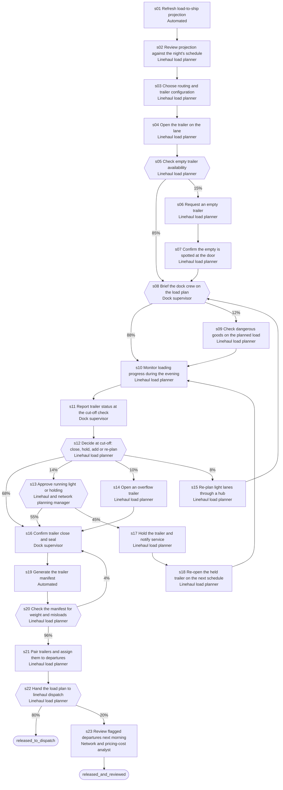

# Plan linehaul loads and departures

`frt-ltl-linehaul-planning` · trucking (less-than-truckload freight) · LTL network operations · part of `freight-carrier-co`

Each evening linehaul planners decide how the day's pickups will travel between terminals: which trailers to open for which destination or hub, when to close them, and which to run light, hold for more freight or combine. They work from a load-to-ship projection in the TMS and from dock scans, while dock supervisors brief loaders and close trailers. The work is slow and error-prone because scan data lags the dock, empties are often in the wrong place, and every cut-off forces a trade between trailer fill and service.

| | |
|---|---|
| Unit of work | one linehaul trailer departure |
| Starts when | Pickup scans and inbound arrivals put freight for a lane into the evening load-to-ship projection. |
| Done when | The closed, sealed trailer with its manifest is assigned to a scheduled departure on the linehaul dispatch board. |
| Organisation | A Canadian LTL carrier of about 3,000 employees with 38 terminals, five hub cross-docks and a 24-hour linehaul planning desk. (3,000 employees, 2019-2022) |
| Volume | 21,000 cases a month (range 18,000 to 25,000) |

## Where it sits

- Starts with **shipment_scan_data** from ltl-origin-dock (65% of cases)
- Starts with **shipment_scan_data** from ltl-hub-crossdock (35% of cases)
- Relies on **freight_bill** from fin-freight-bill-entry (a standing input; it does not start a case)
- Relies on **network_plan** from ltl-network-planning (a standing input; it does not start a case)
- Relies on **dg_shipping_document** from ltl-dg-handling (a standing input; it does not start a case)
- Relies on **yard_status** from ltl-yard-management (a standing input; it does not start a case)
- Relies on **capacity_plan** from ltl-peak-capacity (a standing input; it does not start a case)
- Relies on **system_release** from it-system-change (a standing input; it does not start a case)
- Sends **linehaul_load_plan** to ltl-linehaul-dispatch (outcome: any)
- Sends **empty_trailer_request** to ltl-trailer-balancing (outcome: any)
- Sends **terminal_kpi_data** to ltl-network-planning (outcome: released_and_reviewed)

## Flow

## Roles

| Role | Department | Layer | FTE on this process | Loaded cost per hour | Evidence |
|---|---|---|---:|---:|---|
| Linehaul load planner | LTL network planning and linehaul control | individual contributor | 10.5 | 45 CAD | B [src-noc-14405] |
| Dock supervisor | LTL terminal network | supervisor | 7 | 47 CAD | C |
| Linehaul and network planning manager | LTL network planning and linehaul control | manager | 0.3 | 95 CAD | C |
| Network and pricing-cost analyst | LTL network planning and linehaul control | senior specialist | 1 | 58 CAD | C |

## Steps

Hands-on time and the wait before each step show the most common value. Evidence tier A is a sourced number, B a sourced description, C the author's estimate.

| Step | Who | Kind | Hands-on | Wait before | Control | Evidence |
|---|---|---|---:|---:|---|---|
| **s01 Refresh load-to-ship projection.** The transportation management system adds the afternoon's pickup manifests, dock scans and inbound linehaul arrival times to a projection of weight and cube on hand and still to come for each outbound lane from the terminal. The projection refreshes on a timer, so new freight shows up in batches. | Automated | system auto | 0 min | 10 min |  | B [src-heilig] |
| **s02 Review projection against the night's schedule.** The linehaul planner opens the projection for the terminal and compares the expected weight and cube on each lane with the standing departure schedule from the network plan. The planner notes lanes that will overflow one trailer, lanes that look light and any guaranteed or expedited shipments. | Linehaul load planner | lookup | 0.3 min | 1.5 h |  | B [src-noc-14405], [src-erera] |
| **s03 Choose routing and trailer configuration.** For each lane the planner decides whether freight goes direct to the destination terminal or to a hub, and whether it moves in a 53-foot van or in 28-foot pups that will run as a double. The decision weighs trailer fill against transit time and the cost of an extra handling at the hub. | Linehaul load planner | judgment | 0.3 min | 0 min |  | B [src-erera], [src-gardewine-drivers] |
| **s04 Open the trailer on the lane.** The planner opens a trailer record for the lane in the TMS, gives it a trailer number and an origin door, and prints or posts the door sheet that tells dock workers which destination the door is loading. | Linehaul load planner | data entry | 0.2 min | 2 min |  | C |
| **s05 Check empty trailer availability.** The planner looks at the yard status to see whether an empty trailer of the right type and condition is on hand at the terminal for the lane, and whether pups are available to pair into a double. | Linehaul load planner | lookup | 0.15 min | 0 min |  | C |
| **s06 Request an empty trailer.** The planner raises an empty trailer request to trailer balancing, asking for an empty to be repositioned from a nearby terminal or shunted from the far yard, and states the type and the time it is needed at the door. | Linehaul load planner | communication | 2 min | 5 min |  | B [src-erera] |
| **s07 Confirm the empty is spotted at the door.** The planner checks the yard status again, or calls the dock, to confirm that the empty has arrived and been spotted at the assigned door so loading can start. | Linehaul load planner | lookup | 0.5 min | 2.0 h |  | C |
| **s08 Brief the dock crew on the load plan.** The dock supervisor goes through the door sheets with the evening loaders: which doors load which lanes, which large shipments to headload in the nose, and how to build the load with heavy freight on the floor. Changes to the plan are passed on by radio during the shift. | Dock supervisor | coordination | 0.5 min | 30 min |  | B [src-heilig], [src-ttnews-dock] |
| **s09 Check dangerous goods on the planned load.** The planner reads the dangerous goods shipping documents for the shipments planned on the trailer, checks that incompatible classes are not loaded together and adds up gross mass to see whether the trailer will exceed 500 kg and need placards on each side and end. The trailer is flagged so the dock places placards before it closes. | Linehaul load planner | validation | 2 min | 5 min | Transportation of Dangerous Goods Regulations, Part 4 (s. 4.15 placards, s. 4.16.1 500 kg exemption) | A [src-tc-placards] |
| **s10 Monitor loading progress during the evening.** Through the evening the planner watches the loaded weight, cube and shipment count build on each open trailer from dock scans, as city trucks return with pickups in waves. The planner compares progress with the projection and looks for trailers that will cube out early or stay light. | Linehaul load planner | analysis | 0.5 min | 2.5 h |  | B [src-heilig] |
| **s11 Report trailer status at the cut-off check.** At the planner's cut-off check the dock supervisor reports what is still on the floor for each lane, which trailers are full and which have room, often by radio or phone while walking the dock. | Dock supervisor | communication | 0.4 min | 0 min |  | C |
| **s12 Decide at cut-off: close, hold, add or re-plan.** The planner compares each trailer's fill and the freight still due with the departure time and decides whether to close it as planned, open an extra trailer for overflow, re-plan light lanes into one hub-bound trailer, or seek approval to run light or hold. The decision trades trailer fill against service on the shipments aboard. | Linehaul load planner | judgment | 0.6 min | 5 min |  | C |
| **s13 Approve running light or holding.** The network manager, or by phone at night against standing rules, weighs the cost of running a half-empty trailer against the service failure of holding freight a day. Guaranteed and expedited freight is always run; other light trailers are often held to the next night. | Linehaul and network planning manager | approval | 1 min | 30 min | Carrier linehaul cost and service policy: manager approval to run below the minimum load factor or to hold freight | C |
| **s14 Open an overflow trailer.** The planner opens an extra trailer or pup on the lane, assigns a door, tells the dock which freight goes on it and adds it to the schedule as an extra section, which may need its own driver. | Linehaul load planner | data entry | 2 min | 5 min |  | C |
| **s15 Re-plan light lanes through a hub.** The planner combines freight from two or more light lanes into one trailer bound for the hub, changes the door sheets and tells the dock to move freight already loaded. The freight gains a handling at the hub but saves a light departure. | Linehaul load planner | analysis | 4 min | 5 min |  | B [src-erera] |
| **s16 Confirm trailer close and seal.** The dock supervisor checks that the last shipment for the trailer is scanned aboard, that load bars or decking hold the freight and that placards are on if flagged, then keys the seal number and close time into the TMS. | Dock supervisor | validation | 1.5 min | 20 min | Carrier freight security policy: seal applied and recorded on every closed linehaul trailer | C |
| **s17 Hold the trailer and notify service.** The planner marks the trailer as held in the TMS, moves it to the next night's plan and tells customer service which guaranteed or time-critical shipments will miss their service date so customers can be warned. | Linehaul load planner | data entry | 2 min | 5 min |  | C |
| **s18 Re-open the held trailer on the next schedule.** On the next operating night the planner re-opens the held trailer on that night's plan and continues loading it with the new day's freight. Trailers held on Friday wait for the Sunday or Monday departures. | Linehaul load planner | lookup | 0.5 min | 21.7 h |  | C |
| **s19 Generate the trailer manifest.** When the trailer is closed the TMS builds its manifest with each shipment, weight, pieces, dangerous goods and consignee, and sends an advance manifest to the hub or destination terminal so they can plan the strip. | Automated | system auto | 0 min | 2 min |  | C |
| **s20 Check the manifest for weight and misloads.** The planner scans the manifest for shipments that do not belong to the lane, gross weight above what the configuration allows, a heavy pup that should run as the lead trailer, and missing placards. A problem sends the trailer back to the dock to be re-handled. | Linehaul load planner | validation | 0.4 min | 10 min | Carrier weight and loading policy: gross and axle weights within provincial limits before dispatch | C |
| **s21 Pair trailers and assign them to departures.** The planner pairs closed pups into doubles, or two 53-foot trailers into a long combination where the route allows it, and assigns each set to a scheduled departure with its departure time and relay point in the linehaul load plan. | Linehaul load planner | data entry | 0.4 min | 10 min | Ontario LCV program conditions and provincial vehicle weights and dimensions rules for doubles | B [src-mto-lcv], [src-gardewine-drivers] |
| **s22 Hand the load plan to linehaul dispatch.** The planner posts the departures to the dispatch board and tells the linehaul dispatcher about hot freight, late trailers and extra sections that need a driver. Departures flagged as light, held or overflow go on the next morning's exception list. | Linehaul load planner | communication | 0.3 min | 5 min |  | C |
| **s23 Review flagged departures next morning.** The network analyst goes through the morning exception report of light, held and overflow departures, checks load factor and cost per pound against the lane's norm and recommends schedule changes for the network plan when a lane is light or overflowing night after night. | Network and pricing-cost analyst | analysis | 2 min | 10.0 h |  | C |

## Exceptions

| Exception | Share of cases | What happens |
|---|---:|---|
| No empty trailer at the terminal | 15% | The terminal has no suitable empty for the lane; the planner requests one and loading waits until it is spotted. |
| Light trailer held to the next night | 6% | A light trailer is held with manager approval and re-opened on the next schedule, delaying its freight a day or over a weekend. |
| Re-plan through a hub | 8% | Light lanes are combined into one hub-bound trailer and the dock re-handles freight already loaded. |
| Misload or overweight found on the manifest | 4% | The manifest check finds a shipment for another lane or excess weight; the dock re-opens and re-handles the trailer. |

## Benchmarks

| Metric | Value | Unit | Population | Evidence |
|---|---|---|---|---|
| cycle_time_days | p50 0.35, p90 0.8 | calendar days from the lane's freight first appearing in the projection to the trailer released to dispatch | Evening-loaded linehaul departures at a regional Canadian LTL carrier | C |
| trailer_departures_per_planner_shift | 60 | departures planned per planner per 8-hour shift | This carrier's network: about 700 departures a night across 3 to 4 planners on the evening and night shifts | C |

## Pain points

- Scan data lags the physical dock, so planners confirm trailer status by phone and radio before cut-off and still close some trailers too early or too late. (steps s10, s11, s12; B [src-ttnews-dock])
- Light trailers on thin lanes force a daily choice between running at high cost per pound and holding freight past its service date. (steps s12, s13, s17; C)
- Empty trailers are often in the wrong place in freight-surplus regions, so loading waits for repositioned equipment. (steps s05, s06, s07; B [src-erera])

## Assumptions

- The unit of work is one trailer departure. Planner minutes are per departure and assume planners handle lanes in batches, so a lane decision covering several trailers is spread across them.
- The case starts when the lane's freight first appears in the evening projection and ends when the closed trailer is on the dispatch board; the morning review applies only to flagged departures.
- About 35% of departures are built at the five hubs rather than at origin terminals, so this workflow adds ltl-hub-crossdock as a trigger; the organisation file lists only ltl-origin-dock.
- Dock supervisors take part (briefing, status calls and trailer close) although the organisation file's process map lists only planners, the network manager and analysts.
- Linehaul tractors are not tied up by planning; they are first occupied in ltl-linehaul-dispatch, so only trailers are listed as resources here.
- Night approvals by the network manager are by phone against standing rules; the wait reflects reaching the manager after hours.
- Planner time per departure averages about 7 minutes, or about 2,400 hours a month; 12 planners at about 160 paid hours a month provide about 1,900, so the organisation file's 12 planners is lean and 14 to 15 would be closer to this workload.
- Loaded costs come from the organisation file: wage x 1.30 for hourly staff and x 1.35 for salaried staff.

## Sources

- [src-noc-14405] [NOC 2021 unit group 14405: Transportation route and crew schedulers](https://noc.esdc.gc.ca/Structure/NOCProfile?GocTemplateCulture=en-CA&code=14405&version=2021.0) (Employment and Social Development Canada, 2021). Schedulers at trucking companies set schedules from cargo volumes, travel times, distances and staff availability, adjust for peaks and roadwork, and assign staff and equipment to routes
- [src-erera] [Improved load plan design through integer programming based local search (Transportation Science 47(3), 412-427; abstract)](https://econpapers.repec.org/RePEc:inm:ortrsc:v:47:y:2013:i:3:p:412-427) (INFORMS, abstract via EconPapers, 2013). LTL load plans decide how freight is consolidated into trailers and routed through terminals; loaded and empty trailer moves are planned together; schedules can vary by day of week
- [src-heilig] [A look at LTL carrier dock operations](https://parcelindustry.com/print-article-3642-permanent.html) (PARCEL Industry (Joe Heilig), None). Most shipments cross-docked from pickup unit to linehaul trailer; headloading of large shipments; planning systems project linehaul trailer loads; breakbulks often over 100 doors; unload doors assigned from each shipment's next scheduled door; inbound floor staging to sequence P&D loads; dock metrics such as shipments per hour; bar-code scans record each dock move. The page gives no publication date
- [src-ttnews-dock] [Better planning, equipment maintenance are key to improved loading dock efficiency](https://ttnews.com/articles/better-planning-equipment-maintenance-are-key-improved-loading-dock-efficiency) (Transport Topics (Mindy Long), 2021). LTL carriers measure dock productivity in pounds per hour and feet travelled per shipment; dock work only as good as the load plan; staging congestion and understaffing cause delays; handheld scanning reduces misdirects; trailer creep, pop-up, landing-gear collapse and early departure are forklift hazards
- [src-tc-placards] [Dangerous goods placards (placards flowchart)](https://tc.canada.ca/en/dangerous-goods/dangerous-goods-placards) (Transport Canada, 2022). Placards on each side and each end of a large means of containment (TDG Regulations s. 4.15); exemption when dangerous goods in small containers total 500 kg gross or less (s. 4.16.1), with listed exceptions such as goods needing an ERAP
- [src-mto-lcv] [Long combination vehicles (archived Ontario Ministry of Transportation page, captured 27 August 2021)](https://bac-lac.wayback.archive-it.org/web/20210827055956/http://www.mto.gov.on.ca/english/trucks/long-combination-vehicles.shtml) (Ontario Ministry of Transportation, via Library and Archives Canada web archive, 2021). LCVs up to 40 m pulling two full-length semitrailers; 90 km/h limit; must avoid bad weather or slippery conditions; certified experienced drivers; designated divided highways; terminals within 2 km of an interchange; no GTA or Ottawa rush-hour running
- [src-gardewine-drivers] [Driving positions](https://gardewine.com/?p=11848) (Gardewine (Mullen Group), 2026). Linehaul company and owner-operator drivers run mostly at night between terminals, usually within 800 km of the home terminal, with tandem, Rocky Mountain or turnpike double combinations, out in the evening and back the next morning or out one night

Written by claude-opus on 2026-11-24.
