# Unload, scan and load freight at the origin terminal

`frt-ltl-origin-dock` · trucking and freight transportation · LTL terminal operations · part of `freight-carrier-co`

In the evening, dock workers at the origin terminal unload the freight that city drivers picked up, scan every handling unit, run selected pallets through a dimensioner where the terminal has one, and load each shipment onto the linehaul trailer for its next terminal following the load plan. Dock supervisors assign doors, check dangerous goods paperwork and inspect each trailer's load before it is sealed and released to linehaul. The work is compressed into a few hours between the trucks' return and the linehaul departures, so a congested dock leads to misloads, unscanned or damaged pieces, poorly stacked trailers and shipments that miss their departure.

| | |
|---|---|
| Unit of work | one shipment |
| Starts when | A city truck with the shipment returns to the origin terminal and is assigned a strip door. |
| Done when | The shipment is scanned onto a sealed linehaul trailer released to linehaul dispatch, with its scan data sent to linehaul planning. |
| Organisation | A Canadian LTL and truckload carrier of about 3,000 employees with 33 satellite terminals and 5 hub cross-docks, handheld scanning on the dock and a TMS-based load plan. (3,000 employees, 2019-2022) |
| Volume | 150,000 cases a month (range 130,000 to 175,000) |

## Where it sits

- Starts with **picked_up_freight** from ltl-pickup-execution (96% of cases)
- Starts with **picked_up_freight** from cartage-agent (4% of cases)
- Relies on **labour_schedule** from ltl-dock-labour-scheduling (a standing input; it does not start a case)
- Relies on **linehaul_load_plan** from ltl-linehaul-planning (a standing input; it does not start a case)
- Sends **shipment_scan_data** to ltl-linehaul-planning (outcome: loaded)
- Sends **loaded_trailer** to ltl-linehaul-dispatch (outcome: loaded)
- Sends **wi_referral** to ltl-reweigh-inspection (outcome: any)
- Sends **osd_report** to ltl-osd-exceptions (outcome: any)
- Sends **dg_shipping_document** to ltl-dg-handling (outcome: any)
- Sends **forklift_fault** to mnt-yard-equipment (outcome: any)

## Flow

```mermaid
flowchart TD
    s01{{"s01 Assign the city trailer to a strip door<br/>Dock supervisor"}}
    s02["s02 Unload and scan the shipment at a hub<br/>Hub dock worker and forklift operator"]
    s03["s03 Unload and scan the shipment at a satellite terminal<br/>Terminal dock worker"]
    s04{{"s04 Compare scanned pieces with the bill<br/>Automated"}}
    s05["s05 Recount and write the OS&D report<br/>Terminal dock worker"]
    s06{{"s06 Select the shipment for dimensioning<br/>Automated"}}
    s07["s07 Drive the pallets through the dimensioner<br/>Hub dock worker and forklift operator"]
    s08{{"s08 Compare measured weight and density with the bill<br/>Automated"}}
    s09["s09 Tag the shipment for weight and inspection<br/>Hub dock worker and forklift operator"]
    s10{{"s10 Check for dangerous goods<br/>Terminal dock worker"}}
    s11["s11 Verify DG documents and plan placement<br/>Dock supervisor"]
    s12{{"s12 Look up the outbound door and trailer<br/>Terminal dock worker"}}
    s13{{"s13 Stage the shipment on the floor<br/>Terminal dock worker"}}
    s14{{"s14 Hold the shipment for the next departure<br/>Dock supervisor"}}
    s15["s15 Load the shipment into the linehaul trailer at a hub<br/>Hub dock worker and forklift operator"]
    s16{{"s16 Load the shipment into the linehaul trailer at a satellite<br/>Terminal dock worker"}}
    s17["s17 Report a forklift fault and swap the truck<br/>Terminal dock worker"]
    s18{{"s18 Check the load scan against the trailer's destination<br/>Automated"}}
    s19["s19 Pull and reload the misloaded shipment<br/>Terminal dock worker"]
    s20{{"s20 Inspect the trailer load before closing<br/>Dock supervisor"}}
    s21["s21 Restack and secure the load<br/>Terminal dock worker"]
    s22["s22 Close and seal the trailer<br/>Terminal dock worker"]
    s23["s23 Release the trailer and send scan data<br/>Automated"]
    s01 -->|"40%"| s02
    s01 -->|"60%"| s03
    s02 --> s04
    s03 --> s04
    s04 -->|"97%"| s06
    s04 -->|"3%"| s05
    s05 --> s06
    s06 -->|"75%"| s10
    s06 -->|"25%"| s07
    s07 --> s08
    s08 -->|"75%"| s10
    s08 -->|"25%"| s09
    s09 --> s10
    s10 -->|"95%"| s12
    s10 -->|"5%"| s11
    s11 --> s12
    s12 -->|"47%"| s16
    s12 -->|"31%"| s15
    s12 -->|"22%"| s13
    s13 -->|"51%"| s16
    s13 -->|"34%"| s15
    s13 -->|"15%"| s14
    s14 -->|"60%"| s16
    s14 -->|"40%"| s15
    s15 --> s18
    s16 --> s18
    s16 -->|"0%"| s17
    s17 --> s18
    s18 -->|"98%"| s20
    s18 -->|"2%"| s19
    s19 --> s20
    s20 -->|"95%"| s22
    s20 -->|"5%"| s21
    s21 --> s22
    s22 --> s23
    s23 --> end0
    end0(["loaded"])
```

## Roles

| Role | Department | Layer | FTE on this process | Loaded cost per hour | Evidence |
|---|---|---|---:|---:|---|
| Terminal dock worker | LTL terminal network | individual contributor | 125 | 29 CAD | C |
| Hub dock worker and forklift operator | LTL terminal network | individual contributor | 85 | 30 CAD | C |
| Dock supervisor | LTL terminal network | supervisor | 14 | 47 CAD | C |

## Steps

Hands-on time and the wait before each step show the most common value. Evidence tier A is a sourced number, B a sourced description, C the author's estimate.

| Step | Who | Kind | Hands-on | Wait before | Control | Evidence |
|---|---|---|---:|---:|---|---|
| **s01 Assign the city trailer to a strip door.** As city trucks return between about 3:30 and 7 p.m., the dock supervisor assigns each one a strip door near the outbound doors its freight will go to, and decides which trailers to strip first (heavy, dangerous goods or freight for early departures). Touch time is this shipment's share of the per-trailer decision. | Dock supervisor | coordination | 0.5 min | 20 min |  | B [src-parcel-dock] |
| **s02 Unload and scan the shipment at a hub.** A hub dock worker checks the trailer is restrained and the dock plate is set, drives the forklift into the city trailer, lifts the shipment's pallets out and scans each handling unit's PRO label with the handheld. | Hub dock worker and forklift operator | physical | 3 min | 5 min | Provincial occupational health and safety rules for powered lift trucks (for example Ontario Reg. 851 s.51: operated only by a competent worker) and company dock rule: trailer restrained or wheels chocked and dock plate checked before a forklift enters | B [src-parcel-dock] |
| **s03 Unload and scan the shipment at a satellite terminal.** A terminal dock worker checks the trailer is restrained and the dock plate is set, unloads the shipment's pallets by forklift or pallet jack and scans each handling unit's PRO label. | Terminal dock worker | physical | 3 min | 5 min | Provincial occupational health and safety rules for powered lift trucks (for example Ontario Reg. 851 s.51: operated only by a competent worker) and company dock rule: trailer restrained or wheels chocked and dock plate checked before a forklift enters | B [src-parcel-dock] |
| **s04 Compare scanned pieces with the bill.** The handheld compares the pieces scanned with the piece count the driver recorded at pickup and warns the dock worker of a shortage, an overage or a PRO number with no matching pickup. | Automated | validation | 0 min | 0 min |  | C |
| **s05 Recount and write the OS&D report.** The dock worker searches the city trailer and the floor, recounts, photographs damaged pieces and enters an overage, shortage or damage report on the handheld for the OS&D clerk to work. | Terminal dock worker | data entry | 8 min | 5 min |  | C |
| **s06 Select the shipment for dimensioning.** The TMS marks shipments to run through the dimensioner where the terminal has one, favouring larger and density-rated shipments; terminals without a dimensioner skip this. | Automated | system auto | 0 min | 0 min |  | B [src-ttnews-dim] |
| **s07 Drive the pallets through the dimensioner.** A hub dock worker drives each pallet through the dimensioning and weighing station, which captures length, width, height, weight and a photo against the PRO number. | Hub dock worker and forklift operator | physical | 2 min | 3 min |  | B [src-ttnews-dim] |
| **s08 Compare measured weight and density with the bill.** The TMS compares the captured weight and cube with the shipper's bill of lading and flags shipments outside tolerance for a weight and inspection correction. | Automated | validation | 0 min | 0 min |  | B [src-apex-tariff] |
| **s09 Tag the shipment for weight and inspection.** The dock worker tags the pallets and confirms the photos and readings are attached so the weight and inspection auditor can issue a correction certificate before billing. | Hub dock worker and forklift operator | data entry | 1 min | 0 min |  | C |
| **s10 Check for dangerous goods.** The dock worker checks the handheld flag and the piece labels for dangerous goods before choosing where the shipment can go in the trailer. | Terminal dock worker | validation | 0.2 min | 0 min |  | C |
| **s11 Verify DG documents and plan placement.** The dock supervisor checks the shipping document is with the freight, records the dangerous goods on the trailer manifest, works out whether the trailer will need placards, and tells the loader where to place the pieces away from food and incompatible goods. | Dock supervisor | validation | 6 min | 10 min | Transportation of Dangerous Goods Regulations: Part 3 shipping document, Part 4 placarding, Part 6 training | B [src-tdg-sd], [src-tdg-train] |
| **s12 Look up the outbound door and trailer.** The dock worker reads the shipment's next terminal and the outbound door from the handheld, which follows the linehaul load plan, and checks whether the trailer at that door has room. | Terminal dock worker | lookup | 0.4 min | 0 min |  | B [src-parcel-dock] |
| **s13 Stage the shipment on the floor.** When the trailer is not yet spotted, is waiting for heavy freight to build the floor, or is full, the dock worker sets the shipment in the destination lane on the dock floor and scans it to that location. | Terminal dock worker | physical | 2 min | 0 min |  | C |
| **s14 Hold the shipment for the next departure.** The staged shipment's trailer closed full or left early, so it sits on the floor until the next night. At the start of that shift the dock supervisor records the service failure and puts it first in line for the next trailer. | Dock supervisor | judgment | 2 min | 21.0 h |  | C |
| **s15 Load the shipment into the linehaul trailer at a hub.** The hub dock worker brings the pallets to the outbound door and places them in the trailer following the load plan: heavy and dense freight on the floor, light freight on top, tiers built tight to the walls, and scans each piece to the trailer. | Hub dock worker and forklift operator | physical | 3 min | 15 min | Provincial occupational health and safety rules for powered lift trucks (for example Ontario Reg. 851 s.51: operated only by a competent worker) and company dock rule: trailer restrained or wheels chocked and dock plate checked before a forklift enters | B [src-parcel-dock], [src-odfl21] |
| **s16 Load the shipment into the linehaul trailer at a satellite.** The terminal dock worker loads the pallets into the outbound trailer for the hub or the destination terminal, building tiers tight to the walls with heavy freight on the bottom, and scans each piece to the trailer. | Terminal dock worker | physical | 3 min | 15 min | Provincial occupational health and safety rules for powered lift trucks (for example Ontario Reg. 851 s.51: operated only by a competent worker) and company dock rule: trailer restrained or wheels chocked and dock plate checked before a forklift enters | B [src-parcel-dock], [src-odfl21] |
| **s17 Report a forklift fault and swap the truck.** The dock worker tags out a forklift with a fault such as failing brakes, a hydraulic leak or a dead battery, enters a fault report for the yard equipment mechanic, and waits for a spare. | Terminal dock worker | data entry | 6 min | 15 min | Lift truck pre-use check and tag-out of defective equipment (provincial OHS rules) | C |
| **s18 Check the load scan against the trailer's destination.** The handheld checks that the trailer the shipment was scanned into goes to the shipment's next terminal and alarms on a misload. | Automated | validation | 0 min | 0 min |  | B [src-parcel-dock] |
| **s19 Pull and reload the misloaded shipment.** The dock worker finds the shipment in the wrong trailer, takes it out, moves it to the correct door and scans it into the right trailer. | Terminal dock worker | physical | 6 min | 0 min |  | C |
| **s20 Inspect the trailer load before closing.** When the trailer reaches its departure cut or is full, the dock supervisor looks at the load: crushable freight not under heavy pieces, tiers tight, load bars or decking in place, cube used, and scanned count matching the manifest. Touch time is this shipment's share of the per-trailer check. | Dock supervisor | review | 0.5 min | 2.5 h | Company load quality standard: supervisor check of trailer load before sealing | C |
| **s21 Restack and secure the load.** The dock worker pulls out and restacks crushed or shifting freight, adds load bars, straps or decking so the tiers cannot move, and rescans any pieces that were moved. | Terminal dock worker | physical | 2 min | 5 min | NSC Standard 10 cargo securement as adopted by provincial regulation | B [src-ab-nsc] |
| **s22 Close and seal the trailer.** The dock worker closes the doors, applies a numbered seal, records the seal number and closes the trailer manifest on the handheld. Touch time is this shipment's share. | Terminal dock worker | data entry | 0.3 min | 5 min |  | C |
| **s23 Release the trailer and send scan data.** The TMS closes the manifest, sends the trailer's shipment, weight and cube data to linehaul planning and marks the trailer ready for linehaul dispatch. | Automated | system auto | 0 min | 0 min |  | C |

## Exceptions

| Exception | Share of cases | What happens |
|---|---:|---|
| Short, over or damaged on unloading | 3% | Scanned pieces do not match the pickup count or a piece is damaged; the dock worker recounts and writes an OS&D report. |
| Weight or density outside tolerance | 6% | The dimensioner finds the shipment heavier or bigger than the bill says; it is tagged for weight and inspection. |
| Dangerous goods | 5% | The supervisor checks the shipping document and plans placement and placards. |
| Misload caught by the scanner | 2% | The shipment was scanned into a trailer for the wrong terminal and is pulled and reloaded. |
| Missed departure | 3% | The staged shipment's trailer closed full or left before it was loaded; it waits for the next night's departure, a one-day service failure. |
| Trailer load fails inspection | 5% | The supervisor finds crushable freight under heavy pieces or a loose load; the freight is restacked and secured. |

## Benchmarks

| Metric | Value | Unit | Population | Evidence |
|---|---|---|---|---|
| cycle_time_days | p50 0.2, p90 0.32 | calendar days from city truck at strip door to trailer released | Canadian LTL origin terminals, 2019-2022 | C |
| share_of_freight_dimensioned | low 30, high 40 | percent of freight at carriers with dimensioners | US LTL carriers, 2016 | A [src-ttnews-dim] |
| platform_employees_per_driver | 0.45 | dock employees per driver (5,350 / 11,802) | Old Dominion Freight Line, end of 2021 | A [src-odfl21] |

## Pain points

- City trucks return in a wave late in the afternoon, so strip doors, forklifts and dock workers are short for two or three hours and freight queues on the dock. (steps s01, s02, s03; C)
- Misloads and missed departures cost a service day, and misloads not caught by the scanner surface only at the next terminal. (steps s12, s18, s19, s14; B [src-parcel-dock])
- Poorly built tiers and loose loads cause damage claims; the supervisor's check before sealing catches only part of it. (steps s15, s16, s20, s21; C)
- Bills of lading understate weight and cube, and only shipments that pass a dimensioner can be corrected. (steps s06, s07, s08, s09; B [src-ttnews-dim], [src-apex-tariff])

## Assumptions

- Steps done once per trailer (door assignment, load inspection, sealing) carry this shipment's share of the time, assuming about 10 shipments per city trailer and 20 to 25 per linehaul trailer.
- The hub or satellite split is drawn separately at unloading and at loading, so a simulated shipment can show a hub unload and a satellite load; the totals by role are right but individual paths mix.
- The 40% hub share assumes shipments picked up in the GTA, Montreal, Winnipeg, Calgary and Metro Vancouver are handled on the hub dock.
- Cartage agents bring about 4% of origin freight from small towns to terminals; the organisation file does not link cartage agents to this process.
- The load plan from linehaul planning is a standing input the dock needs; the organisation file sends linehaul_load_plan only to linehaul dispatch.
- Injury reports to workplace safety (listed in the organisation file) are rare per shipment and are not modelled as a step.
- Staffing check: roles state 224 FTE; about 12.5 minutes of hands-on time per shipment times 150,000 shipments implies about 250 FTE at 130 productive hours a month, within the check range. Dock workers on 8-hour shifts have somewhat more than 130 productive hours, so the stated figure is kept.

## Sources

- [src-parcel-dock] [A Look at LTL Carrier Dock Operations](https://parcelindustry.com/print-article-3642-permanent.html) (Parcel Industry (Joe Heilig, enVista), 2013). Dock cost depends on the number of handling units and transfers; outbound service-centre docks are mostly cross-dock, moving shipments directly from the pickup unit to the linehaul trailer; heavy or high-cube shipments loaded as headloads in the trailer nose are not transferred; load planning systems project linehaul loads from picked-up shipments; door assignment reduces travel; dock metrics are shipments per hour or engineered time standards; carriers scan each shipment's dock movement and trailer location. Publication date is not printed on the page; the article number follows the April 2013 article by the same author, so the year is the author's inference.
- [src-odfl21] [Old Dominion Freight Line, Inc. Form 10-K for the fiscal year ended December 31, 2021](https://www.sec.gov/Archives/edgar/data/878927/000156459022006303/odfl-10k_20211231.htm) (US Securities and Exchange Commission (EDGAR), 2022). Service centres handle pickup and delivery in their local area; each night they load outbound freight for transport to other service centres; inbound freight arriving in the evening is generally scheduled for next-business-day delivery; LTL weight per shipment 1,571 lb (2021) and 1,614 lb (2020); 12,880 thousand LTL shipments in 2021; 23,663 employees including 11,802 drivers and 5,350 platform (dock) employees.
- [src-ttnews-dim] [LTL Carriers Boost Dimensioner Use to Improve Pricing Accuracy, Profits](https://ttnews.com/articles/ltl-carriers-boost-dimensioner-use-improve-pricing-accuracy-profits) (Transport Topics (Rip Watson), 2016). Carriers typically run 30% to 40% of their freight through dimensioners (SJ Consulting); FedEx Freight had 45 dimensioners, Estes 72, YRC 70, Saia 33, installed at selected high-volume terminals rather than every terminal.
- [src-apex-tariff] [Terms and Conditions - Tariff 101 (16th revision, effective April 14, 2025)](https://www.apexltl.com/forms/TARIFF101-20250414.pdf) (Apex LTL (apexltl.com), Canadian LTL carrier, 2025). Canadian domestic LTL rules under provincial conditions of carriage: regular pickup and delivery hours 6:00 AM to 6:00 PM; waiting-time free time on pickups and deliveries by billed weight (1-500 lb 15 min, 501-9,999 lb 30 min, 10,000-19,999 lb 1 h) then $25.25 per 15 min; attempted pickup charge $4.25/cwt, minimum $45; carrier provides only one employee (the driver) per vehicle and the consignor loads large or heavy articles; tailgate service up to 1,500 lb per lift; carrier liability $2.00/lb ($4.41/kg) unless higher value declared on the bill of lading; all shipments subject to re-weigh and measurement audit with a $25 rescale fee per pro; bill of lading changes must be authorised in writing; dangerous goods surcharge and excluded classes.
- [src-tdg-sd] [TDG Bulletin: Shipping document](https://tc.canada.ca/en/dangerous-goods/tdg-bulletin-shipping-documents) (Transport Canada, 2025). The consignor completes the shipping document before the carrier takes possession and a carrier may refuse an improperly documented shipment; road carriers keep a copy within the driver's reach; minimum content is UN number, shipping name, classes, packing group, quantity, number of labelled small containers, 24-hour number and consignor's certification; copies kept 2 years.
- [src-tdg-train] [TDG Bulletin: TDG Training](https://tc.canada.ca/en/dangerous-goods/tdg-bulletin-tdg-training) (Transport Canada, 2019). Anyone who handles, offers or transports dangerous goods must be adequately trained and hold an employer-issued training certificate (TDG Regulations s.6.1) or work under the direct physical supervision of a certified person; road certificates expire after 36 months.
- [src-ab-nsc] [Summary of Maintenance and Safety Program Requirements for Alberta-Based Commercial Trucks / Tractors / Trailers](https://www.alberta.ca/system/files/custom_downloaded_images/tr-summary-of-safety-and-maintenance-program-requirements.pdf) (Government of Alberta, Transportation, 2016). Daily trip inspection follows Schedule 1 of NSC Standard 13 Part 2; a trip inspection report records unit, odometer, carrier, location, each defect or no defect, date and time and the inspector's name and signature; a vehicle may not be driven with a major defect; reports kept 6 months; defects seen while driving must be recorded and reported; cargo must be contained, immobilised or secured so it cannot shift or fall (AR 121/2009 s.17(4), NSC Standard 10).

Written by claude-opus on 2026-11-24.
