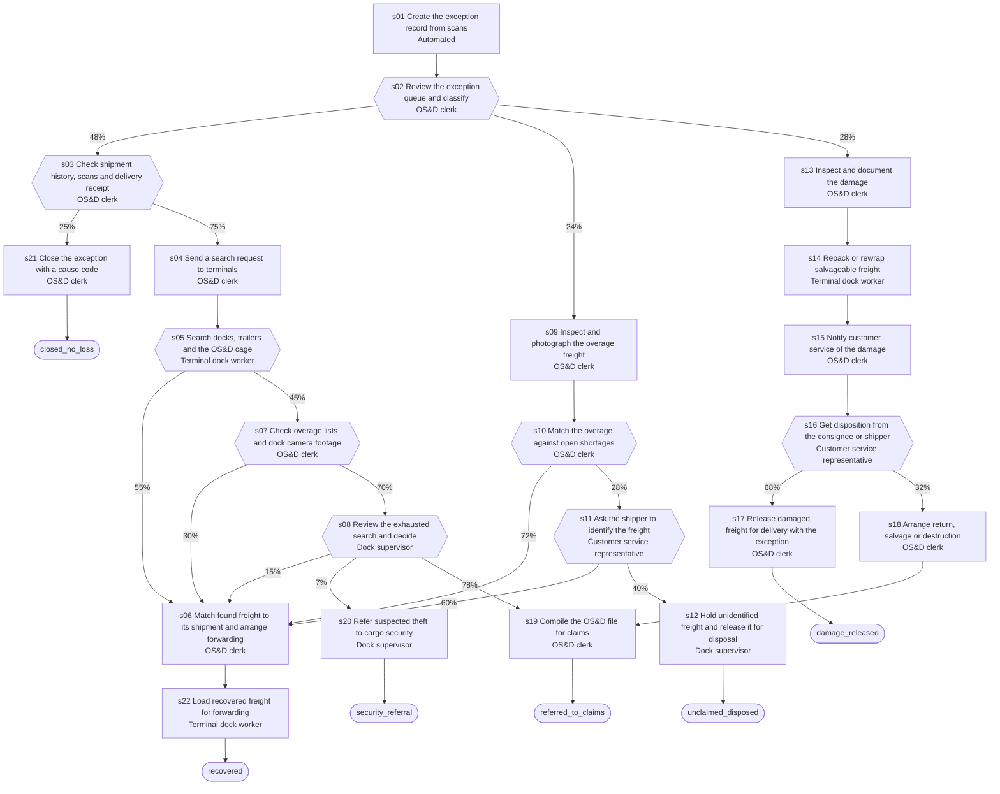

# Resolve overages, shortages and damage (OS&D)

`frt-ltl-osd-exceptions` · trucking and freight transportation · LTL terminal operations · part of `freight-carrier-co`

Every LTL shipment is handled several times across docks and trailers, and some pieces go missing, turn up where they do not belong, or arrive damaged. OS&D clerks at the terminals take each exception from the scan record, trace shortages through the network, match overages to their shipments, inspect and photograph damage, and get instructions from customers through customer service. Searches across several terminals, waiting for shippers to identify freight and thin documentation make cases slow, and unresolved ones become freight claims.

| | |
|---|---|
| Unit of work | one exception |
| Starts when | A scan discrepancy, a damage code, a delivery receipt exception or a trace request creates an OS&D exception in the TMS. |
| Done when | The freight is recovered and forwarded, the exception is closed as a paperwork error, damaged freight is released or returned, or the file is sent to claims or cargo security. |
| Organisation | A Canadian LTL and truckload carrier of about 3,000 employees with 38 LTL terminals, five hub cross-docks, a TMS with handheld scanning and a separate document imaging system. (3,000 employees, 2019-2022) |
| Volume | 3,800 cases a month (range 3,000 to 5,000) |

## Where it sits

- Starts with **osd_report** from ltl-origin-dock (18% of cases)
- Starts with **osd_report** from ltl-hub-crossdock (27% of cases)
- Starts with **osd_report** from ltl-dest-dock (22% of cases)
- Starts with **osd_report** from ltl-delivery-execution (23% of cases)
- Starts with **trace_request** from sls-shipment-tracing (10% of cases)
- Sends **recovered_freight** to ltl-delivery-execution (outcome: recovered)
- Sends **recovered_freight** to ltl-delivery-execution (outcome: damage_released)
- Sends **osd_report** to sls-freight-claims (outcome: damage_released)
- Sends **osd_report** to sls-freight-claims (outcome: referred_to_claims)
- Sends **security_incident** to saf-cargo-security (outcome: security_referral)
- Sends **osd_report** to sls-freight-claims (outcome: security_referral)
- Sends **trace_response** to sls-shipment-tracing (outcome: closed_no_loss)

## Flow

## Roles

| Role | Department | Layer | FTE on this process | Loaded cost per hour | Evidence |
|---|---|---|---:|---:|---|
| OS&D clerk | LTL terminal network | individual contributor | 21 | 33 CAD | B [src-manitoulin-osd] |
| Terminal dock worker | LTL terminal network | individual contributor | 9 | 29 CAD | C |
| Dock supervisor | LTL terminal network | supervisor | 3 | 47 CAD | C |
| Customer service representative | Customer service centre | individual contributor | 5 | 32 CAD | C |

## Steps

Hands-on time and the wait before each step show the most common value. Evidence tier A is a sourced number, B a sourced description, C the author's estimate.

| Step | Who | Kind | Hands-on | Wait before | Control | Evidence |
|---|---|---|---:|---:|---|---|
| **s01 Create the exception record from scans.** The TMS opens an OS&D exception when handheld scans do not match the manifest: pieces short or over at trailer unload, freight with no matching bill (a no-pro), a damage code keyed by a dock worker, a delivery receipt exception keyed at route closeout, or a trace request from customer service with no scan for days. | Automated | system auto | 0 min | 0 min |  | C |
| **s02 Review the exception queue and classify.** The OS&D clerk at the terminal works the exception list at the start of the shift, opens each record, checks the bill of lading image and scan history, and classifies it as a shortage, an overage or damage, assigning it to the right search or inspection path. | OS&D clerk | intake | 4 min | 5.0 h |  | B [src-manitoulin-osd] |
| **s03 Check shipment history, scans and delivery receipt.** For a shortage the clerk follows the shipment through the TMS: piece count on the bill, every scan by terminal and trailer, the delivery receipt and any split-shipment notes. Many shortages turn out to be count errors on the bill, pieces delivered on another stop or a later trailer. | OS&D clerk | lookup | 8 min | 15 min |  | B [src-manitoulin-osd] |
| **s04 Send a search request to terminals.** The clerk sends a shortage notice through the TMS exception board and by email to every terminal and hub the shipment passed through, with the PRO number, piece description, labels and dimensions, asking them to check their docks, trailers and OS&D cages. | OS&D clerk | communication | 5 min | 10 min |  | C |
| **s05 Search docks, trailers and the OS&D cage.** At each terminal a dock worker walks the dock, the OS&D cage and trailers loaded or unloaded around the same time, looking for freight that matches the description, and scans anything found. Searches are fitted between loading and unloading work. | Terminal dock worker | physical | 20 min | 10.0 h |  | C |
| **s06 Match found freight to its shipment and arrange forwarding.** The clerk relabels the found pieces, links them to the PRO in the TMS, closes the shortage and books the pieces onto the next linehaul or city route to the consignee, telling customer service the new delivery date. | OS&D clerk | data entry | 10 min | 30 min |  | B [src-manitoulin-osd] |
| **s07 Check overage lists and dock camera footage.** When the first search fails, the clerk compares the missing pieces with the network list of unmatched overages by description, labels and dimensions, and reviews dock camera footage of the unload and load times to see where the pieces went. | OS&D clerk | analysis | 20 min | 1.0 d |  | B [src-manitoulin-osd] |
| **s08 Review the exhausted search and decide.** After a second round of searches over about a week, the dock supervisor reviews the file, decides that the search is exhausted, or that the pattern (high-value goods, cut shrink-wrap, repeated shortages on one lane) points to theft. | Dock supervisor | review | 10 min | 5.0 d | Carrier OS&D procedure: supervisor sign-off before a shortage is declared and sent to claims | C |
| **s09 Inspect and photograph the overage freight.** For freight on the dock with no matching bill, the clerk reads every label, PRO sticker, purchase order and product marking, measures and weighs it and takes photos so it can be matched to a shipment that is short somewhere in the network. | OS&D clerk | physical | 10 min | 30 min |  | B [src-manitoulin-osd] |
| **s10 Match the overage against open shortages.** The clerk searches the TMS for open shortages and recent shipments from the shipper or to the consignee named on any label, and compares descriptions, weights and dimensions. | OS&D clerk | lookup | 12 min | 20 min |  | C |
| **s11 Ask the shipper to identify the freight.** A customer service representative calls or emails the shipper or consignee named on the labels, sends the photos and asks whether the freight is theirs and which shipment it belongs to. | Customer service representative | communication | 12 min | 1.0 d |  | C |
| **s12 Hold unidentified freight and release it for disposal.** Unidentified freight stays in the OS&D cage; after the holding period the dock supervisor approves sale, donation or disposal and the record is closed. | Dock supervisor | approval | 10 min | 21.0 d | Carrier unclaimed freight policy and bill of lading conditions on undeliverable goods | C |
| **s13 Inspect and document the damage.** The clerk and a dock worker unwrap the damaged pallet or cartons, count damaged and sound units, look for the cause (forklift puncture, load shift, poor packaging, water) and photograph everything for the file. | OS&D clerk | physical | 20 min | 1.0 h |  | C |
| **s14 Repack or rewrap salvageable freight.** A dock worker restacks sound cartons onto a new pallet, shrink-wraps and labels it, and separates units that cannot be delivered. | Terminal dock worker | physical | 20 min | 30 min |  | B [src-manitoulin-osd] |
| **s15 Notify customer service of the damage.** The clerk updates the exception in the TMS with photos and the damage count and emails customer service so the consignee and shipper can be asked what to do with the freight. | OS&D clerk | communication | 6 min | 10 min |  | B [src-manitoulin-osd] |
| **s16 Get disposition from the consignee or shipper.** A customer service representative calls the consignee and shipper, sends the photos and asks whether to deliver as is with the exception noted, return the goods to the shipper or destroy them. | Customer service representative | communication | 10 min | 1.0 d |  | B [src-manitoulin-osd] |
| **s17 Release damaged freight for delivery with the exception.** The clerk sets the shipment back to deliverable in the TMS with the exception code and photos attached, so the driver can note it on the receipt, and sends the file summary to claims for the expected claim. | OS&D clerk | data entry | 6 min | 20 min |  | C |
| **s18 Arrange return, salvage or destruction.** The clerk books a return shipment to the shipper or arranges salvage or destruction as instructed, and records the instruction in the TMS. | OS&D clerk | coordination | 20 min | 1.0 h |  | C |
| **s19 Compile the OS&D file for claims.** The clerk gathers the bill of lading, delivery receipt, scan history, photos, search notes and disposition into the OS&D file in the claims module, so the claims analyst can decide the claim the shipper is expected to file within the bill of lading limits. | OS&D clerk | drafting | 15 min | 1.0 h | Evidence for freight claims: notice within 60 days of delivery and claim within 9 months of shipment under the bill of lading conditions | B [src-dayross-bol], [src-manitoulin-terms] |
| **s20 Refer suspected theft to cargo security.** The dock supervisor writes up the pattern, the camera footage and the shipment value and sends it to the cargo security coordinator, who decides whether to involve police or the insurer. | Dock supervisor | communication | 20 min | 1.0 h | Cargo security program: suspected theft reported to the security coordinator | C |
| **s21 Close the exception with a cause code.** When the freight is accounted for (a count error on the bill, pieces delivered on another stop, a late scan), the clerk records the cause code, tells customer service if a trace is open and closes the exception. | OS&D clerk | data entry | 4 min | 10 min |  | C |
| **s22 Load recovered freight for forwarding.** A dock worker moves the matched pieces to the right door and loads them on the next linehaul trailer or city route, scanning them so tracing shows the freight moving again. | Terminal dock worker | physical | 6 min | 6.0 h |  | C |

## Exceptions

| Exception | Share of cases | What happens |
|---|---:|---|
| Shortage not found | 13% | Two rounds of searches and camera checks fail; the supervisor declares the pieces short and the file goes to claims. |
| Unidentified overage | 3% | Nobody claims the freight; it is held about 30 days and disposed of. |
| Damaged freight returned or destroyed | 9% | The consignee will not take the freight; it is returned or salvaged and the file goes to claims. |
| Suspected theft | 1% | Search pattern points to theft and the case goes to cargo security. |

## Benchmarks

| Metric | Value | Unit | Population | Evidence |
|---|---|---|---|---|
| cycle_time_days | p50 2.5, p90 12 | calendar days from exception record to resolution or claims referral | Canadian LTL terminal OS&D exceptions, 2019-2022 | C |
| cargo_claims_ratio | 0.1 | percent of revenue | Old Dominion Freight Line, fourth quarter 2022 (best-in-class US LTL) | A [src-odfl-q422] |
| claim_notice_limit | 60 | days after delivery for written notice of claim | Canadian LTL bill of lading conditions | A [src-dayross-bol], [src-manitoulin-terms] |

## Pain points

- Searches depend on dock workers at other terminals fitting them between loading work, so requests wait and are repeated. (steps s04, s05, s07; C)
- Overage and shortage lists are kept per terminal or in spreadsheets, so matches across the network are found late or not at all. (steps s07, s10; C)
- Waiting for shippers and consignees to identify freight or give disposition instructions holds cases for days. (steps s11, s16; B [src-manitoulin-osd])
- Thin photos and notes force claims analysts to come back to the terminal weeks later. (steps s13, s19; C)

## Assumptions

- Exception mix is about 48% shortages (including traces with no recent scan), 24% overages and 28% damage; author's estimate.
- About 15-20% of exceptions end in a file sent to claims; with about 3,800 exceptions a month this gives roughly 700 files, close to the 900 freight claims a month in the organisation file, the rest being claims for concealed damage found after delivery.
- terminal-dock-worker is added to this process because dock workers do the searches, repacking and forwarding; the organisation file lists only osd-clerk, dock-supervisor and cs-rep.
- Waits use the clerk's weekday day shift: exceptions raised by night shifts wait for the morning.
- The simulated median (about 1.6 days) is below the 2.5-day estimate in the benchmarks because nearly half of exceptions are found on the first search within a day; the estimate was set before simulation and both are tier C.
- Loaded costs come from the organisation file (wage times 1.30 for hourly staff, 1.35 for salaried).

## Sources

- [src-dayross-bol] [Bill of Lading Terms & Conditions](https://dayross.com/BOLTerms) (Day & Ross, 2026). Canadian LTL bill of lading conditions: written notice of claim within 60 days of delivery (9 months for non-delivery), final claim within 9 months of shipment, liability of CAD 4.41 per kg for Canadian origin, undisclosed dangerous goods may be warehoused at the consignor's expense. Current version; the claim limits match the long-standing provincial uniform conditions.
- [src-manitoulin-terms] [Terms and Conditions](https://manitoulintransport.com/?page_id=88) (Manitoulin Transport, n.d.). Carrier may correct the weight on the bill of lading (III.19); right to open and inspect packages (B.5); notice to consignor and consignee when delivery cannot be made, storage, return after ten days without instructions (III.16-17); 60-day notice and 9-month claim limits; CAD 4.41 per kg liability.
- [src-manitoulin-osd] [OS&D Clerk job posting (Regina, SK)](https://jobs.smartrecruiters.com/ManitoulinGroupOfCompanies/744000085598685-os-d-clerk) (Manitoulin Group of Companies (SmartRecruiters), n.d.). OS&D clerk duties: trace missing freight using POD and bill of lading, track shortages, no-pros and no-goods, call customers about damage, shortages and reroutes, obtain return or redelivery approvals, camera checks for missing freight; weekday day shift 7:00 to 15:30; emails answered within 45 minutes.
- [src-odfl-q422] [Old Dominion Freight Line Reports Fourth Quarter 2022 Earnings Per Diluted Share of $2.92](https://ir.odfl.com/news-events/press-releases/detail/280/old-dominion-freight-line-reports-fourth-quarter-2022/) (Old Dominion Freight Line, 2023). 99% on-time service in the fourth quarter of 2022 with a cargo claims ratio of 0.1%.

Written by claude-opus on 2026-11-24.
