# Plan and dispatch city pickup and delivery routes

`frt-ltl-pd-dispatch` · trucking and freight transportation · LTL terminal operations · part of `freight-carrier-co`

Each terminal's city dispatcher plans the day's pickup and delivery routes: early in the morning they build delivery routes from freight staged overnight and booked appointments, then through the day they slot new pickups into the routes as shippers call them in. The dispatcher balances driver availability and hours, truck size and liftgates, appointment windows and traffic, and re-plans when a truck breaks down, a delivery is refused or a storm closes roads. The terminal operations supervisor approves overtime and cartage help and signs off driver hours, and the drivers themselves inspect their units and check in at the end of the day. Pickups that are unknown in the morning, late calls, driver shortages and winter weather make the work hard to plan.

| | |
|---|---|
| Unit of work | one terminal-day of city routes |
| Starts when | The early dispatcher's shift starts with freight staged overnight, booked delivery appointments and pickups already on the board. |
| Done when | All routes are closed in the TMS, rolled stops are carried to the next day, driver hours are approved and the day's results are posted. |
| Organisation | A Canadian LTL and truckload carrier of about 3,000 employees with 38 terminals, 540 city drivers, a TMS with a route board and handhelds for drivers. (3,000 employees, 2019-2022) |
| Volume | 825 cases a month (range 780 to 870) |

## Where it sits

- Starts with **staged_freight** from ltl-dest-dock (50% of cases)
- Starts with **pickup_request** from ltl-pickup-request (40% of cases)
- Starts with **delivery_appointment** from ltl-appointment-scheduling (10% of cases)
- Relies on **equipment_availability** from mnt-defect-repair (a standing input; it does not start a case)
- Relies on **driver_hire** from saf-driver-onboarding (a standing input; it does not start a case)
- Relies on **labour_schedule** from ltl-dock-labour-scheduling (a standing input; it does not start a case)
- Sends **pd_route** to ltl-pickup-execution (outcome: routes_completed)
- Sends **pd_route** to ltl-delivery-execution (outcome: routes_completed)
- Sends **driver_timecard** to fin-driver-pay (outcome: routes_completed)
- Sends **dvir** to mnt-defect-repair (outcome: routes_completed)
- Sends **terminal_kpi_data** to ltl-terminal-performance (outcome: routes_completed)

## Flow

```mermaid
flowchart TD
    s01["s01 Open the overnight freight and pickup lists<br/>City pickup and delivery dispatcher"]
    s02{{"s02 Check the driver roster<br/>City pickup and delivery dispatcher"}}
    s03["s03 Call in spare drivers or a cartage agent<br/>City pickup and delivery dispatcher"]
    s04["s04 Check truck and trailer availability<br/>City pickup and delivery dispatcher"]
    s05["s05 Build delivery routes on the route board<br/>City pickup and delivery dispatcher"]
    s06{{"s06 Review the route plan with the supervisor<br/>Terminal operations supervisor"}}
    s07["s07 Release route manifests to the dock and drivers<br/>City pickup and delivery dispatcher"]
    s08{{"s08 Do the daily trip inspection<br/>Pickup and delivery driver"}}
    s09["s09 Report the defect and swap the unit<br/>Pickup and delivery driver"]
    s10["s10 Collect manifests and leave the terminal<br/>Pickup and delivery driver"]
    s11["s11 Confirm departures and chase late trucks<br/>City pickup and delivery dispatcher"]
    s12["s12 Insert pickups into routes through the day<br/>City pickup and delivery dispatcher"]
    s13{{"s13 Handle route exceptions<br/>City pickup and delivery dispatcher"}}
    s14["s14 Re-plan for a storm or road closure<br/>Terminal operations supervisor"]
    s15["s15 Notify customer service of storm cancellations<br/>City pickup and delivery dispatcher"]
    s16{{"s16 Check afternoon pickup capacity<br/>City pickup and delivery dispatcher"}}
    s17{{"s17 Approve overtime or roll pickups<br/>Terminal operations supervisor"}}
    s18["s18 Tell customer service which pickups move to tomorrow<br/>City pickup and delivery dispatcher"]
    s19["s19 Run the late-day sweep and sequence returns<br/>City pickup and delivery dispatcher"]
    s20["s20 Check in at the end of the day<br/>Pickup and delivery driver"]
    s21["s21 Reconcile pickups and deliveries<br/>City pickup and delivery dispatcher"]
    s22["s22 Review daily results and approve driver hours<br/>Terminal operations supervisor"]
    s23["s23 Post route results and hours to payroll and reporting<br/>Automated"]
    s01 --> s02
    s02 -->|"75%"| s04
    s02 -->|"25%"| s03
    s03 --> s04
    s04 --> s05
    s05 --> s06
    s06 -->|"85%"| s07
    s06 -->|"15%"| s05
    s07 --> s08
    s08 -->|"94%"| s10
    s08 -->|"6%"| s09
    s09 --> s10
    s10 --> s11
    s11 --> s12
    s12 --> s13
    s13 -->|"96%"| s16
    s13 -->|"4%"| s14
    s14 --> s15
    s15 --> s16
    s16 -->|"70%"| s19
    s16 -->|"30%"| s17
    s17 -->|"50%"| s19
    s17 -->|"50%"| s18
    s18 --> s19
    s19 --> s20
    s20 --> s21
    s21 --> s22
    s22 --> s23
    s23 --> end0
    end0(["routes_completed"])
```

## Roles

| Role | Department | Layer | FTE on this process | Loaded cost per hour | Evidence |
|---|---|---|---:|---:|---|
| City pickup and delivery dispatcher | LTL terminal network | individual contributor | 62 | 39 CAD | C |
| Terminal operations supervisor | LTL terminal network | supervisor | 9 | 54 CAD | C |
| Pickup and delivery driver | LTL terminal network | individual contributor | 52 | 35 CAD | C |

## Steps

Hands-on time and the wait before each step show the most common value. Evidence tier A is a sourced number, B a sourced description, C the author's estimate.

| Step | Who | Kind | Hands-on | Wait before | Control | Evidence |
|---|---|---|---:|---:|---|---|
| **s01 Open the overnight freight and pickup lists.** The early city dispatcher starts around 5 a.m., opens the TMS list of inbound freight unloaded and staged overnight by the destination dock, the delivery appointments booked for today, and the advance and standing pickups already on the board. | City pickup and delivery dispatcher | lookup | 25 min | 0 min |  | B [src-odfl21] |
| **s02 Check the driver roster.** The dispatcher checks who is in today against the labour schedule: vacations, sick calls, drivers who need their off-duty reset, and the spare board. A shortage means calling in spare or casual drivers or asking a cartage agent to take a route. | City pickup and delivery dispatcher | lookup | 15 min | 0 min |  | C |
| **s03 Call in spare drivers or a cartage agent.** The dispatcher phones spare-board and casual drivers in seniority order, or a cartage agent for an outlying route, and waits for call-backs before committing routes. | City pickup and delivery dispatcher | coordination | 20 min | 20 min |  | C |
| **s04 Check truck and trailer availability.** The dispatcher checks which straight trucks, day cabs, pup trailers and liftgate units are out of service in the maintenance system or still at the shop, and which units are needed for downtown, residential or liftgate stops. | City pickup and delivery dispatcher | lookup | 10 min | 0 min |  | C |
| **s05 Build delivery routes on the route board.** The dispatcher groups the day's deliveries by city zone into routes, sequences appointment and time-window stops, matches liftgate and residential stops to the right truck, and leaves each route ending in an area where afternoon pickups are expected. At most terminals this is done with the TMS route board, maps and experience rather than an optimiser. | City pickup and delivery dispatcher | analysis | 1.2 h | 0 min |  | B [src-optym], [src-parcel-pd] |
| **s06 Review the route plan with the supervisor.** The terminal operations supervisor compares the route count with drivers and freight, approves overtime or a cartage agent, and decides whether low-priority freight waits a day. About one plan in seven is sent back for changes. | Terminal operations supervisor | approval | 12 min | 10 min | Terminal policy: supervisor approves overtime, cartage agent use and held freight | C |
| **s07 Release route manifests to the dock and drivers.** The dispatcher releases each route in the TMS so the destination dock can load the trucks in reverse stop order and the manifests appear on the drivers' handhelds or print for drivers still on paper. | City pickup and delivery dispatcher | communication | 15 min | 0 min |  | C |
| **s08 Do the daily trip inspection.** Each driver walks around the assigned truck and trailer, checks brakes, lights, tires, coupling, liftgate and load securement equipment against Schedule 1, and completes the trip inspection report on the handheld or paper. Touch time is the elapsed time; about 14 drivers do this at once at an average terminal. | Pickup and delivery driver | physical | 15 min | 1.0 h | NSC Standard 13 daily trip inspection as adopted by provincial regulation (for example Alberta AR 121/2009, Ontario O. Reg. 199/07) | B [src-ab-nsc] |
| **s09 Report the defect and swap the unit.** A driver who finds a defect records it on the report, tells the dispatcher and the shop, and either waits for a quick fix or takes a spare unit. The dispatcher moves the route's freight if the spare is a different truck. | Pickup and delivery driver | communication | 20 min | 15 min |  | B [src-ab-nsc] |
| **s10 Collect manifests and leave the terminal.** Drivers check that the freight loaded on their truck matches the manifest, sign out, pick up any paper bills or dangerous goods documents and leave the yard. About 14 drivers do this in parallel. | Pickup and delivery driver | coordination | 18 min | 0 min |  | C |
| **s11 Confirm departures and chase late trucks.** The dispatcher watches the yard and the telematics map, follows up trucks still waiting for freight from the dock or for a spare unit, and moves stops between routes when a truck leaves late. | City pickup and delivery dispatcher | coordination | 20 min | 0 min |  | C |
| **s12 Insert pickups into routes through the day.** From mid-morning the dispatcher takes each new pickup from the board, picks the driver whose route is nearest with time and space left, and sends it to the handheld or by phone. Most pickups are not known in the morning and arrive steadily until the cutoff, so this is the dispatcher's main work for six hours. | City pickup and delivery dispatcher | coordination | 5.5 h | 20 min |  | B [src-optym], [src-parcel-pd] |
| **s13 Handle route exceptions.** Through the day the dispatcher deals with breakdowns, refused or closed deliveries, consignees asking for a different time and traffic delays, deciding whether to reassign stops, bring freight back or send another truck. | City pickup and delivery dispatcher | judgment | 50 min | 0 min |  | C |
| **s14 Re-plan for a storm or road closure.** When snow, freezing rain or a highway closure hits, the supervisor decides which routes to pull back, which deliveries to cancel and which shippers to call, and tells customer service. The backlog becomes tomorrow's freight. | Terminal operations supervisor | judgment | 1.0 h | 1.0 h |  | C |
| **s15 Notify customer service of storm cancellations.** The dispatcher sends customer service and the terminal clerks the list of deliveries and pickups that will not run so shippers and consignees can be called. | City pickup and delivery dispatcher | communication | 20 min | 0 min |  | C |
| **s16 Check afternoon pickup capacity.** Around 1 to 2 p.m. the dispatcher compares the pickups still open with the drivers' remaining time and truck space and decides whether the afternoon can be covered. | City pickup and delivery dispatcher | analysis | 10 min | 0 min |  | C |
| **s17 Approve overtime or roll pickups.** The supervisor approves driver overtime, a second sweep by a spare driver or a cartage agent, or agrees that some pickups move to tomorrow. | Terminal operations supervisor | approval | 10 min | 15 min | Terminal policy: overtime and purchased cartage need supervisor approval | C |
| **s18 Tell customer service which pickups move to tomorrow.** The dispatcher sends the clerks the list of rolled pickups so they can call the shippers and change the pickup date. | City pickup and delivery dispatcher | communication | 10 min | 0 min |  | C |
| **s19 Run the late-day sweep and sequence returns.** The dispatcher confirms every assigned pickup has been attempted, watches drivers' on-duty time against the 14-hour limit, and tells the dock supervisor which trucks will come back when and with how much freight so strip doors and dock workers are ready. | City pickup and delivery dispatcher | coordination | 1.0 h | 0 min | Commercial Vehicle Drivers Hours of Service Regulations SOR/2005-313 ss.12-13 and provincial equivalents | B [src-hos] |
| **s20 Check in at the end of the day.** Each driver backs into the assigned strip door, hands in signed delivery receipts and paper bills of lading, reports undelivered freight and any defects found during the day, and submits the day's hours. About 13 drivers check in over 90 minutes. | Pickup and delivery driver | communication | 12 min | 30 min |  | B [src-ab-nsc], [src-hos] |
| **s21 Reconcile pickups and deliveries.** The dispatcher closes every stop in the TMS as done, attempted with a reason, or rolled, checks that undelivered freight is back on the dock with a reason code, and carries open pickups to tomorrow's board. | City pickup and delivery dispatcher | validation | 30 min | 0 min |  | C |
| **s22 Review daily results and approve driver hours.** The terminal operations supervisor reviews stops per hour, missed pickups, late deliveries and overtime for the day, follows up drivers with long or unexplained time, and approves the driver timecards in the TMS. This is often done first thing the next morning. | Terminal operations supervisor | review | 25 min | 20 min | Supervisor approval of hourly driver time before payroll | B [src-parcel-pd] |
| **s23 Post route results and hours to payroll and reporting.** The TMS sends approved driver hours to driver pay, route and stop data to the terminal performance reports, and defect reports to maintenance. | Automated | system auto | 0 min | 0 min |  | C |

## Exceptions

| Exception | Share of cases | What happens |
|---|---:|---|
| Driver shortage | 25% | Sick calls or vacancies leave routes uncovered; the dispatcher calls spares or a cartage agent before building routes. |
| Unit defect at the morning inspection | 6% | A driver finds a defect that keeps the truck in the yard; a spare unit is found and freight may be moved. |
| Storm or road closure | 4% | Snow, freezing rain or a highway closure stops some routes; deliveries and pickups are cancelled and become tomorrow's backlog. |
| Afternoon pickups exceed capacity | 30% | More pickups than drivers can reach before shippers close; overtime, a spare driver or a cartage agent is approved, or pickups roll. |

## Benchmarks

| Metric | Value | Unit | Population | Evidence |
|---|---|---|---|---|
| cycle_time_days | p50 0.72, p90 1.0 | calendar days from the early dispatcher's start to routes posted | Canadian LTL terminal-days, 2019-2022 | C |
| stops_per_route_per_day | low 15, high 20 | pickup and delivery stops per driver-day | North American LTL carriers | B [src-parcel-pd] |
| pd_cost_share_of_revenue | low 12, high 15 | percent of shipment revenue | LTL carriers (US analyst estimate) | B [src-parcel-pd] |

## Pain points

- Most pickups are unknown when routes are built, so afternoon routes backtrack and late calls overload the last hours of the day. (steps s05, s12, s16; B [src-optym], [src-parcel-pd])
- Route building depends on the dispatcher's knowledge of streets, docks and customers rather than an optimiser, so plans vary by dispatcher and are hard to cover when they are away. (steps s05, s12; B [src-optym])
- Driver shortages and unit defects found at 7 a.m. force last-minute re-planning just as trucks should be leaving. (steps s02, s03, s08, s09; C)
- Winter storms and highway closures cancel routes and push a backlog into the following days. (steps s14, s15; C)

## Assumptions

- One case is one terminal-day. Steps done by many drivers at once use people = 14 (540 drivers at about 95% attendance spread over 38 terminals); hubs have far more and small terminals fewer.
- The daily trip inspection and the end-of-day check-in happen once per driver per day, so they are placed here rather than in pickup execution, whose unit is one pickup stop. The organisation file links dvir and driver_timecard from ltl-pickup-execution; this workflow produces them instead.
- Truck occupation on the inspection and departure steps is the sum over all trucks on the terminal-day (about 14 trucks times the step time).
- Labour on the through-day steps (inserting pickups, handling exceptions) is counted for one dispatcher on duty at a time; dispatchers work staggered shifts so the average terminal has about one on the board at any time and hubs have three or four.
- Staffing check: roles state 123 FTE; the hands-on time per terminal-day (about 24 hours across dispatchers, drivers and the supervisor) times 825 terminal-days implies about 155 FTE at 130 hours a month. Drivers' and dispatchers' paid hours are longer than 130, so the true FTE is somewhat lower than the implied figure.

## Sources

- [src-optym] [Solving pickup & delivery planning](https://www.optym.com/blog/solving-pickup-and-delivery-planning) (Optym, 2023). Pickups are not known in advance in most cases, so delivery routes are planned to end in pickup-heavy zones; freight becomes available in waves; none of the large North American LTL carriers fully used a commercial optimisation tool, most relying on in-house AS400 extensions or limited map-based tools.
- [src-parcel-pd] [Insights on LTL Carrier Pickup and Delivery Operations](https://parcelindustry.com/article-3541-Insights-on-LTL-Carrier-Pickup-and-Delivery-Operations.html) (Parcel Industry (Joe Heilig), 2013). Carriers build routes for up to 20 or more stops a day; urban routes 50-60 miles, metro 90-100, peddle 150-200 or more; deliveries are unloaded first and pickups follow, and pickups relayed to the driver during the route cause backtracking; delivery appointments force re-sequencing; carriers track drive time, time at stop and delays; drivers moved from paper manifests to handhelds; key metrics stops per hour, miles per stop, shipments per stop; a 30-minute stop (driving plus time at stop) example; P&D absorbs 12-15% of shipment revenue.
- [src-odfl21] [Old Dominion Freight Line, Inc. Form 10-K for the fiscal year ended December 31, 2021](https://www.sec.gov/Archives/edgar/data/878927/000156459022006303/odfl-10k_20211231.htm) (US Securities and Exchange Commission (EDGAR), 2022). Service centres handle pickup and delivery in their local area; each night they load outbound freight for transport to other service centres; inbound freight arriving in the evening is generally scheduled for next-business-day delivery; LTL weight per shipment 1,571 lb (2021) and 1,614 lb (2020); 12,880 thousand LTL shipments in 2021; 23,663 employees including 11,802 drivers and 5,350 platform (dock) employees.
- [src-hos] [Commercial Vehicle Drivers Hours of Service Regulations (SOR/2005-313)](https://laws-lois.justice.gc.ca/eng/regulations/SOR-2005-313/FullText.html) (Government of Canada, Justice Laws, 2005). s.12: no driving after 13 h driving or 14 h on duty in a day; s.13(3): no driving after 16 h elapsed since the last 8-hour off-duty period; s.81(2) and s.77(3): no daily log or ELD needed for a driver who stays within 160 km of the home terminal and returns there each day to start at least 8 consecutive hours off, if the carrier keeps records of daily on-duty times for 6 months.
- [src-ab-nsc] [Summary of Maintenance and Safety Program Requirements for Alberta-Based Commercial Trucks / Tractors / Trailers](https://www.alberta.ca/system/files/custom_downloaded_images/tr-summary-of-safety-and-maintenance-program-requirements.pdf) (Government of Alberta, Transportation, 2016). Daily trip inspection follows Schedule 1 of NSC Standard 13 Part 2; a trip inspection report records unit, odometer, carrier, location, each defect or no defect, date and time and the inspector's name and signature; a vehicle may not be driven with a major defect; reports kept 6 months; defects seen while driving must be recorded and reported; cargo must be contained, immobilised or secured so it cannot shift or fall (AR 121/2009 s.17(4), NSC Standard 10).

Written by claude-opus on 2026-11-24.
