# Pick up LTL freight from shippers

`frt-ltl-pickup-execution` · trucking and freight transportation · LTL terminal operations · part of `freight-carrier-co`

A city driver collects a shipper's pallets and brings them back to the origin terminal for the evening dock. At the shipper the driver checks in, waits for the freight and a door, checks the bill of lading and any dangerous goods paperwork, counts and inspects the pieces, loads and secures them, labels them with PRO numbers and scans the bill on the handheld. Freight not ready, busy docks, missing paperwork and sites without a dock are the usual delays, and the freight then rides on the truck until the driver returns to the terminal at the end of the route.

| | |
|---|---|
| Unit of work | one pickup stop |
| Starts when | The driver receives a pickup on the morning manifest or from dispatch during the route. |
| Done when | The freight is at a strip door of the origin terminal and the bill is with billing, or the pickup is recorded as attempted for rebooking. |
| Organisation | A Canadian LTL and truckload carrier of about 3,000 employees with 540 city drivers on weekday day shifts, handhelds for pickup scans and bill images. (3,000 employees, 2019-2022) |
| Volume | 100,000 cases a month (range 85,000 to 120,000) |

## Where it sits

- Starts with **pd_route** from ltl-pd-dispatch (100% of cases)
- Relies on **bill_of_lading** from shipper (a standing input; it does not start a case)
- Sends **picked_up_freight** to ltl-origin-dock (outcome: picked_up)
- Sends **bill_of_lading** to fin-freight-bill-entry (outcome: picked_up)
- Sends **pickup_request** to ltl-pd-dispatch (outcome: attempted)

## Flow

```mermaid
flowchart TD
    s01["s01 Receive the pickup on the handheld<br/>Pickup and delivery driver"]
    s02["s02 Drive to the shipper<br/>Pickup and delivery driver"]
    s03["s03 Check in at the shipping office<br/>Pickup and delivery driver"]
    s04{{"s04 Shipper stages the freight and frees a door<br/>Outside party"}}
    s05{{"s05 Decide whether to wait or leave<br/>Pickup and delivery driver"}}
    s06["s06 Position the truck at the door or curb<br/>Pickup and delivery driver"]
    s07{{"s07 Receive and check the bill of lading<br/>Pickup and delivery driver"}}
    s08["s08 Shipper corrects or reprints the bill<br/>Outside party"]
    s09{{"s09 Check for dangerous goods<br/>Pickup and delivery driver"}}
    s10{{"s10 Verify the dangerous goods shipping document<br/>Pickup and delivery driver"}}
    s11{{"s11 Count and inspect the pieces<br/>Pickup and delivery driver"}}
    s12["s12 Note the exception on the bill and photograph it<br/>Pickup and delivery driver"]
    s13{{"s13 Choose the loading method<br/>Pickup and delivery driver"}}
    s14["s14 Load the freight at the dock<br/>Pickup and delivery driver"]
    s15["s15 Load the freight by liftgate<br/>Pickup and delivery driver"]
    s16["s16 Secure the load<br/>Pickup and delivery driver"]
    s17["s17 Sign the bill and label the pieces<br/>Pickup and delivery driver"]
    s18["s18 Scan the labels and photograph the bill<br/>Pickup and delivery driver"]
    s19["s19 Post the pickup to the TMS<br/>Automated"]
    s20["s20 Carry the freight to the terminal<br/>Pickup and delivery driver"]
    s21["s21 Back into a strip door and hand over<br/>Pickup and delivery driver"]
    s22["s22 Match the paper bills to closed pickups<br/>Terminal service clerk"]
    s23["s23 Record the attempted pickup<br/>Pickup and delivery driver"]
    s01 --> s02
    s02 --> s03
    s03 --> s04
    s04 -->|"88%"| s06
    s04 -->|"12%"| s05
    s05 -->|"55%"| s06
    s05 -->|"45%"| s23
    s06 --> s07
    s07 -->|"92%"| s09
    s07 -->|"8%"| s08
    s08 --> s09
    s09 -->|"95%"| s11
    s09 -->|"5%"| s10
    s10 -->|"96%"| s11
    s10 -->|"4%"| s23
    s11 -->|"93%"| s13
    s11 -->|"7%"| s12
    s12 --> s13
    s13 -->|"82%"| s14
    s13 -->|"18%"| s15
    s14 --> s16
    s15 --> s16
    s16 --> s17
    s17 --> s18
    s18 --> s19
    s19 --> s20
    s20 --> s21
    s21 --> s22
    s22 --> end0
    s23 --> end1
    end0(["picked_up"])
    end1(["attempted"])
```

## Roles

| Role | Department | Layer | FTE on this process | Loaded cost per hour | Evidence |
|---|---|---|---:|---:|---|
| Pickup and delivery driver | LTL terminal network | individual contributor | 250 | 35 CAD | C |
| Terminal service clerk | LTL terminal network | individual contributor | 4 | 32 CAD | C |

## Steps

Hands-on time and the wait before each step show the most common value. Evidence tier A is a sourced number, B a sourced description, C the author's estimate.

| Step | Who | Kind | Hands-on | Wait before | Control | Evidence |
|---|---|---|---:|---:|---|---|
| **s01 Receive the pickup on the handheld.** The city driver gets the pickup as part of the morning manifest or as a message from dispatch during the route, and reads the address, ready and closing times, pieces, weight and notes such as liftgate or dangerous goods. | Pickup and delivery driver | intake | 0.5 min | 0 min |  | B [src-parcel-pd] |
| **s02 Drive to the shipper.** The driver finishes the stops ahead of this one and drives to the shipper, usually after the route's deliveries are done. The wait before is the time the pickup sits behind other stops on the route. | Pickup and delivery driver | travel | 7 min | 1.5 h |  | B [src-parcel-pd] |
| **s03 Check in at the shipping office.** The driver parks, goes to the shipping office or window, gives the carrier name and pickup number, and asks which door to use and whether the freight is ready. | Pickup and delivery driver | communication | 1.5 min | 3 min |  | C |
| **s04 Shipper stages the freight and frees a door.** Shipping staff finish wrapping and labelling the pallets, print the bill of lading and free a dock door. About one pickup in eight finds the freight not ready at all. | Outside party | external wait | 0 min | 10 min |  | B [src-apex-tariff] |
| **s05 Decide whether to wait or leave.** The driver asks how long the freight will be and calls the dispatcher, who weighs the other stops and the driver's hours. The driver either waits or leaves and the pickup is rebooked. | Pickup and delivery driver | judgment | 4 min | 0 min |  | C |
| **s06 Position the truck at the door or curb.** The driver backs the trailer into the assigned door and sets the brakes, or parks at the curb for a liftgate pickup where there is no dock. Busy shippers make drivers wait for a door. | Pickup and delivery driver | physical | 1.5 min | 8 min |  | C |
| **s07 Receive and check the bill of lading.** The driver takes the shipper's bill of lading and checks the consignee name and address, number of pieces, weight, description, dangerous goods entries, declared value and special services against the pickup. Missing consignee details, an unreadable bill or a wrong bill-to are the usual problems. | Pickup and delivery driver | validation | 1.5 min | 0 min |  | B [src-apex-tariff] |
| **s08 Shipper corrects or reprints the bill.** The shipping clerk fixes the bill of lading or prints a new one; for small shippers without their own form the driver fills in the carrier's blank bill with them. | Outside party | external wait | 0 min | 10 min |  | C |
| **s09 Check for dangerous goods.** The driver looks for dangerous goods entries on the bill of lading and for hazard class labels or placards on the pieces before accepting them. | Pickup and delivery driver | validation | 0.3 min | 0 min |  | C |
| **s10 Verify the dangerous goods shipping document.** The driver, who holds a TDG training certificate, checks that the shipping document shows the UN number, shipping name, class, packing group, quantity, 24-hour number and the consignor's certification, that pieces are labelled, and that placards come with the freight when needed. An improperly documented shipment is refused. | Pickup and delivery driver | validation | 5 min | 0 min | Transportation of Dangerous Goods Regulations: Part 3 shipping document and Part 6 training certificate | B [src-tdg-sd], [src-tdg-train] |
| **s11 Count and inspect the pieces.** The driver counts pallets and loose pieces against the bill, checks wrapping and labels, and looks for damage. About one pickup in fifteen shows a short count, an overage or visible damage. | Pickup and delivery driver | validation | 1.5 min | 0 min |  | C |
| **s12 Note the exception on the bill and photograph it.** The driver writes the actual count or the damage on both copies of the bill, has the shipper initial it or mark it shipper load and count, and photographs the freight on the handheld so the claim history starts at pickup. | Pickup and delivery driver | data entry | 4 min | 0 min |  | C |
| **s13 Choose the loading method.** Freight at a dock is loaded across the dock plate; freight at a site with no dock comes off the shipper's floor by liftgate and pallet jack. | Pickup and delivery driver | judgment | 0.2 min | 0 min |  | B [src-fedex-pickup] |
| **s14 Load the freight at the dock.** The shipper's forklift operator or the driver with a pallet jack moves the pallets into the trailer; the driver places them in the nose or behind earlier pickups so freight bound for the same terminal stays together and heavy pieces sit on the floor. | Pickup and delivery driver | physical | 4 min | 0 min |  | B [src-apex-tariff] |
| **s15 Load the freight by liftgate.** The driver lowers the liftgate, pulls each pallet onto it with a pallet jack, raises it and pushes the pallet into place, one lift at a time up to the gate's limit. | Pickup and delivery driver | physical | 10 min | 0 min | Company liftgate procedure and provincial occupational health and safety rules for material handling | B [src-apex-tariff] |
| **s16 Secure the load.** The driver sets load bars or straps behind the freight, or against the previous pickup, so nothing shifts or falls when the truck brakes during the rest of the route. | Pickup and delivery driver | physical | 1 min | 0 min | NSC Standard 10 cargo securement as adopted by provincial regulation | B [src-ab-nsc] |
| **s17 Sign the bill and label the pieces.** The driver signs the bill of lading, sticks the pre-printed PRO number labels on each handling unit and on the bill, writes the piece count and time, and leaves the shipper's copy. | Pickup and delivery driver | data entry | 1.5 min | 0 min |  | C |
| **s18 Scan the labels and photograph the bill.** The driver scans the PRO labels and takes a picture of the bill of lading on the handheld, enters pieces and weight, and closes the stop. | Pickup and delivery driver | data entry | 0.8 min | 0 min |  | C |
| **s19 Post the pickup to the TMS.** The handheld sends the pickup completion, pieces and bill image to the TMS and the imaging system; the shipment's status shows as picked up on the customer portal, and the bill joins the billing entry queue. | Automated | system auto | 0 min | 0 min |  | C |
| **s20 Carry the freight to the terminal.** The freight rides on the truck while the driver makes the remaining stops, then the driver drives back to the terminal at the end of the route. Touch time is this pickup's share of the return drive. | Pickup and delivery driver | travel | 3 min | 2.0 h |  | C |
| **s21 Back into a strip door and hand over.** The driver backs into the strip door the dock supervisor assigned, or drops the trailer in the yard when no door is free, and tells the dock which pickups are heavy, damaged or dangerous goods. | Pickup and delivery driver | physical | 1 min | 10 min |  | C |
| **s22 Match the paper bills to closed pickups.** The terminal service clerk takes the driver's paper bills, checks each against a closed pickup in the TMS, chases bills that were not imaged or have no matching pickup, and sends the batch to billing for freight bill entry. | Terminal service clerk | validation | 1 min | 20 min | Revenue control: every picked-up shipment has a bill of lading in billing | C |
| **s23 Record the attempted pickup.** The driver records the attempt with a reason code (freight not ready, shipper closed, documents refused) and a photo where useful; the dispatcher rebooks the pickup and the shipper may be billed an attempted-pickup charge. | Pickup and delivery driver | data entry | 2 min | 0 min |  | B [src-apex-tariff] |

## Exceptions

| Exception | Share of cases | What happens |
|---|---:|---|
| Freight not ready | 12% | The shipper has not finished staging or printing the bill; the driver waits or leaves and the pickup is rebooked (about 5% of pickups end as attempts). |
| Bill of lading missing or incomplete | 8% | The driver waits while the shipper fixes or reprints the bill or fills in the carrier's form. |
| Short, over or damaged at pickup | 7% | The driver notes the exception on the bill and photographs it. |
| Dangerous goods without proper documents | 0% | The driver refuses a DG shipment with an incomplete shipping document or missing labels. |
| No dock at the site | 18% | The driver loads by liftgate and pallet jack, which takes longer. |

## Benchmarks

| Metric | Value | Unit | Population | Evidence |
|---|---|---|---|---|
| cycle_time_days | p50 0.3, p90 0.45 | calendar days from pickup assigned to freight at the terminal door | Canadian LTL pickup stops, 2019-2022 | C |
| driver_time_per_stop | 30 | minutes including driving to the stop | US LTL P&D cost example | B [src-parcel-pd] |
| free_waiting_time | low 15, high 30 | minutes before waiting time is charged, shipments up to 9,999 lb | Canadian LTL tariff | A [src-apex-tariff] |
| weight_per_shipment | 1571 | lb per LTL shipment (2021) | Old Dominion Freight Line | A [src-odfl21] |

## Pain points

- Drivers wait at shippers for freight to be staged and for a door, and the waiting time is rarely billed. (steps s03, s04, s05, s06; B [src-apex-tariff])
- Bills of lading arrive incomplete or handwritten and the driver has to check and fix them at the dock, and paper copies must still be matched and sent to billing. (steps s07, s08, s17, s22; C)
- Attempted pickups waste a stop and push the pickup to another day. (steps s05, s23; B [src-apex-tariff])
- Liftgate pickups at sites without docks take two or three times as long as dock pickups. (steps s15; C)

## Assumptions

- The unit is one pickup stop; a stop carries about 1.5 shipments on average.
- The daily trip inspection and the end-of-day check-in (timecard, defect reports) happen once per driver-day and are modelled in frt-ltl-pd-dispatch, which therefore produces the dvir and driver_timecard that the organisation file attaches to this process.
- Paid time the driver spends waiting at the shipper (steps c, d, f, h) is counted as wait, not touch, so the labour cost per case excludes it; it averages roughly 15 to 20 minutes per pickup and should be added for full driver cost. Truck occupation on those steps does include it.
- Trailer occupation on step t covers the hours the freight rides on the truck during the rest of the route; truck occupation counts only this pickup's share of driving so it is not double counted with other stops.
- Shipper bill of lading is listed as a standing input rather than a trigger because the case starts from dispatch and the bill is handed over during the stop.
- Staffing check: roles state 254 FTE; hands-on time of about 36 minutes per pickup times 100,000 pickups implies about 460 FTE at 130 productive hours a month. City drivers work about 9 to 10 paid hours a day (about 200 hours a month), so the implied headcount on 200 hours is about 300, near the stated 254. The organisation file's 540 city drivers look tight for 100,000 pickups plus the delivery stops.

## Sources

- [src-parcel-pd] [Insights on LTL Carrier Pickup and Delivery Operations](https://parcelindustry.com/article-3541-Insights-on-LTL-Carrier-Pickup-and-Delivery-Operations.html) (Parcel Industry (Joe Heilig), 2013). Carriers build routes for up to 20 or more stops a day; urban routes 50-60 miles, metro 90-100, peddle 150-200 or more; deliveries are unloaded first and pickups follow, and pickups relayed to the driver during the route cause backtracking; delivery appointments force re-sequencing; carriers track drive time, time at stop and delays; drivers moved from paper manifests to handhelds; key metrics stops per hour, miles per stop, shipments per stop; a 30-minute stop (driving plus time at stop) example; P&D absorbs 12-15% of shipment revenue.
- [src-apex-tariff] [Terms and Conditions - Tariff 101 (16th revision, effective April 14, 2025)](https://www.apexltl.com/forms/TARIFF101-20250414.pdf) (Apex LTL (apexltl.com), Canadian LTL carrier, 2025). Canadian domestic LTL rules under provincial conditions of carriage: regular pickup and delivery hours 6:00 AM to 6:00 PM; waiting-time free time on pickups and deliveries by billed weight (1-500 lb 15 min, 501-9,999 lb 30 min, 10,000-19,999 lb 1 h) then $25.25 per 15 min; attempted pickup charge $4.25/cwt, minimum $45; carrier provides only one employee (the driver) per vehicle and the consignor loads large or heavy articles; tailgate service up to 1,500 lb per lift; carrier liability $2.00/lb ($4.41/kg) unless higher value declared on the bill of lading; all shipments subject to re-weigh and measurement audit with a $25 rescale fee per pro; bill of lading changes must be authorised in writing; dangerous goods surcharge and excluded classes.
- [src-fedex-pickup] [Schedule a FedEx Freight pickup](https://www.fedexfreight.com/en-ca/rate-ship/shipping/schedule-pickup) (FedEx Freight Canada, 2026). General cutoff of 3 p.m. for automated pickup requests; online ready time no later than 3 p.m. local; same-day requests after 3 p.m. by phone to customer support or the local service centre; pickups booked same day or up to 10 business days ahead; request needs ready and close times at least 90 minutes apart, weight, number of handling units, package type and special services such as liftgate (no dock means a liftgate is needed); requests by web tool, phone or local service centre.
- [src-tdg-sd] [TDG Bulletin: Shipping document](https://tc.canada.ca/en/dangerous-goods/tdg-bulletin-shipping-documents) (Transport Canada, 2025). The consignor completes the shipping document before the carrier takes possession and a carrier may refuse an improperly documented shipment; road carriers keep a copy within the driver's reach; minimum content is UN number, shipping name, classes, packing group, quantity, number of labelled small containers, 24-hour number and consignor's certification; copies kept 2 years.
- [src-tdg-train] [TDG Bulletin: TDG Training](https://tc.canada.ca/en/dangerous-goods/tdg-bulletin-tdg-training) (Transport Canada, 2019). Anyone who handles, offers or transports dangerous goods must be adequately trained and hold an employer-issued training certificate (TDG Regulations s.6.1) or work under the direct physical supervision of a certified person; road certificates expire after 36 months.
- [src-ab-nsc] [Summary of Maintenance and Safety Program Requirements for Alberta-Based Commercial Trucks / Tractors / Trailers](https://www.alberta.ca/system/files/custom_downloaded_images/tr-summary-of-safety-and-maintenance-program-requirements.pdf) (Government of Alberta, Transportation, 2016). Daily trip inspection follows Schedule 1 of NSC Standard 13 Part 2; a trip inspection report records unit, odometer, carrier, location, each defect or no defect, date and time and the inspector's name and signature; a vehicle may not be driven with a major defect; reports kept 6 months; defects seen while driving must be recorded and reported; cargo must be contained, immobilised or secured so it cannot shift or fall (AR 121/2009 s.17(4), NSC Standard 10).
- [src-odfl21] [Old Dominion Freight Line, Inc. Form 10-K for the fiscal year ended December 31, 2021](https://www.sec.gov/Archives/edgar/data/878927/000156459022006303/odfl-10k_20211231.htm) (US Securities and Exchange Commission (EDGAR), 2022). Service centres handle pickup and delivery in their local area; each night they load outbound freight for transport to other service centres; inbound freight arriving in the evening is generally scheduled for next-business-day delivery; LTL weight per shipment 1,571 lb (2021) and 1,614 lb (2020); 12,880 thousand LTL shipments in 2021; 23,663 employees including 11,802 drivers and 5,350 platform (dock) employees.

Written by claude-opus on 2026-11-24.
