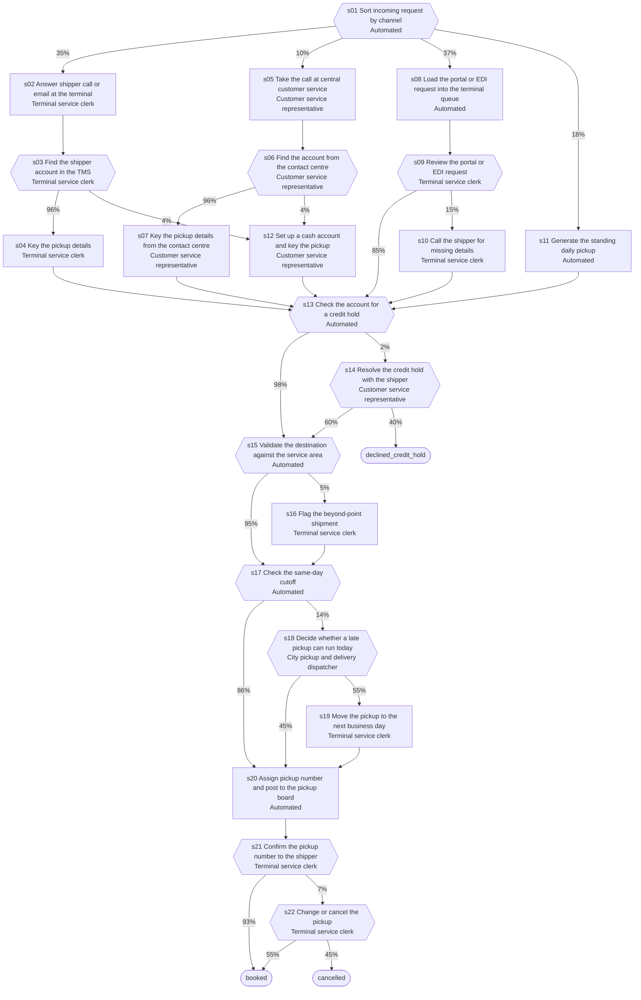

# Take LTL pickup requests

`frt-ltl-pickup-request` · trucking and freight transportation · LTL terminal operations and customer service · part of `freight-carrier-co`

Shippers ask the carrier to collect freight by phoning or emailing the local terminal, calling central customer service, entering a request on the web portal or by EDI, or through a standing daily pickup. A terminal service clerk or customer service representative finds the account, records the ready and closing times, pieces, weight and special needs such as a liftgate, and the TMS checks credit holds, the destination and the same-day cutoff before posting the pickup on the terminal's board for the city dispatcher. Most requests take a few minutes of hands-on work; delays come from late-afternoon calls past the cutoff, portal requests sent overnight, and missing details such as dock hours or a liftgate, which surface later as failed pickups.

| | |
|---|---|
| Unit of work | one pickup request |
| Starts when | A shipper phones, emails, enters a portal or EDI request, or a standing daily pickup order comes due. |
| Done when | The pickup has a confirmation number and sits on the terminal pickup board for its pickup date, or it was declined for credit or cancelled by the shipper. |
| Organisation | A Canadian LTL and truckload carrier of about 3,000 employees with 38 terminals, a central customer service team and a TMS with a customer portal. (3,000 employees, 2019-2022) |
| Volume | 100,000 cases a month (range 85,000 to 120,000) |

## Where it sits

- Starts with **pickup_request** from shipper (100% of cases)
- Relies on **customer_account** from sls-customer-onboarding (a standing input; it does not start a case)
- Relies on **credit_hold** from fin-collections (a standing input; it does not start a case)
- Sends **pickup_request** to ltl-pd-dispatch (outcome: booked)

## Flow

## Roles

| Role | Department | Layer | FTE on this process | Loaded cost per hour | Evidence |
|---|---|---|---:|---:|---|
| Terminal service clerk | LTL terminal network | individual contributor | 32 | 32 CAD | C |
| Customer service representative | Customer service centre | individual contributor | 12 | 32 CAD | C |
| City pickup and delivery dispatcher | LTL terminal network | individual contributor | 1.5 | 39 CAD | C |

## Steps

Hands-on time and the wait before each step show the most common value. Evidence tier A is a sourced number, B a sourced description, C the author's estimate.

| Step | Who | Kind | Hands-on | Wait before | Control | Evidence |
|---|---|---|---:|---:|---|---|
| **s01 Sort incoming request by channel.** The request reaches the carrier by one of four routes: a phone call or email to the local terminal, a call to the central customer service line, a web portal or EDI request, or a standing daily pickup that the shipper set up once. The phone system and the TMS route each one to the right queue without a person touching it. | Automated | system auto | 0 min | 0 min |  | C |
| **s02 Answer shipper call or email at the terminal.** The terminal service clerk picks up the call on the terminal line or opens the email in the shared pickup inbox. They note the caller's company, pickup address and contact, and ask whether this is a new pickup, a change or a trace question. | Terminal service clerk | intake | 1 min | 3 min |  | C |
| **s03 Find the shipper account in the TMS.** The clerk searches the TMS by account number, company name or phone number and checks that the pickup address on file matches. Shippers without an account, such as a one-off or residential shipper, are passed to central customer service to set one up. | Terminal service clerk | lookup | 0.7 min | 0 min |  | C |
| **s04 Key the pickup details.** The clerk types the ready and close times, number of pallets or pieces, weight, dimensions of long or oversized pieces, destination postal code, dangerous goods flag and special services such as liftgate, inside pickup or residential access. These details decide which truck and how much time the dispatcher allows. | Terminal service clerk | data entry | 2 min | 0 min |  | B [src-fedex-pickup], [src-csa-ltl] |
| **s05 Take the call at central customer service.** A customer service representative answers an overflow or toll-free call in the contact centre, identifies the caller and confirms the pickup city and terminal that will serve it. | Customer service representative | intake | 1 min | 2 min |  | C |
| **s06 Find the account from the contact centre.** The representative looks up the account in the TMS and checks the pickup address. Without local knowledge of the shipper's dock they rely on the notes in the account record. | Customer service representative | lookup | 0.7 min | 0 min |  | C |
| **s07 Key the pickup details from the contact centre.** The representative enters the same pickup fields as a terminal clerk: ready and close times, pieces, weight, destination, dangerous goods and special services, then saves the request to the serving terminal's queue. | Customer service representative | data entry | 2 min | 0 min |  | C |
| **s08 Load the portal or EDI request into the terminal queue.** The customer portal or the EDI gateway writes the shipper's request into the TMS and places it in the serving terminal's queue for review. Requests sent in the evening or on weekends wait there until the terminal office opens. | Automated | system auto | 0 min | 0 min |  | C |
| **s09 Review the portal or EDI request.** The clerk opens each queued request and checks that the ready time, closing time, weight and piece count make sense together, that a liftgate is requested where the address has no dock, and that dangerous goods are flagged. Complete requests are released; incomplete ones need a call. | Terminal service clerk | validation | 1 min | 20 min |  | B [src-fedex-pickup] |
| **s10 Call the shipper for missing details.** The clerk phones or emails the shipping contact to get the missing dock hours, liftgate need, piece count or dangerous goods information and updates the request. When nobody answers, the clerk books the pickup with what it has and adds a note for the driver. | Terminal service clerk | communication | 4 min | 45 min |  | C |
| **s11 Generate the standing daily pickup.** Before the office opens, the TMS creates today's pickup for every shipper with a standing daily or weekly pickup order, using the details stored when the order was set up. | Automated | system auto | 0 min | 0 min |  | C |
| **s12 Set up a cash account and key the pickup.** Central customer service creates a prepaid or collect cash account for a shipper without credit, explains that the freight must be prepaid or billed to a consignee with an account, and keys the pickup. | Customer service representative | data entry | 10 min | 30 min |  | C |
| **s13 Check the account for a credit hold.** The TMS compares the account with the collections team's credit hold list and blocks the pickup if the account is over its limit or past due. | Automated | validation | 0 min | 0 min | Company credit policy: no service to accounts on credit hold without collections release | C |
| **s14 Resolve the credit hold with the shipper.** A customer service representative tells the shipper the pickup is on hold and passes the case to collections. The pickup goes ahead once payment or a release is confirmed; otherwise it is cancelled. | Customer service representative | communication | 10 min | 1.0 h |  | C |
| **s15 Validate the destination against the service area.** The TMS checks the destination postal code against the carrier's service-point table and marks shipments that go beyond the network to an interline partner or cartage agent, or to ferry and remote points. | Automated | lookup | 0 min | 0 min |  | C |
| **s16 Flag the beyond-point shipment.** The clerk adds a note to the pickup that the freight moves to an interline partner or cartage agent and tells the shipper about the longer transit time and extra charge. | Terminal service clerk | communication | 3 min | 10 min |  | C |
| **s17 Check the same-day cutoff.** The TMS compares the request time and ready time with the terminal's same-day cutoff, usually 2 or 3 p.m. local time, and with the zone's remaining pickup capacity that the dispatcher has set. | Automated | validation | 0 min | 0 min |  | B [src-fedex-pickup], [src-csa-ltl] |
| **s18 Decide whether a late pickup can run today.** The city dispatcher looks at the route board for a driver near the address with time left before the shipper closes and before the driver's on-duty limit, and accepts or refuses the late pickup. | City pickup and delivery dispatcher | judgment | 2 min | 10 min |  | B [src-fedex-pickup] |
| **s19 Move the pickup to the next business day.** The clerk calls or emails the shipper to say the pickup will run the next business day, changes the pickup date in the TMS and notes any delivery promise that now slips. | Terminal service clerk | communication | 3 min | 10 min |  | C |
| **s20 Assign pickup number and post to the pickup board.** The TMS gives the request a pickup confirmation number and places it on the terminal's pickup board under the city zone for the pickup date, where the dispatcher sees it. | Automated | system auto | 0 min | 0 min |  | C |
| **s21 Confirm the pickup number to the shipper.** For phone and email requests the clerk reads or emails the confirmation number to the shipper; portal and EDI shippers get an automatic confirmation. Some shippers call back before the driver arrives to change the ready time or cancel. | Terminal service clerk | communication | 0.3 min | 0 min |  | C |
| **s22 Change or cancel the pickup.** The clerk opens the pickup, changes the ready time, pieces or special services, or cancels it, and tells the dispatcher if a driver has already been given the stop. | Terminal service clerk | data entry | 2 min | 2.0 h |  | C |

## Exceptions

| Exception | Share of cases | What happens |
|---|---:|---|
| Missing details on a portal or EDI request | 6% | The request lacks dock hours, liftgate or pieces and the clerk has to call the shipper before releasing it. |
| Late request after the same-day cutoff | 14% | The request comes in after 2 or 3 p.m. or the zone is full; the dispatcher accepts about half and the rest move to the next business day. |
| Account on credit hold | 2% | Collections has stopped service; the pickup waits for payment or is cancelled. |
| New shipper without an account | 2% | Customer service sets up a cash account before the pickup is booked. |
| Shipper changes or cancels | 7% | The shipper calls back to change the ready time or cancel; cancellations after the driver has the stop waste route capacity. |

## Benchmarks

| Metric | Value | Unit | Population | Evidence |
|---|---|---|---|---|
| cycle_time_days | p50 0.03, p90 0.5 | calendar days from request received to pickup posted on the board | Canadian LTL pickup requests, all channels, 2019-2022 | C |
| same_day_pickup_cutoff | low 14, high 15 | hour of day, local time | Canadian LTL carriers' published same-day pickup cutoffs | A [src-fedex-pickup], [src-csa-ltl] |
| minimum_pickup_window | 90 | minutes between ready time and close time | FedEx Freight Canada online pickup requests | A [src-fedex-pickup] |

## Pain points

- Requests arrive after the cutoff or with closing times too early for the route, so dispatch rolls them or squeezes them into afternoon routes. (steps s17, s18, s19; B [src-fedex-pickup], [src-csa-ltl])
- Dock hours, liftgate needs and piece counts are often missing or wrong, which shows up only when the driver arrives and causes attempted pickups and rework. (steps s04, s07, s09, s10; B [src-apex-tariff])
- Phone and email requests are re-keyed by hand into the TMS, and the same shipper may call the terminal and customer service for the same pickup, creating duplicates. (steps s02, s04, s05, s07; C)

## Assumptions

- Channel shares (35% phone or email to the terminal, 10% central customer service, 37% portal or EDI, 18% standing daily pickups) are the author's estimates for 2019-2022; no source gave channel shares for Canadian LTL carriers.
- Same-day cutoffs come from two current carrier pages and are assumed to match 2019-2022 practice.
- The case ends when the pickup is on the board for its date; a pickup moved to the next business day counts as booked, and the wait until the next day is not part of this process.
- Credit-hold release time depends on collections; it is modelled as a wait on the customer service step rather than a separate collections step.
- Staffing check: roles state 45.5 FTE, while simulated hands-on time times 100,000 requests implies about 62 FTE at 130 productive hours a month. The gap is within the check's range; clerks on extended-hours shifts work more than 130 hours on the floor, and some terminal clerks shown under other processes (tracing, driver check-in) also take pickup calls at peak.

## Sources

- [src-fedex-pickup] [Schedule a FedEx Freight pickup](https://www.fedexfreight.com/en-ca/rate-ship/shipping/schedule-pickup) (FedEx Freight Canada, 2026). General cutoff of 3 p.m. for automated pickup requests; online ready time no later than 3 p.m. local; same-day requests after 3 p.m. by phone to customer support or the local service centre; pickups booked same day or up to 10 business days ahead; request needs ready and close times at least 90 minutes apart, weight, number of handling units, package type and special services such as liftgate (no dock means a liftgate is needed); requests by web tool, phone or local service centre.
- [src-csa-ltl] [LTL freight shipping](https://www.csatransportation.com/services/ltl-freight-shipping) (CSA Transportation, 2026). Canadian LTL carrier offering same-day pickup for orders placed before 2 PM local time; pickups requested by online form or by converting quotes to pickup requests in the client portal; freight is picked up, consolidated at the nearest terminal with other shipments for the same region, moved on scheduled lanes and delivered.
- [src-apex-tariff] [Terms and Conditions - Tariff 101 (16th revision, effective April 14, 2025)](https://www.apexltl.com/forms/TARIFF101-20250414.pdf) (Apex LTL (apexltl.com), Canadian LTL carrier, 2025). Canadian domestic LTL rules under provincial conditions of carriage: regular pickup and delivery hours 6:00 AM to 6:00 PM; waiting-time free time on pickups and deliveries by billed weight (1-500 lb 15 min, 501-9,999 lb 30 min, 10,000-19,999 lb 1 h) then $25.25 per 15 min; attempted pickup charge $4.25/cwt, minimum $45; carrier provides only one employee (the driver) per vehicle and the consignor loads large or heavy articles; tailgate service up to 1,500 lb per lift; carrier liability $2.00/lb ($4.41/kg) unless higher value declared on the bill of lading; all shipments subject to re-weigh and measurement audit with a $25 rescale fee per pro; bill of lading changes must be authorised in writing; dangerous goods surcharge and excluded classes.

Written by claude-opus on 2026-11-24.
