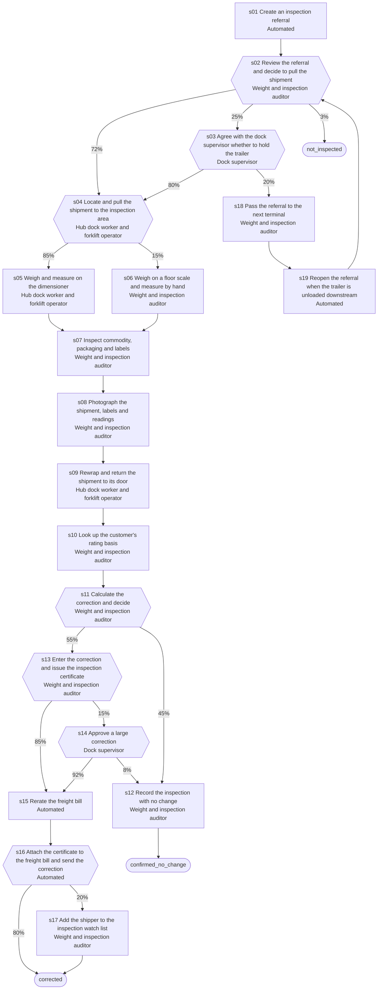

# Reweigh and inspect shipments (W&I)

`frt-ltl-reweigh-inspection` · trucking and freight transportation · LTL terminal operations and revenue protection · part of `freight-carrier-co`

Shippers write the weight, piece count and description on the bill of lading, and many understate weight or describe freight vaguely, which lowers the charges. Weight and inspection auditors at the hubs and large terminals pull flagged shipments, weigh and measure them on a dimensioner or scale, inspect the commodity, photograph it and enter corrections that billing then charges. The work has to fit before the outbound trailer closes, and customers often dispute corrections, so photos and certified readings matter.

| | |
|---|---|
| Unit of work | one inspected shipment |
| Starts when | A dimensioner or scale reading, a vague description, a watch-listed shipper or a manual referral flags the shipment for inspection. |
| Done when | The declared weight and description are confirmed, or a correction with a W&I certificate is sent to billing. |
| Organisation | A Canadian LTL and truckload carrier of about 3,000 employees with 38 LTL terminals, five hub cross-docks, a TMS with handheld scanning and a separate document imaging system. (3,000 employees, 2019-2022) |
| Volume | 12,000 cases a month (range 10,000 to 14,500) |

## Where it sits

- Starts with **wi_referral** from ltl-origin-dock (55% of cases)
- Starts with **wi_referral** from ltl-hub-crossdock (35% of cases)
- Starts with **wi_referral** from fin-freight-bill-entry (10% of cases)
- Sends **reweigh_correction** to fin-billing-corrections (outcome: corrected)

## Flow

## Roles

| Role | Department | Layer | FTE on this process | Loaded cost per hour | Evidence |
|---|---|---|---:|---:|---|
| Weight and inspection auditor | LTL terminal network | individual contributor | 12 | 34 CAD | C |
| Hub dock worker and forklift operator | LTL terminal network | individual contributor | 8 | 30 CAD | C |
| Dock supervisor | LTL terminal network | supervisor | 3 | 47 CAD | C |

## Steps

Hands-on time and the wait before each step show the most common value. Evidence tier A is a sourced number, B a sourced description, C the author's estimate.

| Step | Who | Kind | Hands-on | Wait before | Control | Evidence |
|---|---|---|---:|---:|---|---|
| **s01 Create an inspection referral.** The TMS flags a shipment for weight and inspection when the dimensioner reading or forklift scale weight differs from the bill of lading by more than the tolerance, when the description is vague (freight all kinds, parts, general merchandise), when the shipper is on the watch list, or when a dock worker or billing clerk keys a referral. | Automated | system auto | 0 min | 0 min |  | B [src-lm-2013] |
| **s02 Review the referral and decide to pull the shipment.** The weight and inspection auditor opens the referral, checks the declared weight, pieces and class, the customer's rating basis and the outbound trailer's departure time, and decides whether the shipment is worth pulling before the trailer closes. | Weight and inspection auditor | judgment | 1 min | 1.0 h |  | C |
| **s03 Agree with the dock supervisor whether to hold the trailer.** The auditor asks the dock supervisor whether the outbound door can wait for the inspection. The supervisor weighs the linehaul departure against the revenue at stake and either holds the load or lets the shipment go to be inspected at the next terminal. | Dock supervisor | coordination | 3 min | 10 min |  | C |
| **s04 Locate and pull the shipment to the inspection area.** A dock worker finds the pallets at the inbound door, staging lane or partly loaded trailer and brings them by forklift to the dimensioner or scale area. | Hub dock worker and forklift operator | physical | 4 min | 20 min |  | C |
| **s05 Weigh and measure on the dimensioner.** The forklift sets the pallet in the dimensioning station, which captures length, width, height, weight and an image and sends them to the TMS against the PRO number. | Hub dock worker and forklift operator | physical | 1 min | 5 min | Weights and Measures Act: dimensioning devices used for freight charges are type-approved and inspected by Measurement Canada | B [src-mc-mdmd] |
| **s06 Weigh on a floor scale and measure by hand.** For oversize or irregular freight, or when the dimensioner is down, the auditor weighs the shipment on a certified floor scale and measures each piece with a tape, writing the readings on the inspection form. | Weight and inspection auditor | physical | 6 min | 10 min |  | C |
| **s07 Inspect commodity, packaging and labels.** The auditor reads product labels and markings, opens wrap where needed, counts pieces and compares what is there with the bill of lading description, the freight class claimed and any dangerous goods markings. | Weight and inspection auditor | physical | 3 min | 2 min | Bill of lading conditions giving the carrier the right to open and inspect packages | B [src-manitoulin-terms] |
| **s08 Photograph the shipment, labels and readings.** The auditor photographs each side of the shipment, the labels and the scale or dimensioner display with the handheld so the correction can be defended when the customer disputes it. | Weight and inspection auditor | data entry | 1 min | 0 min |  | C |
| **s09 Rewrap and return the shipment to its door.** A dock worker rewraps any opened pallet, labels it as inspected and takes it back to its outbound door or trailer so the inspection does not make it miss its schedule. | Hub dock worker and forklift operator | physical | 2 min | 2 min |  | C |
| **s10 Look up the customer's rating basis.** At the terminal PC the auditor checks how the customer is rated: by weight, by freight class, by density or under a pricing agreement with its own rules, because this decides whether the new weight or dimensions change the charges. | Weight and inspection auditor | lookup | 1 min | 0 min |  | C |
| **s11 Calculate the correction and decide.** The auditor computes density and rated weight from the measurements, compares them with the bill and decides whether the difference is beyond the tolerance and changes the charges. | Weight and inspection auditor | analysis | 1.5 min | 0 min |  | B [src-lm-2013] |
| **s12 Record the inspection with no change.** The auditor saves the measurements and photos against the PRO with a no-change result, which also tells the watch list that this shipper declared correctly. | Weight and inspection auditor | data entry | 1 min | 0 min |  | C |
| **s13 Enter the correction and issue the inspection certificate.** The auditor enters the corrected weight, dimensions or class in the TMS, attaches the photos and generates the weight and inspection certificate that will go to the customer with the corrected invoice. | Weight and inspection auditor | data entry | 3 min | 0 min | Bill of lading condition allowing the carrier to correct the weight shown on the bill | B [src-manitoulin-terms] |
| **s14 Approve a large correction.** The dock supervisor reviews corrections above the approval threshold or that change the freight class, looks at the photos and readings and approves or rejects them. | Dock supervisor | approval | 3 min | 4.0 h | Carrier approval limit for weight and class corrections | C |
| **s15 Rerate the freight bill.** The rating engine reapplies the customer's tariff or agreement to the corrected weight, dimensions or class and calculates the new charges and the correction amount. | Automated | system auto | 0 min | 30 min |  | C |
| **s16 Attach the certificate to the freight bill and send the correction.** The certificate and photos are filed with the freight bill image and the correction is queued for billing, which either adjusts the invoice before it goes out or issues a corrected invoice. | Automated | system auto | 0 min | 10 min | Measurement records available to the customer for at least 30 days after invoicing when the customer is not present | B [src-mc-mdmd] |
| **s17 Add the shipper to the inspection watch list.** For a shipper with repeated under-declarations the auditor adds the account to the watch list so future shipments are referred automatically, and emails the account executive. | Weight and inspection auditor | data entry | 3 min | 1.0 h |  | C |
| **s18 Pass the referral to the next terminal.** When the trailer leaves before inspection, the auditor forwards the referral to the hub or destination terminal with the reason, so it can be inspected when the trailer is unloaded there. | Weight and inspection auditor | communication | 2 min | 5 min |  | C |
| **s19 Reopen the referral when the trailer is unloaded downstream.** The forwarded referral sits in the TMS until the linehaul trailer arrives and is unloaded at the hub or destination terminal; the unload scan puts it back into that terminal's inspection queue. | Automated | system auto | 0 min | 10.0 h |  | C |

## Exceptions

| Exception | Share of cases | What happens |
|---|---:|---|
| Trailer leaves before inspection | 5% | The supervisor will not hold the outbound door; the referral is forwarded and inspected after linehaul transit at the next terminal. |
| Oversize or irregular freight | 15% | The shipment does not fit the dimensioner and is weighed and measured by hand. |
| Large correction needs approval | 8% | The supervisor reviews the photos and readings before the correction goes to billing. |

## Benchmarks

| Metric | Value | Unit | Population | Evidence |
|---|---|---|---|---|
| cycle_time_days | p50 0.15, p90 0.6 | calendar days from referral to correction sent or inspection closed | Canadian LTL hub and terminal inspections, 2019-2022 | C |
| share_of_shipments_reweighed | 80 | percent of shipments | US LTL carriers, 2013 (unattributed statement in a trade article) | B [src-lm-2013] |
| measurement_record_retention | 30 | days after invoicing | Dimension measuring devices used in trade in Canada | A [src-mc-mdmd] |

## Pain points

- Inspections compete with the linehaul schedule; shipments that cannot be pulled before the trailer closes are inspected later or not at all. (steps s02, s03, s18; C)
- Corrections are disputed by customers, and weak photos or a missing certificate lead to the charge being reversed. (steps s08, s13; B [src-lm-2013])
- Customers rated under different agreements (weight, class, density) make it slow to tell whether a difference changes the charges. (steps s10, s11; C)

## Assumptions

- About 55% of inspections lead to a correction; author's estimate.
- Inspections run mainly at the five hubs and the largest terminals, where the 12 auditors work; at smaller terminals dock supervisors inspect. The hands-on time implies about 20 FTE of auditor-type work for 12,000 inspections a month, more than the 12 auditors in the organisation file, so supervisors and dock workers carry part of it or the inspection count is lower.
- Triggers from the hub cross-dock and from bill entry are added; the organisation file lists only the origin dock.
- Rerating and billing the correction belong to fin-billing-corrections; this workflow ends when the correction is sent.
- Loaded costs come from the organisation file (wage times 1.30 for hourly staff, 1.35 for salaried).

## Sources

- [src-manitoulin-terms] [Terms and Conditions](https://manitoulintransport.com/?page_id=88) (Manitoulin Transport, n.d.). Carrier may correct the weight on the bill of lading (III.19); right to open and inspect packages (B.5); notice to consignor and consignee when delivery cannot be made, storage, return after ten days without instructions (III.16-17); 60-day notice and 9-month claim limits; CAD 4.41 per kg liability.
- [src-lm-2013] [Transportation Best Practices/Trends: ABCs of improving less-than-truckload relations](https://www.logisticsmgmt.com/article/transportation_best_practices_trends_abcs_of_improving_less_than_truckload/Less-Than-Truckload) (Logistics Management (John D. Schulz), 2013). Unattributed statement that carriers re-weigh about 80 percent of shipments because of inaccuracies; analyst view that a 10-pound accuracy threshold is reasonable; carriers increasing the number of bills audited and corrected; customers dispute rebilling.
- [src-mc-mdmd] [Terms and conditions for the approval of multiple dimension measuring devices](https://ised-isde.canada.ca/site/measurement-canada/en/laws-and-requirements/terms-and-conditions-approval-multiple-dimension-measuring-devices) (Measurement Canada, 2017). Approval terms for devices that measure dimensions to calculate freight charges; records kept at least 30 days after invoicing when the customer is not present; sealing of adjustments; field tests within plus or minus one division.

Written by claude-opus on 2026-11-24.
