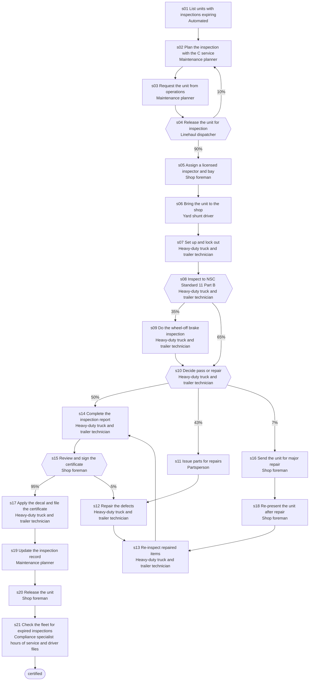

# Carry out periodic mandatory vehicle inspections

`frt-mnt-annual-inspection` · trucking and freight transportation · fleet maintenance · part of `freight-carrier-co`

Every tractor, truck and trailer over 4,500 kg must pass a periodic inspection to the National Safety Code standard every 12 months, done by a licensed technician at a licensed facility, and must carry the certificate and decal. The planner books each unit before its certificate expires, usually together with its annual C service; a licensed technician inspects and measures the brakes and other systems, repairs defects, and the foreman signs the certificate. The hard parts are getting units back to a licensed shop before expiry, keeping brake measurements and certificates complete for audits, and having enough licensed technicians.

| | |
|---|---|
| Unit of work | one periodic inspection of one tractor, truck or trailer |
| Starts when | A unit's inspection certificate is due to expire within the next one to two months. |
| Done when | The unit has passed, carries a new certificate and decal, the record is filed for the facility audit and the expiry date is updated. |
| Organisation | A Canadian LTL and truckload carrier of about 3,000 employees with twelve company maintenance shops at its hubs and larger terminals, about 1,190 company power units and 4,120 trailers. (3,000 employees, 2019-2022) |
| Volume | 445 cases a month (range 400 to 500) |

## Where it sits

- Starts with **pm_schedule** from mnt-preventive-maintenance (100% of cases)
- Sends **work_order** to mnt-defect-repair (outcome: any)
- Sends **inspection_certificate** to saf-facility-audit (outcome: certified)
- Sends **equipment_availability** to ltl-linehaul-dispatch (outcome: certified)
- Sends **equipment_availability** to tl-load-planning (outcome: certified)

## Flow

## Roles

| Role | Department | Layer | FTE on this process | Loaded cost per hour | Evidence |
|---|---|---|---:|---:|---|
| Maintenance planner | Fleet maintenance | individual contributor | 0.9 | 44 CAD | C |
| Linehaul dispatcher | LTL network planning and linehaul control | individual contributor | 0.3 | 43 CAD | C |
| Shop foreman | Fleet maintenance | supervisor | 1.4 | 57 CAD | C |
| Heavy-duty truck and trailer technician | Fleet maintenance | individual contributor | 12 | 46 CAD | B [src-mto21], [src-ab-vip], [src-saaq-pep] |
| Partsperson | Fleet maintenance | individual contributor | 0.3 | 34 CAD | C |
| Yard shunt driver | LTL terminal network | individual contributor | 0.2 | 32 CAD | C |
| Compliance specialist (hours of service and driver files) | Safety, compliance and driver services | individual contributor | 0.2 | 40 CAD | C |

## Steps

Hands-on time and the wait before each step show the most common value. Evidence tier A is a sourced number, B a sourced description, C the author's estimate.

| Step | Who | Kind | Hands-on | Wait before | Control | Evidence |
|---|---|---|---:|---:|---|---|
| **s01 List units with inspections expiring.** At the start of each month the fleet maintenance system produces a list of tractors, trucks and trailers whose annual inspection certificate expires in the next 30 to 60 days, by home shop. | Automated | system auto | 0 min | 3.0 d |  | C |
| **s02 Plan the inspection with the C service.** The maintenance planner matches each expiring unit with its next PM so the inspection is done in the same visit as the annual C service, picks a shop that holds the provincial inspection licence for that vehicle type, and books a day close to the expiry date so the new certificate keeps the cycle. | Maintenance planner | coordination | 8 min | 1.0 d |  | B [src-jjk-pm], [src-mto21] |
| **s03 Request the unit from operations.** The planner emails the dispatcher or driver manager with the unit, the inspection date and the expiry date, stressing that the unit cannot be dispatched after the certificate expires. | Maintenance planner | communication | 3 min | 1.0 h |  | C |
| **s04 Release the unit for inspection.** The dispatcher checks the unit's assignments and agrees a slot. Because an expired unit cannot run, units near expiry get priority, but freight peaks and units away from their home terminal still cause rebooking. | Linehaul dispatcher | judgment | 4 min | 1.0 d |  | C |
| **s05 Assign a licensed inspector and bay.** The foreman assigns the job to a technician who holds a valid inspection licence for the vehicle type and a bay with a pit or hoist, and prints the inspection form or opens the certificate record. | Shop foreman | coordination | 4 min | 2.0 h | Provincial inspection licences: Ontario licensed motor vehicle inspection station and mechanic (HTA Regulation 611); Alberta Vehicle Inspection Regulation (AR 211/2006) facility and technician licences | B [src-mto21], [src-ab-vip] |
| **s06 Bring the unit to the shop.** The shunt driver collects the trailer or tractor from the yard, or from the customer site where a trailer was dropped once it is released, and parks it at the shop. | Yard shunt driver | travel | 10 min | 1.0 h |  | C |
| **s07 Set up and lock out.** The technician moves the unit over the pit or onto the hoist, chocks the wheels, locks out the ignition and drains the air tanks where the procedure requires, so the chassis and brakes can be inspected safely. | Heavy-duty truck and trailer technician | physical | 12 min | 30 min | Shop lockout and vehicle support procedures under provincial occupational health and safety rules | C |
| **s08 Inspect to NSC Standard 11 Part B.** The technician inspects every item in the standard for the vehicle type: brake push-rod stroke, drum and lining thickness, air system and hoses, steering, suspension, frame, coupling devices, lights, tires and wheels, and a visual check of emissions equipment, writing each measurement on the report. | Heavy-duty truck and trailer technician | physical | 1.2 h | 0 min | National Safety Code Standard 11 Part B periodic inspection, adopted by provincial regulation (Ontario HTA Regulation 611, Alberta AR 211/2006) | B [src-mto21], [src-tn-pmvi] |
| **s09 Do the wheel-off brake inspection.** When the unit's wheel-off interval is reached, two technicians pull the wheels and drums on each axle, measure drum and lining wear, check seals and hardware, and refit the wheels to torque. | Heavy-duty truck and trailer technician | physical | 50 min | 0 min |  | B [src-tn-pmvi] |
| **s10 Decide pass or repair.** The technician compares the findings with the reject criteria in the standard and decides whether the unit passes as is, has defects that can be fixed during this visit, or needs a major repair before it can pass. | Heavy-duty truck and trailer technician | judgment | 5 min | 0 min |  | C |
| **s11 Issue parts for repairs.** The partsperson looks up and issues the brake parts, lamps, hoses or air fittings the technician needs, or orders them if not in stock. | Partsperson | lookup | 7 min | 15 min |  | C |
| **s12 Repair the defects.** The technician fixes the defects found: adjusts or replaces slack adjusters and brake chambers, replaces lamps and lenses, repairs air leaks, replaces worn hoses or mud flaps. | Heavy-duty truck and trailer technician | physical | 30 min | 15 min |  | C |
| **s13 Re-inspect repaired items.** The technician re-inspects and re-measures each repaired item against the reject criteria in the standard and records the after-repair values on the inspection report next to the original finding. | Heavy-duty truck and trailer technician | validation | 10 min | 0 min |  | C |
| **s14 Complete the inspection report.** The technician completes the inspection report with all measurements, defects and repairs, enters it in the fleet maintenance system, and completes the provincial certificate (the station's numbered certificate in Ontario, the eFacility record in Alberta). | Heavy-duty truck and trailer technician | data entry | 15 min | 0 min |  | B [src-ab-vip], [src-mto21] |
| **s15 Review and sign the certificate.** The foreman checks the report for completeness, that brake measurements are recorded and repairs are within limits, and that the certificate shows the right unit and plate, then signs it as the station's authorised signer. | Shop foreman | review | 6 min | 1.0 h | Inspection certificate signed by the licensed inspection station or technician (Ontario HTA Regulation 611; Alberta AR 211/2006) | B [src-mto21], [src-ab-vip] |
| **s16 Send the unit for major repair.** For a defect too large to fix during the inspection visit (cracked frame member, worn kingpin, failed suspension), the foreman opens a repair work order, tags the unit out of service and sends it to the repair queue; the inspection resumes when the repair is done. | Shop foreman | coordination | 10 min | 0 min |  | C |
| **s18 Re-present the unit after repair.** When the repair work order is signed off, the foreman puts the unit back on the inspection board for the licensed technician to finish the inspection. | Shop foreman | coordination | 4 min | 2.0 d |  | C |
| **s17 Apply the decal and file the certificate.** The technician fixes the inspection decal to the unit and puts a copy of the certificate in the cab document holder; the original is scanned into the vehicle file. | Heavy-duty truck and trailer technician | physical | 5 min | 0 min |  | B [src-mto21], [src-ab-vip] |
| **s19 Update the inspection record.** The maintenance planner enters the new inspection date and expiry in the fleet maintenance system so the next expiry list is right, and checks that the scanned certificate is attached to the unit record for the facility audit. | Maintenance planner | data entry | 4 min | 4.0 h | Periodic inspection records reviewed in provincial carrier facility audits (NSC Standard 11 Part A, NSC Standard 15) | C |
| **s20 Release the unit.** The foreman sets the unit status to available in the TMS and phones or emails dispatch that the unit has a new certificate and can be assigned to loads again. | Shop foreman | communication | 2 min | 0 min |  | C |
| **s21 Check the fleet for expired inspections.** Each month the compliance specialist compares the active unit list with inspection expiry dates and the scanned certificates, and chases any unit running on an expired certificate or missing a certificate copy. | Compliance specialist (hours of service and driver files) | review | 1 min | 7.0 d |  | C |

## Exceptions

| Exception | Share of cases | What happens |
|---|---:|---|
| Major repair before the unit can pass | 7% | A defect too large to fix in the visit sends the unit to defect repair; the inspection finishes afterwards. |
| Unit away from its home shop at expiry | 10% | Dispatch cannot release the unit, or it is on a long run, and the planner rebooks; some units are parked when their certificate expires. |
| Wheel-off brake inspection due | 35% | Two technicians pull wheels and drums to measure brake wear, adding about an hour. |
| Certificate error | 5% | The foreman finds a missing measurement or wrong unit details and sends the job back. |

## Benchmarks

| Metric | Value | Unit | Population | Evidence |
|---|---|---|---|---|
| cycle_time_days | p50 18, p90 30 | calendar days from expiry list to record verified in the monthly compliance check | Company tractors and trailers at a Canadian carrier, 2019-2022 | C |
| inspection_validity | 12 | months | Ontario and Alberta commercial vehicles over 4,500 kg | A [src-mto21], [src-ab-vip] |

## Pain points

- Units on long runs or held by operations miss their booked slot, so certificates come close to expiry and some units are parked. (steps s04, s02; C)
- Only licensed technicians can inspect, and the diesel technician shortage limits how many inspections a shop can do. (steps s05, s08; B [src-hdt-fact22], [src-ab-vip])
- Brake measurements and certificate details copied by hand are incomplete or wrong, which shows up in audits. (steps s14, s15; B [src-tn-pmvi])

## Assumptions

- Inspection minutes are counted separately from the C service done in the same visit, which is in the preventive maintenance workflow.
- s04 uses the linehaul dispatcher for all operations releases; city dispatchers and truckload driver managers do the same step.
- Quebec units under an SAAQ-recognized PEP follow the same steps with the PEP maintenance sheet in place of a provincial certificate, by mechanics who passed the SAAQ PEP examination.
- The monthly compliance check (s21) is a batch; its wait adds about nine days to the cycle time but nothing to the unit's time off the road, which is about one day.
- The workflow adds equipment availability to dispatch processes as outputs; the organisation file lists only defect repair work orders and certificates for the facility audit.
- The NSC Standard 11 text itself could not be opened; requirements are taken from the MTO, Alberta and Trucknews pages cited.

## Sources

- [src-mto21] [Commercial vehicle safety requirements (archived copy of the MTO page, captured 28 August 2021)](https://bac-lac.wayback.archive-it.org/web/20210828184642/http://www.mto.gov.on.ca/english/trucks/commercial-vehicle-safety-requirements.shtml) (Ontario Ministry of Transportation, via Library and Archives Canada web archive, 2021). Annual inspection of trucks, trailers and converter dollies over 4,500 kg by a licensed motor vehicle inspection mechanic at an MTO-licensed inspection station to NSC Standard 11 Part B as modified by Regulation 611; an annual inspection is valid for 12 months and a sticker is applied; daily trip inspection within 24 hours before driving under Regulation 199/07 with a schedule and a report; minor defects reported to the operator as soon as possible; a vehicle with a major defect may not be driven until repaired; the operator must repair defects immediately or before the next dispatch and keep records of repair.
- [src-ab-vip] [Vehicle Inspection Program - Commercial vehicles](https://www.alberta.ca/vehicle-inspection-program-commercial-vehicles) (Government of Alberta, 2024). All commercial vehicles as defined by the National Safety Code need an annual commercial vehicle inspection (trucks, truck-tractors, semi-trailers and trailers over 4,500 kg registered for extra-provincial operation); inspections are done at private facilities by technicians licensed by Carrier and Vehicle Safety; vehicles must carry a valid inspection certificate and decal under the Vehicle Inspection Regulation (AR 211/2006).
- [src-saaq-pep] [Preventative maintenance program](https://saaq.gouv.qc.ca/en/transportation-goods/preventative-maintenance-program) (Societe de l'assurance automobile du Quebec, 2024). Owners of heavy vehicles (GVWR 4,500 kg or more) may have a preventive maintenance program recognized by the SAAQ instead of submitting vehicles to mandatory periodic mechanical inspection; owners must follow the maintenance interval schedule and fill out and keep maintenance sheets; mechanics working on vehicles of 7,258 kg or more must have passed a preventive maintenance examination recognized by the SAAQ.
- [src-tn-pmvi] [You will be tested on this (revised NSC Standard 11 periodic motor vehicle inspection)](https://www.trucknews.com/transportation/you-will-be-tested-on-this/1003128806) (Trucknews.com, 2015). Most provinces inspect commercial vehicles of 4,500 kg or more every 12 months; the revised standard requires brake stroke and drum and lining thickness to be recorded on the report and limits the time between wheel-off brake inspections (12 months for disc brakes, 24 months for a full drum-removed inspection); adds a visual emissions-system check; Part A gives maintenance program criteria used in carrier audits and Part B the inspection standard; inspections are done by authorized technicians at authorized facilities; US inspections are recognized only by the home province. The page did not show its publication date; the year given is approximate (the article describes adoption planned for late 2015).
- [src-jjk-pm] [Elements of a Successful Preventive Maintenance (PM) Program](https://www.jjkeller.com/learn/preventive-maintenance-program) (J. J. Keller & Associates, 2022). PM A service every 5,000 to 10,000 miles on medium and heavy vehicles (safety check, lubrication, key components), B service every 10,000 to 20,000 miles adding oil and filter change and an ECM download with action on trouble codes, C service normally annual and including the annual inspection; trailers on 3-month, 6-month and annual cycles; inspection lanes and yard checks feed the DVIR process; technicians escalate findings to the maintenance supervisor.
- [src-hdt-fact22] [HDT Fact Book 2022: Trucking fleets focus on preventive maintenance](https://www.truckinginfo.com/10180249/hdt-fact-book-2022-trucking-fleets-focus-on-preventive-maintenance) (Heavy Duty Trucking (truckinginfo.com), 2022). TMC/FleetNet Q4 2021: 42,459 miles between unscheduled repairs, the highest in two years; top five systems about 67% of roadside repairs; ATRI repair and maintenance cost 14.8 US cents per mile in 2020; shortage of diesel technicians.

Written by claude-opus on 2026-11-24.
