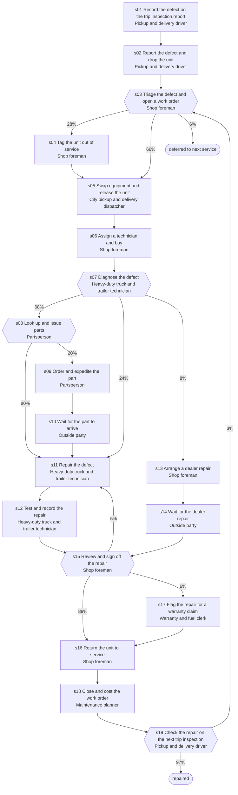

# Repair defects found on trip inspections

`frt-mnt-defect-repair` · trucking and freight transportation · fleet maintenance · part of `freight-carrier-co`

Drivers must inspect their tractor or trailer before each day's driving and report any defect; a unit with a major defect may not be driven until it is fixed, and minor defects must be repaired before the next dispatch. The shop foreman triages each report, dispatch swaps equipment, a technician diagnoses and repairs the defect, and the foreman signs the repair off before the unit goes back to work. Most repairs are short, but units wait for a bay, for spare equipment so the defective one can be released, and above all for parts not in stock, which in 2021 and 2022 could take weeks.

| | |
|---|---|
| Unit of work | one repair work order |
| Starts when | A driver reports a defect on the daily trip inspection report, or another maintenance or safety process sends in a defect. |
| Done when | The defect is repaired, recorded and signed off, the unit is back in service and the next driver has confirmed the repair; or a non-safety item is deferred to the next service. |
| Organisation | A Canadian LTL and truckload carrier of about 3,000 employees with twelve company maintenance shops at its hubs and larger terminals, about 1,190 company power units and 4,120 trailers. (3,000 employees, 2019-2022) |
| Volume | 2,500 cases a month (range 2,100 to 3,100) |

## Where it sits

- Starts with **dvir** from ltl-linehaul-dispatch (15% of cases)
- Starts with **dvir** from tl-trip-execution (25% of cases)
- Starts with **work_order** from mnt-annual-inspection (4% of cases)
- Starts with **work_order** from mnt-roadside-breakdown (8% of cases)
- Starts with **roadside_inspection_report** from saf-roadside-inspections (3% of cases)
- Starts with **work_order** from mnt-preventive-maintenance (15% of cases)
- Starts with **dvir** from ltl-pd-dispatch (30% of cases)
- Relies on **parts_issue** from mnt-parts-inventory (a standing input; it does not start a case)
- Sends **equipment_availability** to ltl-pd-dispatch (outcome: repaired)
- Sends **equipment_availability** to ltl-linehaul-dispatch (outcome: repaired)
- Sends **equipment_availability** to tl-load-planning (outcome: repaired)
- Sends **parts_requisition** to mnt-parts-inventory (outcome: any)
- Sends **warranty_claim** to mnt-warranty-claims (outcome: any)
- Sends **purchase_order** to equipment-dealer (outcome: any)
- Sends **maintenance_record** to saf-facility-audit (outcome: repaired)

## Flow

## Roles

| Role | Department | Layer | FTE on this process | Loaded cost per hour | Evidence |
|---|---|---|---:|---:|---|
| Pickup and delivery driver | LTL terminal network | individual contributor | 1.2 | 35 CAD | C |
| City pickup and delivery dispatcher | LTL terminal network | individual contributor | 1 | 39 CAD | C |
| Shop foreman | Fleet maintenance | supervisor | 6 | 57 CAD | C |
| Heavy-duty truck and trailer technician | Fleet maintenance | individual contributor | 44 | 46 CAD | C |
| Partsperson | Fleet maintenance | individual contributor | 3.5 | 34 CAD | C |
| Warranty and fuel clerk | Fleet maintenance | individual contributor | 0.3 | 35 CAD | C |
| Maintenance planner | Fleet maintenance | individual contributor | 1.4 | 44 CAD | C |

## Steps

Hands-on time and the wait before each step show the most common value. Evidence tier A is a sourced number, B a sourced description, C the author's estimate.

| Step | Who | Kind | Hands-on | Wait before | Control | Evidence |
|---|---|---|---:|---:|---|---|
| **s01 Record the defect on the trip inspection report.** During the pre-trip or post-trip inspection, or when a defect appears en route, the driver writes the defect on the daily inspection report (paper form or the electronic inspection screen on the handheld or ELD), marking it as major or minor against the inspection schedule. | Pickup and delivery driver | data entry | 4 min | 0 min | NSC Standard 13 daily trip inspection as adopted by provinces (Ontario HTA Regulation 199/07) | B [src-mto21] |
| **s02 Report the defect and drop the unit.** The driver tells the dispatcher or shop about the defect: a major defect immediately by phone, a minor one at the end of the shift by handing in the report or leaving it in the shop box. A unit with a major defect is parked; a unit with a minor defect is dropped at the shop or terminal when the run ends. | Pickup and delivery driver | communication | 3 min | 30 min |  | B [src-mto21] |
| **s03 Triage the defect and open a work order.** The shop foreman reads the report, opens a repair work order in the fleet maintenance system, and decides whether the defect is major (unit cannot be driven), a minor safety defect that must be fixed before the next dispatch, or a non-safety item that can wait for the next scheduled service. The foreman sets the priority from the unit's next planned departure. | Shop foreman | judgment | 6 min | 1.0 h | Operator must repair defects before the next dispatch; a vehicle with a major defect may not be driven (Ontario HTA Regulation 199/07, NSC Standard 13) | B [src-mto21] |
| **s04 Tag the unit out of service.** For a major defect the foreman marks the unit out of service in the fleet maintenance system and the TMS, hangs a red tag on the steering wheel, and phones dispatch so that the load is moved to another unit. | Shop foreman | communication | 4 min | 0 min |  | C |
| **s05 Swap equipment and release the unit.** The dispatcher finds a spare tractor, truck or trailer for the next run, re-assigns the load or route in the TMS or route board, and releases the defective unit to the shop. A minor-defect unit waits until it returns from its run or until a spare is free. | City pickup and delivery dispatcher | coordination | 4 min | 2.0 h |  | C |
| **s06 Assign a technician and bay.** The foreman puts the work order on the shift board, matching it to a technician with the right skills (electrical, brakes, engine, trailer) and a free bay, ahead of or behind scheduled PMs depending on priority. | Shop foreman | coordination | 4 min | 2.0 h |  | C |
| **s07 Diagnose the defect.** The technician brings the unit into the bay, locks it out, reproduces the defect, reads fault codes with the diagnostic laptop for engine and electrical faults, and looks up the repair procedure and parts in the service information. The technician notes the cause and parts needed on the work order. | Heavy-duty truck and trailer technician | analysis | 15 min | 15 min | Shop lockout, wheel chocks and support stands under provincial occupational health and safety rules | C |
| **s08 Look up and issue parts.** At the parts counter the partsperson looks up the part number for the unit's make and model, checks bin stock in the fleet maintenance system, and issues the part to the work order, or raises a requisition when it is not in stock. | Partsperson | lookup | 7 min | 10 min |  | C |
| **s09 Order and expedite the part.** The partsperson phones dealers and distributors for availability, raises a purchase order with the one that can deliver soonest, asks for a same-day hot shot when the unit is out of service, and updates the work order with the expected date. | Partsperson | coordination | 15 min | 15 min |  | C |
| **s10 Wait for the part to arrive.** The supplier ships the part on its next delivery run, by courier or by hot shot. In 2021 and 2022 sensors, turbo actuators, water pumps and aftertreatment parts often took weeks. | Outside party | external wait | 0 min | 1.0 d |  | B [src-hdt-parts21] |
| **s11 Repair the defect.** The technician removes and replaces the failed part or makes the adjustment (brake chamber, slack adjuster, air line, light harness, wheel seal, suspension bushing), following the service procedure and torque values. Larger jobs run over more than one shift. | Heavy-duty truck and trailer technician | physical | 40 min | 30 min |  | C |
| **s12 Test and record the repair.** The technician tests the repaired system (air leak-down, brake stroke, light check, short road test for drivability faults), then types the cause, repair, parts and labour time into the work order using the fleet's repair codes. | Heavy-duty truck and trailer technician | data entry | 8 min | 0 min |  | C |
| **s13 Arrange a dealer repair.** For warranty work, engine and aftertreatment faults or jobs the shop cannot do, the foreman phones the dealer, books the repair, issues a purchase order or warranty authorisation, and has a driver or shunt take the unit to the dealer. | Shop foreman | coordination | 20 min | 1.0 h |  | C |
| **s14 Wait for the dealer repair.** The dealer diagnoses and repairs the unit, waiting for its own bay, technician and parts, and calls when the unit is ready to collect. | Outside party | external wait | 0 min | 4.0 d |  | B [src-fo-mack16] |
| **s15 Review and sign off the repair.** The foreman checks the completed work order, confirms that a major defect is repaired before the unit can be dispatched, flags repairs on units still under warranty, and signs off. A repair that did not fix the problem goes back to the technician. | Shop foreman | review | 4 min | 30 min | Records of repair of reported defects (Ontario HTA Regulation 199/07; NSC Standard 11 Part A maintenance records) | B [src-mto21] |
| **s17 Flag the repair for a warranty claim.** The warranty clerk is notified through the work order flag, keeps the failed part tagged with the work order number, and copies the fault codes and repair details into the claim file for the warranty claims process. | Warranty and fuel clerk | data entry | 10 min | 4.0 h |  | C |
| **s16 Return the unit to service.** The foreman clears the out-of-service status in the fleet maintenance system and the TMS and tells dispatch the unit is available, noting the repair on the driver's inspection report so the next driver can see it. | Shop foreman | communication | 3 min | 10 min |  | C |
| **s18 Close and cost the work order.** Each working day the maintenance planner closes signed-off repair work orders, checks that parts issued match the parts on the work order and that labour is coded, posts outside repair invoices against the work order and files the record in the unit history. | Maintenance planner | review | 4 min | 8.0 h |  | C |
| **s19 Check the repair on the next trip inspection.** The next driver to take the unit reads the repair note against the reported defect during the pre-trip inspection and confirms the defect is gone, or writes it up again if it is not. | Pickup and delivery driver | review | 2 min | 0 min |  | C |

## Exceptions

| Exception | Share of cases | What happens |
|---|---:|---|
| Part not in stock | 14% | The partsperson orders and expedites a non-stock part and the unit waits; in 2021-2022 waits of two weeks or more were common for sensors, aftertreatment parts and water pumps. |
| Dealer repair | 8% | Warranty work, engine and aftertreatment faults go to the dealer, adding days of downtime. |
| Comeback | 5% | The repair did not fix the defect and goes back to the technician, or the next driver writes it up again. |
| Non-safety defect deferred | 6% | Items that do not affect safety or compliance (interior trim, a sticking cab door) are deferred to the next PM. |

## Benchmarks

| Metric | Value | Unit | Population | Evidence |
|---|---|---|---|---|
| cycle_time_days | p50 2, p90 7 | calendar days from defect reported to repair confirmed on the next trip | In-house fleet shops at a Canadian LTL and truckload carrier, 2019-2022 | C |
| dealer_repair_downtime_days | 4 | calendar days per repair event at a dealer | US truck dealers, industry average quoted by Mack (2016) | B [src-fo-mack16] |
| share_of_parts_shortage_cases_delayed_over_two_weeks | 0.5 | share of affected fleets reporting delays beyond two weeks | TMC members surveyed, April 2021 | A [src-hdt-parts21] |

## Pain points

- Parts not on the shelf keep units down for days, and for weeks during the 2021-2022 shortages. (steps s09, s10; B [src-hdt-parts21])
- Vague defect descriptions on trip inspection reports make technicians spend time reproducing the problem. (steps s01, s07; C)
- Operations are slow to release units with minor defects because spare equipment is short, so the repair waits for the unit to come back. (steps s05; C)
- Dealer repairs add days of downtime that the shop does not control. (steps s13, s14; B [src-fo-mack16])

## Assumptions

- One step per role: the driver steps use the city P&D driver; linehaul and truckload drivers do the same steps at slightly higher cost. The dispatcher step uses the city dispatcher; linehaul dispatchers and truckload driver managers do the same.
- Trigger shares: about 70% of work orders come from driver trip inspections and the rest from PM findings, breakdown tows, annual inspections and roadside inspections; the split is the author's estimate.
- The workflow adds mnt-preventive-maintenance as a source of repair work orders and equipment-dealer as a receiver of sublet purchase orders; the organisation file has neither link.
- The simulated cycle time includes the daily work order close-out (s18), which does not keep the unit off the road; the time the unit is unavailable is about half a day shorter.
- Roadside inspection defects found by enforcement officers are a small share; most go through the same steps after the safety department passes the report to the shop.
- Organisation file corrected on 2026-11-24: dvir now comes from ltl-pd-dispatch, once per driver-day, as the pickup and delivery workflows record; it previously came from each pickup and delivery stop.

## Sources

- [src-mto21] [Commercial vehicle safety requirements (archived copy of the MTO page, captured 28 August 2021)](https://bac-lac.wayback.archive-it.org/web/20210828184642/http://www.mto.gov.on.ca/english/trucks/commercial-vehicle-safety-requirements.shtml) (Ontario Ministry of Transportation, via Library and Archives Canada web archive, 2021). Annual inspection of trucks, trailers and converter dollies over 4,500 kg by a licensed motor vehicle inspection mechanic at an MTO-licensed inspection station to NSC Standard 11 Part B as modified by Regulation 611; an annual inspection is valid for 12 months and a sticker is applied; daily trip inspection within 24 hours before driving under Regulation 199/07 with a schedule and a report; minor defects reported to the operator as soon as possible; a vehicle with a major defect may not be driven until repaired; the operator must repair defects immediately or before the next dispatch and keep records of repair.
- [src-hdt-parts21] [Parts shortage hobbles new truck deliveries, worsens downtime](https://www.truckinginfo.com/10141744/parts-shortage-hobbles-new-truck-deliveries-worsens-downtime) (Heavy Duty Trucking (truckinginfo.com), 2021). April 2021: more than 43% of TMC members surveyed said parts shortages were affecting maintenance and repair, and more than half of those affected said downtime-related delays stretched beyond two weeks; fleets pre-stocked turbo actuators, water pumps, aftertreatment components and sensors to avoid downtime; tires, rubber parts and semiconductors were short.
- [src-fo-mack16] [Get you in, get you out: Mack targets quicker repairs, more uptime](https://www.fleetowner.com/operations/maintenance/article/21694328/get-you-in-get-you-out-mack-targets-quicker-repairs-more-uptime) (FleetOwner, 2016). Repairs that take about 3.5 hours of technician time cost an industry average of four days of downtime at dealer service locations (Mack's figure).

Written by claude-opus on 2026-11-24.
