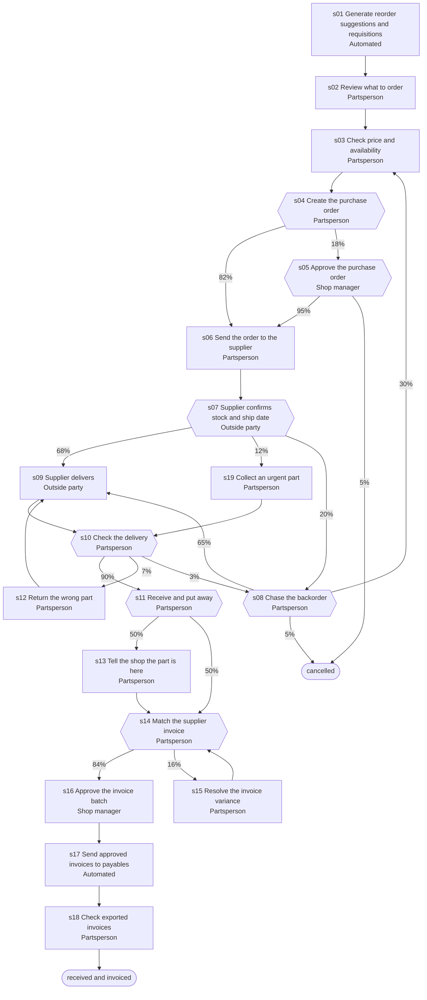

# Buy and stock parts

`frt-mnt-parts-inventory` · trucking and freight transportation · fleet maintenance · part of `freight-carrier-co`

Partspersons in each shop keep filters, brake parts, lamps, hoses and other common parts on the shelf and buy special parts for repair work orders from truck dealers and heavy-duty distributors. Each purchase order is reviewed, priced, placed, chased if backordered, received against the packing slip, put away and matched to the supplier's invoice before payables pays it. Backorders and price changes made this slow in 2021 and 2022, when sensors, aftertreatment parts, water pumps and tires were short and a unit could wait weeks for one part.

| | |
|---|---|
| Unit of work | one purchase order for parts |
| Starts when | Stock falls below its minimum, or a technician's work order needs a part not on the shelf. |
| Done when | The parts are received and in stock or issued to the work order, and the supplier's invoice is matched, approved and in payables; or the order is cancelled. |
| Organisation | A Canadian LTL and truckload carrier of about 3,000 employees with twelve company maintenance shops at its hubs and larger terminals, about 1,190 company power units and 4,120 trailers. (3,000 employees, 2019-2022) |
| Volume | 1,200 cases a month (range 1,000 to 1,450) |

## Where it sits

- Starts with **parts_requisition** from mnt-defect-repair (60% of cases)
- Starts with **parts_requisition** from mnt-preventive-maintenance (30% of cases)
- Starts with **parts_requisition** from mnt-collision-repair (5% of cases)
- Starts with **parts_requisition** from mnt-yard-equipment (5% of cases)
- Relies on **supplier_contract** from exe-procurement (a standing input; it does not start a case)
- Sends **purchase_order** to parts-supplier (outcome: any)
- Sends **purchase_order** to equipment-dealer (outcome: any)
- Sends **parts_issue** to mnt-defect-repair (outcome: received and invoiced)
- Sends **parts_issue** to mnt-preventive-maintenance (outcome: received and invoiced)
- Sends **vendor_invoice** to fin-accounts-payable (outcome: received and invoiced)

## Flow

## Roles

| Role | Department | Layer | FTE on this process | Loaded cost per hour | Evidence |
|---|---|---|---:|---:|---|
| Partsperson | Fleet maintenance | individual contributor | 13 | 34 CAD | C |
| Shop manager | Fleet maintenance | manager | 0.8 | 70 CAD | C |

## Steps

Hands-on time and the wait before each step show the most common value. Evidence tier A is a sourced number, B a sourced description, C the author's estimate.

| Step | Who | Kind | Hands-on | Wait before | Control | Evidence |
|---|---|---|---:|---:|---|---|
| **s01 Generate reorder suggestions and requisitions.** Each night the fleet maintenance system lists stock items that have fallen below their minimum and adds open requisitions for non-stock parts raised on repair and PM work orders during the day. | Automated | system auto | 0 min | 10.0 h |  | C |
| **s02 Review what to order.** The partsperson works through the reorder list and requisitions, checks recent usage and open work orders, removes items that are already on order, adjusts quantities, and cross-references OEM part numbers to approved aftermarket equivalents. | Partsperson | analysis | 6 min | 2.0 h |  | C |
| **s03 Check price and availability.** The partsperson checks contract prices and stock at one to three suppliers by dealer portal, distributor portal or phone, and picks the supplier that has the part at the agreed price and can deliver in time. | Partsperson | lookup | 8 min | 0 min |  | B [src-hdt-parts21] |
| **s04 Create the purchase order.** The partsperson creates the purchase order in the fleet maintenance system with supplier, part numbers, quantities, prices and the work order for special orders; where the system does not pass orders to the ERP, the order is keyed again there. | Partsperson | data entry | 7 min | 0 min |  | C |
| **s05 Approve the purchase order.** The shop manager reviews larger orders (engines, transmissions, bulk stock buys, tire lots) against the budget and the need, and approves or cuts them. | Shop manager | approval | 4 min | 4.0 h | Company purchasing authority limits | C |
| **s06 Send the order to the supplier.** The partsperson sends the order by portal, email or phone, asks for confirmation of stock and ship date, and notes the promised date on the purchase order. | Partsperson | communication | 4 min | 15 min |  | C |
| **s07 Supplier confirms stock and ship date.** The supplier confirms the order and either ships from stock on the next delivery run or reports a backorder with an estimated date. | Outside party | external wait | 0 min | 2.0 h |  | B [src-hdt-parts21] |
| **s08 Chase the backorder.** The partsperson phones the supplier for updated dates, looks for the part at other dealers and distributors, tells the foreman when a unit is waiting, and cancels and re-orders elsewhere when another source is faster. | Partsperson | coordination | 20 min | 3.0 d |  | B [src-hdt-parts21] |
| **s19 Collect an urgent part.** For an out-of-service unit the partsperson drives the parts van to the dealer or distributor counter, collects the part and signs the counter slip. | Partsperson | travel | 40 min | 30 min |  | C |
| **s09 Supplier delivers.** The supplier's route truck, a courier or a hot shot brings the parts to the shop with a packing slip. | Outside party | external wait | 0 min | 12.0 h |  | C |
| **s10 Check the delivery.** The partsperson counts the parts against the packing slip and the purchase order, checks part numbers and looks for damage, and notes any shortage or wrong part. | Partsperson | validation | 6 min | 30 min | Receiving evidence for three-way match of order, receipt and invoice | C |
| **s12 Return the wrong part.** The partsperson asks the supplier for a return authorisation, packs and labels the wrong or damaged part for pickup, and records the expected credit and the replacement order. | Partsperson | coordination | 15 min | 1.0 h |  | C |
| **s11 Receive and put away.** The partsperson posts the receipt against the purchase order in the fleet maintenance system, labels the parts, and puts stock items in their bins or stages special-order parts with the work order number. | Partsperson | data entry | 6 min | 0 min |  | C |
| **s13 Tell the shop the part is here.** For special orders the partsperson tells the foreman or technician that the part for their work order has arrived, and issues it to the work order. | Partsperson | communication | 3 min | 0 min |  | C |
| **s14 Match the supplier invoice.** When the invoice arrives by email, portal or mail, the partsperson matches it to the purchase order and the receipt in the fleet maintenance system, checking quantities, unit prices against the agreed price, core charges and freight. | Partsperson | validation | 6 min | 1.0 d | Three-way match of purchase order, receipt and invoice before payment | C |
| **s15 Resolve the invoice variance.** The partsperson phones or emails the supplier about the difference, asks for a credit memo or a corrected invoice, or accepts the new price when the agreement allows it and records why. | Partsperson | coordination | 15 min | 1.0 d |  | C |
| **s16 Approve the invoice batch.** Once a week the shop manager reviews the matched invoices for the shop, looks at any accepted variances, and approves the batch for payment so the person who ordered is not the only approver. | Shop manager | approval | 2 min | 1.0 d | Invoice approval by a manager other than the buyer (internal control over payables) | C |
| **s17 Send approved invoices to payables.** The fleet maintenance system exports approved invoices with their general ledger and unit coding to the ERP payables module overnight for the next payment run. | Automated | system auto | 0 min | 10.0 h |  | C |
| **s18 Check exported invoices.** The next morning the partsperson checks the export log for invoices the ERP rejected (closed purchase order, unknown supplier number, coding error), fixes them and resends, and files the supplier documents. | Partsperson | review | 2 min | 8.0 h |  | C |

## Exceptions

| Exception | Share of cases | What happens |
|---|---:|---|
| Backorder | 20% | The supplier cannot ship; the partsperson chases and often re-sources from another supplier. In 2021-2022 waits of two weeks or more were common. |
| Urgent pickup | 12% | For an out-of-service unit the partsperson drives to the dealer counter to collect the part. |
| Wrong or damaged part | 7% | The part is returned for credit and a replacement shipped. |
| Invoice variance | 16% | Invoice price, quantity or freight differs from the order and receipt and has to be resolved with the supplier. |

## Benchmarks

| Metric | Value | Unit | Population | Evidence |
|---|---|---|---|---|
| cycle_time_days | p50 7, p90 20 | calendar days from reorder suggestion to invoice accepted by payables | Fleet shop parts purchasing at a Canadian carrier, 2019-2022 | C |
| share_of_fleets_with_parts_shortage_affecting_maintenance | 0.43 | share of TMC members surveyed | US fleets, April 2021 | A [src-hdt-parts21] |

## Pain points

- Backorders in 2021-2022 meant calling several suppliers, re-ordering elsewhere and holding units in the shop for weeks. (steps s07, s08; B [src-hdt-parts21])
- Issues not booked to work orders at the counter make stock records wrong, so automatic reorders are early, late or missed. (steps s01, s11; C)
- Invoice prices often differ from the order price, so matching takes rework with suppliers. (steps s14, s15; C)
- Purchase orders keyed into both the fleet maintenance system and the ERP where the two are not linked. (steps s04; C)

## Assumptions

- Trigger shares split purchase orders by the work that drew the stock down or requested the part; stock replenishment orders are counted against the work that consumed the stock.
- The organisation file lists parts-supplier parts deliveries as a trigger of this process; here a delivery is a step inside each purchase order, not a new case.
- The workflow adds collision repair and yard equipment maintenance as sources of parts requisitions, equipment dealers as receivers of purchase orders for OEM parts, and fin-accounts-payable as the receiver of matched invoices; the organisation file has none of these links and routes parts invoices straight from the supplier to payables.
- Counter issues of parts to work orders, cycle counts and annual stocktakes are not per purchase order and are left out; they take most of the other half of partsperson time.
- Staffing: stated FTE (about 14) is close to hands-on time times volume.

## Sources

- [src-hdt-parts21] [Parts shortage hobbles new truck deliveries, worsens downtime](https://www.truckinginfo.com/10141744/parts-shortage-hobbles-new-truck-deliveries-worsens-downtime) (Heavy Duty Trucking (truckinginfo.com), 2021). April 2021: more than 43% of TMC members surveyed said parts shortages were affecting maintenance and repair, and more than half of those affected said downtime-related delays stretched beyond two weeks; fleets pre-stocked turbo actuators, water pumps, aftertreatment components and sensors to avoid downtime; tires, rubber parts and semiconductors were short.

Written by claude-opus on 2026-11-24.
