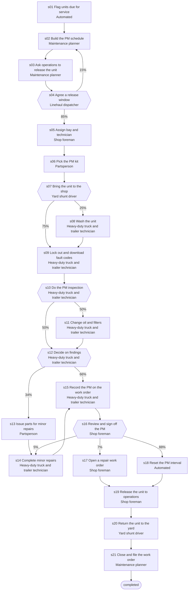

# Perform preventive maintenance on tractors, trucks and trailers

`frt-mnt-preventive-maintenance` · trucking and freight transportation · fleet maintenance · part of `freight-carrier-co`

Every company tractor, city truck and trailer gets a scheduled service when it reaches a mileage, engine-hour or calendar interval. The maintenance planner builds a weekly schedule from the due list, asks dispatch to release each unit, and a technician inspects the brakes, air system, steering, lights and tires, changes oil and filters where due, fixes small defects and records the readings. The work in the bay takes one to three hours; most of the elapsed time is spent waiting for operations to spare the unit and for a bay to come free, and readings typed from paper checklists are a common source of record errors.

| | |
|---|---|
| Unit of work | one preventive maintenance service on one tractor, truck or trailer |
| Starts when | The fleet maintenance system puts a unit on the PM due list when its odometer, engine hours or the calendar reach the service interval. |
| Done when | The service is done, the readings and parts are recorded, the unit is back in operation and the next interval is set; any defect beyond the PM has its own repair work order. |
| Organisation | A Canadian LTL and truckload carrier of about 3,000 employees with twelve company maintenance shops at its hubs and larger terminals, about 1,190 company power units and 4,120 trailers. (3,000 employees, 2019-2022) |
| Volume | 1,200 cases a month (range 950 to 1,600) |

## Where it sits

- Starts with **odometer_data** from ltl-linehaul-dispatch (30% of cases)
- Starts with **odometer_data** from ltl-pd-dispatch (30% of cases)
- Starts with **odometer_data** from tl-trip-execution (40% of cases)
- Relies on **parts_issue** from mnt-parts-inventory (a standing input; it does not start a case)
- Relies on **equipment_unit** from mnt-fleet-acquisition (a standing input; it does not start a case)
- Sends **equipment_availability** to ltl-linehaul-dispatch (outcome: completed)
- Sends **equipment_availability** to ltl-pd-dispatch (outcome: completed)
- Sends **equipment_availability** to tl-load-planning (outcome: completed)
- Sends **pm_schedule** to mnt-annual-inspection (outcome: completed)
- Sends **parts_requisition** to mnt-parts-inventory (outcome: any)
- Sends **tire_record** to mnt-tire-program (outcome: completed)
- Sends **maintenance_record** to saf-facility-audit (outcome: completed)
- Sends **work_order** to mnt-defect-repair (outcome: any)

## Flow

## Roles

| Role | Department | Layer | FTE on this process | Loaded cost per hour | Evidence |
|---|---|---|---:|---:|---|
| Maintenance planner | Fleet maintenance | individual contributor | 2.4 | 44 CAD | C |
| Linehaul dispatcher | LTL network planning and linehaul control | individual contributor | 0.6 | 43 CAD | C |
| Shop foreman | Fleet maintenance | supervisor | 2.6 | 57 CAD | C |
| Partsperson | Fleet maintenance | individual contributor | 1.4 | 34 CAD | C |
| Yard shunt driver | LTL terminal network | individual contributor | 0.9 | 32 CAD | C |
| Heavy-duty truck and trailer technician | Fleet maintenance | individual contributor | 26 | 46 CAD | C |

## Steps

Hands-on time and the wait before each step show the most common value. Evidence tier A is a sourced number, B a sourced description, C the author's estimate.

| Step | Who | Kind | Hands-on | Wait before | Control | Evidence |
|---|---|---|---:|---:|---|---|
| **s01 Flag units due for service.** Each night the fleet maintenance system reads odometer and engine-hour readings passed from the telematics platform and the TMS, compares them and the calendar with each unit's PM interval, and adds units within the due window to the PM due list by shop. | Automated | system auto | 0 min | 12.0 h |  | B [src-jjk-pm] |
| **s02 Build the PM schedule.** The maintenance planner opens the due list, looks up each unit's location and next assignment in the TMS and telematics map, groups units by home terminal and picks a day and shop for each so that bays are loaded evenly. Units overdue or close to their annual inspection are put first. | Maintenance planner | coordination | 8 min | 1.0 d |  | C |
| **s03 Ask operations to release the unit.** The planner emails or phones the dispatcher or driver manager with the unit number, the shop and the time slot, and asks for the unit to be routed to the shop at the end of its run. For trailers, the planner asks for the trailer to be emptied and left at the terminal. | Maintenance planner | communication | 4 min | 1.0 h |  | C |
| **s04 Agree a release window.** The dispatcher checks the unit's planned loads and driver hours in the TMS, decides whether the unit can be spared on the requested day, and either confirms the slot and routes the driver to the shop or proposes another day. Freight peaks and driver shortages are the usual reasons for refusing. | Linehaul dispatcher | judgment | 5 min | 1.0 d |  | C |
| **s05 Assign bay and technician.** The shop foreman looks at the shift board, assigns the PM to a technician and a bay for the agreed slot, and prints the PM checklist for the unit class and level (A, B or C service for tractors, trailer service) from the fleet maintenance system as a work order. | Shop foreman | coordination | 5 min | 4.0 h |  | B [src-jjk-pm] |
| **s06 Pick the PM kit.** The partsperson reads the work order, picks the filters, oil, grease and wear items listed for that engine and PM level, and charges them to the work order in the fleet maintenance system. Missing filters are substituted or ordered. | Partsperson | physical | 10 min | 15 min |  | C |
| **s07 Bring the unit to the shop.** At the agreed time the yard shunt driver collects the trailer or the tractor from the yard, or from a customer site where a trailer was dropped, and parks it at the shop door. Trailers dropped at customers wait until the customer releases them. | Yard shunt driver | travel | 10 min | 1.0 h |  | C |
| **s08 Wash the unit.** A technician or apprentice runs the unit through the wash bay, pressure-washing the chassis, brakes and wheel ends so that cracks, leaks and worn parts can be seen during the inspection. Winter salt and mud make this necessary for about a quarter of units. | Heavy-duty truck and trailer technician | physical | 25 min | 1.0 h |  | C |
| **s09 Lock out and download fault codes.** The technician moves the unit into the bay, chocks the wheels, applies lockout to the ignition, then connects a laptop to the engine computer, downloads active and stored fault codes and notes them on the work order. | Heavy-duty truck and trailer technician | physical | 12 min | 30 min | Shop lockout and wheel-chock procedure under provincial occupational health and safety rules | B [src-jjk-pm] |
| **s10 Do the PM inspection.** The technician works down the checklist: brake stroke and lining, slack adjusters, air system leaks, steering and suspension, lights, coupling devices, tires and tread depth, frame and body, and greases every fitting. Readings are written on the paper checklist. | Heavy-duty truck and trailer technician | physical | 50 min | 0 min |  | B [src-jjk-pm] |
| **s11 Change oil and filters.** For tractor and truck services due an oil change, the technician drains the engine oil, changes the oil, fuel and air filters as listed, takes an oil sample where the fleet runs oil analysis and refills to level. | Heavy-duty truck and trailer technician | physical | 45 min | 0 min |  | B [src-jjk-pm] |
| **s12 Decide on findings.** The technician reviews what the inspection found and decides, under shop rules, which items can be fixed inside the PM (bulbs, mud flaps, air line fittings, brake adjustment) and which need parts or a separate repair order. | Heavy-duty truck and trailer technician | judgment | 5 min | 0 min |  | C |
| **s13 Issue parts for minor repairs.** The technician walks to the parts counter; the partsperson looks up part numbers for the unit in the fleet maintenance system, issues stock to the work order or raises a requisition when the part is not on the shelf. | Partsperson | lookup | 6 min | 10 min |  | C |
| **s14 Complete minor repairs.** The technician replaces the worn items found during the inspection, re-checks the affected system, and notes the parts and time on the checklist. | Heavy-duty truck and trailer technician | physical | 30 min | 15 min |  | C |
| **s15 Record the PM on the work order.** The technician types the checklist results, brake and tread readings, parts used and labour time into the fleet maintenance system, re-keying from the paper checklist, and flags any defect that needs a separate repair. | Heavy-duty truck and trailer technician | data entry | 10 min | 0 min |  | C |
| **s16 Review and sign off the PM.** The shop foreman reads the completed work order against the checklist, checks that brake readings and defects are recorded and that repairs were done, and signs off. Incomplete items go back to the technician; serious defects get their own repair order. | Shop foreman | review | 5 min | 1.0 h | NSC Standard 11 Part A maintenance program records and provincial operator duty to keep records of repair (Ontario HTA Regulation 199/07) | B [src-mto21], [src-tn-pmvi] |
| **s17 Open a repair work order.** The foreman opens a separate repair work order for the defect, sets the unit out of service if the defect is major, and hands it to the defect repair queue. The PM itself is closed as complete. | Shop foreman | data entry | 5 min | 0 min |  | C |
| **s18 Reset the PM interval.** When the work order is signed off, the fleet maintenance system records the service, resets the mileage and calendar counters for the next PM, and updates the unit's annual inspection and tire history. | Automated | system auto | 0 min | 0 min |  | C |
| **s19 Release the unit to operations.** The foreman changes the unit status to available in the TMS or phones the dispatcher, and tells the driver or yard where the unit is parked. | Shop foreman | communication | 3 min | 15 min |  | C |
| **s20 Return the unit to the yard.** The shunt driver moves the serviced trailer or tractor from the shop door to the ready line or to the dock door where it is needed next. | Yard shunt driver | travel | 8 min | 0 min |  | C |
| **s21 Close and file the work order.** Once a week the maintenance planner closes signed-off PM work orders, compares labour hours with the standard for the PM level, follows up overruns with the foreman and files the record in the unit history used for the facility audit. | Maintenance planner | review | 3 min | 1.0 d |  | C |

## Exceptions

| Exception | Share of cases | What happens |
|---|---:|---|
| Unit cannot be spared | 15% | Dispatch refuses the slot because of freight or driver shortages and the planner reschedules; some units go past their interval. |
| Defect found that needs its own repair | 7% | The inspection finds a defect beyond the PM (cracked brake drum, leaking wheel seal, worn kingpin) and the foreman opens a repair work order. |
| Trailer held at a customer | 10% | A drop trailer due for service sits at a customer dock and cannot be collected until it is emptied and released. |
| Incomplete checklist | 5% | The foreman finds a missed item or missing reading and sends the job back to the technician. |

## Benchmarks

| Metric | Value | Unit | Population | Evidence |
|---|---|---|---|---|
| cycle_time_days | p50 6, p90 12 | calendar days from unit flagged due to work order closed | Company tractors and trailers at a Canadian LTL and truckload carrier, 2019-2022 | C |
| pm_a_service_interval | low 5000, high 10000 | miles between A services, medium and heavy vehicles | US practitioner guidance | B [src-jjk-pm] |
| miles_between_unscheduled_roadside_repairs | 42459 | miles | TMC/FleetNet benchmark fleets, Q4 2021 | A [src-hdt-fact22] |

## Pain points

- Operations hold on to units during freight peaks and driver shortages, so PMs slip past their interval and bays sit empty on the planned day. (steps s04, s02; C)
- Readings written on paper checklists are re-keyed into the maintenance system, which loses or mistypes brake and tread readings needed for audits. (steps s10, s15; C)
- Technician shortages leave bays unstaffed on some shifts, so scheduled units wait. (steps s05, s09; B [src-hdt-fact22])

## Assumptions

- One step per role: s04 shows the linehaul dispatcher, but for truckload tractors the driver manager and for city trucks the city dispatcher do the same step at similar cost.
- Touch times average tractor and trailer services: a trailer service takes about one hour in the bay, a tractor B or C service two to three hours.
- The annual inspection is documented in frt-mnt-annual-inspection and is not counted here even when done in the same bay visit.
- Defects found during the PM that need a separate job leave this workflow as a work order for mnt-defect-repair.
- The workflow adds ltl-pd-dispatch as a source of odometer data and tl-load-planning, ltl-pd-dispatch and mnt-defect-repair as receivers; the organisation file lists only linehaul dispatch and truckload trip execution as triggers and only linehaul dispatch as a receiver of equipment availability.
- Monthly volume is set at 950 to 1,600 (mode 1,200) from fleet counts and guide intervals, slightly above the organisation file's mode of 1,100.
- Staffing check: stated FTE (about 34) is close to the 37 implied by hands-on time times volume; technicians also do defect repairs, annual inspections, tires and collision work outside this workflow.

## Sources

- [src-jjk-pm] [Elements of a Successful Preventive Maintenance (PM) Program](https://www.jjkeller.com/learn/preventive-maintenance-program) (J. J. Keller & Associates, 2022). PM A service every 5,000 to 10,000 miles on medium and heavy vehicles (safety check, lubrication, key components), B service every 10,000 to 20,000 miles adding oil and filter change and an ECM download with action on trouble codes, C service normally annual and including the annual inspection; trailers on 3-month, 6-month and annual cycles; inspection lanes and yard checks feed the DVIR process; technicians escalate findings to the maintenance supervisor.
- [src-mto21] [Commercial vehicle safety requirements (archived copy of the MTO page, captured 28 August 2021)](https://bac-lac.wayback.archive-it.org/web/20210828184642/http://www.mto.gov.on.ca/english/trucks/commercial-vehicle-safety-requirements.shtml) (Ontario Ministry of Transportation, via Library and Archives Canada web archive, 2021). Annual inspection of trucks, trailers and converter dollies over 4,500 kg by a licensed motor vehicle inspection mechanic at an MTO-licensed inspection station to NSC Standard 11 Part B as modified by Regulation 611; an annual inspection is valid for 12 months and a sticker is applied; daily trip inspection within 24 hours before driving under Regulation 199/07 with a schedule and a report; minor defects reported to the operator as soon as possible; a vehicle with a major defect may not be driven until repaired; the operator must repair defects immediately or before the next dispatch and keep records of repair.
- [src-tn-pmvi] [You will be tested on this (revised NSC Standard 11 periodic motor vehicle inspection)](https://www.trucknews.com/transportation/you-will-be-tested-on-this/1003128806) (Trucknews.com, 2015). Most provinces inspect commercial vehicles of 4,500 kg or more every 12 months; the revised standard requires brake stroke and drum and lining thickness to be recorded on the report and limits the time between wheel-off brake inspections (12 months for disc brakes, 24 months for a full drum-removed inspection); adds a visual emissions-system check; Part A gives maintenance program criteria used in carrier audits and Part B the inspection standard; inspections are done by authorized technicians at authorized facilities; US inspections are recognized only by the home province. The page did not show its publication date; the year given is approximate (the article describes adoption planned for late 2015).
- [src-hdt-fact22] [HDT Fact Book 2022: Trucking fleets focus on preventive maintenance](https://www.truckinginfo.com/10180249/hdt-fact-book-2022-trucking-fleets-focus-on-preventive-maintenance) (Heavy Duty Trucking (truckinginfo.com), 2022). TMC/FleetNet Q4 2021: 42,459 miles between unscheduled repairs, the highest in two years; top five systems about 67% of roadside repairs; ATRI repair and maintenance cost 14.8 US cents per mile in 2020; shortage of diesel technicians.

Written by claude-opus on 2026-11-24.
