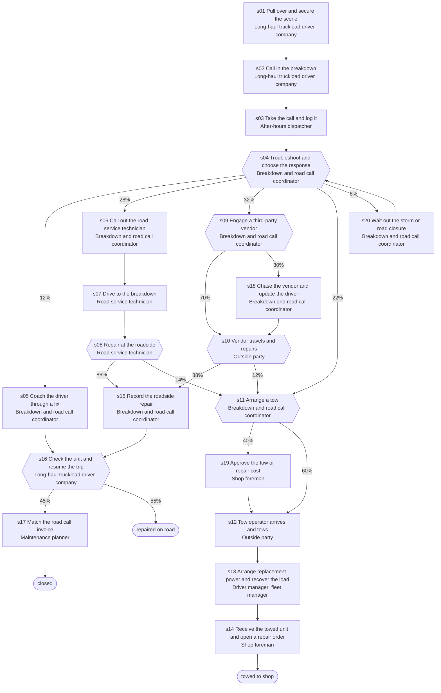

# Respond to roadside breakdowns

`frt-mnt-roadside-breakdown` · trucking and freight transportation · fleet maintenance · part of `freight-carrier-co`

When a tractor or trailer breaks down on the highway, the driver secures the scene and calls in, and the maintenance breakdown desk decides within minutes whether the driver can fix it, a company road technician or a contracted mobile repair or tire service should go, or the unit must be towed. Most calls are tires, brakes, lights, hoses and engine cooling faults fixed in about an hour once help arrives; the time is lost waiting for help to reach the unit, especially at night, in winter and on remote highways. A tow also means finding replacement power to recover the load and telling the customer it will be late.

| | |
|---|---|
| Unit of work | one breakdown call |
| Starts when | A driver phones in a breakdown on the road. |
| Done when | The unit is running again, or towed to a shop with a repair work order open, and any vendor or tow invoice is matched and passed to payables. |
| Organisation | A Canadian LTL and truckload carrier of about 3,000 employees with twelve company maintenance shops at its hubs and larger terminals, about 1,190 company power units and 4,120 trailers. (3,000 employees, 2019-2022) |
| Volume | 300 cases a month (range 240 to 380) |

## Where it sits

- Starts with **breakdown_call** from tl-trip-execution (60% of cases)
- Starts with **breakdown_call** from ltl-linehaul-dispatch (40% of cases)
- Sends **work_order** to mnt-defect-repair (outcome: any)
- Sends **tow_request** to tow-operator (outcome: any)
- Sends **vendor_invoice** to fin-accounts-payable (outcome: closed)
- Sends **equipment_availability** to tl-load-planning (outcome: any)

## Flow

## Roles

| Role | Department | Layer | FTE on this process | Loaded cost per hour | Evidence |
|---|---|---|---:|---:|---|
| Long-haul truckload driver (company) | Truckload fleet operations | individual contributor | 0.4 | 37 CAD | C |
| After-hours dispatcher | Truckload fleet operations | individual contributor | 0.25 | 41 CAD | C |
| Breakdown and road call coordinator | Fleet maintenance | individual contributor | 2.6 | 43 CAD | C |
| Road service technician | Fleet maintenance | individual contributor | 1.8 | 48 CAD | C |
| Shop foreman | Fleet maintenance | supervisor | 0.3 | 57 CAD | C |
| Driver manager (fleet manager) | Truckload fleet operations | individual contributor | 0.4 | 43 CAD | C |
| Maintenance planner | Fleet maintenance | individual contributor | 0.3 | 44 CAD | C |

## Steps

Hands-on time and the wait before each step show the most common value. Evidence tier A is a sourced number, B a sourced description, C the author's estimate.

| Step | Who | Kind | Hands-on | Wait before | Control | Evidence |
|---|---|---|---:|---:|---|---|
| **s01 Pull over and secure the scene.** When a warning light, loss of power, air leak or tire failure occurs, the driver pulls onto the shoulder or the nearest safe place, switches on the hazard lights, sets out warning triangles behind the unit and checks the problem. | Long-haul truckload driver (company) | physical | 10 min | 0 min | Provincial highway traffic rules requiring warning devices around a disabled commercial vehicle | C |
| **s02 Call in the breakdown.** The driver phones the dispatch or breakdown line and gives the unit number, location (highway, nearest exit or kilometre marker), the symptoms and the dashboard codes, the load and its delivery time, and whether the unit is in a safe place. | Long-haul truckload driver (company) | communication | 8 min | 0 min |  | C |
| **s03 Take the call and log it.** The dispatcher opens the trip in the TMS, notes the breakdown and location against the load, checks the delivery appointment and the driver's remaining hours, and transfers the call to the maintenance breakdown desk. | After-hours dispatcher | intake | 5 min | 5 min |  | C |
| **s04 Troubleshoot and choose the response.** The road call coordinator talks the driver through checks, reads live fault codes and location from the telematics platform, looks up the unit's warranty and repair history, and decides whether the driver can fix it, a company road technician should go, a third-party mobile repair or tire service should be called, or the unit must be towed. | Breakdown and road call coordinator | judgment | 15 min | 10 min |  | B [src-fw-tmc20], [src-fo-tmc19] |
| **s05 Coach the driver through a fix.** The coordinator talks the driver through a simple fix (resetting a fault, reconnecting an air or electrical line, replacing a fuse or bulb, regenerating the particulate filter) and confirms the warning has cleared. | Breakdown and road call coordinator | communication | 15 min | 0 min |  | C |
| **s06 Call out the road service technician.** The coordinator phones the on-call road service technician, gives the location, symptoms and likely parts, and agrees an arrival time with the driver. | Breakdown and road call coordinator | coordination | 6 min | 5 min |  | C |
| **s07 Drive to the breakdown.** The road service technician loads likely parts on the service truck and drives to the unit, often at night and in winter conditions on highways near the terminal. | Road service technician | travel | 1.0 h | 30 min |  | C |
| **s08 Repair at the roadside.** Wearing high-visibility gear and using the truck's beacons for traffic protection, the technician diagnoses and repairs the fault on the shoulder: replaces a hose, belt, air line, lamp or tire, or makes a temporary repair that lets the unit reach a shop. | Road service technician | physical | 1.0 h | 0 min | Roadside work-zone protection under provincial occupational health and safety and highway traffic rules | B [src-fw-tmc20] |
| **s09 Engage a third-party vendor.** The coordinator calls mobile repair or tire service vendors near the location from the approved vendor list, compares arrival times and rates, gives the vendor a purchase order number and passes the arrival time to the driver. | Breakdown and road call coordinator | coordination | 20 min | 0 min |  | C |
| **s18 Chase the vendor and update the driver.** The coordinator phones the vendor for an updated arrival time, tries another vendor if the first cannot come, and keeps the driver and the dispatcher informed so the delivery appointment can be moved. | Breakdown and road call coordinator | coordination | 10 min | 1.0 h |  | C |
| **s10 Vendor travels and repairs.** The vendor drives to the unit and repairs it on the shoulder, most often a tire, brake, light or hose; the vendor's time is billed to the carrier. | Outside party | external wait | 0 min | 3.0 h |  | B [src-fw-tmc20], [src-hdt-uptime21] |
| **s11 Arrange a tow.** The coordinator chooses a heavy-tow operator that covers the area, agrees the rate and the destination (the nearest company shop or the dealer for warranty work), and tells the driver what to expect. | Breakdown and road call coordinator | coordination | 15 min | 5 min |  | B [src-fw-tmc20] |
| **s19 Approve the tow or repair cost.** The on-call shop foreman reviews the tow quote or repair estimate against the unit's value and warranty and approves it or asks the coordinator to find a cheaper option. | Shop foreman | approval | 5 min | 15 min | Company spending authority limits for road calls and tows | C |
| **s12 Tow operator arrives and tows.** The tow operator travels to the unit, often far from town and in winter weather, hooks up the tractor or the combination and tows it to the shop or dealer. | Outside party | external wait | 0 min | 5.0 h |  | C |
| **s13 Arrange replacement power and recover the load.** While the unit is towed, the driver manager finds a spare tractor or another driver to recover the trailer and finish the delivery, re-plans the driver's next load, and has customer service tell the consignee the new arrival time. | Driver manager (fleet manager) | coordination | 30 min | 0 min |  | C |
| **s14 Receive the towed unit and open a repair order.** The shop foreman checks the towed unit in, records its condition and opens a repair work order for the defect repair queue, attaching the coordinator's notes and fault codes. | Shop foreman | data entry | 10 min | 1.0 h |  | C |
| **s15 Record the roadside repair.** The coordinator records what was done, the parts, the vendor or technician time and the purchase order in the fleet maintenance system, and opens a follow-up work order when the fix was temporary. | Breakdown and road call coordinator | data entry | 6 min | 15 min |  | C |
| **s16 Check the unit and resume the trip.** The driver walks around the unit, checks that the warning has cleared and nothing is leaking, records the delay on the logbook or ELD, and continues the trip or drives to the nearest shop for a permanent repair. | Long-haul truckload driver (company) | physical | 10 min | 0 min |  | C |
| **s17 Match the road call invoice.** When the vendor or tow operator's invoice arrives, the maintenance planner matches it to the purchase order and road call record, checks hours, mileage charges and parts against the quote, codes it to the unit and passes it to accounts payable. | Maintenance planner | validation | 8 min | 2.0 d |  | C |
| **s20 Wait out the storm or road closure.** When a storm or highway closure stops tow trucks and technicians from reaching the unit, the coordinator keeps in touch with the driver, checks that the driver is safe and warm, and holds the response until the road reopens. | Breakdown and road call coordinator | external wait | 10 min | 8.0 h |  | C |

## Exceptions

| Exception | Share of cases | What happens |
|---|---:|---|
| Tow after a failed roadside repair | 8% | The technician or vendor cannot fix the unit on the shoulder and it is towed after all, adding hours. |
| Storm or road closure | 6% | Help cannot reach the unit until the highway reopens; the driver waits in the cab. |
| Vendor late or unavailable | 10% | The first vendor cannot come or is late and the coordinator chases or finds another. |
| Cost above the coordinator's limit | 10% | A long tow or large repair needs the on-call foreman's approval. |

## Benchmarks

| Metric | Value | Unit | Population | Evidence |
|---|---|---|---|---|
| cycle_time_days | p50 0.4, p90 4 | calendar days from call to call closed (invoice matched where there is one) | Breakdown calls at a Canadian LTL and truckload carrier, 2019-2022 | C |
| roadside_repair_hours | 1.1 | hours of repair time per roadside event | TMC/FleetNet benchmark fleets, Q4 2019 | A [src-fw-tmc20] |
| miles_between_roadside_repairs_ltl | 64768 | miles | LTL fleets in the TMC/FleetNet benchmark, Q4 2019 | A [src-fw-tmc20] |
| roadside_vs_shop_repair_cost | 4 | times the cost of the same repair in the fleet's own shop | Truckload fleets in the TMC/FleetNet program, 2018 | A [src-fo-tmc19] |

## Pain points

- Waiting for a vendor or tow to reach the unit, at night, in winter and on remote highways, is most of the downtime. (steps s10, s12, s20; C)
- Roadside repairs cost about four times as much as the same repair in the company's shop. (steps s09, s10; A [src-fo-tmc19])
- Vague locations and symptoms from the driver send the wrong help. (steps s02, s03, s04; C)
- Vendor invoices arrive late and with extra hours or mileage that must be checked against the call record. (steps s17; C)

## Assumptions

- The organisation file names a 'shop dispatcher' in the process description but has no such role; this workflow adds a breakdown and road call coordinator (not in the organisation file) on a 24-hour desk.
- Driver steps use the long-haul truckload driver; LTL linehaul drivers and owner-operators do the same steps.
- Vendor and tow operator time is entered as waiting time on external steps (their labour is billed, not paid as wages), so it counts in elapsed time but not in the carrier's hands-on time.
- About a third of calls generate a vendor invoice matched in s17; driver fixes and company technician calls do not, and tow invoices are matched on the shop repair work order after the unit is towed in.
- The workflow adds fin-accounts-payable (vendor invoices) and tl-load-planning (replacement equipment) as receivers; the organisation file lists only defect repair work orders and tow requests. Tow operators' invoices already reach payables directly in the organisation file.
- Simulated cycle time includes the days until a vendor invoice is matched for about a third of calls; the unit itself is usually moving again within hours.

## Sources

- [src-fw-tmc20] [TMC20: Unscheduled truck maintenance costs rising](https://www.freightwaves.com/news/tmc20-unscheduled-truck-maintenance-costs-rising) (FreightWaves, 2020). TMC and FleetNet America benchmark, Q4 2019: average roadside repair cost US$450 (US$358 a year earlier); average tow cost US$1,485; roadside repair time rose from 0.9 to 1.1 hours; miles between roadside repairs 14,333 for truckload dry van fleets, 64,768 for LTL fleets and 44,303 for tank fleets; tires, brakes, lighting, power plant and cooling systems account for 65% of repairs.
- [src-fo-tmc19] [Study: Roadside truck breakdowns occur every 10,000 miles](https://www.fleetowner.com/operations/maintenance/article/21703593/study-roadside-truck-breakdowns-occur-every-10000-miles) (FleetOwner, 2019). TMC and FleetNet America BenchMarkit program (truckload fleets, 2018): about 10,000 miles between breakdown events; average roadside repair event cost US$334 in Q4 2018 excluding tires; roadside repairs cost about four times as much as the same repair in the fleet's own shop; most frequent systems are cooling, wheels and hubs, brakes, lighting and tires.
- [src-hdt-uptime21] [4 Ways to Improve Fleet Uptime](https://www.truckinginfo.com/10143404/4-ways-to-improve-fleet-uptime) (Heavy Duty Trucking (truckinginfo.com), 2021). TMC/FleetNet benchmarking for Q3 2020: 34,629 miles between unscheduled roadside repairs for the average fleet; top five systems 72% of roadside repairs; LTL average cost per mechanical roadside repair US$642; top LTL fleets have 34% fewer breakdowns than the average LTL fleet.

Written by claude-opus on 2026-11-24.
