# Respond to and investigate collisions

`frt-saf-collision-management` · trucking (LTL and truckload freight) · safety and compliance · part of `freight-carrier-co`

When a company truck is in a collision, the driver secures the scene and calls dispatch, the on-call safety manager guides the driver by phone and arranges towing, and the driver writes a report. The safety manager then pulls ELD, telematics and camera data, interviews the driver, sends the unit to the shop, passes claims to the claims specialist and decides whether the collision was preventable, with a monthly committee for serious or disputed cases. Most collisions are minor, but files stay open for weeks waiting for police reports and committee meetings, and serious collisions bring police, regulators and lawyers.

| | |
|---|---|
| Unit of work | one collision |
| Starts when | A driver reports a collision involving a company or owner-operator truck to dispatch. |
| Done when | The collision file is closed with a preventability decision, the unit sent for repair, the claim passed to liability claims and the record sent to driver performance. |
| Organisation | A Canadian LTL and truckload carrier of about 3,000 employees running about 1,190 company power units and 380 owner-operators, with six regional safety managers on an on-call rotation. (3,000 employees, 2019-2022) |
| Volume | 25 cases a month (range 18 to 35) |

## Where it sits

- Starts with **collision_report** from ltl-delivery-execution (45% of cases)
- Starts with **collision_report** from tl-trip-execution (35% of cases)
- Starts with **collision_report** from ltl-linehaul-dispatch (20% of cases)
- Sends **collision_report** to mnt-collision-repair (outcome: closed)
- Sends **insurance_claim** to saf-liability-claims (outcome: closed)
- Sends **collision_report** to provincial-regulators (outcome: closed)
- Sends **collision_report** to saf-driver-performance (outcome: closed)

## Flow

```mermaid
flowchart TD
    s01{{"s01 Driver secures the scene and checks for injuries<br/>Pickup and delivery driver"}}
    s02["s02 City dispatcher takes the collision call<br/>City pickup and delivery dispatcher"]
    s03["s03 After-hours dispatcher takes the collision call<br/>After-hours dispatcher"]
    s04{{"s04 Safety manager guides the driver by phone<br/>Regional safety manager"}}
    s05["s05 Dispatcher arranges tow and recovery<br/>After-hours dispatcher"]
    s06{{"s06 Tow operator clears the scene<br/>Outside party"}}
    s07["s07 Safety manager drives to the scene<br/>Regional safety manager"]
    s08{{"s08 Investigate at the scene<br/>Regional safety manager"}}
    s09["s09 Driver completes post-accident drug and alcohol test<br/>Pickup and delivery driver"]
    s10{{"s10 Driver writes collision report<br/>Pickup and delivery driver"}}
    s11["s11 Driver reports to a collision reporting centre<br/>Pickup and delivery driver"]
    s12["s12 Open collision file and pull vehicle data<br/>Regional safety manager"]
    s13["s13 Interview the driver and witnesses<br/>Regional safety manager"]
    s14{{"s14 Send unit for damage appraisal and repair<br/>Regional safety manager"}}
    s15{{"s15 Claims specialist reports the claim<br/>Insurance and liability claims specialist"}}
    s16["s16 Wait for police report<br/>Outside party"]
    s17{{"s17 Decide preventability<br/>Regional safety manager"}}
    s18["s18 Collision review committee confirms the decision<br/>Vice-president, safety and compliance"]
    s19{{"s19 Communicate the decision and refer for coaching<br/>Regional safety manager"}}
    s20{{"s20 Record collision in register and check carrier profile<br/>Safety data analyst"}}
    s21["s21 Prepare CVOR collision point appeal<br/>Regional safety manager"]
    s22["s22 Wait for review panel decision<br/>Outside party"]
    s23["s23 Close collision file<br/>Regional safety manager"]
    s01 -->|"55%"| s02
    s01 -->|"45%"| s03
    s02 --> s04
    s03 --> s04
    s04 -->|"33%"| s05
    s04 -->|"67%"| s10
    s05 --> s06
    s06 -->|"15%"| s07
    s06 -->|"5%"| s09
    s06 -->|"80%"| s10
    s07 --> s08
    s08 -->|"50%"| s09
    s08 -->|"50%"| s10
    s09 --> s10
    s10 -->|"35%"| s11
    s10 -->|"65%"| s12
    s11 --> s12
    s12 --> s13
    s13 --> s14
    s14 -->|"55%"| s15
    s14 -->|"20%"| s16
    s14 -->|"25%"| s17
    s15 -->|"45%"| s16
    s15 -->|"55%"| s17
    s16 --> s17
    s17 -->|"25%"| s18
    s17 -->|"75%"| s19
    s18 --> s19
    s19 -->|"92%"| s20
    s19 -->|"8%"| s18
    s20 -->|"4%"| s21
    s20 -->|"96%"| s23
    s21 --> s22
    s22 --> s23
    s23 --> end0
    end0(["closed"])
```

## Roles

| Role | Department | Layer | FTE on this process | Loaded cost per hour | Evidence |
|---|---|---|---:|---:|---|
| Regional safety manager | Safety, compliance and driver services | manager | 0.9 | 78 CAD | C |
| Insurance and liability claims specialist | Safety, compliance and driver services | senior specialist | 0.15 | 54 CAD | C |
| After-hours dispatcher | Truckload fleet operations | individual contributor | 0.1 | 41 CAD | C |
| City pickup and delivery dispatcher | LTL terminal network | individual contributor | 0.05 | 39 CAD | C |
| Pickup and delivery driver | LTL terminal network | individual contributor | 0.3 | 35 CAD | C |
| Vice-president, safety and compliance | Safety, compliance and driver services | executive | 0.05 | 145 CAD | C |
| Safety data analyst | Safety, compliance and driver services | individual contributor | 0.07 | 47 CAD | C |

## Steps

Hands-on time and the wait before each step show the most common value. Evidence tier A is a sourced number, B a sourced description, C the author's estimate.

| Step | Who | Kind | Hands-on | Wait before | Control | Evidence |
|---|---|---|---:|---:|---|---|
| **s01 Driver secures the scene and checks for injuries.** The driver stops, puts on hazard lights and sets out warning triangles, checks for injured people and calls 911 when anyone is hurt, the road is blocked or dangerous goods are leaking. The driver stays at the scene and does not discuss fault. | Pickup and delivery driver | physical | 20 min | 0 min | Company collision procedure and provincial highway traffic acts: secure the scene, remain and report | C |
| **s02 City dispatcher takes the collision call.** The terminal's city dispatcher takes the driver's call, runs the collision checklist (injuries, police called, vehicle drivable, dangerous goods, freight on board), reassigns the driver's remaining stops and phones the safety manager. | City pickup and delivery dispatcher | communication | 10 min | 5 min |  | C |
| **s03 After-hours dispatcher takes the collision call.** At night, on weekends and for truckload drivers, the after-hours dispatcher takes the call, runs the same checklist, notes the location from telematics and pages the on-call safety manager. | After-hours dispatcher | communication | 10 min | 5 min |  | C |
| **s04 Safety manager guides the driver by phone.** The on-call safety manager calls the driver, tells them which photos to take and what information to exchange from the collision kit, decides whether police must be called, whether the unit needs a tow, and whether US post-accident testing applies, and decides whether to go to the scene. | Regional safety manager | judgment | 25 min | 20 min |  | C |
| **s05 Dispatcher arranges tow and recovery.** The after-hours dispatcher calls the contracted towing company, arranges road service or a second unit to recover the freight and trailer, notifies the customer of delayed freight and books the damaged unit into a shop. | After-hours dispatcher | coordination | 40 min | 10 min |  | C |
| **s06 Tow operator clears the scene.** The towing company reaches the scene, waits for police to release the vehicle, uprights or hooks the unit and tows it to the terminal or a shop. Storms, closed highways and heavy-recovery work lengthen the wait. | Outside party | physical | 2.0 h | 1.5 h |  | C |
| **s07 Safety manager drives to the scene.** For collisions with serious injury, a fatality, a rollover, a dangerous goods release or a highway closure, the safety manager drives to the scene or the hospital, briefing the vice-president of safety by phone on the way. | Regional safety manager | travel | 2.5 h | 30 min |  | C |
| **s08 Investigate at the scene.** Once police release the scene, the safety manager photographs the vehicles, road and sightlines, records positions and skid marks, collects witness names, checks the driver's condition and secures the dash camera and ELD data. | Regional safety manager | physical | 2.5 h | 2.0 h |  | C |
| **s09 Driver completes post-accident drug and alcohol test.** For crashes in the US that meet the federal criteria, the driver goes to a collection site for an alcohol test within eight hours and a drug test within 32 hours, and the safety manager records the reason if a test was late or not done. | Pickup and delivery driver | physical | 2.0 h | 2.0 h | 49 CFR 382.303 post-accident testing (US operations); company drug and alcohol policy in Canada | A [src-cfr-382-303] |
| **s10 Driver writes collision report.** At the end of the shift the driver fills in the company collision report with a diagram and statement, attaches the photos and the other party's details, and hands it to the terminal or uploads it. | Pickup and delivery driver | drafting | 45 min | 12.0 h |  | C |
| **s11 Driver reports to a collision reporting centre.** Where police did not attend and damage is over the threshold (in Ontario, $2,000 combined until 2025), the driver takes the unit to a police collision reporting centre within the deadline, has the damage photographed and files a report. | Pickup and delivery driver | travel | 2.0 h | 1.0 d | Ontario Highway Traffic Act s.199 and equivalent provincial rules on reporting collisions to police | C |
| **s12 Open collision file and pull vehicle data.** The safety manager opens a collision file in the safety system, attaches the driver report and photos, and downloads the ELD record, telematics speed and hard-braking data and any forward camera video for the minutes before the collision. | Regional safety manager | lookup | 1.2 h | 1.0 d |  | C |
| **s13 Interview the driver and witnesses.** The safety manager talks to the driver about speed, following distance, mirrors and what the other road user did, calls witnesses where there are any, and fills gaps in the driver's report. | Regional safety manager | communication | 40 min | 1.0 d |  | C |
| **s14 Send unit for damage appraisal and repair.** The safety manager sends the collision details to the shop manager so the unit is appraised and a repair order opened, and asks for the estimate the claims specialist will need. | Regional safety manager | communication | 15 min | 4.0 h |  | C |
| **s15 Claims specialist reports the claim.** The claims specialist reports the collision to the insurer or the third party's insurer, opens a claim with a reserve in the claims log and asks the other party for their insurer details. | Insurance and liability claims specialist | communication | 1.0 h | 1.0 d |  | C |
| **s16 Wait for police report.** The claims specialist orders the police collision report, which can take weeks to be released, and the preventability decision usually waits for it. | Outside party | external wait | 0 min | 10.0 d |  | C |
| **s17 Decide preventability.** The safety manager reviews the file against the company's preventability standard, which asks whether the driver did everything reasonable to avoid the collision, and records preventable or not preventable with the reasons. Disputed, serious or unusual cases go to the review committee. | Regional safety manager | judgment | 1.0 h | 1.0 d |  | C |
| **s18 Collision review committee confirms the decision.** At its monthly meeting, a committee chaired by the vice-president of safety with operations and, at unionised terminals, a union representative reviews the file and confirms or changes the preventability decision. | Vice-president, safety and compliance | review | 45 min | 7.0 d | Company collision review policy and collective agreement | C |
| **s19 Communicate the decision and refer for coaching.** The safety manager tells the driver and the driver's manager the decision, explains what could have been done differently, and refers preventable collisions to coaching or discipline under the driver performance process. | Regional safety manager | communication | 30 min | 1.0 d |  | C |
| **s20 Record collision in register and check carrier profile.** The safety analyst enters the collision in the accident register and monthly statistics, and checks how the provincial regulator recorded it on the carrier's safety profile (in Ontario, the CVOR record and its collision points). | Safety data analyst | data entry | 20 min | 1.0 d | 49 CFR 390.15 accident register (US operations); provincial carrier profile monitoring | A [src-cfr-390-15] |
| **s21 Prepare CVOR collision point appeal.** The safety manager assembles the appeal package for the review panel: driver report with diagram, police reports, CVOR record, court disposition, photos and witness statements, with the fee. | Regional safety manager | drafting | 4.0 h | 5.0 d |  | A [src-ihsa-cvor] |
| **s22 Wait for review panel decision.** The panel reviews the evidence and decides whether the collision was preventable; only a not-preventable finding removes the points from the CVOR record. | Outside party | external wait | 0 min | 30.0 d |  | B [src-ihsa-cvor] |
| **s23 Close collision file.** The safety manager checks that the decision, coaching referral, repair order and insurance claim reference are recorded and closes the collision file; the insurance claim itself continues in the liability claims process. | Regional safety manager | review | 15 min | 1.0 d |  | C |

## Exceptions

| Exception | Share of cases | What happens |
|---|---:|---|
| Serious collision | 5% | Injury, fatality, rollover or dangerous goods release: the safety manager attends, US testing may apply, police reconstruct the collision and the file goes to the committee and to legal counsel. |
| Driver disputes preventability | 6% | The driver, often with the union, disputes a preventable finding and the committee reviews it again. |
| CVOR point appeal | 4% | An Ontario collision the carrier judges not preventable carries CVOR points; the carrier appeals to the review panel. |

## Benchmarks

| Metric | Value | Unit | Population | Evidence |
|---|---|---|---|---|
| cycle_time_days | p50 21, p90 60 | calendar days from collision report to closed collision file | Collisions at a mid-size Canadian carrier, 2019-2022 | C |
| cvor_collision_appeal_fee | 750 | CAD | Ontario CVOR Collision Point Review Panel | A [src-ihsa-cvor] |

## Pain points

- Files wait weeks for police reports before preventability can be decided. (steps s16, s17; C)
- The monthly committee adds up to a month to serious and disputed cases. (steps s18, s19; C)
- Driver reports are often incomplete, so the safety manager reconstructs events from telematics, camera video and interviews. (steps s10, s12, s13; C)
- Winter storms bring several collisions at once while tow operators are stretched and highways are closed. (steps s05, s06; C)

## Assumptions

- The role pd-driver stands in for the involved driver in every division (about 45% of collisions are pickup and delivery trucks, 35% truckload and 20% linehaul); the pd-truck resource stands in for the involved power unit.
- Safety managers are on an on-call rotation after hours for collisions (shift pattern on_call in this process); the organisation file gives them no shift pattern.
- Ontario's police reporting threshold of $2,000 combined damage in 2019-2022 and the National Safety Code collision reporting rules are described from general knowledge; their texts were not opened.
- US rules (49 CFR 382.303, 390.15) apply only to collisions in US operations or with US-regulated drivers.
- Repair, claim handling and coaching continue in other processes and are not timed here.
- Loaded costs are the organisation file's.
- Simulated median cycle time (about 22 days) matches the 21-day estimate; the simulated 90th percentile (about 40 days) is below the 60-day estimate because only about 45% of files wait for a police report and a quarter go to the committee. Litigated serious collisions that stay open for months are left to the liability claims process.

## Sources

- [src-cfr-382-303] [49 CFR 382.303 Post-accident testing](https://www.law.cornell.edu/cfr/text/49/382.303) (Legal Information Institute, Cornell Law School, 2021). Alcohol and drug tests after a fatal crash, or after an injury or tow-away crash in which the driver receives a citation; if the alcohol test is not done within 2 hours the reasons are recorded and attempts stop at 8 hours; drug tests stop at 32 hours with a record of the reasons.
- [src-cfr-390-15] [49 CFR 390.15 Assistance in investigations and special studies](https://www.law.cornell.edu/cfr/text/49/390.15) (Legal Information Institute, Cornell Law School, 2021). Motor carriers keep an accident register for 3 years after each accident with date, place, driver name, injuries, fatalities and hazardous materials released, plus copies of accident reports required by states or insurers.
- [src-ihsa-cvor] [CVOR Collision Point Review Panel](https://www.ihsa.ca/Committees/CVOR.aspx) (Infrastructure Health and Safety Association (IHSA), 2022). Ontario carriers may appeal CVOR collision points for reportable collisions in Ontario where no charge was laid or no conviction resulted; the package needs a driver report with diagram, police reports, the CVOR record and court documents; non-refundable fee of $750; requests within twelve months of the collision appearing on the CVOR record; the panel decides preventable or non-preventable and only a non-preventable finding removes points.

Written by claude-opus on 2026-11-24.
