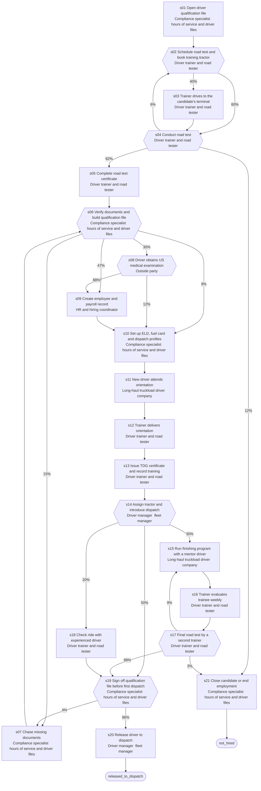

# Qualify and onboard new drivers

`frt-saf-driver-onboarding` · trucking (LTL and truckload freight) · safety and driver services · part of `freight-carrier-co`

Each candidate from recruiting, and each driver an owner-operator puts on the road, is road-tested by a driver trainer, has a driver qualification file built and checked by a compliance specialist, is set up in payroll, the ELD and dispatch systems, and attends two to three days of orientation. Newly licensed drivers then spend three to six weeks with a mentor driver before a final road test by a second trainer. The process is slow because trainers and training tractors are shared across 38 terminals, documents such as medical certificates arrive late, and the finishing program ties up a mentor and a tractor for weeks.

| | |
|---|---|
| Unit of work | one new driver |
| Starts when | Recruiting hands over a candidate who accepted a conditional offer, or owner-operator contracting submits a driver the owner-operator wants to put on the road. |
| Done when | The driver is qualified on file and available for dispatch, or the candidate failed the road test or was released during finishing. |
| Organisation | A Canadian LTL and truckload carrier of about 3,000 employees with 18 driver trainers, 10 training tractors and a compliance team in its safety department. (3,000 employees, 2019-2022) |
| Volume | 53 cases a month (range 35 to 80) |

## Where it sits

- Starts with **qualified_candidate** from saf-driver-recruiting (85% of cases)
- Starts with **driver_application** from tl-oo-contracting (15% of cases)
- Sends **driver_hire** to tl-driver-management (outcome: released_to_dispatch)
- Sends **driver_hire** to ltl-pd-dispatch (outcome: released_to_dispatch)
- Sends **dq_file** to saf-hos-log-audit (outcome: released_to_dispatch)
- Sends **dq_file** to saf-facility-audit (outcome: released_to_dispatch)
- Sends **training_record** to saf-driver-training (outcome: released_to_dispatch)
- Sends **new_employee** to hr-payroll-run (outcome: released_to_dispatch)

## Flow

## Roles

| Role | Department | Layer | FTE on this process | Loaded cost per hour | Evidence |
|---|---|---|---:|---:|---|
| Compliance specialist (hours of service and driver files) | Safety, compliance and driver services | individual contributor | 2 | 40 CAD | C |
| Driver trainer and road tester | Safety, compliance and driver services | individual contributor | 4.5 | 42 CAD | C |
| HR and hiring coordinator | Human resources | individual contributor | 0.3 | 38 CAD | C |
| Driver manager (fleet manager) | Truckload fleet operations | individual contributor | 0.4 | 43 CAD | C |
| Long-haul truckload driver (company) | Truckload fleet operations | individual contributor | 40 | 37 CAD | C |

## Steps

Hands-on time and the wait before each step show the most common value. Evidence tier A is a sourced number, B a sourced description, C the author's estimate.

| Step | Who | Kind | Hands-on | Wait before | Control | Evidence |
|---|---|---|---:|---:|---|---|
| **s01 Open driver qualification file.** The compliance specialist receives the candidate handoff from recruiting, opens a driver qualification file in the safety system and checks that the application, abstract, verifications and consents arrived with it. Missing items are listed for follow-up later in the file build. | Compliance specialist (hours of service and driver files) | intake | 20 min | 4.0 h |  | B [src-cfr-391-51], [src-alberta-audit] |
| **s02 Schedule road test and book training tractor.** A driver trainer looks at the trainer calendar and the training tractor bookings, picks a slot at the candidate's nearest terminal (recruiting has usually pencilled one in with the offer), and confirms the date and time with the candidate by phone and email. | Driver trainer and road tester | coordination | 15 min | 12.0 h |  | C |
| **s03 Trainer drives to the candidate's terminal.** The trainer drives the training tractor or a company car from the home terminal to the candidate's terminal, often combining two or three road tests and an orientation in one trip. Storms and closed highways postpone the trip. | Driver trainer and road tester | travel | 1.5 h | 0 min |  | C |
| **s04 Conduct road test.** The trainer watches the candidate do a full pre-trip inspection, couple and uncouple a trailer, drive in city traffic and on the highway, turn, brake, back into a dock and park, scoring each item on the road test form. The trainer decides pass, retest after coaching, or fail. | Driver trainer and road tester | physical | 1.7 h | 1.0 d | 49 CFR 391.31 road test (or accepted equivalent) for drivers operating into the US; insurer requirement for domestic drivers | A [src-cfr-391-31] |
| **s05 Complete road test certificate.** The trainer signs the road test form, completes the road test certificate with the tractor and trailer types and distance driven, gives the driver a copy and uploads the originals to the driver's file in the safety system. | Driver trainer and road tester | drafting | 15 min | 1.0 h |  | A [src-cfr-391-31] |
| **s06 Verify documents and build qualification file.** The compliance specialist checks the licence class and expiry, medical certificate dates, abstract date, previous-employer responses, TDG and border documents against a checklist, and records expiry dates in the safety system so renewals are flagged. Cross-border drivers without a current US medical certificate are sent for one. | Compliance specialist (hours of service and driver files) | validation | 45 min | 12.0 h | 49 CFR 391.51 driver qualification file; provincial National Safety Code driver record requirements checked in facility audits | A [src-cfr-391-51] |
| **s07 Chase missing documents.** The compliance specialist emails and phones the driver, or the recruiter, for the missing licence copy, medical certificate, signed consent or employer response, and logs each request in the file. | Compliance specialist (hours of service and driver files) | communication | 15 min | 2.0 d |  | C |
| **s08 Driver obtains US medical examination.** The driver books and attends a medical examination with a certified medical examiner and returns the medical examiner's certificate, which the compliance specialist later files. | Outside party | external wait | 1.0 h | 2.0 d |  | B [src-cfr-391-51] |
| **s09 Create employee and payroll record.** The HR coordinator enters the new driver in the HR and payroll system with pay rate, pay basis (mileage, hourly or trip), banking, tax forms, benefits waiting period and, at unionised terminals, union membership and seniority date. | HR and hiring coordinator | data entry | 45 min | 1.0 d |  | C |
| **s10 Set up ELD, fuel card and dispatch profiles.** The compliance specialist creates the driver's ELD login and HOS cycle settings, requests a fuel card, and re-types the driver into the transportation management system so dispatch can assign loads, because none of these systems share a driver master. | Compliance specialist (hours of service and driver files) | data entry | 30 min | 4.0 h |  | C |
| **s11 New driver attends orientation.** The new driver spends two to three paid days in the orientation class: company policies, hours of service and the ELD, trip inspections, cargo securement, TDG, customs and border procedures for cross-border drivers, collision reporting and the drug and alcohol policy. The driver signs the policy acknowledgements. | Long-haul truckload driver (company) | communication | 20.0 h | 2.5 d |  | B [src-tn-melt], [src-tn-finishing] |
| **s12 Trainer delivers orientation.** A driver trainer runs the classroom and yard sessions for a class of about six new drivers, demonstrates the ELD and inspection routine, and marks attendance and quiz results. The figure here is one driver's share of the trainer's time. | Driver trainer and road tester | communication | 3.0 h | 0 min |  | C |
| **s13 Issue TDG certificate and record training.** The trainer issues the employer's TDG training certificate, enters the orientation modules, quiz scores and certificate expiry in the learning management system, and files copies in the driver file. | Driver trainer and road tester | data entry | 15 min | 4.0 h | Transportation of Dangerous Goods Regulations Part 6: training certificate before handling or transporting dangerous goods | C |
| **s14 Assign tractor and introduce dispatch.** The driver manager or terminal supervisor assigns a tractor, issues keys, fuel card and permits, walks the driver through dispatch, trip pay and messaging, and decides from the file and road test whether the driver needs the finishing program or a check ride. | Driver manager (fleet manager) | coordination | 45 min | 12.0 h |  | B [src-tn-newdrivers] |
| **s15 Run finishing program with a mentor driver.** The new driver runs revenue loads with a mentor driver for three to six weeks, first watching, then driving most of the miles with the mentor beside them, then driving their own truck while the mentor follows. Both are paid; the hours shown are working hours for each of the two (about 50 to 60 a week), and the off-duty days in between appear as the wait before the final road test. | Long-haul truckload driver (company) | physical | 10.4 d | 2.0 d | Insurer requirement for a documented finishing or mentoring program before newly licensed drivers run solo | B [src-tn-finishing] |
| **s16 Trainer evaluates trainee weekly.** A driver trainer meets the trainee and mentor each week, rides along for part of a shift, reviews ELD logs and any telematics events, and records progress and the skills still to practise. | Driver trainer and road tester | review | 4.0 h | 0 min |  | B [src-tn-finishing] |
| **s17 Final road test by a second trainer.** At the end of the scheduled program weeks (the wait here is the off-duty and home time inside the program that the hours above leave out), a different trainer from the one who coached the trainee gives a final road test in the trainee's assigned truck and decides whether the trainee runs solo, needs more weeks with the mentor, or is let go. | Driver trainer and road tester | physical | 1.5 h | 10.0 d | Insurer-approved finishing program: independent final evaluation | B [src-tn-finishing] |
| **s18 Check ride with experienced driver.** A driver trainer rides with an experienced new hire on a first local run to watch inspections, coupling, backing and log use in company equipment, and notes anything to correct before the driver goes solo. | Driver trainer and road tester | physical | 3.0 h | 1.0 d |  | C |
| **s19 Sign off qualification file before first dispatch.** The compliance specialist rechecks the file against the checklist (application, abstract, road test certificate, medical, training, consents) and marks the driver as qualified in the safety system. Previous-employer responses still outstanding go on a 30-day follow-up list. | Compliance specialist (hours of service and driver files) | review | 15 min | 12.0 h | 49 CFR 391.51 and 391.23(c); National Safety Code driver records | A [src-cfr-391-23], [src-cfr-391-51] |
| **s20 Release driver to dispatch.** The driver manager or terminal supervisor marks the driver available in the transportation management system with home terminal, fleet and cross-border status, so planners can assign the first solo load. | Driver manager (fleet manager) | data entry | 10 min | 4.0 h |  | C |
| **s21 Close candidate or end employment.** When a candidate fails the road test or a trainee is released, the compliance specialist records the reason, notifies the recruiter and HR, closes the file and keeps it for the retention period. | Compliance specialist (hours of service and driver files) | communication | 15 min | 4.0 h |  | C |

## Exceptions

| Exception | Share of cases | What happens |
|---|---:|---|
| Road test retest | 6% | The candidate makes correctable errors (backing, coupling) and is coached and retested a few days later. |
| Finishing extended | 3% | The final road test shows gaps and the trainee spends one to three more weeks with the mentor. |
| Medical certificate delay | 5% | A cross-border driver waits more than a week for a medical examination appointment and starts on domestic runs or waits. |

## Benchmarks

| Metric | Value | Unit | Population | Evidence |
|---|---|---|---|---|
| cycle_time_days | p50 12, p90 45 | calendar days from candidate handoff to release for first solo dispatch | New company and owner-operator drivers at a mid-size Canadian carrier, 2019-2022 | B [src-tn-finishing] |
| entry_level_training_hours_class_a | 103.5 | hours | Ontario MELT (from July 2017) and the national standard approved in 2020; Alberta 113, Manitoba and Saskatchewan 121.5 | A [src-tn-melt] |

## Pain points

- Eighteen trainers and ten training tractors cover 38 terminals, so road tests wait for a slot and trainers spend hours driving between terminals. (steps s02, s03, s04; C)
- The same driver is typed into the safety system, HR and payroll, the ELD platform, the fuel card portal and the TMS. (steps s09, s10, s20; C)
- Finishing programs tie up a mentor driver and a tractor for three to six weeks per newly licensed driver, yet insurers require them before such drivers run solo. (steps s15, s16, s17; B [src-tn-newdrivers], [src-tn-finishing])
- Medical certificates, consents and previous-employer responses arrive late and gaps in the file are a facility audit finding. (steps s06, s07, s19; B [src-alberta-audit])

## Assumptions

- The role tl-driver-longhaul stands in for the new hire and the mentor driver in every division; LTL pickup and delivery and linehaul hires follow the same steps at slightly different pay.
- Finishing program hours count both mentor and trainee working time (people = 2) although they haul revenue loads at the same time, so labour cost per case overstates the incremental cost of finishing.
- Training tractor use is one tractor for each road test plus travel; the finishing program uses a regular truckload tractor.
- US rules (49 CFR 391) apply to drivers who will run into the US (about 30%); domestic drivers' files follow National Safety Code driver record rules, which could not be opened and are described from general knowledge.
- Driver trainers work office hours; road tests postponed by storms are shown as a weather wait on trainer travel.
- Loaded costs are the organisation file's (wage x 1.30 for hourly staff, x 1.35 for salaried staff).
- The staffing check counts 130 productive hours a month per FTE; drivers in finishing work 200 or more hours a month, so the implied FTE overstates driver headcount. About 47 FTE stated (40 of them drivers in orientation and finishing) is consistent with about 18 trainee-mentor pairs on the road at any time.
- Simulated median cycle time sits a little above the 12-day benchmark because orientation runs weekly and road tests, medical certificates and HR set-up queue one after another for experienced hires.

## Sources

- [src-cfr-391-51] [49 CFR 391.51 General requirements for driver qualification files](https://www.law.cornell.edu/cfr/text/49/391.51) (Legal Information Institute, Cornell Law School, 2021). Driver qualification file holds the application, driving records, road test certificate, annual review, medical examiner's certificate and related documents; kept for the period of employment and three years after.
- [src-cfr-391-31] [49 CFR 391.31 Road test](https://www.law.cornell.edu/cfr/text/49/391.31) (Legal Information Institute, Cornell Law School, 2021). Road test given by the carrier or its designee in the type of vehicle the driver will be assigned, covering at least the pre-trip inspection, coupling and uncoupling, placing the vehicle in operation, use of controls and emergency equipment, driving in traffic and passing, turning, braking, backing and parking; examiner rates the test on a form and issues a certificate kept in the qualification file.
- [src-cfr-391-23] [49 CFR 391.23 Investigation and inquiries](https://www.law.cornell.edu/cfr/text/49/391.23) (Legal Information Institute, Cornell Law School, 2021). Within 30 days of employment beginning, obtain the driving record from every licensing authority of the past 3 years and investigate the driver's safety performance history with DOT-regulated employers of the past 3 years, including drug and alcohol violations, with the driver's written consent; previous employers must respond within 30 days; document good-faith efforts when they do not.
- [src-alberta-audit] [Facility audits and new carrier compliance reviews](https://www.alberta.ca/facility-audits-and-new-carrier-compliance-reviews) (Government of Alberta, 2022). Facility auditors request driver file records and hours-of-service records with documentation that supports the reported hours, such as payroll records, gate tickets and fuel receipts; results can change the safety rating, add conditions or bring administrative penalties.
- [src-tn-finishing] [Carriers reap rewards from their driving schools, finishing programs](https://www.trucknews.com/health-safety/carriers-reap-rewards-from-their-driving-schools-finishing-programs/1003179923) (Trucknews.com, 2023). Ontario and Alberta carriers' finishing programs for newly licensed drivers: Challenger three weeks in the yard, two weeks city and two weeks highway with an instructor; Kriska minimum six weeks starting with four days of classroom, weekly evaluations and a final road test by a different instructor; New Way three months; Musket several weeks with a mentor, driving own truck in week four.
- [src-tn-newdrivers] [New drivers traverse difficult road to employment](https://www.trucknews.com/human-resources/new-drivers-traverse-difficult-road-to-employment/1003175110) (Trucknews.com, 2023). Most carriers require at least one year's experience, mainly because of insurance; carriers with fleet policies can hire newly licensed drivers if they run onboarding, finishing or mentoring programs; carriers prefer Canadian experience for cross-border work; US visa waits delay new drivers' cross-border eligibility.
- [src-tn-melt] [Canada's truck drivers to require 103.5 hours of training](https://www.trucknews.com/transportation/canadas-truck-drivers-to-require-103-5-hours-of-training/1003136596) (Trucknews.com, 2020). National entry-level training standard of 103.5 hours for Class 1/A (36.5 classroom, 17 yard, 50 behind the wheel) approved February 2020; Ontario MELT in force since July 2017; Manitoba and Saskatchewan 121.5 hours, Alberta 113 hours; CTA says many carriers still require recruits to take additional training.
- [src-ata-turnover] [Turnover Remained Unchanged at Large Truckload Fleets in Fourth Quarter](https://trucking.org/news-insights/turnover-remained-unchanged-large-truckload-fleets-fourth-quarter) (American Trucking Associations, 2021). US annualized driver turnover in 2020: large truckload fleets 90% (92% in Q4), small truckload 69%, LTL 13% (12% in Q4).

Written by claude-opus on 2026-11-24.
