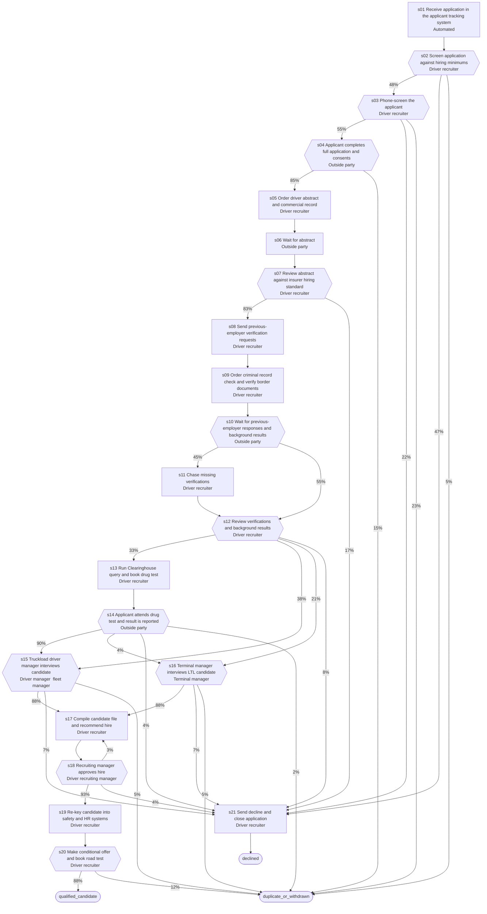

# Recruit company drivers

`frt-saf-driver-recruiting` · trucking (LTL and truckload freight) · safety and driver services · part of `freight-carrier-co`

Driver recruiters take each application from job boards, the careers page and driving schools, screen it against the insurer's hiring standard, pull the driver abstract, verify three years of previous driving employment and, for cross-border drivers, run the US drug and alcohol checks. Truckload and LTL managers interview the survivors, the recruiting manager approves the hire and the candidate goes to road testing. About one application in eight becomes a candidate. The process is slow because applicants are hard to reach, previous employers answer late or not at all, and in 2021 and 2022 candidates took competing offers while files were still open.

| | |
|---|---|
| Unit of work | one driver application |
| Starts when | A driver applicant or driving-school graduate submits an application through the careers page, a job board or a school referral. |
| Done when | The candidate has accepted a conditional offer and is booked for a road test and orientation, or the application is declined or withdrawn. |
| Organisation | A Canadian LTL and truckload carrier of about 3,000 employees and 1,210 company drivers with a central driver recruiting team in its safety department. (3,000 employees, 2019-2022) |
| Volume | 450 cases a month (range 350 to 600) |

## Where it sits

- Starts with **driver_application** from driver-applicants (90% of cases)
- Starts with **driver_application** from driving-schools (10% of cases)
- Relies on **driver_vacancy** from tl-driver-management (a standing input; it does not start a case)
- Relies on **staffing_plan** from fin-budget-forecast (a standing input; it does not start a case)
- Sends **qualified_candidate** to saf-driver-onboarding (outcome: qualified_candidate)

## Flow

## Roles

| Role | Department | Layer | FTE on this process | Loaded cost per hour | Evidence |
|---|---|---|---:|---:|---|
| Driver recruiter | Safety, compliance and driver services | individual contributor | 11 | 40 CAD | C |
| Driver recruiting manager | Safety, compliance and driver services | manager | 0.4 | 70 CAD | C |
| Driver manager (fleet manager) | Truckload fleet operations | individual contributor | 0.6 | 43 CAD | C |
| Terminal manager | LTL terminal network | manager | 0.3 | 72 CAD | C |

## Steps

Hands-on time and the wait before each step show the most common value. Evidence tier A is a sourced number, B a sourced description, C the author's estimate.

| Step | Who | Kind | Hands-on | Wait before | Control | Evidence |
|---|---|---|---:|---:|---|---|
| **s01 Receive application in the applicant tracking system.** The applicant tracking system receives an online application from the careers page, a job board or a driving-school referral, applies knock-out questions (licence class, years of experience, home location) and emails an automatic acknowledgement. It places the application in the recruiter queue for the applicant's home region. | Automated | system auto | 0 min | 0 min |  | C |
| **s02 Screen application against hiring minimums.** A driver recruiter opens the application and compares it with the hiring standard for the opening: licence class (AZ or Class 1), years of verifiable experience, recent job changes, home location against the terminal or lane, and willingness to cross the border. The recruiter decides to call the applicant, decline, or merge a duplicate. | Driver recruiter | validation | 6 min | 12.0 h |  | B [src-tn-newdrivers] |
| **s03 Phone-screen the applicant.** The recruiter calls the applicant, often several times, to confirm experience, equipment driven, home time expectations, pay and any collisions or tickets the applicant volunteers. The recruiter explains the lane, pay per mile or hour and benefits and records notes in the tracking system. | Driver recruiter | communication | 20 min | 1.0 d |  | C [src-tn-vacancies] |
| **s04 Applicant completes full application and consents.** The applicant fills in the full driver application with employment history, licences, collisions and convictions, and signs consents for the driver abstract, criminal record check and previous-employer safety history inquiry. Cross-border candidates add passport, FAST card or visa details. | Outside party | external wait | 45 min | 1.0 d |  | B [src-cfr-391-23] |
| **s05 Order driver abstract and commercial record.** The recruiter orders the provincial driver abstract (three years or more) and, where the applicant has run their own authority, the commercial operator record, through the ministry or an abstract service. The recruiter attaches the order to the application. | Driver recruiter | lookup | 10 min | 4.0 h | 49 CFR 391.23(a)(1) driving record inquiry for drivers operating into the US; insurer hiring standard for domestic drivers | B [src-cfr-391-23] |
| **s06 Wait for abstract.** The ministry or abstract service returns the abstract. Ontario abstracts ordered online come back the same day; Quebec, out-of-province and US records can take several days. | Outside party | external wait | 0 min | 4.0 h |  | C |
| **s07 Review abstract against insurer hiring standard.** The recruiter reads the abstract and counts demerit points, moving violations, at-fault collisions and suspensions in the look-back period, and compares them with the insurer's hiring grid. Borderline records are flagged for the recruiting manager. | Driver recruiter | judgment | 10 min | 1.0 h |  | B [src-tn-newdrivers] |
| **s08 Send previous-employer verification requests.** The recruiter emails or faxes each driving employer of the past three years a verification form asking for dates, equipment, collisions, reason for leaving and, for US-regulated employers, drug and alcohol history. Gaps over 30 days are noted for the applicant to explain. | Driver recruiter | communication | 20 min | 2.0 h | 49 CFR 391.23(a)(2) and (e) previous-employer safety performance history inquiry | A [src-cfr-391-23] |
| **s09 Order criminal record check and verify border documents.** While verifications are out, the recruiter orders a criminal record check through a screening vendor and checks passport, FAST card or US visa for cross-border openings. A record that bars US entry ends a cross-border candidacy but may leave a domestic opening. | Driver recruiter | lookup | 10 min | 0 min |  | C |
| **s10 Wait for previous-employer responses and background results.** Previous employers return the verification forms and the vendor returns the criminal record check. Large carriers answer within days; small fleets and closed companies often do not answer at all. | Outside party | external wait | 0 min | 3.0 d |  | B [src-cfr-391-23] |
| **s11 Chase missing verifications.** The recruiter phones and re-faxes the employers that have not answered, asks the applicant to nudge former supervisors, and records each attempt as a documented good-faith effort when no answer comes. | Driver recruiter | communication | 20 min | 2.0 d | 49 CFR 391.23(c)(2) documentation of good-faith efforts | A [src-cfr-391-23] |
| **s12 Review verifications and background results.** The recruiter compares employer answers with the dates and collisions the applicant declared, reads the background result, and decides whether the candidate goes forward and to which fleet (cross-border truckload, domestic truckload or LTL). | Driver recruiter | judgment | 15 min | 4.0 h |  | C |
| **s13 Run Clearinghouse query and book drug test.** For drivers who will run into the US, the recruiter obtains the driver's consent, runs the pre-employment full query of the FMCSA Drug and Alcohol Clearinghouse (from January 2020) and books a pre-employment drug test at a collection site near the applicant. | Driver recruiter | coordination | 15 min | 4.0 h | 49 CFR 382.701 pre-employment Clearinghouse query and 382.301 pre-employment testing | A [src-cfr-382-701] |
| **s14 Applicant attends drug test and result is reported.** The applicant goes to the collection site, the laboratory tests the specimen and the medical review officer reports the result to the carrier, usually two to three business days later. | Outside party | external wait | 1.0 h | 2.0 d |  | C |
| **s15 Truckload driver manager interviews candidate.** A truckload driver manager meets or calls the candidate to explain lanes, home time, equipment and dispatch practice, and judges fit with the fleet. The driver manager records a hire or no-hire recommendation. | Driver manager (fleet manager) | judgment | 45 min | 2.0 d |  | C |
| **s16 Terminal manager interviews LTL candidate.** The terminal manager of the hiring terminal interviews the candidate in person, walks the yard and docks, explains city or linehaul runs, seniority and union rules where they apply, and records a recommendation. | Terminal manager | judgment | 45 min | 2.0 d |  | C |
| **s17 Compile candidate file and recommend hire.** The recruiter assembles the application, abstract, verifications, background result, drug test result and interview notes into one candidate file, notes any exceptions to the hiring standard and sends it to the recruiting manager. | Driver recruiter | drafting | 25 min | 4.0 h |  | C |
| **s18 Recruiting manager approves hire.** The driver recruiting manager reviews the file, checks that every required record is present and decides exceptions to the insurer standard, which may need the insurer's agreement. The manager approves, declines or sends the file back for a missing item. | Driver recruiting manager | approval | 10 min | 1.0 d | Insurer hiring standard and company hiring policy: second-person approval of driver hires | C |
| **s19 Re-key candidate into safety and HR systems.** Because the tracking system is not linked to the safety system or the HR system, the recruiter re-types the candidate's name, licence, abstract date, medical expiry and verifications into the safety system and sends the HR coordinator a new-hire request. | Driver recruiter | data entry | 15 min | 4.0 h |  | C |
| **s20 Make conditional offer and book road test.** The recruiter phones the candidate with a conditional offer subject to the road test and file completion, books the road test and the next orientation class, and passes the candidate to onboarding. | Driver recruiter | communication | 25 min | 4.0 h |  | B [src-tn-vacancies] |
| **s21 Send decline and close application.** The recruiter selects a decline reason in the tracking system, which sends a standard decline email, and keeps the file for the retention period. Recruiters often batch declines once or twice a week. | Driver recruiter | communication | 4 min | 1.0 d |  | C |

## Exceptions

| Exception | Share of cases | What happens |
|---|---:|---|
| Previous employer never answers | 3% | A closed or small former employer never returns the verification; the recruiter documents good-faith efforts and the manager decides whether to proceed. |
| Insurer exception | 1% | A candidate with less experience or a marginal abstract needs the insurer's written agreement before the manager can approve. |
| Cross-border candidate with a record barring US entry | 0% | The background check shows a record that bars US entry; the candidate is offered a domestic opening or declined. |

## Benchmarks

| Metric | Value | Unit | Population | Evidence |
|---|---|---|---|---|
| cycle_time_days | p50 4, p90 20 | calendar days from application received to decline, withdrawal or accepted conditional offer | All driver applications at a mid-size Canadian carrier, 2019-2022 | C |
| share_of_driver_vacancies_open_over_90_days | 44.3 | percent | Canadian truck driver vacancies, Q3 2021 (34.5% in Q2 2021) | A [src-tn-vacancies] |
| share_of_driver_vacancies_filled_within_15_days | 12.2 | percent | Canadian truck driver vacancies, Q3 2021 (20.8% in Q2 2021) | A [src-tn-vacancies] |
| annual_driver_turnover | large_truckload 90, ltl 13 | percent | US fleets, 2020 average | A [src-ata-turnover] |

## Pain points

- Applicants apply to several carriers at once and are hard to reach; about a quarter of phone screens never happen. (steps s03, s04; C [src-tn-vacancies])
- Previous-employer verifications take days to weeks and often need chasing; the file cannot close until responses or good-faith efforts are documented. (steps s10, s11; B [src-cfr-391-23])
- Candidate data is typed again into the safety and HR systems, which introduces licence and expiry date errors. (steps s19; C)
- In the 2021-2022 driver shortage, candidates accepted faster competing offers while files waited for verifications, interviews and approval. (steps s15, s16, s18, s20; B [src-tn-vacancies])

## Assumptions

- US rules (49 CFR 391 and 382) apply to drivers who will operate into the US, about a third of candidates; domestic-only candidates follow the insurer's standard, which asks for the same abstract and employment checks but no drug test.
- Funnel: 48% pass the first screen, 55% of those pass the phone screen, 85% complete the full application, 83% pass the abstract, 92% pass verifications, about 86% pass interviews and drug tests, 93% are approved and 88% accept the offer: about 12% of applications become qualified candidates (about 55 a month).
- Interview step roles: driver-manager for truckload and terminal-manager for LTL. The organisation file lists only the recruiter and recruiting manager for this process.
- Recruiters work office hours; waits include evenings and weekends.
- Loaded costs are the organisation file's (wage x 1.35 for salaried office staff, x 1.30 for hourly staff).
- Staffing: the roles state about 12 FTE while hands-on time times 450 applications implies about 4.5 FTE. The gap is lead handling not counted as applications (calls and partial web leads, often several times the application count), job fairs, school visits, advertising and follow-up with candidates who are not yet ready; if those are excluded, about 6 to 8 recruiters would cover this volume.
- Simulated median cycle time is short because most applications end at the first screens; candidates who reach an offer take about two to four weeks.

## Sources

- [src-ata-turnover] [Turnover Remained Unchanged at Large Truckload Fleets in Fourth Quarter](https://trucking.org/news-insights/turnover-remained-unchanged-large-truckload-fleets-fourth-quarter) (American Trucking Associations, 2021). US annualized driver turnover in 2020: large truckload fleets 90% (92% in Q4), small truckload 69%, LTL 13% (12% in Q4).
- [src-tn-vacancies] [Canadian truck driver vacancies surge to record levels: Report](https://www.trucknews.com/transportation/canadian-truck-driver-vacancies-surge-to-record-levels-report/1003156228) (Trucknews.com (reporting Trucking HR Canada labour market data), 2021). 22,990 vacant truck driver jobs in Q3 2021, up 20% from Q2; 44.3% vacant for more than 90 days (34.5% in Q2); only 12.2% filled within 15 days (20.8% in Q2); truck transportation vacancy rate 8% against 5.4% for all sectors; Ontario 6,080 vacancies; CTA expected 12,000 to 16,000 drivers could leave cross-border work under the vaccine mandate.
- [src-tn-newdrivers] [New drivers traverse difficult road to employment](https://www.trucknews.com/human-resources/new-drivers-traverse-difficult-road-to-employment/1003175110) (Trucknews.com, 2023). Most carriers require at least one year's experience, mainly because of insurance; carriers with fleet policies can hire newly licensed drivers if they run onboarding, finishing or mentoring programs; carriers prefer Canadian experience for cross-border work; US visa waits delay new drivers' cross-border eligibility.
- [src-cfr-391-23] [49 CFR 391.23 Investigation and inquiries](https://www.law.cornell.edu/cfr/text/49/391.23) (Legal Information Institute, Cornell Law School, 2021). Within 30 days of employment beginning, obtain the driving record from every licensing authority of the past 3 years and investigate the driver's safety performance history with DOT-regulated employers of the past 3 years, including drug and alcohol violations, with the driver's written consent; previous employers must respond within 30 days; document good-faith efforts when they do not.
- [src-cfr-382-701] [49 CFR 382.701 Drug and Alcohol Clearinghouse](https://www.law.cornell.edu/cfr/text/49/382.701) (Legal Information Institute, Cornell Law School, 2021). Employers must not use a driver subject to testing in safety-sensitive functions without first conducting a pre-employment full query of the Clearinghouse with the driver's consent, and must query at least once a year.

Written by claude-opus on 2026-11-24.
