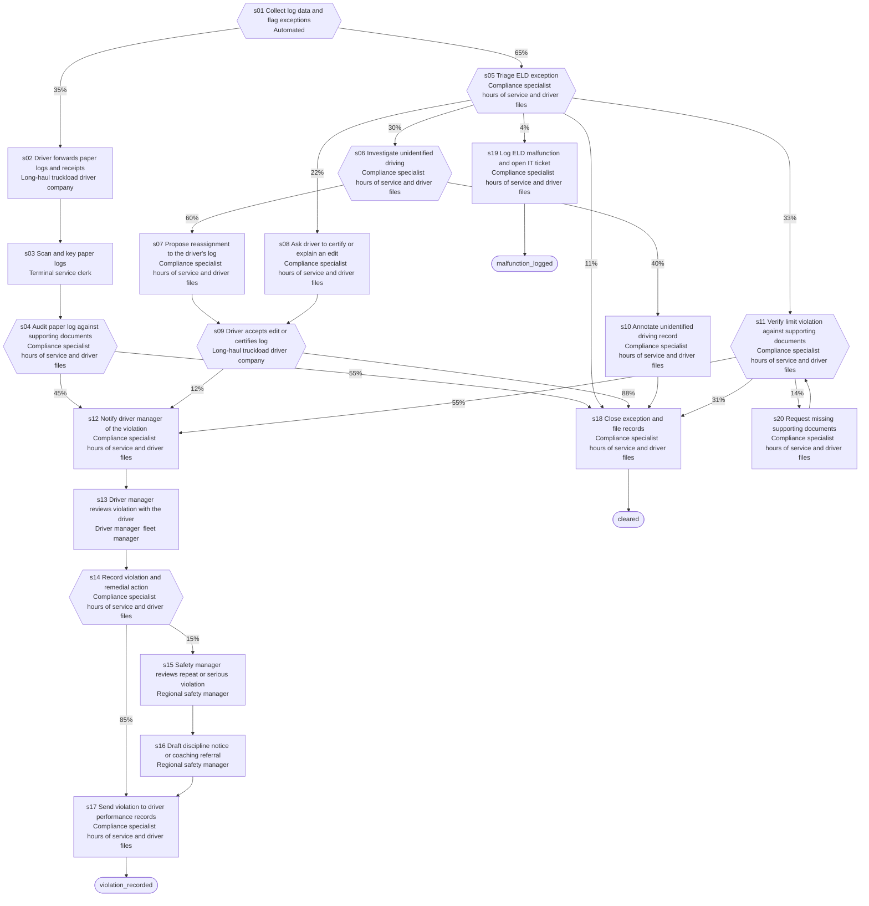

# Audit hours of service and ELD logs

`frt-saf-hos-log-audit` · trucking (LTL and truckload freight) · safety and compliance · part of `freight-carrier-co`

Compliance specialists work through each hours-of-service exception: a driving or on-duty limit broken, driving with no driver logged in, an edit or an uncertified day, or a paper log that does not match its receipts. They check the log against dispatch, fuel, toll and border records, get the driver to accept or explain, record the violation and the remedial action the regulation requires, and pass repeat cases to a safety manager. Paper logs, still common until the ELD mandate of June 2021, take days to arrive and must be scanned and keyed before they can be audited; electronic exceptions pile up in a queue and drivers on the road answer slowly.

| | |
|---|---|
| Unit of work | one hours-of-service exception |
| Starts when | The ELD platform flags an exception, or a paper log arrives and the log audit tool flags a day. |
| Done when | The exception is cleared and filed, or a confirmed violation and its remedial action are recorded and passed to driver performance. |
| Organisation | A Canadian LTL and truckload carrier of about 3,000 employees with about 1,210 company drivers and 380 owner-operators whose logs it must monitor. (3,000 employees, 2019-2022) |
| Volume | 1,500 cases a month (range 1,200 to 2,000) |

## Where it sits

- Starts with **hos_record** from tl-trip-execution (70% of cases)
- Starts with **hos_record** from ltl-linehaul-dispatch (30% of cases)
- Relies on **dq_file** from saf-driver-onboarding (a standing input; it does not start a case)
- Relies on **eld_malfunction_record** from it-service-desk (a standing input; it does not start a case)
- Sends **hos_violation** to saf-driver-performance (outcome: violation_recorded)
- Sends **hos_audit_report** to saf-facility-audit (outcome: any)
- Sends **it_ticket** to it-service-desk (outcome: malfunction_logged)

## Flow

## Roles

| Role | Department | Layer | FTE on this process | Loaded cost per hour | Evidence |
|---|---|---|---:|---:|---|
| Compliance specialist (hours of service and driver files) | Safety, compliance and driver services | individual contributor | 6.5 | 40 CAD | C |
| Terminal service clerk | LTL terminal network | individual contributor | 0.8 | 32 CAD | C |
| Driver manager (fleet manager) | Truckload fleet operations | individual contributor | 1 | 43 CAD | C |
| Regional safety manager | Safety, compliance and driver services | manager | 0.4 | 78 CAD | C |
| Long-haul truckload driver (company) | Truckload fleet operations | individual contributor | 0.3 | 37 CAD | C |

## Steps

Hands-on time and the wait before each step show the most common value. Evidence tier A is a sourced number, B a sourced description, C the author's estimate.

| Step | Who | Kind | Hands-on | Wait before | Control | Evidence |
|---|---|---|---:|---:|---|---|
| **s01 Collect log data and flag exceptions.** For drivers with electronic logs, the ELD and telematics platform checks each day's record against the daily and cycle limits and raises exceptions for violations, unidentified driving, edits and uncertified days. For drivers still on paper logs, the case starts when the driver's log sheets come in. | Automated | system auto | 0 min | 0 min |  | B [src-eld] |
| **s02 Driver forwards paper logs and receipts.** The driver drops the week's log sheets, fuel receipts, toll and border receipts and bills of lading in the terminal drop box or mails them in. The rules allow up to 20 days after each day's record. | Long-haul truckload driver (company) | communication | 5 min | 5.0 d | Hours of Service Regulations s.85(1) and s.85(3) | A [src-hos] |
| **s03 Scan and key paper logs.** A terminal service clerk sorts the log package, scans the sheets and receipts to the imaging system and keys duty status changes into the log audit tool, which flags the day that breaks a limit or does not match the receipts. One flagged exception usually means keying a week of logs. | Terminal service clerk | data entry | 25 min | 1.0 d |  | A [src-eld] |
| **s04 Audit paper log against supporting documents.** The compliance specialist opens the flagged log and compares the recorded times and places with fuel receipts, tolls, border crossing times, bills of lading and GPS trip records, looking for driving shown as off duty or a second set of logs. The specialist confirms the violation or clears the flag. | Compliance specialist (hours of service and driver files) | validation | 12 min | 1.0 d | Commercial Vehicle Drivers Hours of Service Regulations s.87: carrier must monitor each driver's compliance and take and record remedial action | B [src-eld], [src-alberta-audit] |
| **s05 Triage ELD exception.** The compliance specialist works through the exception queue in the ELD platform, opens each item and classifies it as unidentified driving, an edit or uncertified day, a limit violation, a device malfunction or a false alarm such as a yard move. | Compliance specialist (hours of service and driver files) | analysis | 5 min | 1.0 d |  | C [src-amta-eld] |
| **s06 Investigate unidentified driving.** The compliance specialist matches the unit and time of the unidentified driving with dispatch records, yard and shop work orders and gate logs to find who was driving. Technicians' road tests and yard moves cannot be given to a driver. | Compliance specialist (hours of service and driver files) | lookup | 10 min | 1.0 h |  | B [src-amta-eld], [src-hos] |
| **s07 Propose reassignment to the driver's log.** The compliance specialist sends the unidentified segment to the identified driver's log through the ELD platform with a note explaining the evidence. | Compliance specialist (hours of service and driver files) | data entry | 4 min | 0 min |  | B [src-amta-eld] |
| **s08 Ask driver to certify or explain an edit.** For uncertified days or edits without an adequate reason, the compliance specialist messages the driver through the ELD to certify the day or annotate the edit, and copies the driver manager when the driver is on the road. | Compliance specialist (hours of service and driver files) | communication | 4 min | 1.0 h |  | C |
| **s09 Driver accepts edit or certifies log.** The driver reviews the proposed edit or uncertified day on the ELD tablet at the next stop and accepts, rejects with a comment or certifies it. | Long-haul truckload driver (company) | review | 3 min | 12.0 h |  | B [src-amta-eld] |
| **s10 Annotate unidentified driving record.** The compliance specialist annotates the unidentified segment with the reason (technician road test, yard move, tow) and leaves it in the unidentified driver account, which inspectors may ask to see. | Compliance specialist (hours of service and driver files) | data entry | 3 min | 0 min | Hours of Service Regulations s.78.1 and s.99(1)(b) | A [src-hos] |
| **s11 Verify limit violation against supporting documents.** The compliance specialist checks a flagged driving, on-duty or cycle violation against dispatch times, fuel and toll records and customs crossing times, and checks for allowed exceptions such as adverse driving conditions or deferred off-duty time. | Compliance specialist (hours of service and driver files) | validation | 12 min | 4.0 h | Commercial Vehicle Drivers Hours of Service Regulations s.87: carrier must monitor each driver's compliance and take and record remedial action | B [src-hos], [src-eld] |
| **s12 Notify driver manager of the violation.** The compliance specialist emails the driver manager or linehaul supervisor the violation, the evidence and the rule broken, and asks for the driver's explanation within a week. | Compliance specialist (hours of service and driver files) | communication | 8 min | 4.0 h |  | C |
| **s13 Driver manager reviews violation with the driver.** The driver manager calls or meets the driver, hears the reason (customer delays, traffic, a planning error by dispatch), reminds them of the rule and records the explanation and the driver's acknowledgement. | Driver manager (fleet manager) | coordination | 15 min | 2.0 d |  | C |
| **s14 Record violation and remedial action.** The compliance specialist re-keys the violation, the explanation and the remedial action (warning, coaching, load planning change) from the ELD platform and email into the driver's record in the safety system, with the dates as the regulation requires. | Compliance specialist (hours of service and driver files) | data entry | 10 min | 4.0 h | Commercial Vehicle Drivers Hours of Service Regulations s.87: carrier must monitor each driver's compliance and take and record remedial action | A [src-hos] |
| **s15 Safety manager reviews repeat or serious violation.** The regional safety manager reads the driver's violation history, the evidence and the explanation and decides between retraining, a written warning, suspension or, for falsified logs, termination, in line with the progressive discipline policy and any collective agreement. | Regional safety manager | judgment | 25 min | 2.0 d | Progressive discipline policy and collective agreement | C |
| **s16 Draft discipline notice or coaching referral.** The safety manager writes the discipline notice or the referral to a trainer for an hours-of-service refresher and sends it to the driver manager and, for unionised drivers, labour relations. | Regional safety manager | drafting | 20 min | 4.0 h |  | C |
| **s17 Send violation to driver performance records.** The compliance specialist links the violation to the driver's safety performance record so it counts in coaching decisions and monthly reporting, files the supporting documents and closes the exception. | Compliance specialist (hours of service and driver files) | data entry | 5 min | 4.0 h |  | C |
| **s18 Close exception and file records.** The compliance specialist closes the exception with a resolution code and makes sure the record and supporting documents are kept for at least six months. | Compliance specialist (hours of service and driver files) | data entry | 2 min | 1.0 h |  | A [src-hos] |
| **s19 Log ELD malfunction and open IT ticket.** The compliance specialist records the malfunction in the register, tells the driver to keep paper logs until the device is fixed, and opens a service desk ticket to repair or replace the device within 14 days. | Compliance specialist (hours of service and driver files) | communication | 12 min | 1.0 h | Hours of Service Regulations s.78(5) | A [src-hos] |
| **s20 Request missing supporting documents.** The compliance specialist asks the terminal, the fuel card portal or the driver for the missing fuel receipt, toll record or bill of lading needed to confirm the times in the log. | Compliance specialist (hours of service and driver files) | lookup | 10 min | 2.0 d |  | B [src-eld] |

## Exceptions

| Exception | Share of cases | What happens |
|---|---:|---|
| Falsified paper log | 2% | Fuel or border receipts show driving while the log shows off duty; the case goes to the safety manager for discipline. |
| Driver rejects reassigned time | 3% | The driver refuses unidentified time the evidence points to them; the driver manager resolves it with the driver. |
| Missing supporting documents | 5% | A fuel receipt or bill of lading is needed to confirm the times and has to be requested. |

## Benchmarks

| Metric | Value | Unit | Population | Evidence |
|---|---|---|---|---|
| cycle_time_days | p50 5, p90 20 | calendar days from exception flagged (or paper log day) to closure | Hours-of-service exceptions at a mid-size Canadian carrier, 2019-2022 | B [src-hos] |
| clerical_minutes_per_paper_log | 3.5 | minutes | Canadian federally regulated carriers (Transport Canada regulatory impact analysis, 2019) | A [src-eld] |
| share_of_drivers_routinely_exceeding_limits | low 5, high 10 | percent | Canadian commercial vehicle drivers (Transport Canada estimate, 2019) | A [src-eld] |
| share_of_inspections_with_hos_out_of_service_order | 2.81 | percent | Provincial and territorial roadside inspections | A [src-eld] |

## Pain points

- Paper logs arrive up to 20 days late and each flagged exception means scanning and keying a week of sheets before anyone can audit it. (steps s02, s03, s04; A [src-hos], [src-eld])
- Unidentified driving from yard moves, shop road tests and forgotten logins fills the queue and must be traced by hand through dispatch and work orders. (steps s05, s06, s10; B [src-amta-eld])
- Drivers on the road answer edit requests and violation calls slowly, so exceptions sit open for days. (steps s09, s13; C)
- Violations are re-keyed from the ELD platform into the safety system, so driver records and reports lag. (steps s14, s17; C)

## Assumptions

- Paper-log share of 35% is an average over 2019-2022: higher in 2019-2020, near zero for long-haul drivers after June 2021. Drivers within 160 km of home terminal (most pickup and delivery drivers) are exempt from daily logs and are outside this process.
- The role tl-driver-longhaul stands in for drivers of every division and owner-operators' drivers; linehaul supervisors play the driver manager's part for LTL linehaul drivers.
- Owner-operators' drivers' logs are audited by the carrier in the same way as company drivers'.
- Compliance specialists work office hours; waits include nights and weekends.
- Loaded costs are the organisation file's.

## Sources

- [src-hos] [Commercial Vehicle Drivers Hours of Service Regulations (SOR/2005-313)](https://laws-lois.justice.gc.ca/eng/regulations/SOR-2005-313/FullText.html) (Government of Canada, Justice Laws Website, 2005). s.12-14: 13 h driving and 14 h on duty per day, 10 h off duty per day with 8 consecutive; s.26-27 cycle 1 of 70 h in 7 days and cycle 2 of 120 h in 14 days; s.85: drivers forward records of duty status within 20 days, carriers deposit them at the principal place of business within 30 days and keep them at least 6 months; s.86 bans duplicate or inaccurate records and ELD tampering; s.87: the motor carrier shall monitor each driver's compliance and on finding non-compliance take immediate remedial action and record the dates and actions; s.78.1 and s.99(1)(b): a distinct account for driving time of an unidentified driver, produced on request; s.78(5): repair or replace a malfunctioning ELD within 14 days; s.91 out-of-service declarations.
- [src-eld] [Regulations Amending the Commercial Vehicle Drivers Hours of Service Regulations (Electronic Logging Devices and Other Amendments), SOR/2019-165](https://gazette.gc.ca/rp-pr/p2/2019/2019-06-12/html/sor-dors165-eng.html) (Canada Gazette, Part II, 2019). ELD provisions in force on the second anniversary of publication (June 2021); 157,424 federally regulated CMVs need daily logs, 87,849 operate into the US; carriers estimate clerical staff take about 3.5 minutes to file each paper daily log; 4.5 minutes of driver time saved per record; Transport Canada estimates 5% to 10% of drivers routinely exceed HOS limits; 2.81% of inspections end in an HOS out-of-service order; about 9,400 HOS convictions a year, 48% for failing to maintain or produce a log; carriers verify records against supporting documents such as bills of lading, payroll, fuel receipts and trip records.
- [src-amta-eld] [Unassigned and Unidentified: Compliance considerations for Canadian ELDs](https://amta.ca/news/unassigned-and-unidentified-compliance-considerations-for-canadian-elds) (Alberta Motor Transport Association, 2023). Driving without a logged-in driver goes to the ELD's unidentified driver account; the carrier reviews it and moves time only to the driver who actually drove; drivers may refuse unassigned time; technicians' test drives stay in the account with a note; causes include forgotten logins and misuse of yard move and personal conveyance settings; more than 30 minutes of unassigned driving triggers a malfunction code.
- [src-alberta-audit] [Facility audits and new carrier compliance reviews](https://www.alberta.ca/facility-audits-and-new-carrier-compliance-reviews) (Government of Alberta, 2022). Facility auditors request driver file records and hours-of-service records with documentation that supports the reported hours, such as payroll records, gate tickets and fuel receipts; results can change the safety rating, add conditions or bring administrative penalties.

Written by claude-opus on 2026-11-24.
