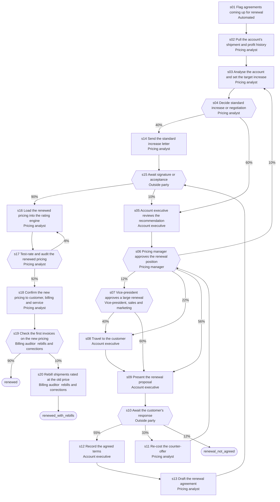

# Renew contracts and apply the general rate increase

`frt-sls-contract-renewal` · trucking (less-than-truckload and truckload freight) · sales and pricing · part of `freight-carrier-co`

Each customer rate agreement comes up for renewal on its anniversary, and most are renewed in the autumn so new prices take effect with the January general rate increase. A pricing analyst reviews the account's profit and shipment history, sets a target increase, and either sends a standard increase letter or prepares a negotiation that the account executive leads with the customer, with approval from the pricing manager and, for large accounts, the vice-president of sales. Agreed pricing is drafted, signed, loaded into the rating engine and audited. The work bunches into a few weeks, customers take weeks to reply, and pricing loaded after the effective date causes rebills.

| | |
|---|---|
| Unit of work | one contract renewal |
| Starts when | A customer rate agreement reaches its expiry or anniversary date, or the annual GRI is announced for agreements with a GRI clause. |
| Done when | Renewed pricing is loaded, audited and in effect, with any rebills issued, or the customer declines and the account goes to bid. |
| Organisation | A Canadian LTL and truckload carrier of about 3,000 employees whose contract customers renew annually, with a ten-analyst pricing desk and 32 account executives. (3,000 employees, 2019-2022) |
| Volume | 100 cases a month (range 60 to 150) |

## Where it sits

- Starts with **rate_agreement** from shipper (100% of cases)
- Relies on **account_profitability_report** from fin-month-end-close (a standing input; it does not start a case)
- Relies on **fuel_surcharge_table** from fin-fuel-surcharge (a standing input; it does not start a case)
- Relies on **pricing_error_report** from fin-billing-corrections (a standing input; it does not start a case)
- Sends **rate_agreement** to shipper (outcome: renewed)
- Sends **rate_agreement** to fin-rating-invoicing (outcome: renewed)
- Sends **corrected_invoice** to shipper (outcome: renewed_with_rebills)
- Sends **rate_agreement** to fin-rating-invoicing (outcome: renewed_with_rebills)
- Sends **pricing_error_report** to sls-pricing-quotes (outcome: renewed_with_rebills)
- Sends **rfp_bid** to sls-rfp-response (outcome: renewal_not_agreed)

## Flow

## Roles

| Role | Department | Layer | FTE on this process | Loaded cost per hour | Evidence |
|---|---|---|---:|---:|---|
| Pricing analyst | Sales and customer service | senior specialist | 1.6 | 54 CAD | B [src-lineage-job] |
| Account executive | Sales and customer service | individual contributor | 2 | 62 CAD | C |
| Pricing manager | Sales and customer service | manager | 0.2 | 95 CAD | C |
| Vice-president, sales and marketing | Sales and customer service | executive | 0.03 | 160 CAD | C |
| Billing auditor (rebills and corrections) | Billing centre | individual contributor | 0.2 | 34 CAD | C |

## Steps

Hands-on time and the wait before each step show the most common value. Evidence tier A is a sourced number, B a sourced description, C the author's estimate.

| Step | Who | Kind | Hands-on | Wait before | Control | Evidence |
|---|---|---|---:|---:|---|---|
| **s01 Flag agreements coming up for renewal.** A monthly CRM report lists customer rate agreements that expire or reach their anniversary in the next 90 days, and agreements with a general rate increase clause that the January GRI will touch. The pricing manager assigns each to an analyst and account executive. | Automated | system auto | 0 min | 7.0 d |  | B [src-odfl-10k21] |
| **s02 Pull the account's shipment and profit history.** The pricing analyst runs the account profitability report and pulls 12 months of shipments from the TMS: revenue, weight and density by lane, accessorials, claims, rebills and the operating ratio from the costing model. Accounts with a poor margin are marked for a larger increase. | Pricing analyst | lookup | 30 min | 5.0 d |  | B [src-lineage-job] |
| **s03 Analyse the account and set the target increase.** The analyst re-costs the account at current cost factors, compares its operating ratio with the target, and sets a target increase and a floor, usually starting from the published GRI of 5% to 7% and adding more for unprofitable lanes or density problems. The analyst writes a one-page recommendation. | Pricing analyst | analysis | 45 min | 1.0 h |  | B [src-fw-gri], [src-tforce-gri] |
| **s04 Decide standard increase or negotiation.** The analyst decides whether the account can take a standard increase by letter, which suits small and profitable accounts with an increase clause, or needs a negotiated renewal because it is large, unprofitable or likely to go to bid. | Pricing analyst | judgment | 3 min | 0 min |  | C |
| **s05 Account executive reviews the recommendation.** The account executive reads the recommendation and adds what the numbers do not show: competing bids the customer has mentioned, service failures, planned volume changes and the customer's budget timing. The executive and analyst agree the opening position and the walk-away floor. | Account executive | review | 30 min | 2.0 d |  | C |
| **s06 Pricing manager approves the renewal position.** The pricing manager checks the proposed increase and floor against the account's operating ratio and the network's lane balance, and approves, sends it back, or refers large accounts to the vice-president of sales. Counter-offers return here for a new floor. | Pricing manager | approval | 15 min | 1.0 d | Pricing authority matrix: renewal floors set by the analyst approved by the pricing manager | C |
| **s07 Vice-president approves a large renewal.** The vice-president of sales reviews renewals for the largest accounts, where a loss would change terminal volumes, and confirms the floor and whether the carrier will walk away. The decision is often made in the weekly sales meeting. | Vice-president, sales and marketing | approval | 20 min | 3.0 d | Pricing authority matrix: renewals above an annual revenue threshold approved by the vice-president of sales | C |
| **s08 Travel to the customer.** For larger accounts the account executive drives or flies to the customer's site for the renewal meeting, often combining it with other visits in the same city. The travel time is paid working time. | Account executive | travel | 1.5 h | 3.0 d |  | C |
| **s09 Present the renewal proposal.** The account executive presents the new pricing, explains the cost increases behind it (wages, equipment, fuel and insurance) and the service record, and listens for objections. The executive records the customer's response and any competitor prices in the CRM. | Account executive | communication | 45 min | 1.0 d |  | C |
| **s10 Await the customer's response.** The customer takes the proposal to its procurement or logistics manager, sometimes compares it with quotes from other carriers, and replies with acceptance, a counter-offer or a decision to put the business out to bid. | Outside party | external wait | 0 min | 7.0 d |  | B [src-odfl-10k21] |
| **s11 Re-cost the counter-offer.** The analyst prices the customer's counter-offer or competitor price lane by lane, shows the margin at that level and suggests a compromise such as a smaller increase with a higher minimum charge or a density rule. | Pricing analyst | analysis | 30 min | 1.0 d |  | C |
| **s12 Record the agreed terms.** The account executive writes the agreed terms into the CRM opportunity and emails them to the analyst: discount, minimum charge, accessorial changes, fuel surcharge table, effective date and term. Terms agreed by phone are sometimes recorded incompletely. | Account executive | data entry | 10 min | 12.0 h |  | C |
| **s13 Draft the renewal agreement.** The analyst prepares the renewal amendment or new rate agreement from the template with the agreed pricing, effective date and term, and sends it to the account executive for the customer's signature. | Pricing analyst | drafting | 20 min | 1.0 d |  | C |
| **s14 Send the standard increase letter.** For standard renewals the analyst merges the account's new prices into the increase notice template, states the effective date with at least 30 days' notice, and the account executive emails it to the customer. | Pricing analyst | drafting | 12 min | 1.0 d |  | B [src-tforce-gri] |
| **s15 Await signature or acceptance.** The customer signs the agreement or, for standard increases, lets the notice period pass without objection. Some customers object to the standard increase and the renewal becomes a negotiation. | Outside party | external wait | 0 min | 5.0 d |  | C |
| **s16 Load the renewed pricing into the rating engine.** The analyst keys the new discount, minimums, accessorial exceptions and effective date into the rating engine for every account number covered. In the renewal season many agreements are loaded in the last weeks before the January effective date, and late loads mean shipments are rated at the old price. | Pricing analyst | data entry | 20 min | 2.0 d |  | B [src-lineage-job] |
| **s17 Test-rate and audit the renewed pricing.** A second analyst rates sample shipments for each account number on the new pricing and compares them with the agreement. Errors go back for reloading. | Pricing analyst | review | 10 min | 1.0 d | Pricing department rule: a second analyst audits contract pricing before it takes effect | C |
| **s18 Confirm the new pricing to customer, billing and service.** The analyst emails the account executive, billing and customer service the effective date and agreement number and updates the expiry date in the CRM so the next renewal is flagged. The account executive confirms to the customer. | Pricing analyst | communication | 6 min | 30 min |  | C |
| **s19 Check the first invoices on the new pricing.** A billing auditor reviews the customer's first week of invoices after the effective date and compares the rated charges with the agreement. Shipments rated before the pricing was loaded, or on the wrong account, are flagged for rebilling. | Billing auditor (rebills and corrections) | review | 10 min | 7.0 d | Billing quality control: first-invoice check after a pricing change | C |
| **s20 Rebill shipments rated at the old price.** The billing auditor pulls every shipment rated since the effective date at the old or wrong price, re-rates it, issues corrected invoices and a cover note, and sends a pricing error report to the pricing manager. | Billing auditor (rebills and corrections) | data entry | 1.0 h | 1.0 d |  | C |

## Exceptions

| Exception | Share of cases | What happens |
|---|---:|---|
| Counter-offer | 20% | The customer counters with a smaller increase or a competitor's price; the analyst re-costs it and it goes back through approval. |
| Customer objects to a standard increase | 4% | A customer who received the standard letter objects and the renewal becomes a negotiation. |
| Late load causes rebills | 10% | Pricing loaded after the effective date or on the wrong account is found in the first invoices and shipments are rebilled. |
| Account goes to bid | 8% | The customer rejects the renewal and runs an RFP, which the carrier answers through the RFP process. |

## Benchmarks

| Metric | Value | Unit | Population | Evidence |
|---|---|---|---|---|
| cycle_time_days | p50 45, p90 90 | calendar days from the renewal flag to pricing in effect or the account lost | Canadian LTL carrier contract renewals | C |
| general_rate_increase | low 4.9, high 7.9 | percent average increase on tariff base rates | North American LTL carriers, GRIs effective 2021 and early 2022 | A [src-fw-gri], [src-tforce-gri] |

## Pain points

- Renewals bunch into the weeks before January, so analysts load pricing late and shipments are rated at the old price until rebills catch them. (steps s16, s19, s20; C)
- Customers take weeks to respond and counter-offers repeat the analysis and approval loop. (steps s10, s11, s06; C)
- Terms agreed by phone are re-keyed from the CRM into an agreement and again into the rating engine, so details get lost. (steps s12, s13, s16; B [src-lineage-job])

## Assumptions

- The organisation file says renewals are triggered by the shipper's rate agreement; in practice the carrier starts the case from its own expiry calendar, which is modelled as a system step. The interface keeps the organisation file's trigger.
- 40% of renewals are standard increases by letter and 60% are negotiated; 12% of negotiated renewals end with the customer going to bid.
- The renewal flag is generated about 90 days ahead, but the simulated cycle time starts when the flag is produced and includes up to four weeks before an analyst picks it up.
- Billing auditors and the vice-president of sales take part although the organisation file lists only account executives, pricing analysts, the pricing manager and the vice-president on this process; the auditor is in the organisation file under finance.
- The account profitability report is shown as an input from month-end close, as in the organisation file, but at most carriers the pricing or network analysts produce it from the costing model.
- No step ties up vehicles, equipment or crews, so no resources are listed; no step is done by several people of one role together.

## Sources

- [src-odfl-10k21] [Old Dominion Freight Line, Inc. Form 10-K for the year ended December 31, 2021](https://www.sec.gov/Archives/edgar/data/0000878927/000156459022006303/odfl-10k_20211231.htm) (US Securities and Exchange Commission (EDGAR), 2022). Many customers ship under the carrier's tariffs; customers generally solicit bids for relatively large numbers of shipments for one to two years; carriers compete on on-time performance and minimising cargo claims.
- [src-lineage-job] [Logistics Pricing Analyst (Calgary) job posting](https://jobs.sjfventures.com/companies/lineage-logistics/jobs/38499077-logistics-pricing-analyst) (Lineage Logistics (via SJF Ventures job board), 2024). Pricing analyst prepares spot quotes and cost checks, breaks down bids, costs opportunities in TCG costing software, maintains rate sheets, accessorials and fuel surcharge programs in Truckmate, works within the pricing department's approved guidelines and coordinates the annual general rate increase and rate agreement updates.
- [src-fw-gri] [LTL: How do general rate increases work?](https://www.freightwaves.com/news/ltl-how-do-general-rate-increases-work) (FreightWaves (Todd Maiden), 2022). GRIs raise base tariff rates while shippers keep negotiated discounts; GRIs are usually announced in Q3 or Q4 and take effect in Q1; only about 25% of ArcBest's and 20% to 25% of Saia's business is subject to the GRI, the rest is under contract or individual pricing; most carriers took a 5% to 6% GRI in Q1 2021 and many a second later in 2021.
- [src-tforce-gri] [TForce Freight Announces Rate Changes (effective November 15, 2021)](https://tforcefreight.com/ltl/apps/Announcement_details_20211108a) (TForce Freight, 2021). Average 6.9% increase on non-contractual LTL shipments rated on tariffs including the 525 US/Canada tariff; does not apply to contractual shipments; accessorial charges also rise.

Written by claude-opus on 2026-11-24.
