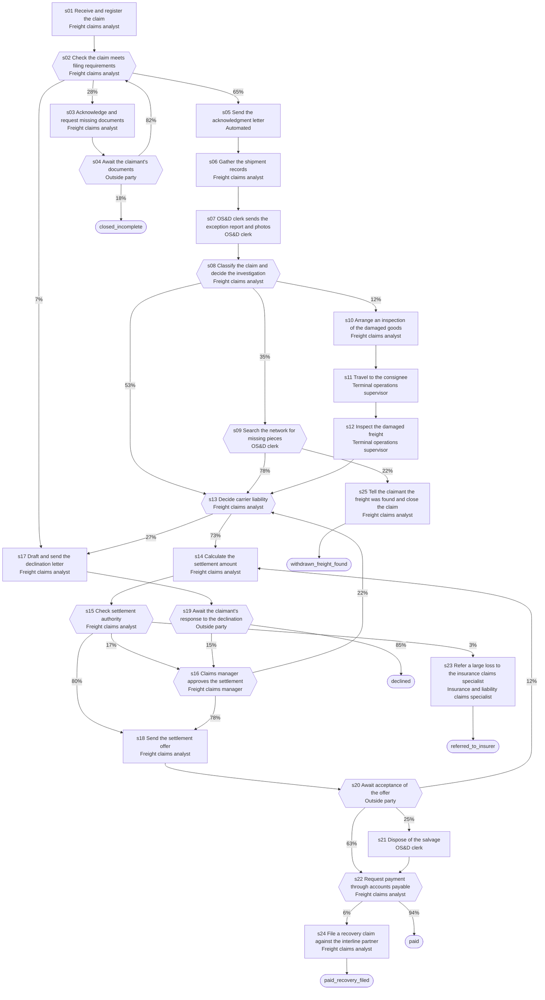

# Process freight claims

`frt-sls-freight-claims` · trucking (less-than-truckload and truckload freight) · customer service (claims) · part of `freight-carrier-co`

When freight is lost, short or damaged, the shipper or consignee files a written claim with the carrier. A claims analyst registers it, checks it was filed in time with the invoice and photos, gathers the bill of lading, delivery receipt and OS&D report, and for some claims has the network searched or the goods inspected. The analyst decides whether the carrier is liable under the conditions of carriage, calculates the amount within the per-kilogram limit, and pays, declines or negotiates within authority limits, sending large losses to the insurer. Claims slow down when documents are missing, when inspections wait for the consignee, and in the autumn peak when backlogs build.

| | |
|---|---|
| Unit of work | one freight claim |
| Starts when | A shipper or consignee files a written claim for loss, shortage, damage or delay of a shipment. |
| Done when | The claim is paid through accounts payable, declined with reasons, withdrawn because the freight was found, closed for lack of documents, or referred to the insurer. |
| Organisation | A Canadian LTL carrier of about 3,000 employees with a freight claims team of ten analysts and a manager inside customer service. (3,000 employees, 2019-2022) |
| Volume | 900 cases a month (range 700 to 1,200) |

## Where it sits

- Starts with **freight_claim** from shipper (90% of cases)
- Starts with **freight_claim** from consignee (10% of cases)
- Relies on **osd_report** from ltl-osd-exceptions (a standing input; it does not start a case)
- Relies on **delivery_receipt** from ltl-pod-capture (a standing input; it does not start a case)
- Sends **claim_payment_request** to fin-accounts-payable (outcome: paid)
- Sends **claim_payment_request** to fin-accounts-payable (outcome: paid_recovery_filed)
- Sends **freight_claim** to interline-partner (outcome: paid_recovery_filed)
- Sends **insurance_claim** to saf-liability-claims (outcome: referred_to_insurer)
- Sends **recovered_freight** to ltl-osd-exceptions (outcome: withdrawn_freight_found)

## Flow

## Roles

| Role | Department | Layer | FTE on this process | Loaded cost per hour | Evidence |
|---|---|---|---:|---:|---|
| Freight claims analyst | Customer service centre | individual contributor | 8.5 | 36 CAD | C |
| Freight claims manager | Customer service centre | manager | 0.5 | 70 CAD | C |
| OS&D clerk | LTL terminal network | individual contributor | 2 | 33 CAD | C |
| Terminal operations supervisor | LTL terminal network | supervisor | 0.7 | 54 CAD | C |
| Insurance and liability claims specialist | Safety, compliance and driver services | senior specialist | 0.2 | 54 CAD | C |

## Steps

Hands-on time and the wait before each step show the most common value. Evidence tier A is a sourced number, B a sourced description, C the author's estimate.

| Step | Who | Kind | Hands-on | Wait before | Control | Evidence |
|---|---|---|---:|---:|---|---|
| **s01 Receive and register the claim.** A claims analyst takes the next claim from the claims inbox, portal or mail, creates a claim record in the claims module linked to the PRO number, and scans or attaches the claim form, invoice and photos. Paper claims arriving by mail or fax are keyed by hand. | Freight claims analyst | intake | 8 min | 1.0 d |  | C |
| **s02 Check the claim meets filing requirements.** The analyst checks that the claim is in writing, names the claimant and the shipment, states a specific amount, was filed within the time limits, and comes with the commercial invoice, photos and a paid freight bill. Claims filed late or that are not claims, such as a general complaint, are declined. | Freight claims analyst | validation | 5 min | 0 min | Uniform conditions of carriage under provincial regulation (Ontario O. Reg. 643/05 Schedule 1 and equivalents): written notice of claim within 60 days of delivery or nine months of shipment; 49 CFR 370.3 minimum filing requirements on US interstate legs | B [src-freightcom], [src-cfr370] |
| **s03 Acknowledge and request missing documents.** The analyst sends an acknowledgment letter from the claims module template that lists what is missing: the commercial invoice, photos, packing list, inspection report or proof that freight charges are paid. The claim is set to pending. | Freight claims analyst | communication | 6 min | 1.0 h | 49 CFR 370.5: written acknowledgment within 30 days stating any further documents needed (US interstate legs; applied to all claims as company practice) | B [src-cfr370-5] |
| **s04 Await the claimant's documents.** The claimant gathers the missing invoice or photos, which often means asking its own supplier or customer. Some claimants never reply and the claim is closed after a reminder. | Outside party | external wait | 0 min | 10.0 d |  | C |
| **s05 Send the acknowledgment letter.** For complete claims the claims module generates the acknowledgment letter with the claim number and expected handling time in the nightly letter run, and emails or mails it to the claimant. | Automated | system auto | 0 min | 8.0 h | 49 CFR 370.5: written acknowledgment within 30 days stating any further documents needed (US interstate legs; applied to all claims as company practice) | B [src-cfr370-5] |
| **s06 Gather the shipment records.** The analyst pulls the bill of lading, the delivery receipt with any exceptions the consignee wrote on it, the scan history, weights and piece counts from the TMS, and the freight bill from billing. A clear delivery receipt with no exception noted makes a damage claim much harder to accept. | Freight claims analyst | lookup | 12 min | 4.0 d |  | C |
| **s07 OS&D clerk sends the exception report and photos.** On request the OS&D clerk at the terminal that recorded the shortage or damage attaches the OS&D report, dock photos and notes on how the freight was packaged and loaded. The clerk usually answers while the analyst is still pulling the other records. | OS&D clerk | lookup | 10 min | 30 min |  | C |
| **s08 Classify the claim and decide the investigation.** The analyst classifies the claim as shortage or loss, visible damage noted at delivery, or concealed damage or high-value damage that needs an inspection. The class decides whether to search the network, inspect the goods or go straight to a liability decision. | Freight claims analyst | judgment | 4 min | 0 min |  | C |
| **s09 Search the network for missing pieces.** The OS&D clerk compares the missing pieces with unmatched overages reported across the terminals and hubs and asks the last terminals that handled the shipment to search. Found freight is delivered and the claim is withdrawn. | OS&D clerk | lookup | 20 min | 3.0 d |  | C |
| **s10 Arrange an inspection of the damaged goods.** The analyst asks the destination terminal to inspect the goods at the consignee, or books an independent inspector for high-value claims, and asks the consignee to hold the goods and packaging until then. | Freight claims analyst | coordination | 10 min | 1.0 h |  | C |
| **s11 Travel to the consignee.** A terminal operations supervisor drives to the consignee's premises when the consignee can make the goods available, usually fitting the visit around dock duties. | Terminal operations supervisor | travel | 40 min | 2.0 d |  | C |
| **s12 Inspect the damaged freight.** The supervisor examines and photographs the goods and packaging, notes whether the damage fits carrier handling or poor packing, estimates salvage value and writes an inspection report. Damaged dangerous goods are only handled after checking the safety data and with trained staff. | Terminal operations supervisor | physical | 40 min | 0 min | Transportation of Dangerous Goods Regulations training requirement and company hazard assessment before handling damaged dangerous goods | C |
| **s13 Decide carrier liability.** The analyst reads the file against the bill of lading terms and the uniform conditions of carriage: whether an exception was noted at delivery, whether concealed damage was reported within the carrier's window, whether packaging was adequate, and whether an exclusion such as an act of God applies. The analyst decides liable, partly liable or not liable. | Freight claims analyst | judgment | 15 min | 2.0 d |  | B [src-freightcom], [src-mccague] |
| **s14 Calculate the settlement amount.** The analyst works out the payable amount: invoice cost of the lost or damaged goods, less any salvage allowance, plus freight charges on lost goods, capped at $4.41 per kilogram of the affected weight unless the shipper declared a higher value on the bill of lading. Partial liability claims get a compromise figure. | Freight claims analyst | analysis | 10 min | 0 min |  | B [src-mccague], [src-freightcom] |
| **s15 Check settlement authority.** The analyst compares the settlement with the authority limits: small claims within the analyst's limit go straight to the offer, larger ones to the claims manager, and losses above the cargo insurance deductible to the insurance claims specialist. | Freight claims analyst | validation | 2 min | 0 min | Claims settlement authority limits by amount | C |
| **s16 Claims manager approves the settlement.** The claims manager reviews the file, the liability reasoning and the amount, and approves, changes the amount or sends the file back for more investigation. Appeals of declined claims also come to the manager. | Freight claims manager | approval | 12 min | 1.0 d | Claims settlement authority limits: payments above the analyst limit approved by the claims manager | C |
| **s17 Draft and send the declination letter.** The analyst writes a declination letter that gives the reason, such as a clear delivery receipt, late notice, inadequate packaging or an exclusion in the conditions of carriage, and closes the claim as declined pending any appeal. | Freight claims analyst | drafting | 10 min | 4.0 h |  | C |
| **s18 Send the settlement offer.** The analyst sends the claimant the settlement letter with the amount and how it was calculated, and a release to sign for compromise settlements. Full payments of small claims are usually paid without a release. | Freight claims analyst | communication | 8 min | 4.0 h |  | B [src-cfr370-9] |
| **s19 Await the claimant's response to the declination.** Most claimants accept the declination or do not reply. Some send new evidence or ask for a review, which goes to the claims manager. | Outside party | external wait | 0 min | 7.0 d |  | C |
| **s20 Await acceptance of the offer.** The claimant reviews the offer against its own loss, then accepts it, signs and returns the release, or counters with a higher amount and more evidence of value such as replacement invoices. Accepted damage claims paid in full leave the salvage with the carrier. | Outside party | external wait | 0 min | 5.0 d |  | C |
| **s21 Dispose of the salvage.** For damaged goods paid in full, the OS&D clerk arranges to collect the goods from the consignee or terminal and sells them to a salvage buyer or disposes of them, and records the salvage proceeds against the claim. | OS&D clerk | coordination | 20 min | 3.0 d |  | B [src-cfr370] |
| **s22 Request payment through accounts payable.** The analyst enters the payment request in the claims module with the payee, amount and general ledger code, which flows to accounts payable for the next cheque or EFT run, or applies the amount as a credit against the claimant's open freight bills. The claim is closed as paid. | Freight claims analyst | data entry | 8 min | 4.0 h | Accounts payable releases the payment; claims cannot pay directly | C |
| **s23 Refer a large loss to the insurance claims specialist.** Losses above the cargo insurance deductible go to the insurance and liability claims specialist, who notifies the insurer, sends the file and takes over the settlement. | Insurance and liability claims specialist | communication | 1.0 h | 1.0 d | Cargo insurance policy notification terms for losses above the deductible | C |
| **s24 File a recovery claim against the interline partner.** When a partner carrier had the freight when it was lost or damaged, the analyst files a claim against the partner under the interline agreement with the paid claim file attached, and tracks it until the partner pays. | Freight claims analyst | communication | 25 min | 1.0 d |  | C |
| **s25 Tell the claimant the freight was found and close the claim.** The analyst tells the claimant the missing freight has been found and when it will be delivered, asks for the claim to be withdrawn, and closes the file once delivery is confirmed. | Freight claims analyst | communication | 8 min | 1.0 d |  | C |

## Exceptions

| Exception | Share of cases | What happens |
|---|---:|---|
| Missing documents | 28% | The claim arrives without the invoice, photos or proof of paid charges; the analyst asks for them and the claim waits, and about one in five is never completed. |
| Network search finds the freight | 8% | Missing pieces turn up as an overage at another terminal; they are delivered and the claim is withdrawn. |
| Inspection needed | 12% | Concealed or high-value damage is inspected at the consignee, which waits for access and a supervisor's time. |
| Appeal of a declination | 4% | The claimant sends new evidence and the manager reviews the decision. |
| Large loss to insurer | 2% | A loss above the deductible is handed to the insurance claims specialist. |

## Benchmarks

| Metric | Value | Unit | Population | Evidence |
|---|---|---|---|---|
| cycle_time_days | p50 30, p90 90 | calendar days from claim received to paid, declined, withdrawn or closed | Canadian LTL and courier carriers, cargo claims | B [src-freightcom], [src-cfr370-9] |
| cargo_claims_ratio | 0.54 | percent of revenue | Saia, US LTL carrier, Q2 2021 (a company record) | A [src-saia-q2-21] |
| claim_acknowledgment_deadline | 30 | days from receipt | Motor carriers on US interstate shipments | A [src-cfr370-5] |

## Pain points

- About a quarter of claims arrive incomplete and wait weeks for the claimant's invoice or photos. (steps s02, s03, s04; B [src-freightcom])
- Files wait days in the analyst queue before records are gathered, longest in the autumn peak, which frustrates customers. (steps s01, s06; C)
- Inspections depend on the consignee holding the goods and a terminal supervisor finding time, so damage claims stall. (steps s10, s11, s12; C)
- Liability decisions on clear delivery receipts and concealed damage lead to disputes and appeals. (steps s13, s17, s19; B [src-freightcom], [src-mccague])

## Assumptions

- Claims rules: the Ontario uniform conditions of carriage (O. Reg. 643/05 Schedule 1) could not be opened (the government site refused the request); the 60-day notice window comes from Freightcom and the $4.41 per kilogram limit from McCague Borlack. The nine-month limit for non-delivery is the author's understanding of the uniform conditions and is not sourced.
- US 49 CFR Part 370 timelines (30-day acknowledgment, 120-day disposition) bind only US interstate legs; the carrier is assumed to apply them to all claims as company practice.
- OS&D clerks, terminal operations supervisors and the insurance claims specialist take part although the organisation file lists only claims analysts and the claims manager on this process.
- Payment itself is made by accounts payable (fin-accounts-payable) and is outside this workflow, so the cycle time ends at the payment request. The simulated median of about 24 days and 90th percentile of about 43 days sit at the low end of the 30 to 90 day benchmark range; adding one to two weeks for the payment run and the slower claims that wait for status reports under the 120-day rule brings the time to the claimant's receipt of money closer to the benchmark.
- Shares: 35% shortage or loss, 53% visible damage, 12% inspected; 73% of investigated claims are paid in full or part.
- Inspection travel uses the supervisor's own or a pool car, which the organisation file does not list as a resource, so no resource is attached; no step is done by several people of one role together.

## Sources

- [src-freightcom] [LTL claims](https://www.freightcom.com/ltl-claims) (Freightcom, 2024). Canadian LTL carriers mostly require concealed damage to be reported within 24 hours and claims for noted loss or damage within 60 days of delivery; documents: invoice, photos, description and claim value; freight charges must be paid; liability from 10 cents per pound for used goods to $2 per pound for new goods; some carriers set minimum claim amounts of $50 to $100; carriers take 30 to 90 days to settle courier claims.
- [src-cfr370] [49 CFR Part 370 - Principles and practices for the investigation and voluntary disposition of loss and damage claims and processing salvage](https://www.law.cornell.edu/cfr/text/49/part-370) (Legal Information Institute, Cornell Law School (text of the US Code of Federal Regulations), 1997). Part 370 has sections on filing of claims (370.3), acknowledgment (370.5), investigation (370.7), disposition (370.9) and processing of salvage (370.11); source 62 FR 32042, June 12, 1997.
- [src-cfr370-5] [49 CFR 370.5 - Acknowledgment of claims](https://www.law.cornell.edu/cfr/text/49/370.5) (Legal Information Institute, Cornell Law School, 1997). The carrier must acknowledge a claim in writing within 30 days of receipt, unless paid or declined in that time, and say whether it needs further documents.
- [src-cfr370-9] [49 CFR 370.9 - Disposition of claims](https://www.law.cornell.edu/cfr/text/49/370.9) (Legal Information Institute, Cornell Law School, 1997). Within 120 days of receipt the carrier must pay, decline or make a firm compromise offer in writing; if it cannot, it must send a written status report every 60 days until disposed.
- [src-mccague] [Contract of carriage: limitation of liability under Ontario's uniform conditions of carriage](https://mccagueborlack.com/emails/articles/contract-carriage.html) (McCague Borlack LLP, 2016). Under section 9 of Schedule 1 of O. Reg. 643/05 a carrier's liability is limited to $4.41 per kilogram unless a value is declared on the contract of carriage; courts disagree on whether an attached invoice declares value.
- [src-saia-q2-21] [Saia Reports Record Second Quarter Results](https://ca.finance.yahoo.com/news/saia-reports-record-second-quarter-113000783.html) (Saia, Inc. (via Yahoo Finance), 2021). Saia's cargo claims ratio in Q2 2021 was 0.54%, a company record; LTL shipments per workday about 31,440; revenue per shipment $277.24.

Written by claude-opus on 2026-11-24.
