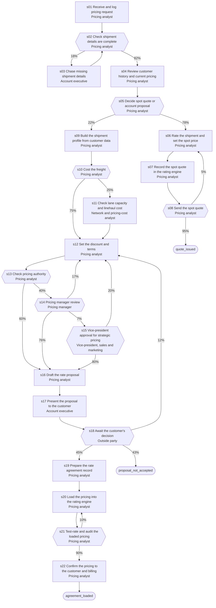

# Price quotes and customer rate agreements

`frt-sls-pricing-quotes` · trucking (less-than-truckload and truckload freight) · sales and pricing · part of `freight-carrier-co`

The pricing desk turns requests from shippers and account executives into prices the billing system can apply. Most requests are spot quotes for one shipment or a few weeks of volume, which an analyst rates against the tariff, records as a quote number and emails the same day. About a quarter are account proposals, where the analyst costs the customer's shipment history lane by lane, sets a discount within an authority matrix, and the account executive presents it; accepted proposals are loaded into the rating engine and audited. The work is slowed by incomplete shipment details, approval queues and customers who take weeks to decide, and errors in recording quotes or loading discounts turn into billing disputes and rebills months later.

| | |
|---|---|
| Unit of work | one quote or pricing request |
| Starts when | A shipper or an account executive sends a request for a price on one or more lanes. |
| Done when | A quote is sent with a quote number recorded in the rating engine, or an accepted proposal is loaded and audited in the rating engine, or the proposal is declined or lapses. |
| Organisation | A Canadian LTL and truckload carrier of about 3,000 employees with a central pricing desk of ten analysts, a pricing manager, and 32 account executives who sell regionally. (3,000 employees, 2019-2022) |
| Volume | 2,500 cases a month (range 2,000 to 3,200) |

## Where it sits

- Starts with **quote_request** from shipper (70% of cases)
- Starts with **quote_request** from sls-account-acquisition (30% of cases)
- Relies on **network_plan** from ltl-network-planning (a standing input; it does not start a case)
- Relies on **fuel_surcharge_table** from fin-fuel-surcharge (a standing input; it does not start a case)
- Relies on **pricing_error_report** from fin-billing-corrections (a standing input; it does not start a case)
- Sends **rate_quote** to shipper (outcome: quote_issued)
- Sends **rate_quote** to fin-rating-invoicing (outcome: quote_issued)
- Sends **rate_agreement** to shipper (outcome: agreement_loaded)
- Sends **rate_agreement** to fin-rating-invoicing (outcome: agreement_loaded)
- Sends **rate_quote** to sls-rfp-response (outcome: agreement_loaded)

## Flow

## Roles

| Role | Department | Layer | FTE on this process | Loaded cost per hour | Evidence |
|---|---|---|---:|---:|---|
| Pricing analyst | Sales and customer service | senior specialist | 8 | 54 CAD | B [src-lineage-job], [src-fastfrate-job] |
| Account executive | Sales and customer service | individual contributor | 4 | 62 CAD | C |
| Pricing manager | Sales and customer service | manager | 0.4 | 95 CAD | C |
| Network and pricing-cost analyst | LTL network planning and linehaul control | senior specialist | 0.3 | 58 CAD | C |
| Vice-president, sales and marketing | Sales and customer service | executive | 0.03 | 160 CAD | C |

## Steps

Hands-on time and the wait before each step show the most common value. Evidence tier A is a sourced number, B a sourced description, C the author's estimate.

| Step | Who | Kind | Hands-on | Wait before | Control | Evidence |
|---|---|---|---:|---:|---|---|
| **s01 Receive and log pricing request.** A pricing analyst opens the shared pricing inbox or the CRM request queue, where requests arrive from shippers directly or from account executives after a sales call. The analyst creates or opens the request record in the CRM, links it to the customer account if one exists and notes the requested lanes, due date and requester. | Pricing analyst | intake | 2 min | 1.5 h |  | B [src-lineage-job], [src-fastfrate-job] |
| **s02 Check shipment details are complete.** The analyst checks that the request gives origin and destination postal codes, pieces, weight, dimensions or density, commodity, dangerous goods flags, accessorials such as liftgate or appointment, and expected frequency. Without dimensions the analyst cannot price on density, which is how most Canadian LTL pricing is set. | Pricing analyst | validation | 2 min | 0 min |  | C |
| **s03 Chase missing shipment details.** The account executive, or the analyst for shipper-direct requests routed back to sales, emails or calls the shipper for the missing dimensions, commodity or volume. The request waits until the shipper replies, often a day or more, and is then re-checked. | Account executive | communication | 8 min | 16.0 h |  | C |
| **s04 Review customer history and current pricing.** The analyst looks up the customer's last 12 months of shipments in the TMS, the current discount or contract in the rating engine, revenue and margin in the BI reports, and any credit hold. This shows whether the request is a new lane for an existing customer, a re-price, or a prospect with no history. | Pricing analyst | lookup | 3 min | 5 min |  | C |
| **s05 Decide spot quote or account proposal.** The analyst decides whether the request is a one-off or short-term spot quote that can be rated against the tariff within spot guidelines, or an account proposal that needs a costed shipment profile. Requests from account acquisition and multi-lane re-prices go to the proposal path. | Pricing analyst | judgment | 1 min | 0 min |  | C |
| **s06 Rate the shipment and set the spot price.** The analyst runs the shipment through the rating engine at the base tariff, checks whether the lane is a headhaul or backhaul in the network plan, applies a discount within the spot floor, and adds the fuel surcharge and accessorials. Backhaul lanes get deeper discounts to fill empty trailers. | Pricing analyst | analysis | 5 min | 10 min | Pricing department discount guidelines for spot quotes (analyst may quote within published spot floors) | B [src-lineage-job], [src-fastfrate-job] |
| **s07 Record the spot quote in the rating engine.** The analyst creates a quote number in the rating engine with the lane, weight break, price, accessorials and an expiry date, usually 30 days, so that billing rates the shipment at the quoted price when the bill of lading shows the quote number. Quotes not recorded or recorded on the wrong account are rated at full tariff and later disputed. | Pricing analyst | data entry | 2 min | 0 min |  | B [src-fastfrate-job] |
| **s08 Send the spot quote.** The analyst emails the quote to the shipper or account executive with the quote number, price, validity, fuel surcharge basis and the instruction to show the quote number on the bill of lading. Some shippers ask for a re-quote at a different weight or date. | Pricing analyst | communication | 2 min | 0 min |  | C |
| **s09 Build the shipment profile from customer data.** The analyst imports the customer's shipment history file, often a spreadsheet of three to twelve months of shipments, into the costing workbook, cleans postal codes and weights, fills missing dimensions with commodity averages and maps each lane to origin and destination terminals. Prospects without history give a sample that the analyst has to scale. | Pricing analyst | data entry | 25 min | 1.0 d |  | B [src-lineage-job] |
| **s10 Cost the freight.** The analyst runs the profile through the costing model: pickup and delivery cost per stop and per hundredweight, cross-dock handling by density, and linehaul cost per lane from the network cost factors. The output is the cost per shipment and the operating ratio at candidate discount levels. | Pricing analyst | analysis | 20 min | 30 min |  | B [src-lineage-job] |
| **s11 Check lane capacity and linehaul cost.** A network analyst checks linehaul load factors and trailer balance on the requested lanes, and partner or interline costs for points the carrier does not serve directly. The analyst replies with a capacity view and adjusted cost factors while the pricing analyst finishes the costing. | Network and pricing-cost analyst | analysis | 20 min | 1.0 h |  | C |
| **s12 Set the discount and terms.** The analyst chooses the discount off the base tariff, minimum charge, any freight-all-kinds class or density rule, accessorial waivers and the target operating ratio, using the cost, the lane balance and competitor prices reported by the account executive. Counter-offers from the customer come back to this step. | Pricing analyst | judgment | 12 min | 15 min |  | B [src-fastfrate-job], [src-fw-gri] |
| **s13 Check pricing authority.** The analyst compares the proposed discount, projected annual revenue and operating ratio with the pricing authority matrix. Proposals below the margin floor or above the analyst's revenue limit go to the pricing manager. | Pricing analyst | validation | 2 min | 0 min | Pricing authority matrix by discount depth and annual revenue | B [src-lineage-job] |
| **s14 Pricing manager review.** The pricing manager opens the costing workbook, checks the operating ratio by lane and the effect on network balance, and approves, asks for changes or escalates strategic or below-floor deals to the vice-president of sales. | Pricing manager | approval | 10 min | 8.0 h | Pricing authority matrix: proposals outside analyst limits approved by the pricing manager | C |
| **s15 Vice-president approval for strategic pricing.** The vice-president of sales reviews deals that fall below the margin floor or are large enough to change network flows, usually in a short meeting with the pricing manager and the account executive, and approves or sends the price back. | Vice-president, sales and marketing | approval | 20 min | 1.0 d | Pricing authority matrix: below-floor or strategic pricing approved by the vice-president of sales | C |
| **s16 Draft the rate proposal.** The analyst builds the rate sheet and proposal letter from the template: base tariff reference, discount, minimum charge, accessorial schedule, fuel surcharge table, validity of 30 to 60 days and terms of carriage. Large proposals include lane-by-lane prices in a spreadsheet attachment. | Pricing analyst | drafting | 15 min | 1.0 h |  | B [src-fastfrate-job], [src-lineage-job] |
| **s17 Present the proposal to the customer.** The account executive sends the proposal and walks the customer through it by phone, video call or a visit, answering questions on transit times, accessorials and fuel surcharge. The executive records the presentation and any objections in the CRM. | Account executive | communication | 20 min | 12.0 h |  | C |
| **s18 Await the customer's decision.** The customer compares the proposal with other carriers' prices and decides. Many proposals get no answer and lapse at the end of their validity; some come back with a counter-offer or a competitor's price to beat. | Outside party | external wait | 0 min | 5.0 d |  | C |
| **s19 Prepare the rate agreement record.** The analyst confirms the bill-to and shipper account numbers, the locations covered, the effective date and the agreed prices, and prepares the rate agreement record for loading. New customers must first be set up by onboarding, so the analyst checks that the account exists. | Pricing analyst | data entry | 8 min | 12.0 h |  | C |
| **s20 Load the pricing into the rating engine.** The analyst keys the discount, minimum charges, accessorial exceptions, fuel surcharge table and effective dates into the rating engine and links them to each account number. Loading errors are the main source of later billing disputes and rebills. | Pricing analyst | data entry | 12 min | 30 min |  | B [src-lineage-job], [src-fastfrate-job] |
| **s21 Test-rate and audit the loaded pricing.** A second pricing analyst rates a sample of the customer's past shipments against the new pricing and compares the results with the proposal. Differences go back to the loading analyst to fix. | Pricing analyst | review | 6 min | 8.0 h | Pricing department rule: a second analyst audits contract pricing before it takes effect | C |
| **s22 Confirm the pricing to the customer and billing.** The analyst emails the account executive, the customer and the billing supervisor with the agreement number and effective date, and closes the request in the CRM. Billing uses the agreement to rate the customer's next shipments. | Pricing analyst | communication | 4 min | 0 min |  | C |

## Exceptions

| Exception | Share of cases | What happens |
|---|---:|---|
| Incomplete shipment details | 18% | The request lacks dimensions, commodity or volume, so the account executive goes back to the shipper and the request waits for a reply. |
| Counter-offer | 5% | The customer returns with a competitor's price; the analyst re-sets the discount and the proposal goes through approval again. |
| Loading error found in audit | 1% | The second analyst finds a wrong account link or effective date and the pricing is reloaded. |
| Strategic deal escalated | 1% | A below-floor or network-changing deal waits for the vice-president of sales. |

## Benchmarks

| Metric | Value | Unit | Population | Evidence |
|---|---|---|---|---|
| cycle_time_days | p50 0.3, p90 15 | calendar days from request received to quote sent, proposal accepted and loaded, or proposal declined | Canadian LTL carrier pricing desk, all pricing requests | C |
| share_of_ltl_revenue_subject_to_gri | low 0.2, high 0.25 | share of revenue | US LTL carriers ArcBest and Saia, 2021 | A [src-fw-gri] |

## Pain points

- Spot quotes not recorded against the right account, or expired, are billed at tariff and come back as disputes and rebills. (steps s07, s20; C)
- Proposals wait in the analyst queue and the manager's inbox during busy months, while the customer is comparing other carriers' prices. (steps s09, s14; C)
- Costing is done in spreadsheets from customer files that need cleaning, so each proposal repeats manual data preparation. (steps s09, s10; B [src-lineage-job])

## Assumptions

- 78% of requests are spot or short-term quotes and 22% are account proposals; the organisation file gives no split.
- At the organisation file's 2,500 requests a month, the simulated hands-on time (mean about 1.1 hours a request) implies about 21 FTE at 130 productive hours a month, against 12.7 FTE stated (8 of the 10 pricing analysts plus part of the account executives' time). The stated FTE cannot rise much because the organisation file has only ten pricing analysts, who also carry RFP responses and renewals. Either the volume is closer to 1,300 to 1,800 requests a month, or simple spot quotes are given by customer service representatives from the rating engine and should be counted elsewhere, or the pricing analyst headcount is low; the gap is reported rather than hidden by shortening touch times further.
- Network analyst and vice-president of sales take part although the organisation file does not list them on this process.
- The simulated median (about 0.4 days) is set by the spot path, where requests arriving in the evening wait for the morning; the 90th percentile (about 15 days) is set by proposals waiting for customer decisions.
- Truckload spot quotes are included in the volume and follow the spot path; truckload lane pricing for contract customers follows the proposal path.
- No step in this process ties up vehicles, equipment or crews, so no resources are listed; no step is done by several people of one role together.

## Sources

- [src-lineage-job] [Logistics Pricing Analyst (Calgary) job posting](https://jobs.sjfventures.com/companies/lineage-logistics/jobs/38499077-logistics-pricing-analyst) (Lineage Logistics (via SJF Ventures job board), 2024). Pricing analyst prepares spot quotes and cost checks, breaks down bids, costs opportunities in TCG costing software, maintains rate sheets, accessorials and fuel surcharge programs in Truckmate, works within the pricing department's approved guidelines and coordinates the annual general rate increase and rate agreement updates.
- [src-fastfrate-job] [Pricing Analyst - Fastfrate Group (Woodbridge) job posting](https://builtin.com/job/pricing-analyst-fastfrate-group-woodbridge/9646957) (Challenger Motor Freight / Fastfrate Group (via Built In), 2025). Pricing analyst prepares customer proposals, keeps the director informed through the RFQ process, tracks competitor pricing, handles urgent one-off rate requests, uploads rates and maintains rate programs in the TMS, and is reachable after hours for pricing problems.
- [src-fw-gri] [LTL: How do general rate increases work?](https://www.freightwaves.com/news/ltl-how-do-general-rate-increases-work) (FreightWaves (Todd Maiden), 2022). GRIs raise base tariff rates while shippers keep negotiated discounts; GRIs are usually announced in Q3 or Q4 and take effect in Q1; only about 25% of ArcBest's and 20% to 25% of Saia's business is subject to the GRI, the rest is under contract or individual pricing; most carriers took a 5% to 6% GRI in Q1 2021 and many a second later in 2021.

Written by claude-opus on 2026-11-24.
