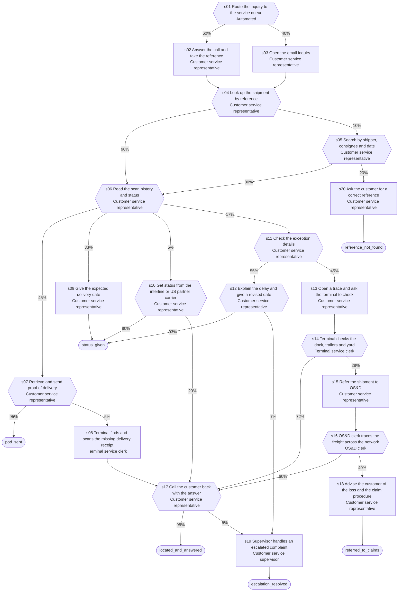

# Answer shipment trace and status questions

`frt-sls-shipment-tracing` · trucking (less-than-truckload and truckload freight) · customer service · part of `freight-carrier-co`

Shippers and consignees call or email the customer service centre to ask where their freight is, when it will arrive, or for proof of delivery. A representative finds the shipment in the TMS by PRO, bill of lading or purchase order number, reads its scan history and answers most questions in a few minutes. Late or unscanned shipments need a check by the terminal or a network-wide trace by the OS&D clerks, and the customer is called back hours or days later. The work is slowed by wrong reference numbers, missing delivery receipt images and storm days when calls nearly double.

| | |
|---|---|
| Unit of work | one trace inquiry |
| Starts when | A shipper or consignee calls, emails or sends a portal message asking about a shipment's status or for proof of delivery. |
| Done when | The customer has the status, expected delivery date or proof of delivery, or has been told the freight is lost and how to claim. |
| Organisation | A Canadian LTL carrier of about 3,000 employees moving about 150,000 LTL shipments a month, with a central customer service centre of 60 representatives working extended hours. (3,000 employees, 2019-2022) |
| Volume | 30,000 cases a month (range 24,000 to 38,000) |

## Where it sits

- Starts with **trace_inquiry** from shipper (65% of cases)
- Starts with **trace_inquiry** from consignee (35% of cases)
- Relies on **delivery_receipt** from ltl-pod-capture (a standing input; it does not start a case)
- Relies on **border_hold** from tl-border-holds (a standing input; it does not start a case)
- Sends **trace_response** to shipper (outcome: any)
- Sends **trace_response** to consignee (outcome: any)
- Sends **delivery_receipt** to shipper (outcome: pod_sent)
- Sends **trace_request** to ltl-osd-exceptions (outcome: referred_to_claims)
- Sends **trace_request** to ltl-osd-exceptions (outcome: located_and_answered)

## Flow

## Roles

| Role | Department | Layer | FTE on this process | Loaded cost per hour | Evidence |
|---|---|---|---:|---:|---|
| Customer service representative | Customer service centre | individual contributor | 32 | 32 CAD | C |
| Customer service supervisor | Customer service centre | supervisor | 0.6 | 48 CAD | C |
| Terminal service clerk | LTL terminal network | individual contributor | 4 | 32 CAD | C |
| OS&D clerk | LTL terminal network | individual contributor | 1.5 | 33 CAD | C |

## Steps

Hands-on time and the wait before each step show the most common value. Evidence tier A is a sourced number, B a sourced description, C the author's estimate.

| Step | Who | Kind | Hands-on | Wait before | Control | Evidence |
|---|---|---|---:|---:|---|---|
| **s01 Route the inquiry to the service queue.** The contact centre software routes incoming calls to the next free customer service representative and puts emails and portal messages into the shared service inbox. Callers who choose the automated tracking option and get an answer never reach this process. | Automated | system auto | 0 min | 0 min |  | C |
| **s02 Answer the call and take the reference.** The representative answers, identifies the caller as shipper, consignee or third party, and asks for the PRO number, bill of lading or purchase order number. Callers often have only a purchase order number or the shipper's name. | Customer service representative | intake | 1 min | 2 min | Customer privacy practice: shipment details and delivery receipts given only to the shipper, consignee or a party named on the bill of lading | C |
| **s03 Open the email inquiry.** The representative takes the next email or portal message from the shared inbox, reads which shipments are asked about (some emails list several) and copies the references into the TMS search. | Customer service representative | intake | 1 min | 2.0 h |  | C |
| **s04 Look up the shipment by reference.** The representative searches the TMS by PRO, bill of lading or purchase order number. Shipments booked by a broker or with a wrong number do not come up. | Customer service representative | lookup | 1 min | 0 min |  | B [src-fw-lsp44] |
| **s05 Search by shipper, consignee and date.** The representative searches the TMS by shipper and consignee names, postal codes and pickup dates over the past week, compares weights and piece counts with what the caller describes, and picks the likely match. | Customer service representative | lookup | 5 min | 0 min |  | B [src-fw-lsp44] |
| **s06 Read the scan history and status.** The representative reads the shipment's scan history from the dock and driver handhelds: picked up, loaded to linehaul, arrived at destination terminal, out for delivery or delivered. The status decides the answer. | Customer service representative | lookup | 1.5 min | 0 min |  | C |
| **s07 Retrieve and send proof of delivery.** The representative opens the delivery receipt image in the imaging system, checks the signature and any exceptions noted, and emails or faxes it to the customer, or reads the signer and time over the phone. | Customer service representative | communication | 2 min | 0 min |  | C |
| **s08 Terminal finds and scans the missing delivery receipt.** A terminal service clerk receives the request by email, finds the paper delivery receipt in the day's driver paperwork, scans it into the imaging system and replies to customer service. | Terminal service clerk | lookup | 6 min | 8.0 h |  | C |
| **s09 Give the expected delivery date.** The representative works out the expected delivery date from the last scan and the standard transit time for the lane, tells the customer, and notes the call in the shipment's TMS notes. | Customer service representative | communication | 1.5 min | 0 min |  | C |
| **s10 Get status from the interline or US partner carrier.** For freight handed to a partner carrier beyond the network, the representative looks up the partner's PRO number in the TMS and checks the partner's tracking website or calls its service desk. Some partners reply later by email. | Customer service representative | lookup | 8 min | 0 min |  | C |
| **s11 Check the exception details.** The representative reads the OS&D notes, the linehaul dispatch status, the truck's position on the telematics map, road closure and weather notices and any border hold for cross-border freight, to find out why the shipment is late. | Customer service representative | lookup | 4 min | 0 min |  | C |
| **s12 Explain the delay and give a revised date.** The representative explains the cause, such as a missed linehaul, weather closure, appointment or border hold, gives a revised delivery date and notes the call. Upset callers are passed to the supervisor. | Customer service representative | communication | 3 min | 0 min |  | C |
| **s13 Open a trace and ask the terminal to check.** The representative opens a trace ticket in the TMS and emails or calls the terminal that last scanned the freight, giving the PRO, pieces and description. The customer is told someone will call back. | Customer service representative | coordination | 4 min | 0 min |  | C |
| **s14 Terminal checks the dock, trailers and yard.** A terminal service clerk checks the dock and the trailer manifests, walks the dock or asks the dock supervisor to look in loaded trailers and the yard, and replies with the location or a not-found answer. Freight left on the dock or loaded to the wrong trailer is the common finding. | Terminal service clerk | physical | 12 min | 3.0 h |  | C |
| **s15 Refer the shipment to OS&D.** The representative sends a trace request to the OS&D clerks with the shipment details and the terminal's reply, and tells the customer the freight is being traced across the network. | Customer service representative | data entry | 4 min | 30 min |  | C |
| **s16 OS&D clerk traces the freight across the network.** An OS&D clerk compares the missing freight with overage reports from other terminals, checks unmatched freight photos and asks hubs to search. Found freight is re-routed and the clerk replies to customer service. | OS&D clerk | lookup | 20 min | 1.0 d |  | C |
| **s17 Call the customer back with the answer.** The representative picks up the terminal's or OS&D's reply from the trace ticket, calls or emails the customer with the location and new delivery date, and closes the ticket. | Customer service representative | communication | 3 min | 2.0 h |  | C |
| **s18 Advise the customer of the loss and the claim procedure.** The representative tells the customer the freight cannot be found, explains how and by when to file a claim (written notice within 60 days of delivery, or nine months from shipment if never delivered) and sends the claim form. | Customer service representative | communication | 6 min | 2.0 h |  | B [src-freightcom] |
| **s19 Supervisor handles an escalated complaint.** The customer service supervisor calls the customer back, reviews what went wrong with the terminal manager and decides on a remedy such as expedited delivery or waiving a charge. | Customer service supervisor | judgment | 20 min | 4.0 h |  | C |
| **s20 Ask the customer for a correct reference.** The representative tells the customer no matching shipment was found, asks for the PRO number from the shipper's bill of lading or confirms the freight has not yet been picked up, and notes the inquiry. | Customer service representative | communication | 2 min | 0 min |  | B [src-fw-lsp44] |

## Exceptions

| Exception | Share of cases | What happens |
|---|---:|---|
| Reference not found | 10% | The customer's number does not match; the representative searches by names and dates, and about one in five such searches fails. |
| Terminal check | 8% | The records do not explain a late shipment, so the terminal checks the dock and trailers and the customer is called back. |
| Network trace | 2% | The terminal cannot find the freight and OS&D traces it across the network; four in ten are not found and the customer is told to claim. |
| Missing proof of delivery image | 2% | The delivery receipt was not scanned or is unreadable, so the terminal has to find the paper copy. |

## Benchmarks

| Metric | Value | Unit | Population | Evidence |
|---|---|---|---|---|
| cycle_time_days | p50 0.015, p90 0.4 | calendar days from the inquiry reaching the queue to the customer having an answer | Canadian LTL carrier customer service centre, trace inquiries | C |

## Pain points

- Customers quote purchase order or broker numbers instead of the PRO, so representatives search by names and dates. (steps s04, s05, s20; B [src-fw-lsp44])
- Freight without a recent scan needs a terminal dock check, and the customer waits hours for a callback. (steps s13, s14, s17; C)
- On storm days call volume nearly doubles while answers depend on linehaul status that dispatch has not yet updated. (steps s02, s11, s12; C)

## Assumptions

- 60% of inquiries arrive by phone and 40% by email or portal message; 45% ask for proof of delivery, 33% are on-schedule status checks, 5% are with partner carriers and 17% are late or exceptions.
- Terminal service clerks and OS&D clerks take part although the organisation file lists only customer service representatives and supervisors on this process.
- The FreightWaves source is from 2026 but describes manual tracing work that it says the industry has done for decades, so it is used for the 2019-2022 description.
- The simulated median is set by phone calls answered within a few minutes; the 90th percentile is set by emails waiting overnight and terminal callbacks.
- No step ties up vehicles, equipment or crews, so no resources are listed; weather appears as the cause of the volume surge rather than as a wait inside a case.

## Sources

- [src-fw-lsp44] [Carrier Logistics, LSP44 announce partnership to automate LTL shipment identification](https://freightwaves.com/news/carrier-logistics-lsp44-announce-partnership-to-automate-ltl-shipment-identification) (FreightWaves (Patrick Hatzis), 2026). LTL tracking relies on a valid PRO number; when the shipper or broker lacks it the carrier's system cannot find the shipment and the customer must call or email so an employee searches manually by origin, destination, postal codes, names and description; every LTL carrier runs a customer service team absorbing this cost.
- [src-freightcom] [LTL claims](https://www.freightcom.com/ltl-claims) (Freightcom, 2024). Canadian LTL carriers mostly require concealed damage to be reported within 24 hours and claims for noted loss or damage within 60 days of delivery; documents: invoice, photos, description and claim value; freight charges must be paid; liability from 10 cents per pound for used goods to $2 per pound for new goods; some carriers set minimum claim amounts of $50 to $100; carriers take 30 to 90 days to settle courier claims.

Written by claude-opus on 2026-11-24.
