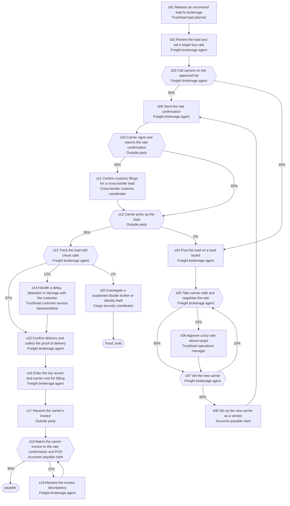

# Broker overflow loads to third-party carriers

`frt-tl-brokerage` · trucking (truckload) · operations · part of `freight-carrier-co`

When the carrier's own trucks cannot take a customer's load, a brokerage agent finds another trucking company to haul it, earning the gap between the customer rate and the rate paid to that carrier. The agent calls carriers it already uses or posts the load on a load board, vets new carriers, sends a rate confirmation, tracks the load to delivery and collects the proof of delivery, and accounts payable matches the carrier's invoice before payment. Margins are thin, rates move fast in tight markets, and no-shows, delays and carriers using stolen identities to double broker loads add rework and risk.

| | |
|---|---|
| Unit of work | one brokered load |
| Starts when | A booked customer load cannot be covered by a company driver or owner-operator and the load planner releases it to brokerage. |
| Done when | The load is delivered, the trip record is with billing and the carrier invoice is approved for payment, or payment is held after suspected fraud. |
| Organisation | A Canadian LTL and truckload carrier of about 3,000 employees with a small brokerage desk inside its truckload division that covers overflow loads in Canada and to and from the US. (3,000 employees, 2019-2022) |
| Volume | 600 cases a month (range 450 to 850) |

## Where it sits

- Starts with **booked_load** from tl-load-tender (100% of cases)
- Relies on **capacity_plan** from ltl-peak-capacity (a standing input; it does not start a case)
- Sends **brokered_load** to third-party-carrier (outcome: payable)
- Sends **trip_record** to fin-rating-invoicing (outcome: any)
- Sends **carrier_rate_confirmation** to fin-accounts-payable (outcome: payable)
- Sends **carrier_invoice** to fin-accounts-payable (outcome: payable)
- Sends **security_incident** to saf-cargo-security (outcome: fraud_hold)

## Flow

## Roles

| Role | Department | Layer | FTE on this process | Loaded cost per hour | Evidence |
|---|---|---|---:|---:|---|
| Freight brokerage agent | Truckload customer service and brokerage | individual contributor | 9 | 42 CAD | C |
| Truckload load planner | Truckload fleet operations | individual contributor | 0.5 | 44 CAD | C |
| Truckload operations manager | Truckload fleet operations | manager | 0.1 | 82 CAD | C |
| Accounts payable clerk | Finance | individual contributor | 2 | 32 CAD | C |
| Cross-border customs coordinator | Cross-border and customs desk | individual contributor | 0.5 | 38 CAD | C |
| Truckload customer service representative | Truckload customer service and brokerage | individual contributor | 0.3 | 36 CAD | C |
| Cargo security coordinator | Safety, compliance and driver services | senior specialist | 0.1 | 50 CAD | C |

## Steps

Hands-on time and the wait before each step show the most common value. Evidence tier A is a sourced number, B a sourced description, C the author's estimate.

| Step | Who | Kind | Hands-on | Wait before | Control | Evidence |
|---|---|---|---:|---:|---|---|
| **s01 Release an uncovered load to brokerage.** The truckload load planner looks at a booked load that no company driver or owner-operator can reach before the pickup appointment, for example in a lane the fleet rarely runs or during the autumn peak, and flags it in the TMS as released to brokerage. | Truckload load planner | judgment | 5 min | 4.0 h |  | C |
| **s02 Review the load and set a target buy rate.** The brokerage agent opens the load in the TMS, reads the customer rate, equipment, weight, appointments and border crossing, looks up what was paid on the lane before and the current load-board rate, and sets the most the carrier can be paid while keeping a margin of about 12% to 15%. | Freight brokerage agent | analysis | 10 min | 1.0 h |  | B [src-tia-margin] |
| **s03 Call carriers on the approved list.** The agent phones or emails carriers already set up and known to run the lane, offering the load at or below the target rate. About half of loads are covered this way. | Freight brokerage agent | communication | 12 min | 15 min |  | C |
| **s04 Post the load on a load board.** The agent posts the lane, dates, equipment and a rate or 'call for rate' on a load board used in Canada and the US, and watches for calls. | Freight brokerage agent | data entry | 5 min | 10 min |  | C |
| **s05 Take carrier calls and negotiate the rate.** The agent takes calls from carriers and dispatchers who saw the posting, asks for their MC or safety number, truck location and empty time, and negotiates the rate. During tight markets in 2021 the agent may call back several times as rates rise. | Freight brokerage agent | communication | 20 min | 2.0 h |  | C |
| **s06 Approve a buy rate above target.** The truckload operations manager decides whether to pay above the target, cutting or losing the margin, to protect a customer's service, or to go back to the customer for a higher rate. | Truckload operations manager | approval | 5 min | 1.0 h | Company delegation of authority: below-margin brokered loads approved by the operations manager | C |
| **s07 Vet the new carrier.** The agent checks the carrier's operating authority and safety rating (FMCSA records for US authority, the provincial safety rating for Canadian carriers), calls the insurer to confirm liability and cargo cover, checks the authority's age, the address and email domain, and calls back on the carrier's main number. | Freight brokerage agent | validation | 25 min | 15 min | Company carrier selection policy: authority, safety rating and insurance verified before tender | B [src-ttnews-db], [src-tia-vetting] |
| **s08 Set up the new carrier as a vendor.** The accounts payable clerk enters the carrier's legal name, GST number or US tax form, remit-to address and bank details from the signed broker-carrier agreement into the ERP, and confirms bank details by phone. | Accounts payable clerk | data entry | 25 min | 4.0 h | Internal control: carrier bank details entered by accounts payable, not by the agent who books the load | C |
| **s09 Send the rate confirmation.** The agent builds the rate confirmation in the TMS with the pickup and delivery details, the agreed rate, accessorial rules, tracking and paperwork requirements, and emails it to the carrier. | Freight brokerage agent | drafting | 8 min | 10 min |  | C |
| **s10 Carrier signs and returns the rate confirmation.** The carrier's dispatcher signs the rate confirmation and returns it with the driver's name, cell number, tractor and trailer numbers. | Outside party | external wait | 0 min | 1.0 h |  | C |
| **s11 Confirm customs filings for a cross-border load.** The cross-border customs coordinator checks that the carrier has filed its eManifest with CBSA or US CBP before arrival and that the customs broker has the PARS or PAPS number for the shipment, and sends the carrier the customs paperwork. | Cross-border customs coordinator | coordination | 15 min | 2.0 h | CBSA Advance Commercial Information (eManifest) and US CBP ACE eManifest requirements for highway carriers | C |
| **s12 Carrier picks up the load.** The carrier's truck travels to the shipper and loads at the appointment. A carrier that does not show up leaves the agent to re-cover the load at short notice. | Outside party | external wait | 0 min | 12.0 h |  | C |
| **s13 Track the load with check calls.** The agent calls or texts the driver at pickup, once a day in transit and before delivery, or follows a tracking link, and updates the load status in the TMS so customer service can answer the shipper. | Freight brokerage agent | communication | 15 min | 1.0 d |  | B [src-ttnews-db] |
| **s14 Handle a delay, detention or damage with the customer.** The truckload customer service representative tells the shipper or consignee about the delay, for example a winter highway closure or a long wait at the dock, rebooks the appointment, and records detention or other accessorial charges to bill and to pay the carrier. | Truckload customer service representative | communication | 25 min | 1.0 h |  | C |
| **s15 Confirm delivery and collect the proof of delivery.** The agent confirms delivery with the driver or consignee and asks the carrier to email the signed bill of lading and proof of delivery, which the agent attaches to the load in the imaging system. | Freight brokerage agent | lookup | 10 min | 12.0 h |  | C |
| **s16 Enter the trip record and carrier cost for billing.** The agent completes the load in the TMS with delivery date, accessorials and the carrier cost, which releases it to billing to invoice the customer and records the expected carrier payable. | Freight brokerage agent | data entry | 10 min | 4.0 h |  | C |
| **s17 Receive the carrier's invoice.** The carrier mails or emails its invoice with the bill of lading and proof of delivery. Many small carriers choose quick-pay at a discount or factor their invoices, which changes who is paid. | Outside party | external wait | 0 min | 3.0 d |  | C |
| **s18 Match the carrier invoice to the rate confirmation and POD.** The accounts payable clerk matches the invoice amount with the signed rate confirmation, the accessorials approved in the TMS and the proof of delivery, checks the remit-to against the vendor record, and approves the invoice for the next payment run. | Accounts payable clerk | validation | 8 min | 1.0 d | Internal control over financial reporting: match of carrier invoice, rate confirmation and proof of delivery before payment | C |
| **s19 Resolve the invoice discrepancy.** The agent reviews the disputed amount, usually detention, a lumper fee or an extra stop, calls the carrier, and either approves the extra charge in the TMS or asks the carrier for a corrected invoice. | Freight brokerage agent | analysis | 20 min | 1.0 d |  | C |
| **s20 Investigate a suspected double broker or identity theft.** The cargo security coordinator calls the carrier on its registered main number, checks whether the truck at the shipper belongs to the carrier on the rate confirmation, and if not, holds the payment, warns the customer and reports the case. | Cargo security coordinator | analysis | 2.0 h | 4.0 h | Company cargo security policy: payment held until the hauling carrier is confirmed | B [src-ttnews-db] |

## Exceptions

| Exception | Share of cases | What happens |
|---|---:|---|
| Load board needed | 45% | No approved carrier takes the load, so the agent posts it and vets a new carrier. |
| Rate above target | 7% | The only available carrier wants more than the target rate and the operations manager approves or refuses. |
| Carrier no-show | 5% | The carrier does not arrive and the load is re-posted at short notice. |
| Delay or detention | 12% | Weather or dock waits delay the load; customer service rebooks and records accessorials. |
| Invoice mismatch | 15% | The carrier invoice does not match the rate confirmation, usually because of accessorials. |
| Suspected double brokering | 1% | The truck at pickup is not the contracted carrier's; payment is held and security investigates. |

## Benchmarks

| Metric | Value | Unit | Population | Evidence |
|---|---|---|---|---|
| cycle_time_days | p50 8, p90 16 | calendar days from release to brokerage to carrier invoice approved | Brokered truckload loads at an asset-based carrier | C |
| truckload_brokerage_gross_margin | low 11.4, mode 12.4, high 15.2 | percent of revenue | TIA member brokers, Q4 2019 to Q4 2020 | A [src-tia-margin] |
| average_truckload_invoice | 1997 | USD per load | TIA member brokers, Q4 2020 | A [src-tia-margin] |
| us_broker_security_required | 75000 | USD | Property brokers registered with FMCSA | A [src-cfr387] |

## Pain points

- Covering loads off the load board takes many calls and rate rounds, and vetting each new carrier by phone adds time. (steps s04, s05, s07; B [src-ttnews-db], [src-tia-vetting])
- Carriers using stolen identities and double brokering rose from late 2022, so checks that passed a carrier may still let a fraudster through. (steps s07, s13, s20; B [src-ttnews-db])
- Thin margins mean a single above-target buy or an unbilled detention charge wipes out the profit on a load. (steps s06, s14, s16; B [src-tia-margin])
- Carrier invoices arrive days after delivery and often disagree with the rate confirmation on accessorials. (steps s17, s18, s19; C)

## Assumptions

- Volume follows the organisation file (450 to 850 loads a month). That volume implies brokerage revenue of about 3% of company revenue, not the 6% the organisation file states; one of the two is off by about a factor of two.
- The process ends when the carrier invoice is approved; payment terms (often 30 days, or quick-pay at a discount) are in accounts payable.
- Margins use US TIA figures; Canadian brokerage margins in the period are assumed similar.
- The carrier is assumed to hold US broker authority with the USD 75,000 bond for loads it brokers in the US; Canadian provincial broker rules are not modelled.
- Customs and eManifest rules are described from general knowledge; the CBSA page cited in the organisation file was not opened by this author.
- The simulated median of about 10 days is above the 8-day estimate because carrier invoices arrive up to a week after delivery; the estimate itself is tier C, so the gap is left as it is.
- The neighbouring tender workflow sends about 6.5% of truckload tenders to brokerage, about 600 loads a month on 9,500 tenders, which supports the volume used here.
- Loaded costs come from the organisation file. Third-party trucks are not company resources, so no resources are listed.

## Sources

- [src-tia-margin] [Truckload brokerage margins in Q4 lowest in 2 years: TIA](https://www.freightwaves.com/news/truckload-brokerage-margins-in-q4-lowest-in-2-years-tia) (FreightWaves, 2021). TIA quarterly data: truckload brokerage gross margin 11.4% in Q4 2020, down from 12.4% in Q3 2020 and 15.2% in Q4 2019; average truckload invoice USD 1,997 per load in Q4 2020.
- [src-cfr387] [49 CFR 387.307 - Property broker surety bond or trust fund](https://www.law.cornell.edu/cfr/text/49/387.307) (Legal Information Institute, Cornell Law School (US Code of Federal Regulations), 2024). A property broker must hold a USD 75,000 surety bond (Form BMC-84) or trust fund (Form BMC-85).
- [src-ttnews-db] [Reports of Double-Brokering Increase](https://ttnews.com/articles/double-brokering-increases) (Transport Topics, 2023). TIA Watchdog reports of double brokering rose from December 2022; Truckstop saw a 400% rise in complaints in Q4 2022 and Q1 2023; brokers vet carriers by operating history, inspection records, insurance confirmation with the insurer, address and email-domain checks, call-backs to the carrier's main number and holding payment until the hauling carrier is identified.
- [src-tia-vetting] [Carrier vetting red flags brokers should know](https://news.tianet.org/carrier-vetting-red-flags-brokers-should-know/) (Transportation Intermediaries Association (TIA) news, 2026). Broker carrier-vetting steps: verify USDOT and MC numbers against name and address, check contact details and email domain, require proof of insurance, check authority age and work history, take time over verification. A later article describing checks that were already common.

Written by claude-opus on 2026-11-24.
