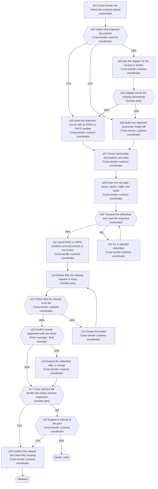

# File eManifests and clear cross-border loads

`frt-tl-customs-emanifest` · trucking and freight transportation · cross-border and customs · part of `freight-carrier-co`

Every truck entering Canada or the US must send the border agency an electronic manifest describing the trip and its shipments before it arrives: at least an hour ahead, or 30 minutes for FAST trips into the US. The carrier's customs coordinators gather the invoice and broker details, enter the shipments with their PARS or PAPS numbers and the driver, tractor and trailer details, transmit, fix rejects, and send the numbers to each importer's customs broker, who files the release. They check the release is on file before the truck arrives and help when it is referred at the port. Missing invoices, vague commodity descriptions, wrong plates, late driver or trailer changes and brokers who have not filed are the common causes of border delays.

| | |
|---|---|
| Unit of work | one border crossing |
| Starts when | A cross-border truckload trip is assigned to a driver, or an LTL linehaul trailer for a US exchange is built. |
| Done when | The truck is released at the port and the crossing is closed in the TMS, or the load is held and passed to the border-hold process. |
| Organisation | A Canadian LTL and truckload carrier of about 3,000 employees whose truckload division runs about 400 company sleeper tractors and 380 owner-operators within Canada and across the US border, on a carrier TMS with EDI, ELDs and an eManifest service provider. (3,000 employees, 2019-2022) |
| Volume | 3,000 cases a month (range 2,500 to 3,600) |

## Where it sits

- Starts with **trip_assignment** from tl-load-planning (88% of cases)
- Starts with **freight_bill** from fin-freight-bill-entry (12% of cases)
- Sends **customs_release** to tl-trip-execution (outcome: released)
- Sends **customs_release** to ltl-linehaul-dispatch (outcome: released)
- Sends **emanifest** to cbsa (outcome: any)
- Sends **emanifest** to us-cbp (outcome: any)
- Sends **customs_entry_request** to customs-broker (outcome: any)
- Sends **border_hold** to tl-border-holds (outcome: border_hold)

## Flow

## Roles

| Role | Department | Layer | FTE on this process | Loaded cost per hour | Evidence |
|---|---|---|---:|---:|---|
| Cross-border customs coordinator | Cross-border and customs desk | individual contributor | 12 | 38 CAD | C |
| Driver manager (fleet manager) | Truckload fleet operations | individual contributor | 1.2 | 43 CAD | C |

## Steps

Hands-on time and the wait before each step show the most common value. Evidence tier A is a sourced number, B a sourced description, C the author's estimate.

| Step | Who | Kind | Hands-on | Wait before | Control | Evidence |
|---|---|---|---:|---:|---|---|
| **s01 Cross-border trip enters the customs queue.** When a planner flags a truckload trip as cross-border, or an LTL linehaul trailer is built for a US partner exchange, the TMS adds it to the customs desk queue with the shipments, the planned port of entry and the ETA at the border. | Automated | system auto | 0 min | 0 min |  | C |
| **s02 Gather the shipment documents.** The customs coordinator opens the crossing, pulls the bill of lading and commercial invoice from the imaging system or the shipper's email, and checks that the importer's customs broker is named on the order. | Cross-border customs coordinator | lookup | 4 min | 1.0 h |  | C |
| **s03 Ask the shipper for the invoice or broker.** The coordinator emails or calls the shipper for the commercial invoice, the importer of record or the broker's name, explaining that the truck cannot cross without them. | Cross-border customs coordinator | communication | 5 min | 0 min |  | C |
| **s04 Shipper sends the missing documents.** The shipper's office emails the invoice or names the broker. Small shippers and shipments picked up late in the day often answer only the next morning. | Outside party | external wait | 0 min | 3.0 h |  | C |
| **s05 Build the shipment record with its PARS or PAPS number.** The coordinator takes the next PARS (into Canada) or PAPS (into the US) number from the carrier's pre-printed barcode range and enters the shipment in the eManifest service provider's software: shipper, consignee, commodity description, quantity, weight and port of entry, copying details from the TMS order. | Cross-border customs coordinator | data entry | 6 min | 0 min |  | B [src-cbsa-aci], [src-d17-1-4] |
| **s06 Build one shipment record per freight bill.** For an LTL linehaul trailer the coordinator enters a shipment record for each freight bill on the trailer, often 10 to 30, each with its own PARS or PAPS number, consignee, description and weight, and checks that every bill has a broker. | Cross-border customs coordinator | data entry | 30 min | 0 min |  | C |
| **s07 Check commodity descriptions and data.** The coordinator reads each description against the CBSA's guidance on detailed commodity descriptions and the invoice, replaces vague terms with what the goods are, and checks quantities and weights against the bill of lading. | Cross-border customs coordinator | validation | 1.5 min | 0 min | CBSA Advance Commercial Information (ACI eManifest): cargo and conveyance data at least 1 hour before arrival, accurate and complete, AMPS penalties for late or wrong data; CBP ACE eManifest under 19 CFR 123.92 (1 hour, 30 minutes for FAST) | B [src-cbsa-aci] |
| **s08 Enter the trip data: driver, tractor, trailer and seals.** The coordinator creates the trip (conveyance) record with the driver's name, date of birth, citizenship and FAST card number, the tractor and trailer plates and their province or state, seal numbers, port of entry and ETA, and links the shipment records to it. | Cross-border customs coordinator | data entry | 5 min | 0 min | CBSA Advance Commercial Information (ACI eManifest): cargo and conveyance data at least 1 hour before arrival, accurate and complete, AMPS penalties for late or wrong data; CBP ACE eManifest under 19 CFR 123.92 (1 hour, 30 minutes for FAST) | A [src-cbsa-aci], [src-cfr-123], [src-fleetowner-fast] |
| **s09 Transmit the eManifest and read the response.** The service provider sends the trip and shipments to the CBSA (ACI) or CBP (ACE) and returns an acceptance or a reject with an error code within minutes; accepted trips show in the portal with their status. | Automated | system auto | 0 min | 5 min |  | B [src-cbsa-eval] |
| **s10 Fix a rejected eManifest.** The coordinator reads the reject code, corrects the plate format, carrier code, duplicate cargo control number or missing field, and resends. | Cross-border customs coordinator | validation | 8 min | 10 min |  | C |
| **s11 Send PARS or PAPS numbers and documents to the broker.** The coordinator emails or faxes the commercial invoice and bill of lading to each importer's customs broker with the PARS or PAPS number, so the broker can file the release request against the same cargo control number. | Cross-border customs coordinator | communication | 2 min | 0 min |  | B [src-d17-1-4], [src-cfr-123] |
| **s12 Broker files the release request or entry.** The importer's customs broker files the PARS release request with the CBSA or the PAPS entry with CBP, using the invoice and the carrier's number. Brokers work through a queue and file late-day shipments in the evening or next morning. | Outside party | external wait | 0 min | 2.0 h |  | B [src-d17-1-4] |
| **s13 Check that the release is on file.** Before the truck nears the border the coordinator checks the portal notices for each shipment: a PARS release recommendation or referral from the CBSA, or the PAPS entry on file with CBP. Missing ones are chased. | Cross-border customs coordinator | lookup | 1.5 min | 2.0 h |  | A [src-cbsa-eval] |
| **s14 Chase the broker.** The coordinator phones or emails the broker to find out why the release is not on file, resends documents or obtains a missing importer number, and, if the truck is close, tells the driver manager to slow or hold the driver. | Cross-border customs coordinator | communication | 6 min | 0 min |  | C |
| **s15 Confirm border paperwork with the driver.** The driver manager sends the driver the eManifest trip number and checks that the driver has the PARS or PAPS labels, invoices and seal, and that the truck, trailer and port have not changed since filing. | Driver manager (fleet manager) | communication | 3 min | 30 min |  | C |
| **s16 Amend the eManifest after a change.** When the driver, tractor, trailer or port changes after filing, the coordinator amends the trip in the portal and retransmits before the truck reaches the border, because the driver cannot use a different port without an update. | Cross-border customs coordinator | data entry | 6 min | 15 min | CBSA Advance Commercial Information (ACI eManifest): cargo and conveyance data at least 1 hour before arrival, accurate and complete, AMPS penalties for late or wrong data; CBP ACE eManifest under 19 CFR 123.92 (1 hour, 30 minutes for FAST) | B [src-cbsa-aci] |
| **s17 Truck reaches the border and clears primary inspection.** The truck drives to the port, queues and stops at the primary booth, where the officer scans the manifest and release and releases the truck or refers it inside. | Outside party | external wait | 2 min | 8.0 h |  | A [src-cbsa-eval], [src-mtri] |
| **s18 Support a referral at the port.** The coordinator takes the driver's call from the counter, finds what is missing or wrong, gets the broker to file or correct the release, and sends corrected data; selected loads are examined and some are held. | Cross-border customs coordinator | coordination | 15 min | 10 min |  | B [src-d17-1-4], [src-cbsa-eval] |
| **s19 Confirm the release and close the crossing.** The coordinator sees the release or arrival notice in the portal, marks the crossing cleared in the TMS so tracing and billing show it, and files the manifest record. | Cross-border customs coordinator | data entry | 1 min | 30 min |  | C |

## Exceptions

| Exception | Share of cases | What happens |
|---|---:|---|
| Missing invoice or broker | 18% | The shipper has not sent the commercial invoice or named the broker; the coordinator chases it, sometimes overnight. |
| eManifest rejected | 6% | The CBSA or CBP rejects the transmission for a plate format, carrier code or duplicate number error, and it is fixed and resent. |
| Release not on file | 14% | The broker has not filed the release or entry when the truck nears the border; the coordinator chases and may hold the driver short of the port. |
| Change after filing | 10% | A driver swap, trailer change, new port or new ETA forces an amendment before arrival. |
| Referral or hold at the port | 9% | The officer refers the truck inside; most are released after the broker fixes the release, and about three in ten are held for examination or a missing release. |

## Benchmarks

| Metric | Value | Unit | Population | Evidence |
|---|---|---|---|---|
| cycle_time_days | p50 1.0, p90 2.2 | calendar days from the crossing entering the customs queue to release at the port | Canadian carrier customs desks, 2019-2022 | C |
| frontline_referral_rate | low 0.07, mode 0.09, high 0.13 | share of highway crossings referred from primary inspection | CBSA highway mode, 2018-19 to 2022-23 | A [src-cbsa-eval] |
| release_recommendation_ready_on_arrival | 0.994 | share of release requests filed at least 1 hour before arrival with a recommendation ready on arrival | CBSA, 2018-19 to 2022-23 | A [src-cbsa-eval] |

## Pain points

- Shipment details are re-keyed from the TMS order and the invoice into the eManifest software, which costs time and produces plate, weight and description errors. (steps s05, s06, s08; C)
- The carrier depends on brokers it does not choose; trucks wait when a broker has not filed the release. (steps s12, s13, s14; B [src-d17-1-4])
- Missing commercial invoices from shippers hold up filing, often overnight. (steps s03, s04; C)
- Late changes of driver, trailer or port need amendments; a missed amendment means a referral or a penalty. (steps s15, s16; B [src-cbsa-aci])

## Assumptions

- One case is one loaded border crossing in either direction; trucks entering the US file ACE and trucks entering Canada file ACI, through the same eManifest service provider, so the steps are shown once.
- About 12% of crossings are LTL linehaul trailers with many freight bills, which take much longer to manifest (s06).
- The org file lists the customs broker's customs_release as a trigger; in practice it is a response within the case (s12-s13) rather than what starts it, so it is not a trigger here.
- Held loads end this process with the outcome 'border_hold' and pass to tl-border-holds; the org file links border holds only from the CBSA and CBP.
- Staffing check: coordinator touch time averages about 35 minutes per crossing, which at 3,000 crossings implies about 13 FTE at 130 productive hours a month, against 14 coordinators who also work border holds and cover 24 hours a day; the desk has little slack.
- Loaded costs come from the org file.

## Sources

- [src-cbsa-aci] [Highway mode: Transmit electronic commercial data (Advance Commercial Information / eManifest)](https://www.cbsa-asfc.gc.ca/prog/aci-manif-ipec/hcc-ctr-eng.html) (Canada Border Services Agency, None). Highway carriers transmit cargo and conveyance data at least 1 hour before arrival at the port of entry; corrections must be sent as soon as known, including a change of port; tractor and trailer plates must be valid and cargo descriptions clear; late, incorrect or incomplete data can draw AMPS monetary penalties; contingency plan for system outages.
- [src-d17-1-4] [Memorandum D17-1-4: Release of Commercial Goods](https://www.cbsa-asfc.gc.ca/publications/dm-md/d17/d17-1-4-eng.html) (Canada Border Services Agency, 2025). Importers or brokers may submit PARS release requests electronically up to 45 days before arrival; a border services officer reviews them and records a release or refer recommendation; the cargo control number links release and cargo documents; on arrival release or refer notices go to the broker; without a release request the goods cannot be released at the first port and are held or moved in-bond to a sufferance warehouse.
- [src-cfr-123] [19 CFR 123.92](https://www.law.cornell.edu/cfr/text/19/123.92) (Legal Information Institute, Cornell Law School, None). The incoming truck carrier must transmit advance electronic cargo information so that CBP receives it no later than 30 minutes or 1 hour before the truck reaches the first US port of arrival, depending on the CBP-approved system; under the dual-party option the importer or its broker may send part of it.
- [src-fleetowner-fast] [Trucks Must Give One-Hour Notice Unless They're FAST](https://www.fleetowner.com/news/article/21676130/trucks-must-give-one-hour-notice-unless-theyre-fast) (FleetOwner, 2003). Inbound trucks to the US must give electronic notice one hour before reaching the border, FAST-registered trucks 30 minutes.
- [src-cbsa-eval] [Evaluation of eManifest, Final Report](https://www.cbsa-asfc.gc.ca/agency-agence/reports-rapports/ae-ve/mani/menu-eng.html) (Canada Border Services Agency, Program Evaluation Division, 2024). Highway pre-arrival transmissions of about 14 million (2019-20) to 16 million (2021-22) a year; electronic submission 99.2% to 99.7%; referrals from primary inspection to the counter 13% (2018-19), 10% (2019-20), 8% (2020-21), 7% (2021-22), about 9% on average; a release recommendation was available on arrival for 99.4% of release requests sent at least one hour before arrival.
- [src-mtri] [Documenting and Determining Distributions, Trends, and Relations in Truck Lanes at International Border Crossing Facilities](https://www.mtu.edu/mtri/research/project-areas/transportation/mobility/truck-border-crossing/) (Michigan Tech Research Institute, None). 1,085 truck crossings at the Ambassador Bridge in June 2014: crossing time always higher for trucks entering the US, peaks near 8 a.m. and 5 p.m., crossings concentrated Tuesday to Thursday; 19 of 1,085 trucks (1.75%) sent to secondary inspection; inspections generally 1 to 2 minutes.

Written by claude-opus on 2026-11-24.
