# Manage truckload drivers' hours and home time

`frt-tl-driver-management` · trucking (truckload) · operations · part of `freight-carrier-co`

Each week a driver manager keeps every company truckload driver legal, loaded and on track to get home on the promised day. The manager reads hours left from the electronic logs, tells load planners when and where each truck frees up, checks that planned trips fit the daily and cycle limits, and makes check calls during the week. Pay questions go to the driver pay clerk, out-of-rotation time off to the operations manager, and drivers who look likely to quit to a stay conversation and, if they leave, to recruiting. The work is slow and error-prone because it runs on phone calls and in-cab messages, because a late unload or a storm can wreck a home-time plan, and because before the June 2021 ELD mandate many domestic drivers still used paper logs.

| | |
|---|---|
| Unit of work | one driver-week |
| Starts when | A new week starts for an active company truckload driver, with hours-of-service records carried from the trips of the week before, or a newly hired driver joins a driver manager's board. |
| Done when | The week is closed with the driver's availability and home time recorded, or the driver resigns and a vacancy is raised with recruiting. |
| Organisation | A Canadian LTL and truckload carrier of about 3,000 employees whose truckload division runs about 430 company drivers and 380 owner-operators across Canada and into the US. (3,000 employees, 2019-2022) |
| Volume | 1,850 cases a month (range 1,750 to 1,950) |

## Where it sits

- Starts with **hos_record** from tl-trip-execution (98% of cases)
- Starts with **driver_hire** from saf-driver-onboarding (2% of cases)
- Sends **driver_availability** to tl-load-planning (outcome: any)
- Sends **driver_vacancy** to saf-driver-recruiting (outcome: vacancy_raised)

## Flow

```mermaid
flowchart TD
    s01["s01 Open the weekly hours and home-time board<br/>Driver manager  fleet manager"]
    s02["s02 Update projected time available in the TMS<br/>Driver manager  fleet manager"]
    s03{{"s03 Driver confirms home-time request<br/>Long-haul truckload driver  company"}}
    s04["s04 Negotiate loads that route the driver home<br/>Truckload load planner"]
    s05{{"s05 Check the planned trip against hours available<br/>Driver manager  fleet manager"}}
    s06["s06 Send load details and trip plan to the driver<br/>Driver manager  fleet manager"]
    s07{{"s07 ELD flags hours and trip exceptions<br/>Automated"}}
    s08{{"s08 Coach the driver and replan around the hours limit<br/>Driver manager  fleet manager"}}
    s09["s09 Record the violation and remedial action<br/>Compliance specialist  hours of service and driver files"]
    s10{{"s10 Mid-week check call with the driver<br/>Driver manager  fleet manager"}}
    s11["s11 Look up trip pay and answer the pay question<br/>Driver pay and owner-operator settlements clerk"]
    s12["s12 Relay the pay answer to the driver<br/>Driver manager  fleet manager"]
    s13["s13 Assess a personal issue or time-off request<br/>Driver manager  fleet manager"]
    s14{{"s14 Approve time off or an emergency trip home<br/>Truckload operations manager"}}
    s15["s15 After-hours dispatcher handles a night or weekend call<br/>After-hours dispatcher"]
    s16{{"s16 Check whether home time falls this week<br/>Driver manager  fleet manager"}}
    s17{{"s17 Driver runs the last leg home<br/>Long-haul truckload driver  company"}}
    s18["s18 Replan after a delay pushes back home time<br/>Driver manager  fleet manager"]
    s19["s19 Confirm the driver is back on duty after home time<br/>Driver manager  fleet manager"]
    s20["s20 Second check call for drivers staying out<br/>Driver manager  fleet manager"]
    s21{{"s21 Review the driver's week against targets<br/>Driver manager  fleet manager"}}
    s22{{"s22 Hold a stay conversation with an at-risk driver<br/>Truckload operations manager"}}
    s23["s23 Close out the departing driver and notify recruiting<br/>Driver manager  fleet manager"]
    s24["s24 Open a requisition for a replacement driver<br/>Driver recruiter"]
    s01 --> s02
    s02 --> s03
    s03 -->|"35%"| s04
    s03 -->|"65%"| s05
    s04 --> s05
    s05 -->|"90%"| s06
    s05 -->|"10%"| s04
    s06 --> s07
    s07 -->|"12%"| s08
    s07 -->|"88%"| s10
    s08 -->|"25%"| s09
    s08 -->|"75%"| s10
    s09 --> s10
    s10 -->|"18%"| s11
    s10 -->|"7%"| s13
    s10 -->|"15%"| s15
    s10 -->|"60%"| s16
    s11 --> s12
    s12 --> s16
    s13 --> s14
    s14 -->|"50%"| s04
    s14 -->|"50%"| s16
    s15 --> s16
    s16 -->|"55%"| s17
    s16 -->|"45%"| s20
    s17 -->|"85%"| s19
    s17 -->|"15%"| s18
    s18 --> s19
    s19 --> s21
    s20 --> s21
    s21 -->|"3%"| s22
    s21 -->|"97%"| end0
    s22 -->|"35%"| s23
    s22 -->|"65%"| end1
    s23 --> s24
    s24 --> end2
    end0(["week_closed"])
    end1(["retained"])
    end2(["vacancy_raised"])
```

## Roles

| Role | Department | Layer | FTE on this process | Loaded cost per hour | Evidence |
|---|---|---|---:|---:|---|
| Driver manager (fleet manager) | Truckload fleet operations | individual contributor | 15 | 43 CAD | C |
| Long-haul truckload driver (company) | Truckload fleet operations | individual contributor | 1.6 | 37 CAD | C |
| Truckload load planner | Truckload fleet operations | individual contributor | 1.6 | 44 CAD | C |
| Truckload operations manager | Truckload fleet operations | manager | 0.4 | 82 CAD | C |
| Driver pay and owner-operator settlements clerk | Finance | individual contributor | 0.7 | 33 CAD | C |
| Compliance specialist (hours of service and driver files) | Safety, compliance and driver services | individual contributor | 0.2 | 40 CAD | B [src-hos] |
| After-hours dispatcher | Truckload fleet operations | individual contributor | 0.5 | 41 CAD | C |
| Driver recruiter | Safety, compliance and driver services | individual contributor | 0.05 | 40 CAD | C |

## Steps

Hands-on time and the wait before each step show the most common value. Evidence tier A is a sourced number, B a sourced description, C the author's estimate.

| Step | Who | Kind | Hands-on | Wait before | Control | Evidence |
|---|---|---|---:|---:|---|---|
| **s01 Open the weekly hours and home-time board.** On Monday morning the driver manager opens the ELD portal and the TMS driver board for the driver, reads the hours left in the current cycle, the date of the last 36-hour reset and the home-time date promised to the driver. Before mid-2021 many domestic drivers still sent paper logs, so the manager also reads the last log sheets faxed or scanned in. | Driver manager (fleet manager) | lookup | 5 min | 1.0 h |  | B [src-hos], [src-dr-posting], [src-eld-tn] |
| **s02 Update projected time available in the TMS.** The driver manager types the driver's projected time and place of availability and the home-by date into the TMS so load planners see when and where the truck frees up. The manager adds notes on preferred lanes, border-crossing documents and any restrictions such as no Quebec loads or no reefer. | Driver manager (fleet manager) | data entry | 4 min | 30 min |  | C |
| **s03 Driver confirms home-time request.** The driver answers the manager's ELD or phone message at the next stop, confirming the day he or she wants to be home, any appointments, and whether he or she will take a full reset at home. Long-haul drivers usually ask for two to four days at home after ten to fourteen days out. | Long-haul truckload driver (company) | communication | 5 min | 4.0 h |  | C |
| **s04 Negotiate loads that route the driver home.** The driver manager calls the load planner with the home-by date and the planner searches open loads in the TMS for one delivering near the driver's home terminal. If none fits, they agree to swap loads between drivers or to deadhead the truck home empty, which costs empty miles. | Truckload load planner | coordination | 10 min | 2.0 h |  | C |
| **s05 Check the planned trip against hours available.** The driver manager compares the pickup and delivery appointments of the planned loads with the hours shown in the ELD: 13 hours of driving and 14 on duty in a day, no driving after 16 hours elapsed, and 70 hours in 7 days. If the trip cannot be run legally, the manager asks the planner to swap the load. | Driver manager (fleet manager) | validation | 6 min | 1.0 h | Commercial Vehicle Drivers Hours of Service Regulations SOR/2005-313, s. 87 (carrier must monitor each driver's compliance) and ss. 12-14, 26-28 (daily and cycle limits); US 49 CFR Part 395 on cross-border trips | B [src-hos], [src-dr-posting] |
| **s06 Send load details and trip plan to the driver.** The driver manager sends the load numbers, pickup and delivery appointments, routing notes and fuel stops to the driver's in-cab unit and confirms the driver has accepted. The manager answers questions on directions, border documents and customer rules. | Driver manager (fleet manager) | communication | 5 min | 30 min |  | B [src-dr-posting] |
| **s07 ELD flags hours and trip exceptions.** While the driver runs, the ELD and telematics platform tracks duty status and raises alerts when the driver nears the daily or cycle limit, misses a 30-minute US break, or records unassigned driving. Before mid-2021 paper-log drivers produced no live alerts, so problems surfaced only when the logs were audited. | Automated | system auto | 0 min | 1.5 d |  | B [src-eld-tn], [src-hos] |
| **s08 Coach the driver and replan around the hours limit.** The driver manager calls the driver, works out where the driver can legally stop, and either moves the delivery appointment, plans a 36-hour reset, or asks the planner to repower the load with another driver. The manager records the remedial action against the driver. | Driver manager (fleet manager) | judgment | 20 min | 30 min | Commercial Vehicle Drivers Hours of Service Regulations SOR/2005-313, s. 87 (carrier must monitor each driver's compliance) and ss. 12-14, 26-28 (daily and cycle limits); US 49 CFR Part 395 on cross-border trips | B [src-hos] |
| **s09 Record the violation and remedial action.** The compliance specialist reviews the log, enters the violation, its date and the remedial action in the safety system, and sends a written warning or coaching referral according to the progressive discipline policy. Repeat offenders go to the safety manager. | Compliance specialist (hours of service and driver files) | data entry | 25 min | 4.0 h | SOR/2005-313 s. 87(2): record dates of non-compliance and the remedial action taken | B [src-hos] |
| **s10 Mid-week check call with the driver.** The driver manager calls or messages the driver to ask how the trip is going, check fuel and equipment problems, and confirm the home-time date still holds. Drivers raise pay questions, family matters and complaints about waiting times here. | Driver manager (fleet manager) | communication | 10 min | 1.0 d |  | B [src-dr-posting] |
| **s11 Look up trip pay and answer the pay question.** The driver pay clerk opens the driver's pay record in the TMS and payroll system, compares paid miles with the practical route miles, and checks whether stop pay, layover or border pay was entered. The clerk writes the answer or keys a correction for the next pay run. | Driver pay and owner-operator settlements clerk | lookup | 15 min | 1.0 d |  | C |
| **s12 Relay the pay answer to the driver.** The driver manager passes the clerk's answer to the driver and, where pay was short, tells the driver when the correction will appear. Unresolved pay complaints are noted on the driver's file because they raise the risk of the driver leaving. | Driver manager (fleet manager) | communication | 5 min | 2.0 h |  | C |
| **s13 Assess a personal issue or time-off request.** The driver manager listens to the driver's request, such as a sick family member, a medical appointment or a request for extra days, checks the driver's rotation and the loads already planned, and decides whether to ask for an early trip home. | Driver manager (fleet manager) | judgment | 10 min | 1.0 h |  | B [src-dr-posting] |
| **s14 Approve time off or an emergency trip home.** The truckload operations manager approves time off outside the rotation or an empty move to bring the driver home, weighing the cost of deadhead miles and the uncovered loads against retention. Approved requests go back to the planner. | Truckload operations manager | approval | 5 min | 4.0 h | Company home-time and leave policy: manager approval for time off outside the rotation | C |
| **s15 After-hours dispatcher handles a night or weekend call.** The after-hours dispatcher takes the driver's call outside office hours, for example a late unload, a refused load or a breakdown, updates the TMS notes and, if hours or home time are affected, leaves a note for the driver manager for the next morning. | After-hours dispatcher | communication | 12 min | 0 min |  | C |
| **s16 Check whether home time falls this week.** The driver manager checks the trip plan against the home-by date to see whether the driver will reach home before the week ends. Drivers who stay out continue on loads; drivers going home are watched on the last leg. | Driver manager (fleet manager) | lookup | 3 min | 30 min |  | C |
| **s17 Driver runs the last leg home.** The driver delivers the last load and drives the tractor to the home terminal or, where policy allows, to a parking spot near home. The time is ordinary driving already paid as trip miles, so no extra labour is counted here. | Long-haul truckload driver (company) | external wait | 0 min | 1.0 d |  | C |
| **s18 Replan after a delay pushes back home time.** When a winter storm, a highway closure or a long wait at a customer delays the driver, the driver manager rebooks the delivery, tells the driver the new home date and apologises. The manager notes the missed home time because repeated misses predict resignations. | Driver manager (fleet manager) | coordination | 20 min | 8.0 h |  | C |
| **s19 Confirm the driver is back on duty after home time.** After the driver's days at home, the driver manager checks in the ELD that the driver has taken the reset and is back on duty, and confirms the tractor is ready for the next dispatch. The tractor sits parked while the driver is home. | Driver manager (fleet manager) | lookup | 4 min | 2.0 d |  | B [src-hos] |
| **s20 Second check call for drivers staying out.** For drivers not going home this week, the driver manager makes a second call late in the week to confirm the next home date, ask about rest and fatigue and check that the weekend loads still fit the hours left in the cycle. | Driver manager (fleet manager) | communication | 8 min | 3.0 d |  | C |
| **s21 Review the driver's week against targets.** At the end of the week the driver manager reviews the driver's paid miles, revenue, idle time, home time delivered against promised and any complaints, using the weekly BI report. Low miles, missed home time and pay disputes mark a driver as a retention risk. | Driver manager (fleet manager) | analysis | 8 min | 4.0 h |  | C |
| **s22 Hold a stay conversation with an at-risk driver.** The truckload operations manager calls the driver to hear the complaint and may offer a different lane, a regional run, a newer tractor or a fixed home-time pattern. The outcome is recorded on the driver's file. | Truckload operations manager | communication | 30 min | 1.0 d |  | B [src-ata] |
| **s23 Close out the departing driver and notify recruiting.** The driver manager arranges the driver's last trip to the terminal, collects the fuel card and tractor keys, and emails recruiting and payroll with the leaving date and the seat to be filled. | Driver manager (fleet manager) | communication | 15 min | 2.0 h |  | C |
| **s24 Open a requisition for a replacement driver.** The driver recruiter logs the vacancy in the applicant tracking system with the domicile, lane type and start date, and adds it to the week's job advertisements. | Driver recruiter | intake | 20 min | 1.0 d |  | C |

## Exceptions

| Exception | Share of cases | What happens |
|---|---:|---|
| Hours shortfall needs a replan | 12% | The ELD shows the driver cannot legally finish the planned trip, so the manager moves the appointment, plans a reset or repowers the load. |
| Hours violation recorded | 3% | A violation occurs and the compliance specialist records it with the remedial action. |
| Missed home time | 8% | A storm, road closure or late unload delays the driver's arrival home and the manager rebooks the home date. |
| Pay question | 18% | The driver disputes miles or missing accessorial pay and the pay clerk investigates. |
| Resignation | 1% | An at-risk driver resigns after a stay conversation and recruiting opens a requisition. |

## Benchmarks

| Metric | Value | Unit | Population | Evidence |
|---|---|---|---|---|
| cycle_time_days | p50 7, p90 8 | calendar days per case | One company driver-week | C |
| annualised_driver_turnover_large_truckload | 90 | percent per year | US truckload fleets over USD 30 million revenue, 2020 | A [src-ata] |
| daily_driving_limit_south_of_60 | 13 | hours | Commercial vehicle drivers in Canada south of latitude 60 | A [src-hos] |
| drivers_per_driver_manager | low 25, mode 35, high 45 | drivers | Truckload fleets | C |

## Pain points

- Missed home time after storms, road closures and long waits at customers is a main reason truckload drivers quit. (steps s17, s18, s22; B [src-ata])
- Before the June 2021 ELD mandate, paper-log drivers gave no live hours data, so managers planned trips on drivers' word and found violations only at the log audit. (steps s01, s07; B [src-eld-tn])
- Pay questions bounce between driver, driver manager and pay clerk, and each unresolved one adds to the risk of resignation. (steps s10, s11, s12; C)
- Routing a driver home competes with covering customer loads, so planners and driver managers negotiate by phone each week. (steps s04, s05; C)

## Assumptions

- The unit of work is one company driver's week, following the organisation file (430 company drivers, about 1,850 driver-weeks a month). Owner-operators are handled by the same driver managers but are not counted here; if they were, the volume would be about 3,500 driver-weeks a month.
- The driver step uses the long-haul driver role to stand for both long-haul and regional company drivers; regional drivers go home weekly, which is folded into the 55% share of weeks with home time.
- Times and branch shares are tier C estimates: no public source opened gives driver-manager task times. The hours rules come from SOR/2005-313 and the duties from a driver-manager job posting.
- Waits are calendar time across a week; the home-time path and the stay-out path are both set to take about seven days, so the simulated cycle time reflects the weekly unit rather than queue delays.
- The resignation branch is tuned so that about 1% of driver-weeks end in a resignation (about 55% annual turnover), close to the organisation file's assumption of 50%.
- The company tractor is listed without a running cost because it sits parked, not running, while the driver is home; the step records how long it is out of service.
- Loaded costs come from the organisation file (x1.30 for hourly field staff, x1.35 for salaried office staff).
- Staffing: the steps imply about 15 FTE of driver-manager time for 430 drivers, about 29 drivers per FTE. The organisation file's 36 driver managers at 30 to 45 drivers each would cover 1,080 to 1,620 drivers, more than the 810 company and owner-operator drivers; the remaining driver-manager time is assumed to go to owner-operators and trip problems in other processes.

## Sources

- [src-hos] [Commercial Vehicle Drivers Hours of Service Regulations (SOR/2005-313)](https://laws-lois.justice.gc.ca/eng/regulations/SOR-2005-313/FullText.html) (Government of Canada, Justice Laws Website, 2005). South of 60 degrees: 13 h driving and 14 h on duty per day (s. 12), no driving after 16 h elapsed (s. 13(3)), 10 h off duty per day (s. 14); cycle 1 of 70 h in 7 days (s. 26), cycle 2 of 120 h in 14 days (s. 27); cycle reset after 36 h (cycle 1) or 72 h (cycle 2) off duty (s. 28); the motor carrier must monitor each driver's compliance and record remedial action (s. 87).
- [src-eld-tn] [Enforcement of Canada's ELD mandate to be phased in over a year](https://www.trucknews.com/english/enforcement-of-canadas-eld-mandate-to-be-phased-in-over-a-year) (Today's Trucking / trucknews.com, 2021). Transport Canada kept the 12 June 2021 ELD mandate date with a 12-month progressive enforcement period of education and awareness; full enforcement expected from June 2022.
- [src-ata] [Turnover Remained Unchanged at Large Truckload Fleets in Fourth Quarter](https://trucking.org/news-insights/turnover-remained-unchanged-large-truckload-fleets-fourth-quarter) (American Trucking Associations, 2021). Annualised driver turnover in 2020: large truckload fleets 90% (92% in Q4), small truckload 69%, LTL 13%; tight driver market.
- [src-dr-posting] [Driver Manager, Day & Ross (Duncan, OK) job posting](https://www.career.com/job/day-ross/driver-manager-duncan-ok/j202606092320058965520) (career.com, 2026). Driver manager duties at a Canadian-owned carrier: give drivers complete load information, coach on departure and driving time for on-time delivery and hours-of-service compliance, coach on the ELD, monitor ELD messages and TMS trip flow, process time-off requests, support driver retention; day shifts from 5 AM. A later posting used as a description of a long-standing role.

Written by claude-opus on 2026-11-24.
