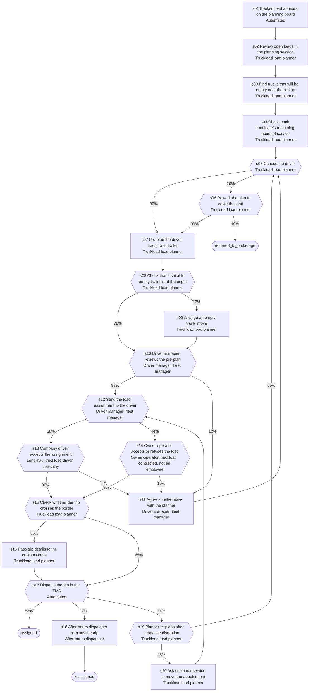

# Plan and assign truckload loads to drivers

`frt-tl-load-planning` · trucking and freight transportation · truckload fleet operations · part of `freight-carrier-co`

Each booked truckload load needs a driver, a tractor and a trailer that can reach the pickup on time and deliver within hours-of-service limits. Load planners look for trucks that will be empty nearby, check each driver's remaining hours, weigh home time, equipment, border credentials and empty kilometres, and pre-plan the load. Driver managers, who know their drivers, review the plan and send the assignment to the in-cab unit; owner-operators can refuse it. Late prior deliveries, breakdowns, refusals and shipper changes force re-planning, which after hours falls to a small night dispatch desk.

| | |
|---|---|
| Unit of work | one load assignment |
| Starts when | A booked load is released to the planning board, or a border hold sends a load back for re-planning. |
| Done when | A driver has accepted the assignment and the trip is dispatched, or the load is handed back to the brokerage desk. |
| Organisation | A Canadian LTL and truckload carrier of about 3,000 employees whose truckload division runs about 400 company sleeper tractors and 380 owner-operators within Canada and across the US border, on a carrier TMS with EDI, ELDs and an eManifest service provider. (3,000 employees, 2019-2022) |
| Volume | 7,700 cases a month (range 6,800 to 8,800) |

## Where it sits

- Starts with **booked_load** from tl-load-tender (99% of cases)
- Starts with **border_hold** from tl-border-holds (1% of cases)
- Relies on **driver_availability** from tl-driver-management (a standing input; it does not start a case)
- Relies on **empty_trailer_move** from tl-trailer-pools (a standing input; it does not start a case)
- Relies on **equipment_availability** from mnt-defect-repair (a standing input; it does not start a case)
- Relies on **equipment_availability** from mnt-collision-repair (a standing input; it does not start a case)
- Sends **trip_assignment** to tl-trip-execution (outcome: assigned)
- Sends **trip_assignment** to tl-trip-execution (outcome: reassigned)
- Sends **trip_assignment** to tl-customs-emanifest (outcome: assigned)
- Sends **trip_assignment** to tl-customs-emanifest (outcome: reassigned)
- Sends **booked_load** to tl-brokerage (outcome: returned_to_brokerage)

## Flow

## Roles

| Role | Department | Layer | FTE on this process | Loaded cost per hour | Evidence |
|---|---|---|---:|---:|---|
| Truckload load planner | Truckload fleet operations | individual contributor | 12 | 44 CAD | C |
| Driver manager (fleet manager) | Truckload fleet operations | individual contributor | 12 | 43 CAD | C |
| After-hours dispatcher | Truckload fleet operations | individual contributor | 1.5 | 41 CAD | C |
| Long-haul truckload driver (company) | Truckload fleet operations | individual contributor | 1.5 | 37 CAD | C |
| Owner-operator, truckload (contracted, not an employee) | Truckload fleet operations | external party | 0 | 65 CAD | C |

## Steps

Hands-on time and the wait before each step show the most common value. Evidence tier A is a sourced number, B a sourced description, C the author's estimate.

| Step | Who | Kind | Hands-on | Wait before | Control | Evidence |
|---|---|---|---:|---:|---|---|
| **s01 Booked load appears on the planning board.** When customer service releases a booked load, the TMS adds it to the planning board for its pickup region and date, with the appointment times, equipment type, weight, border flag and customer notes that the planner needs. | Automated | system auto | 0 min | 0 min |  | C |
| **s02 Review open loads in the planning session.** The load planner for the region works through the open loads for the next one to two days in the morning and afternoon planning sessions, sorting them by pickup time and noting loads with tight appointments, reefer or flatdeck equipment, or a border crossing. | Truckload load planner | analysis | 1 min | 6.0 h |  | C |
| **s03 Find trucks that will be empty near the pickup.** The planner filters the power list for drivers whose current load delivers near the origin before the pickup time, using the GPS position and ETA from the telematics platform, and lists two or three candidates with the empty kilometres each would run. | Truckload load planner | lookup | 2 min | 0 min |  | C |
| **s04 Check each candidate's remaining hours of service.** The planner opens each candidate's log to see remaining driving and on-duty time for the day and the cycle, and checks whether the driver can reach the pickup, load and make the delivery appointment without breaking the 13-hour driving and 14-hour on-duty limits, or the 11-hour and 14-hour US limits on a US leg. Before ELDs were required in June 2021, drivers on paper logs were often phoned for their hours. | Truckload load planner | validation | 1.5 min | 0 min | Commercial Vehicle Drivers Hours of Service Regulations SOR/2005-313 s.12-14 and 26-27; for US legs 49 CFR 395.3 | A [src-hos], [src-cfr-395], [src-eld] |
| **s05 Choose the driver.** The planner weighs home-time dates and requests, equipment type, border credentials (passport or FAST card and admissibility to the US), dangerous goods training, customer-specific requirements and empty kilometres, and picks the driver who covers the load at the lowest cost without breaking a home-time promise. | Truckload load planner | judgment | 2 min | 0 min |  | C |
| **s06 Rework the plan to cover the load.** When no driver fits, the planner tries swapping loads between two drivers, setting up a relay at a terminal, offering the load to an owner-operator, or moving a home-time date with the driver manager. If nothing works, the planner hands the load back to the brokerage desk. | Truckload load planner | judgment | 8 min | 0 min |  | C |
| **s07 Pre-plan the driver, tractor and trailer.** The planner assigns the driver, tractor and trailer number to the load in the TMS, which marks the load as pre-planned on the board and shows it to the driver manager. | Truckload load planner | data entry | 1 min | 0 min |  | C |
| **s08 Check that a suitable empty trailer is at the origin.** The planner checks the trailer pool at the shipper or the nearest drop yard for an empty trailer of the right type, clean and, for reefer loads, with a working unit. | Truckload load planner | lookup | 1 min | 0 min |  | C |
| **s09 Arrange an empty trailer move.** The planner tells the driver to pick up an empty at a yard on the way, or asks for a shunt or another driver's empty to be repositioned to the shipper, and records the move in the TMS. | Truckload load planner | coordination | 5 min | 0 min |  | C |
| **s10 Driver manager reviews the pre-plan.** The driver manager responsible for the driver checks the pre-plan against what the planner may not know: the driver's real home-time needs, a medical appointment, pay fairness between drivers, or a customer the driver should not go back to. The manager agrees or pushes back. | Driver manager (fleet manager) | review | 3 min | 1.0 h |  | C |
| **s11 Agree an alternative with the planner.** The driver manager calls or messages the planner, explains why the driver should not take this load, and suggests a better match or a later load; the planner then chooses again. | Driver manager (fleet manager) | coordination | 6 min | 15 min |  | C |
| **s12 Send the load assignment to the driver.** When the driver's current load is close to delivery, the driver manager sends the assignment as a macro on the in-cab unit or by phone: pickup number, address, appointment, trailer to use, delivery appointment and special instructions such as temperature or border documents. | Driver manager (fleet manager) | communication | 4 min | 2.0 h |  | C |
| **s13 Company driver accepts the assignment.** The company driver reads the message at the next stop, checks the trip against remaining hours and home time, and accepts on the in-cab unit; drivers cannot read messages while driving. | Long-haul truckload driver (company) | communication | 2 min | 20 min |  | C |
| **s14 Owner-operator accepts or refuses the load.** The owner-operator, a contractor who may refuse loads, looks at the revenue, empty kilometres and where the load leaves the truck, and accepts or turns it down by message or phone. | Owner-operator, truckload (contracted, not an employee) | communication | 3 min | 20 min |  | C |
| **s15 Check whether the trip crosses the border.** The planner checks the border flag on the accepted load. Cross-border trips need the customs desk to build the eManifest from the driver, tractor and trailer details now assigned. | Truckload load planner | validation | 0.5 min | 0 min |  | C |
| **s16 Pass trip details to the customs desk.** The planner flags the trip for the customs desk in the TMS and emails the driver name, FAST card status, tractor and trailer plates, planned port of entry and ETA, so the eManifest can be sent at least an hour before arrival. | Truckload load planner | communication | 2 min | 0 min |  | B [src-cbsa-aci] |
| **s17 Dispatch the trip in the TMS.** The TMS marks the load dispatched, starts tracking against the appointments and sends EDI 214 status messages to shippers on EDI. Most trips need no further planning; some are disrupted before pickup. | Automated | system auto | 0 min | 1 min |  | C |
| **s18 After-hours dispatcher re-plans the trip.** At night or on a weekend the after-hours dispatcher takes the driver's call or the late alert, finds another driver who has the hours or moves the pickup with the shipper's night contact, and sends the new assignment to the driver directly. | After-hours dispatcher | judgment | 12 min | 30 min | Commercial Vehicle Drivers Hours of Service Regulations SOR/2005-313 s.12-14 and 26-27; for US legs 49 CFR 395.3 | C |
| **s19 Planner re-plans after a daytime disruption.** The planner sees the late alert or gets the driver manager's call, decides whether the same driver can still make it with a new pickup time or whether another driver must take the load, and starts the plan again where needed. | Truckload load planner | judgment | 8 min | 20 min |  | C |
| **s20 Ask customer service to move the appointment.** The planner sends the customer service representative the new pickup or delivery time to agree with the dock, then the driver manager re-sends the assignment with the new time. | Truckload load planner | communication | 3 min | 0 min |  | C |

## Exceptions

| Exception | Share of cases | What happens |
|---|---:|---|
| No driver fits the load | 20% | The planner reworks the plan with swaps, relays or an owner-operator; about one in ten of these loads goes back to brokerage. |
| Driver manager pushes back | 12% | The driver manager knows of a home-time need or other reason the driver should not take the load, and the planner picks again. |
| Owner-operator refuses | 4% | The owner-operator turns the load down because of its revenue or where it leaves the truck. |
| Disruption before pickup | 18% | A late prior delivery, breakdown, driver out of hours or shipper not ready forces a new time or a new driver; at night the after-hours dispatcher handles it. |
| Paper logs before the ELD mandate | 30% | Before June 2021 drivers without electronic logs were phoned for their remaining hours, which made the hours check slower and less reliable. |

## Benchmarks

| Metric | Value | Unit | Population | Evidence |
|---|---|---|---|---|
| cycle_time_days | p50 1.0, p90 2.2 | calendar days from release to the planning board to driver acceptance | Canadian truckload carriers, 2019-2022 | C |
| hos_out_of_service_rate | 0.0281 | share of roadside inspections ending in an hours-of-service out-of-service order | Canadian provincial and territorial inspections, 2009-10 to 2013-14 average | A [src-eld] |

## Pain points

- Planners and driver managers work from different information, so a share of plans is undone by home-time or driver issues only the driver manager knows. (steps s10, s11; C)
- Hours-of-service checks were slow before ELDs because drivers had to be phoned; afterwards the ELD shows hours but ETAs on the current load are still often optimistic. (steps s03, s04; B [src-eld], [src-ccmta-eld])
- Disruptions overnight land on a small after-hours desk with less context, and decisions are revisited in the morning. (steps s18; C)

## Assumptions

- The split between load planners (who match loads to trucks) and driver managers (who own the relationship with about 20 drivers each and send the assignment) follows common North American truckload practice; some carriers combine the two jobs.
- Company long-haul and regional drivers are shown as one role (tl-driver-longhaul) on the acceptance step; owner-operators have their own step because they can refuse loads.
- Staffing check: planner touch time averages about 21 minutes per assignment, which at 7,700 assignments implies about 21 FTE at 130 productive hours a month against 14 planners in the org file, who also help on tenders and trailer pools. Either the org file understates the planning desk or planners plan faster than estimated here; driver manager time (about 13 minutes per assignment, about 12 FTE) fits the 36 driver managers.
- Cases that are re-planned after the assignment is made (s18) end as 'reassigned'; the simulation does not send them through driver acceptance again.
- Before June 2021 a share of drivers kept paper logs; the hours check (s04) is slower for them, which is folded into its high touch time.
- Loaded costs come from the org file.

## Sources

- [src-hos] [Commercial Vehicle Drivers Hours of Service Regulations (SOR/2005-313)](https://laws-lois.justice.gc.ca/eng/regulations/SOR-2005-313/FullText.html) (Government of Canada, Justice Laws Website, 2005). South of 60 degrees: 13 h driving and 14 h on duty per day (s.12), 8 consecutive hours off before driving again (s.13), 10 h off duty per day (s.14); cycle 1 of 70 h in 7 days and cycle 2 of 120 h in 14 days (s.26-27); cycle reset after 36 or 72 h off (s.28); daily record of duty status (s.77, 81, 82).
- [src-cfr-395] [49 CFR 395.3 Maximum driving time for property-carrying vehicles](https://www.law.cornell.edu/cfr/text/49/395.3) (Legal Information Institute, Cornell Law School, None). US limits for property-carrying drivers: 11 h driving within a 14 h window after 10 h off, 30-minute break after 8 h of driving, 60 h in 7 days or 70 h in 8 days, 34 h restart.
- [src-eld] [Regulations Amending the Commercial Vehicle Drivers Hours of Service Regulations (Electronic Logging Devices and Other Amendments), SOR/2019-165](https://gazette.gc.ca/rp-pr/p2/2019/2019-06-12/html/sor-dors165-eng.html) (Canada Gazette, Part II, 2019). ELD provisions in force on 12 June 2021; 160 km radius exemption; 157,424 CMVs keep daily logs and 87,849 run into the US; 2.81% of inspections end in an HOS out-of-service order with average detention of 34 hours; clerks take about 3.5 minutes to file each paper log; drivers forward records within 20 days.
- [src-cbsa-aci] [Highway mode: Transmit electronic commercial data (Advance Commercial Information / eManifest)](https://www.cbsa-asfc.gc.ca/prog/aci-manif-ipec/hcc-ctr-eng.html) (Canada Border Services Agency, None). Highway carriers transmit cargo and conveyance data at least 1 hour before arrival at the port of entry; corrections must be sent as soon as known, including a change of port; tractor and trailer plates must be valid and cargo descriptions clear; late, incorrect or incomplete data can draw AMPS monetary penalties; contingency plan for system outages.
- [src-ccmta-eld] [No ELD penalties until June 2022, jurisdictions confirm](https://www.trucknews.com/road-today/no-eld-penalties-until-june-2022-jurisdictions-confirm/) (Trucknews.com, 2021). CCMTA statement of 7 May 2021: provinces would enforce the ELD mandate progressively, without penalties, until 12 June 2022.

Written by claude-opus on 2026-11-24.
