# Accept truckload tenders and book loads

`frt-tl-load-tender` · trucking and freight transportation · truckload customer service · part of `freight-carrier-co`

Shippers offer full-truckload shipments to the carrier as tenders, mostly by EDI 204 from their own routing-guide systems and the rest through web portals, email or phone. A truckload customer service representative reviews each tender, checks the contract rate and whether a truck will be free near the pickup, asks a load planner when capacity is unclear, and accepts or declines before the shipper's deadline. Accepted loads are completed in the TMS, appointments are booked with the docks, and the load goes to the planning board or, if the fleet cannot cover it, to the brokerage desk. Re-keying portal and email tenders, waiting for dock appointment replies, and late shipper changes are the main sources of delay and error.

| | |
|---|---|
| Unit of work | one load tender |
| Starts when | A shipper sends a load tender by EDI 204, web portal, email or phone. |
| Done when | The tender is declined, expires or is cancelled, or the load is booked with appointments and released to the planning board or the brokerage desk. |
| Organisation | A Canadian LTL and truckload carrier of about 3,000 employees whose truckload division runs about 400 company sleeper tractors and 380 owner-operators within Canada and across the US border, on a carrier TMS with EDI, ELDs and an eManifest service provider. (3,000 employees, 2019-2022) |
| Volume | 9,500 cases a month (range 8,000 to 11,000) |

## Where it sits

- Starts with **load_tender** from shipper (100% of cases)
- Relies on **rate_agreement** from sls-pricing-quotes (a standing input; it does not start a case)
- Relies on **edi_connection** from it-edi-integration (a standing input; it does not start a case)
- Sends **load_confirmation** to shipper (outcome: booked_fleet)
- Sends **load_confirmation** to shipper (outcome: booked_brokerage)
- Sends **booked_load** to tl-load-planning (outcome: booked_fleet)
- Sends **booked_load** to tl-brokerage (outcome: booked_brokerage)

## Flow

```mermaid
flowchart TD
    s01{{"s01 Shipper sends a load tender<br/>Outside party"}}
    s02["s02 Load the EDI tender into the TMS queue<br/>Automated"]
    s03["s03 Copy a portal tender into the TMS<br/>Truckload customer service representative"]
    s04["s04 Key an email or phone tender into the TMS<br/>Truckload customer service representative"]
    s05{{"s05 Review the tender and the customer account<br/>Truckload customer service representative"}}
    s06["s06 Ask the shipper for missing details<br/>Truckload customer service representative"]
    s07["s07 Shipper answers the query<br/>Outside party"]
    s08{{"s08 Look up the contract rate and fuel surcharge<br/>Truckload customer service representative"}}
    s09["s09 Pricing analyst confirms or sets the rate<br/>Pricing analyst"]
    s10{{"s10 Check truck capacity for the pickup<br/>Truckload customer service representative"}}
    s11{{"s11 Load planner decides whether to take the load<br/>Truckload load planner"}}
    s12["s12 Decline the tender<br/>Truckload customer service representative"]
    s13{{"s13 Accept the tender<br/>Truckload customer service representative"}}
    s14{{"s14 Complete the order in the TMS<br/>Truckload customer service representative"}}
    s15{{"s15 Record customs broker and border details<br/>Truckload customer service representative"}}
    s16["s16 Request pickup and delivery appointments<br/>Truckload customer service representative"]
    s17["s17 Shipper and consignee confirm the appointments<br/>Outside party"]
    s18{{"s18 Release the load to the planning board<br/>Truckload customer service representative"}}
    s19{{"s19 Update the order after a shipper change<br/>Truckload customer service representative"}}
    s20["s20 Send the load confirmation<br/>Automated"]
    s21{{"s21 Route the load to the fleet or the brokerage desk<br/>Truckload customer service representative"}}
    s22["s22 Hand the load to the brokerage desk<br/>Truckload customer service representative"]
    s01 -->|"55%"| s02
    s01 -->|"20%"| s03
    s01 -->|"25%"| s04
    s02 --> s05
    s03 --> s05
    s04 --> s05
    s05 -->|"92%"| s08
    s05 -->|"8%"| s06
    s06 --> s07
    s07 --> s08
    s08 -->|"93%"| s10
    s08 -->|"7%"| s09
    s09 --> s10
    s10 -->|"66%"| s13
    s10 -->|"34%"| s11
    s11 -->|"68%"| s13
    s11 -->|"32%"| s12
    s12 --> end0
    s13 -->|"98%"| s14
    s13 -->|"2%"| end1
    s14 -->|"35%"| s15
    s14 -->|"39%"| s16
    s14 -->|"26%"| s18
    s15 -->|"60%"| s16
    s15 -->|"40%"| s18
    s16 --> s17
    s17 --> s18
    s18 -->|"88%"| s20
    s18 -->|"9%"| s19
    s18 -->|"3%"| end2
    s19 -->|"60%"| s16
    s19 -->|"40%"| s20
    s20 --> s21
    s21 -->|"93%"| end3
    s21 -->|"7%"| s22
    s22 --> end4
    end0(["declined"])
    end1(["expired"])
    end2(["cancelled"])
    end3(["booked_fleet"])
    end4(["booked_brokerage"])
```

## Roles

| Role | Department | Layer | FTE on this process | Loaded cost per hour | Evidence |
|---|---|---|---:|---:|---|
| Truckload customer service representative | Truckload customer service and brokerage | individual contributor | 19 | 36 CAD | C |
| Truckload load planner | Truckload fleet operations | individual contributor | 2.5 | 44 CAD | C |
| Pricing analyst | Sales and customer service | senior specialist | 1 | 54 CAD | C |

## Steps

Hands-on time and the wait before each step show the most common value. Evidence tier A is a sourced number, B a sourced description, C the author's estimate.

| Step | Who | Kind | Hands-on | Wait before | Control | Evidence |
|---|---|---|---:|---:|---|---|
| **s01 Shipper sends a load tender.** The shipper's transportation team, usually through its own TMS routing guide, offers one full-truckload shipment to the carrier with origin, destination, pickup window, delivery date, equipment type, weight and the contract rate. The tender carries a response deadline, after which the shipper's system moves it to the next carrier in the routing guide. | Outside party | intake | 0 min | 0 min |  | C |
| **s02 Load the EDI tender into the TMS queue.** The EDI gateway polls the value-added network, maps the 204 transaction into a pending tender in the TMS with the shipper's reference numbers and stops, and places it in the truckload customer service queue with its response deadline. No one touches it unless the mapping fails. | Automated | system auto | 0 min | 5 min |  | B [src-sps-tender] |
| **s03 Copy a portal tender into the TMS.** The customer service representative logs into the shipper's tendering portal, opens the offered load, and re-keys the shipper, stops, dates, equipment, weight and reference numbers into a new order in the carrier's TMS. Portals are checked between other work, so tenders wait until the next check. | Truckload customer service representative | data entry | 6 min | 40 min |  | B [src-sps-tender] |
| **s04 Key an email or phone tender into the TMS.** The representative reads the shipper's email or spreadsheet, or takes the call, and types a new order into the TMS with the stops, dates, equipment, commodity, weight and references, asking on the spot for anything obviously missing. Email tenders sit in a shared inbox until someone picks them up. | Truckload customer service representative | data entry | 7 min | 30 min |  | C |
| **s05 Review the tender and the customer account.** The representative checks that the pickup and delivery windows are workable, the equipment type exists in the fleet, the weight is legal, any dangerous goods are declared, and whether the load crosses the border. The TMS shows whether the customer account is active and not on credit hold. | Truckload customer service representative | validation | 2 min | 10 min | Credit policy: no new loads for accounts on credit hold | C |
| **s06 Ask the shipper for missing details.** The representative emails or calls the shipper's logistics contact to fill gaps such as a missing pickup number, a delivery appointment requirement, the commodity for a cross-border load or a temperature setting for a reefer load. | Truckload customer service representative | communication | 4 min | 0 min |  | C |
| **s07 Shipper answers the query.** The shipper's contact replies by email or phone with the missing information. The tender clock keeps running, so a slow answer can let the response deadline pass. | Outside party | external wait | 0 min | 1.0 h |  | C |
| **s08 Look up the contract rate and fuel surcharge.** The representative checks the rate on file for the lane in the rating tables and compares it with the rate on the tender, together with this week's fuel surcharge and any agreed accessorials such as stop-offs or border fees. | Truckload customer service representative | lookup | 2 min | 0 min |  | C |
| **s09 Pricing analyst confirms or sets the rate.** The pricing analyst reviews the lane, the customer's contract and current market conditions, then either confirms the shipper's rate, sets a one-time spot rate, or asks the account executive to talk to the customer. The answer goes back to the representative by email or a TMS note. | Pricing analyst | judgment | 10 min | 2.0 h | Pricing authority matrix: rates outside the agreement need pricing approval | C |
| **s10 Check truck capacity for the pickup.** The representative opens the planning board and the regional capacity sheet to see whether the fleet has committed capacity on this lane and day. Routine loads within the weekly lane commitment are accepted directly; others go to the load planner. | Truckload customer service representative | lookup | 2 min | 0 min |  | C |
| **s11 Load planner decides whether to take the load.** The load planner looks at drivers expected to be empty near the origin, their remaining hours and home-time dates, the freight balance in the destination region and the empty kilometres involved. The planner tells the representative to accept, to accept for the brokerage desk, or to decline. | Truckload load planner | judgment | 5 min | 30 min |  | C |
| **s12 Decline the tender.** The representative rejects the tender in the TMS, which sends an EDI 990 decline or is clicked in the portal, or emails the shipper, with a reason code such as no capacity. The freight goes to the next carrier in the shipper's routing guide. | Truckload customer service representative | communication | 2 min | 5 min |  | B [src-fw-otri] |
| **s13 Accept the tender.** The representative accepts the tender in the TMS, which sends the EDI 990 acceptance, or clicks accept in the shipper's portal, or confirms by email. If the deadline has passed, the shipper's system has already given the load to another carrier. | Truckload customer service representative | communication | 1 min | 5 min |  | C |
| **s14 Complete the order in the TMS.** The representative finishes the order: bill of lading and pickup numbers, purchase orders, special instructions, accessorial flags, temperature for reefer loads and the billing party. Errors here show up later as missed pickups or rejected invoices. | Truckload customer service representative | data entry | 4 min | 30 min |  | C |
| **s15 Record customs broker and border details.** For a cross-border load the representative records the importer's customs broker, the port of entry and whether the shipper is C-TPAT or PIP certified, and emails the shipper to confirm that the commercial invoice will travel with the freight and go to the broker. | Truckload customer service representative | data entry | 4 min | 0 min |  | B [src-cbsa-aci] |
| **s16 Request pickup and delivery appointments.** The representative books the pickup slot with the shipper's shipping office and the delivery slot through the consignee's dock-scheduling portal, by email or by phone, choosing times the driver can reach within hours-of-service limits. | Truckload customer service representative | coordination | 4 min | 20 min |  | C |
| **s17 Shipper and consignee confirm the appointments.** The receiving docks confirm or counter-offer a slot. Large retail and grocery distribution centres often reply within hours through their portal; smaller receivers answer by email the next day. | Outside party | external wait | 0 min | 4.0 h |  | C |
| **s18 Release the load to the planning board.** The representative enters confirmed appointment times, sets the load status to available, and the order appears on the load planners' board for the pickup region and date. | Truckload customer service representative | data entry | 2 min | 20 min |  | C |
| **s19 Update the order after a shipper change.** When the shipper sends an EDI 204 change or an email moving the date, adding a stop or changing the weight, the representative updates the order, tells the planner if the load is already planned, and re-books appointments when the date moved. | Truckload customer service representative | data entry | 5 min | 8.0 h |  | C |
| **s20 Send the load confirmation.** The TMS sends the shipper a load confirmation by email or EDI with the carrier's load number, accepted rate and appointment times, and starts EDI 214 status messages for shippers on EDI. | Automated | system auto | 0 min | 2 min |  | C |
| **s21 Route the load to the fleet or the brokerage desk.** The representative checks the planner's note on the order. Loads the fleet cannot cover but that the customer relationship requires are flagged for the brokerage desk; all others stay on the planning board for the company fleet and owner-operators. | Truckload customer service representative | coordination | 1 min | 0 min |  | C |
| **s22 Hand the load to the brokerage desk.** The representative moves the order to the brokerage queue in the TMS and sends the brokerage agent a short note with the customer's rate, appointment times and any special handling, so the agent can find a third-party carrier. | Truckload customer service representative | communication | 3 min | 5 min |  | C |

## Exceptions

| Exception | Share of cases | What happens |
|---|---:|---|
| Missing tender details | 8% | The tender lacks a pickup number, commodity, appointment requirement or temperature, and the representative has to ask the shipper while the response clock runs. |
| Rate not on file | 7% | The lane has no contract rate or the tender rate differs, so pricing has to confirm or set a spot rate before acceptance. |
| Tender expired before response | 2% | The response arrives after the shipper's deadline and the load has already gone to another carrier. |
| Shipper change after booking | 9% | The shipper moves the date, adds a stop or changes the weight after acceptance; appointments are re-booked and the planner is told. |

## Benchmarks

| Metric | Value | Unit | Population | Evidence |
|---|---|---|---|---|
| cycle_time_days | p50 0.5, p90 1.4 | calendar days from tender receipt to release on the planning board or decline | Canadian truckload carriers, 2019-2022 | C |
| tender_rejection_rate_us_market | low 0.2, high 0.27 | share of contracted tenders declined by carriers | US truckload market, 2021 | B [src-fw-otri] |

## Pain points

- Portal and email tenders are re-keyed into the TMS, which costs time and introduces date and reference errors. (steps s03, s04; B [src-sps-tender])
- Representatives cannot see firm capacity, so a third of tenders wait for a load planner's call while the shipper's response deadline runs. (steps s10, s11; C)
- Dock appointment confirmations take hours to a day and are chased by email and phone. (steps s16, s17; C)
- Late shipper changes force re-booking and can arrive after the load is planned. (steps s19; C)

## Assumptions

- Volumes and shares are set to agree with the org file: 9,500 tenders a month give about 7,400 loads to the fleet, 600 to brokerage and about 1,050 declines (the process map's 7,700 planning cases also include re-planned loads), with 2% expired and 3% cancelled.
- Shipper and consignee effort is not counted as touch time; external steps carry only elapsed waits.
- Representatives work extended weekday hours with Saturday cover, so tenders arriving overnight or on Sunday wait several hours; this sits in the high end of the queue waits.
- Staffing check: representative touch time averages about 26 minutes per tender, which at 9,500 tenders implies about 31 FTE at 130 productive hours a month, against 22 representatives in the org file who also handle detention and customer calls. Either the org file understates the desk (about 30 representatives would fit) or Canadian representatives handled tenders faster than estimated here.
- Loaded costs come from the org file (wage x 1.30 for hourly staff, x 1.35 for salaried staff).
- Brokered loads follow the same booking steps; the split between fleet and brokerage is drawn at the end because the simulation does not carry the planner's decision forward.

## Sources

- [src-sps-tender] [4 impacts from streamlining load tender response times](https://www.spscommerce.com/community/articles/load-tender-response-times) (SPS Commerce, The Supply Chain Source, 2025). EDI 204 load tenders; carrier responses slowed by manual handling: spreadsheets, whiteboards, logging into several shipper portals, phone calls and faxes; response time affects whether the carrier wins the freight.
- [src-fw-otri] [Where did all the truckload capacity go?](https://www.freightwaves.com/news/where-did-all-the-truckload-capacity-go) (FreightWaves, 2021). US Outbound Tender Reject Index (share of contracted load tenders that carriers turned down) was above 20% for much of 2021, falling from about 27% to near 20% over the year; 21.92% in late December 2021.
- [src-cbsa-aci] [Highway mode: Transmit electronic commercial data (Advance Commercial Information / eManifest)](https://www.cbsa-asfc.gc.ca/prog/aci-manif-ipec/hcc-ctr-eng.html) (Canada Border Services Agency, None). Highway carriers transmit cargo and conveyance data at least 1 hour before arrival at the port of entry; corrections must be sent as soon as known, including a change of port; tractor and trailer plates must be valid and cargo descriptions clear; late, incorrect or incomplete data can draw AMPS monetary penalties; contingency plan for system outages.

Written by claude-opus on 2026-11-24.
