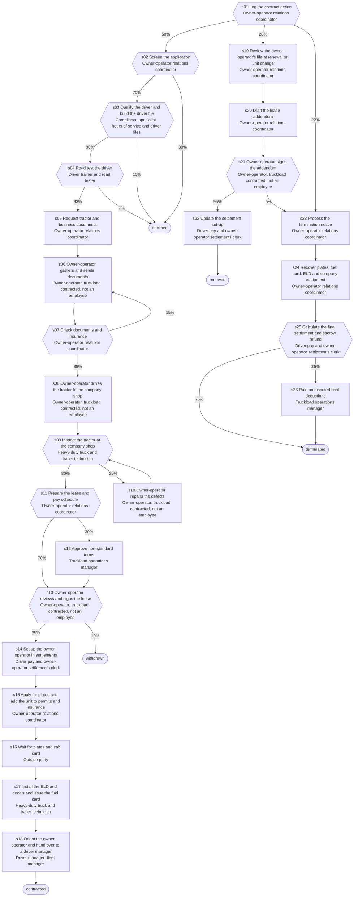

# Contract and manage owner-operators

`frt-tl-oo-contracting` · trucking (truckload) · operations · part of `freight-carrier-co`

Owner-operators are self-employed drivers who own their tractors and lease them to the carrier under a written contract. The owner-operator coordinator screens applicants, safety qualifies and road-tests the driver, a technician inspects the tractor, and the coordinator writes the lease, plates the unit under the carrier's accounts and hands it to a driver manager; settlements set up pay and deductions. The same team handles renewals, tractor changes and terminations, where escrow refunds and final deductions are often disputed. The work is slow because it waits on the applicant's documents, the shop, the driver trainer and the plate office, and because lease terms, fuel surcharge and chargebacks must match what settlements later pays.

| | |
|---|---|
| Unit of work | one owner-operator contract action |
| Starts when | An owner-operator applies, a lease comes up for renewal or the tractor changes, or either side gives notice to end a lease. |
| Done when | A new owner-operator is leased on and dispatched, a lease is renewed or amended, a lease is ended with the final settlement paid, or the application is declined or withdrawn. |
| Organisation | A Canadian LTL and truckload carrier of about 3,000 employees with about 380 owner-operators leased to its truckload division. (3,000 employees, 2019-2022) |
| Volume | 50 cases a month (range 35 to 70) |

## Where it sits

- Starts with **owner_operator_application** from owner-operator-business (100% of cases)
- Relies on **fuel_surcharge_table** from fin-fuel-surcharge (a standing input; it does not start a case)
- Sends **owner_operator_agreement** to owner-operator-business (outcome: contracted)
- Sends **owner_operator_agreement** to fin-oo-settlements (outcome: contracted)
- Sends **owner_operator_agreement** to fin-oo-settlements (outcome: renewed)
- Sends **driver_application** to saf-driver-onboarding (outcome: contracted)
- Sends **settlement_statement** to owner-operator-business (outcome: terminated)

## Flow

## Roles

| Role | Department | Layer | FTE on this process | Loaded cost per hour | Evidence |
|---|---|---|---:|---:|---|
| Owner-operator relations coordinator | Truckload fleet operations | individual contributor | 1.3 | 42 CAD | C |
| Compliance specialist (hours of service and driver files) | Safety, compliance and driver services | individual contributor | 0.2 | 40 CAD | C |
| Driver trainer and road tester | Safety, compliance and driver services | individual contributor | 0.15 | 42 CAD | C |
| Heavy-duty truck and trailer technician | Fleet maintenance | individual contributor | 0.4 | 46 CAD | C |
| Truckload operations manager | Truckload fleet operations | manager | 0.1 | 82 CAD | C |
| Driver pay and owner-operator settlements clerk | Finance | individual contributor | 0.2 | 33 CAD | C |
| Driver manager (fleet manager) | Truckload fleet operations | individual contributor | 0.1 | 43 CAD | C |
| Owner-operator, truckload (contracted, not an employee) | Truckload fleet operations | external party | 0 | 65 CAD | C |

## Steps

Hands-on time and the wait before each step show the most common value. Evidence tier A is a sourced number, B a sourced description, C the author's estimate.

| Step | Who | Kind | Hands-on | Wait before | Control | Evidence |
|---|---|---|---:|---:|---|---|
| **s01 Log the contract action.** The owner-operator coordinator opens the request, which is a new application from the website or a recruiter, an upcoming lease renewal or unit change, or a termination notice, and logs it in the owner-operator tracking spreadsheet with the unit number and due date. | Owner-operator relations coordinator | intake | 10 min | 4.0 h |  | C |
| **s02 Screen the application.** The coordinator reads the application and checks years of experience, the tractor's year, make and kilometres, whether the applicant can cross the border (passport, FAST card) and the lanes wanted, and phones the applicant and one previous carrier. Applicants with an old tractor or a poor record are declined at once. | Owner-operator relations coordinator | validation | 40 min | 1.0 d |  | C |
| **s03 Qualify the driver and build the driver file.** The compliance specialist orders the driver's abstract and criminal record check, gets previous-employer references, sends the driver for a pre-contract drug and alcohol test for US work, and builds the driver qualification file in the safety system. The owner-operator's driver must meet the same standard as a company driver. | Compliance specialist (hours of service and driver files) | validation | 1.2 h | 2.0 d | Provincial National Safety Code carrier safety programs and, for US trips, FMCSA driver qualification and drug and alcohol testing rules (49 CFR Parts 391 and 382) | C |
| **s04 Road test the driver.** A driver trainer rides with the driver for a road test covering a pre-trip inspection, coupling, backing and highway driving, and scores it on the company form. A failed test ends the application or sends the driver for more training. | Driver trainer and road tester | physical | 1.5 h | 2.0 d | Company driver qualification policy: road test before first dispatch | C |
| **s05 Request tractor and business documents.** The coordinator emails the checklist of documents needed: proof of tractor ownership and registration, the last annual safety inspection, bobtail and physical damage insurance certificates, the GST/HST (and QST in Quebec) number, incorporation papers if incorporated, and a void cheque for direct deposit. | Owner-operator relations coordinator | communication | 15 min | 1.0 h |  | C |
| **s06 Owner-operator gathers and sends documents.** The owner-operator collects the papers from the insurer, the bank and the accountant, often between trips, and scans or photographs them back to the coordinator. Missing insurance certificates are the usual hold-up. | Owner-operator, truckload (contracted, not an employee) | communication | 30 min | 2.0 d |  | C |
| **s07 Check documents and insurance.** The coordinator compares the registration and ownership with the tractor's VIN, confirms the inspection is current, calls the insurer or broker to confirm the certificates are in force, and checks the business number. Missing or expired papers go back to the owner-operator. | Owner-operator relations coordinator | validation | 25 min | 8.0 h |  | C |
| **s08 Owner-operator drives the tractor to the company shop.** The owner-operator books an inspection slot and drives the tractor to the nearest company shop, usually between loads or on a day off, which can mean a few hours of driving. | Owner-operator, truckload (contracted, not an employee) | travel | 3.0 h | 2.0 d |  | C |
| **s09 Inspect the tractor at the company shop.** A heavy-duty technician carries out the carrier's intake inspection on the company's periodic inspection form: brakes, steering, tires, lights, frame, coupling devices, exhaust and the cab. Defects are listed and the tractor is passed or failed. | Heavy-duty truck and trailer technician | physical | 2.0 h | 4.0 h | National Safety Code periodic vehicle inspection standard and company equipment policy: unit inspected before it is leased on | C |
| **s10 Owner-operator repairs the defects.** The owner-operator has the listed defects fixed at his or her own cost, at the company shop at a quoted rate or at an outside shop, and brings the tractor back for re-inspection. | Owner-operator, truckload (contracted, not an employee) | external wait | 0 min | 3.0 d |  | C |
| **s11 Prepare the lease and pay schedule.** The coordinator fills in the standard lease template: pay per loaded and empty mile or a percentage of revenue, fuel surcharge passed through from the weekly table, the list of chargebacks with how each is computed, escrow amount, insurance responsibilities, notice period and start date. Non-standard terms are marked for approval. | Owner-operator relations coordinator | drafting | 45 min | 8.0 h | 49 CFR 376.12 written lease requirements (Truth-in-Leasing) for owner-operator equipment run in the US under the carrier's authority; applied fleet-wide by policy for Canadian trips | B [src-cfr376] |
| **s12 Approve non-standard terms.** The truckload operations manager reviews requests for a higher rate, a lower escrow, a dedicated lane or permission to haul for others, compares them with the rates paid to similar owner-operators, and approves, changes or refuses them. | Truckload operations manager | approval | 20 min | 1.0 d | Company delegation of authority: operations manager approves non-standard owner-operator pay terms | C |
| **s13 Owner-operator reviews and signs the lease.** The owner-operator reads the lease, often with an accountant, asks about deductions and fuel surcharge, and signs. Some applicants walk away at this point because another carrier offers more. | Owner-operator, truckload (contracted, not an employee) | review | 1.0 h | 2.0 d | 49 CFR 376.12 written lease requirements (Truth-in-Leasing) for owner-operator equipment run in the US under the carrier's authority; applied fleet-wide by policy for Canadian trips | B [src-cfr376] |
| **s14 Set up the owner-operator in settlements.** The settlements clerk creates the owner-operator as a vendor in the ERP and the TMS settlement module, enters the bank details from the void cheque, the pay rate, escrow, insurance and plate deductions, and links the fuel card. Bank details are entered by finance, not by the operations staff who signed the lease. | Driver pay and owner-operator settlements clerk | data entry | 45 min | 1.0 d | Internal control over financial reporting: vendor and bank master data maintained by finance, separate from the staff who negotiate terms | C |
| **s15 Apply for plates and add the unit to permits and insurance.** The coordinator adds the tractor to the carrier's apportioned (IRP) fleet and IFTA account, orders plates and a cab card, adds the unit to the carrier's safety fleet list and to the insurer's schedule, and orders US permits for cross-border units. | Owner-operator relations coordinator | data entry | 1.0 h | 1.0 d | International Registration Plan and International Fuel Tax Agreement registration for units running in more than one jurisdiction | C |
| **s16 Wait for plates and cab card.** The provincial registration office issues the apportioned plates and cab card, which are couriered to the terminal. Until they arrive the tractor cannot run loaded across jurisdictions under the carrier's account. | Outside party | external wait | 0 min | 3.0 d |  | C |
| **s17 Install the ELD and decals and issue the fuel card.** A technician installs and activates the company ELD and telematics unit, applies the carrier's name and safety numbers to the doors and mounts the plates; the coordinator hands over the fuel card. The tractor is now ready for dispatch. | Heavy-duty truck and trailer technician | physical | 1.0 h | 4.0 h |  | B [src-eld-tn] |
| **s18 Orient the owner-operator and hand over to a driver manager.** The driver manager who will dispatch the unit walks the owner-operator through the dispatch rules, trip paperwork, scanning of bills of lading, settlement timing and safety policies, and plans the first load. | Driver manager (fleet manager) | communication | 1.0 h | 4.0 h |  | C |
| **s19 Review the owner-operator's file at renewal or unit change.** Ahead of the lease anniversary or a tractor change, the coordinator reviews the owner-operator's insurance expiry, inspection date, safety record, settlement disputes and revenue, and asks the driver manager whether to renew. | Owner-operator relations coordinator | review | 30 min | 3.0 d |  | C |
| **s20 Draft the lease addendum.** The coordinator writes an addendum with the new rate, the replacement tractor's details or updated deductions, citing the clauses of the original lease that change. | Owner-operator relations coordinator | drafting | 25 min | 8.0 h | 49 CFR 376.12 written lease requirements (Truth-in-Leasing) for owner-operator equipment run in the US under the carrier's authority; applied fleet-wide by policy for Canadian trips | B [src-cfr376] |
| **s21 Owner-operator signs the addendum.** The owner-operator reads the addendum, checks the new rate and deductions against recent settlements, sometimes negotiates the rate with the operations manager, and signs and returns it by email. | Owner-operator, truckload (contracted, not an employee) | review | 20 min | 2.0 d |  | C |
| **s22 Update the settlement set-up.** The settlements clerk changes the pay rate, deductions or unit number in the TMS settlement module and the ERP vendor record so the next weekly settlement uses the new terms. | Driver pay and owner-operator settlements clerk | data entry | 20 min | 1.0 d |  | C |
| **s23 Process the termination notice.** The coordinator records who ended the lease and why, sets the last dispatch date in line with the notice period, and tells the driver manager, settlements, safety and the insurer. | Owner-operator relations coordinator | coordination | 30 min | 4.0 h |  | C |
| **s24 Recover plates, fuel card, ELD and company equipment.** When the owner-operator returns to the terminal after the last trip, the coordinator collects the plates and cab card, cancels the fuel card, has the ELD removed and the company trailer returned, and removes the unit from the IRP fleet and insurance schedule. | Owner-operator relations coordinator | coordination | 45 min | 3.0 d |  | C |
| **s25 Calculate the final settlement and escrow refund.** The settlements clerk waits for the last trip paperwork, fuel card transactions, tolls and repair invoices to arrive, deducts what is owed from the escrow, adds interest and pays the balance with an itemised statement. | Driver pay and owner-operator settlements clerk | analysis | 1.2 h | 14.0 d | 49 CFR 376.12(k): final escrow accounting and return no later than 45 days after termination | B [src-cfr376] |
| **s26 Rule on disputed final deductions.** The truckload operations manager reviews the disputed items, such as damage to a returned trailer or an unreturned plate, against the lease and the evidence, and decides what to refund. | Truckload operations manager | approval | 40 min | 3.0 d |  | C |

## Exceptions

| Exception | Share of cases | What happens |
|---|---:|---|
| Declined applicant | 20% | The applicant fails screening, driver qualification or the road test. |
| Tractor fails intake inspection | 6% | The owner-operator must repair defects and bring the tractor back. |
| Missing or expired documents | 5% | Insurance certificates or registration are missing and go back to the owner-operator. |
| Applicant walks away at signing | 3% | The applicant takes a better offer elsewhere after the lease is drafted. |
| Disputed final settlement | 6% | On termination the owner-operator disputes deductions from escrow and the operations manager rules. |

## Benchmarks

| Metric | Value | Unit | Population | Evidence |
|---|---|---|---|---|
| cycle_time_days | p50 16, p90 38 | calendar days from logging the action to its end state | Owner-operator contract actions at a Canadian truckload carrier (mix of applications, renewals and terminations) | C |
| escrow_return_after_termination_max | 45 | days | Owner-operator leases under US Truth-in-Leasing rules | A [src-cfr376] |

## Pain points

- Onboarding waits on the applicant's documents, the driver trainer, the shop and the plate office in turn, so good applicants sign elsewhere. (steps s06, s04, s09, s16, s13; C)
- Lease terms for chargebacks and escrow are typed again into the settlement system, and mismatches show up as disputes on the first settlements. (steps s11, s14; B [src-cfr376])
- Final settlements are held for weeks waiting for late fuel and repair charges, and escrow deductions are a common source of disputes. (steps s25, s26; B [src-cfr376])

## Assumptions

- Volume is set at 35 to 70 contract actions a month, above the organisation file's 6 to 16, because renewals, tractor changes and terminations are part of the process and new applications outnumber signed leases. The 6 to 16 figure fits signed new leases only.
- US Truth-in-Leasing rules (49 CFR 376.12) bind leases for equipment run in the US under the carrier's authority; the carrier is assumed to use one lease form for all owner-operators, so the rules shape every lease.
- Canadian National Safety Code standards, IRP and IFTA rules are described from general knowledge; their texts were not opened, so those steps are tier C.
- Owner-operator time is shown for completeness and adds to the simulated hands-on hours, but it is not company labour: the role's fte_on_process is 0.
- Loaded costs come from the organisation file. The owner-operator tractor resource has no running cost in the organisation file.
- Cycle time mixes three paths: new leases about three weeks, renewals about a week, terminations about five weeks with the escrow holding period.

## Sources

- [src-cfr376] [49 CFR 376.12 - Written lease requirements](https://www.law.cornell.edu/cfr/text/49/376.12) (Legal Information Institute, Cornell Law School (US Code of Federal Regulations), 2024). Lease of owner-operator equipment to an authorized carrier: written lease signed by both parties stating start and end, exclusive possession and control by the carrier, compensation stated before any trip, chargeback items listed with how each is computed, payment within 15 days after submission of the delivery documents, a copy of the rated freight bill when pay is a percentage of revenue, written itemisation before cargo or damage deductions, escrow terms with interest and return within 45 days of termination.
- [src-eld-tn] [Enforcement of Canada's ELD mandate to be phased in over a year](https://www.trucknews.com/english/enforcement-of-canadas-eld-mandate-to-be-phased-in-over-a-year) (Today's Trucking / trucknews.com, 2021). Transport Canada kept the 12 June 2021 ELD mandate date with a 12-month progressive enforcement period of education and awareness; full enforcement expected from June 2022.

Written by claude-opus on 2026-11-24.
