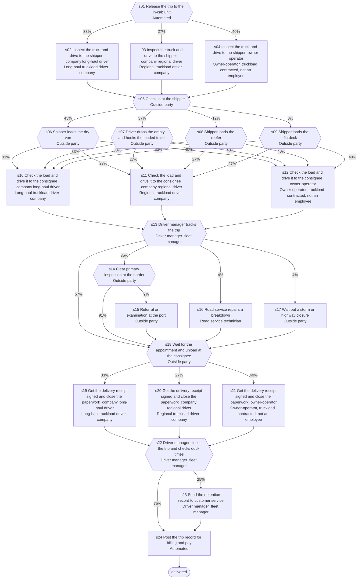

# Run a truckload trip

`frt-tl-trip-execution` · trucking and freight transportation · truckload fleet operations · part of `freight-carrier-co`

A truckload trip moves one full trailer from a shipper to a consignee, usually several hundred to a few thousand kilometres. The driver, a company long-haul or regional driver or a contracted owner-operator, inspects the truck, drives to the shipper, waits to be loaded or hooks a pre-loaded trailer, checks and seals the load, and drives to the consignee within hours-of-service limits, crossing the US border on about a third of trips. Driver managers track the trip and handle late deliveries, road service fixes breakdowns, and the signed delivery receipt and ELD times feed billing, pay and detention claims. Dock waits at shippers and receivers, border queues, winter storms and breakdowns make the elapsed time much longer than the driving time.

| | |
|---|---|
| Unit of work | one truckload trip |
| Starts when | A driver accepts a trip assignment and the trip is released to the in-cab unit. |
| Done when | The freight is delivered, the signed delivery receipt is scanned and the trip record is posted for billing, pay and settlements. |
| Organisation | A Canadian LTL and truckload carrier of about 3,000 employees whose truckload division runs about 400 company sleeper tractors and 380 owner-operators within Canada and across the US border, on a carrier TMS with EDI, ELDs and an eManifest service provider. (3,000 employees, 2019-2022) |
| Volume | 7,500 cases a month (range 6,600 to 8,600) |

## Where it sits

- Starts with **trip_assignment** from tl-load-planning (97% of cases)
- Starts with **customs_release** from tl-customs-emanifest (3% of cases)
- Sends **delivered_freight** to consignee (outcome: delivered)
- Sends **trip_record** to fin-rating-invoicing (outcome: delivered)
- Sends **trip_record** to fin-driver-pay (outcome: delivered)
- Sends **trip_record** to fin-oo-settlements (outcome: delivered)
- Sends **detention_record** to tl-detention-accessorials (outcome: delivered)
- Sends **hos_record** to tl-driver-management (outcome: delivered)
- Sends **hos_record** to saf-hos-log-audit (outcome: delivered)
- Sends **trailer_status** to tl-trailer-pools (outcome: delivered)
- Sends **dvir** to mnt-defect-repair (outcome: delivered)
- Sends **odometer_data** to mnt-preventive-maintenance (outcome: delivered)
- Sends **jurisdiction_mileage** to fin-fuel-tax-reporting (outcome: delivered)
- Sends **breakdown_call** to mnt-roadside-breakdown (outcome: any)
- Sends **collision_report** to saf-collision-management (outcome: any)
- Sends **telematics_event** to saf-driver-performance (outcome: any)
- Sends **security_incident** to saf-cargo-security (outcome: any)
- Sends **it_ticket** to it-service-desk (outcome: any)

## Flow

## Roles

| Role | Department | Layer | FTE on this process | Loaded cost per hour | Evidence |
|---|---|---|---:|---:|---|
| Long-haul truckload driver (company) | Truckload fleet operations | individual contributor | 285 | 37 CAD | C |
| Regional truckload driver (company) | Truckload fleet operations | individual contributor | 115 | 36 CAD | C |
| Owner-operator, truckload (contracted, not an employee) | Truckload fleet operations | external party | 0 | 65 CAD | C |
| Driver manager (fleet manager) | Truckload fleet operations | individual contributor | 14 | 43 CAD | C |
| Road service technician | Fleet maintenance | individual contributor | 5 | 48 CAD | C |

## Steps

Hands-on time and the wait before each step show the most common value. Evidence tier A is a sourced number, B a sourced description, C the author's estimate.

| Step | Who | Kind | Hands-on | Wait before | Control | Evidence |
|---|---|---|---:|---:|---|---|
| **s01 Release the trip to the in-cab unit.** Once the driver has accepted the load, the TMS creates the trip with its stops, appointments and trailer and sends it to the in-cab unit, where the driver sees directions and the shipper's instructions. | Automated | system auto | 0 min | 0 min |  | C |
| **s02 Inspect the truck and drive to the shipper (company long-haul driver).** The company long-haul driver does the daily trip inspection of tractor and trailer (brakes, tires, lights, coupling, load securement devices), records it on the ELD or paper report, then drives empty, or with an empty trailer, to the shipper. Defects are reported to maintenance; a major defect stops the truck. | Long-haul truckload driver (company) | travel | 1.8 h | 30 min | Provincial commercial vehicle trip inspection rules based on National Safety Code Standard 13: inspection every 24 hours, written report, no driving with a major defect | B [src-ns-trip] |
| **s03 Inspect the truck and drive to the shipper (company regional driver).** The company regional driver does the daily trip inspection of tractor and trailer (brakes, tires, lights, coupling, load securement devices), records it on the ELD or paper report, then drives empty, or with an empty trailer, to the shipper. Defects are reported to maintenance; a major defect stops the truck. | Regional truckload driver (company) | travel | 1.2 h | 30 min | Provincial commercial vehicle trip inspection rules based on National Safety Code Standard 13: inspection every 24 hours, written report, no driving with a major defect | B [src-ns-trip] |
| **s04 Inspect the truck and drive to the shipper (owner-operator).** The owner-operator does the daily trip inspection of tractor and trailer (brakes, tires, lights, coupling, load securement devices), records it on the ELD or paper report, then drives empty, or with an empty trailer, to the shipper. Defects are reported to maintenance; a major defect stops the truck. | Owner-operator, truckload (contracted, not an employee) | travel | 1.8 h | 30 min | Provincial commercial vehicle trip inspection rules based on National Safety Code Standard 13: inspection every 24 hours, written report, no driving with a major defect | B [src-ns-trip] |
| **s05 Check in at the shipper.** The driver checks in at the shipping office or guard shack with the pickup number and waits to be told whether to back into a door for a live load or to hook a trailer already loaded in the yard. Busy docks and early or late arrivals make this wait long. | Outside party | external wait | 0 min | 30 min |  | B [src-mhl-atri] |
| **s06 Shipper loads the dry van.** The shipper's dock crew loads the van from the dock with forklifts while the driver waits in the cab, on duty but not driving. Loading itself takes under an hour for most loads; waiting for a door, labour or the freight to be ready adds the rest. | Outside party | physical | 0 min | 1.5 h |  | B [src-mhl-atri], [src-oig-detention] |
| **s07 Driver drops the empty and hooks the loaded trailer.** At shippers with a trailer pool the driver drops the empty trailer in the yard, finds the pre-loaded trailer, checks its seal and paperwork at the office, and hooks up, with no wait for loading. | Outside party | physical | 0 min | 25 min |  | C |
| **s08 Shipper loads the reefer.** The driver pre-cools the reefer to the set point on the bill of lading, the shipper's crew checks pulp temperatures and loads it, and the driver confirms the setting before leaving. Food shippers often run late, and reefer loads see the longest dock waits. | Outside party | physical | 0 min | 2.0 h |  | B [src-mhl-atri] |
| **s09 Shipper loads the flatdeck.** The shipper loads steel, lumber or machinery on the flatdeck by forklift or crane; the driver then secures it with straps or chains to the cargo securement standard and tarps it, which is counted in the driver's loaded-drive step. | Outside party | physical | 0 min | 1.5 h | National Safety Code Standard 10 (cargo securement) as adopted by the provinces | C |
| **s10 Check the load and drive it to the consignee (company long-haul driver).** The company long-haul driver counts the freight against the bill of lading, checks weight and, on flatdecks, secures and tarps the load, records the seal number and signs the bill. The driver then drives to the consignee within the daily driving and on-duty limits, logging time on the ELD and taking the required off-duty rest on multi-day runs; on cross-border trips the route passes through a port of entry. | Long-haul truckload driver (company) | travel | 12.0 h | 5 min | Commercial Vehicle Drivers Hours of Service Regulations SOR/2005-313 s.12-14 and 77 (ELD from June 2021); 49 CFR 395.3 on US legs | A [src-hos], [src-cfr-395], [src-statcan-cfaf] |
| **s11 Check the load and drive it to the consignee (company regional driver).** The company regional driver counts the freight against the bill of lading, checks weight and, on flatdecks, secures and tarps the load, records the seal number and signs the bill. The driver then drives to the consignee within the daily driving and on-duty limits, logging time on the ELD and taking the required off-duty rest on multi-day runs; on cross-border trips the route passes through a port of entry. | Regional truckload driver (company) | travel | 4.0 h | 5 min | Commercial Vehicle Drivers Hours of Service Regulations SOR/2005-313 s.12-14 and 77 (ELD from June 2021); 49 CFR 395.3 on US legs | A [src-hos], [src-cfr-395], [src-statcan-cfaf] |
| **s12 Check the load and drive it to the consignee (owner-operator).** The owner-operator counts the freight against the bill of lading, checks weight and, on flatdecks, secures and tarps the load, records the seal number and signs the bill. The driver then drives to the consignee within the daily driving and on-duty limits, logging time on the ELD and taking the required off-duty rest on multi-day runs; on cross-border trips the route passes through a port of entry. | Owner-operator, truckload (contracted, not an employee) | travel | 10.0 h | 5 min | Commercial Vehicle Drivers Hours of Service Regulations SOR/2005-313 s.12-14 and 77 (ELD from June 2021); 49 CFR 395.3 on US legs | A [src-hos], [src-cfr-395], [src-statcan-cfaf] |
| **s13 Driver manager tracks the trip.** While the driver is on the road, the driver manager watches the trip on the TMS map against the delivery appointment, answers the driver's messages, and calls customer service and the consignee when the truck will be late. | Driver manager (fleet manager) | coordination | 8 min | 0 min |  | C |
| **s14 Clear primary inspection at the border.** The driver queues at the port of entry and presents the manifest number, PARS or PAPS labels and travel documents to the CBSA or CBP officer at the primary booth, who checks that the eManifest and the broker's release are on file and releases the truck or refers it. | Outside party | external wait | 2 min | 45 min | Customs Act reporting at the first port of arrival (CBSA ACI eManifest) and 19 CFR 123.92 (CBP ACE eManifest) | A [src-cbsa-eval], [src-mtri] |
| **s15 Referral or examination at the port.** The driver parks and takes the papers inside; the officer resolves a missing release, a data mismatch or selects the load for examination, while the customs desk and the broker work the problem by phone. Most referrals are released within hours; holds go to the border-hold process. | Outside party | external wait | 0 min | 1.5 h |  | B [src-cbsa-eval], [src-d17-1-4] |
| **s16 Road service repairs a breakdown.** The driver calls the after-hours or road service desk; a road service technician drives out with parts, or a tow and a third-party shop are arranged, and the driver waits with the load. Tires, air leaks, electrical faults and reefer units are the usual causes. | Road service technician | physical | 2.0 h | 2.0 h |  | C |
| **s17 Wait out a storm or highway closure.** Snowstorms, freezing rain and mountain pass closures stop trucks on Highway 401, the Trans-Canada and the Coquihalla several times a winter; the driver parks at a truck stop until the road reopens and the driver manager rebooks the delivery. | Outside party | external wait | 0 min | 8.0 h |  | C |
| **s18 Wait for the appointment and unload at the consignee.** The driver reaches the consignee, often after an off-duty rest on multi-day runs, waits for the appointment and a door, and the receiver's crew unloads and counts the freight. Grocery and retail distribution centres may refuse early trucks and turn away late ones. | Outside party | external wait | 0 min | 5.0 h |  | B [src-hos], [src-mhl-atri] |
| **s19 Get the delivery receipt signed and close the paperwork (company long-haul driver).** After unloading, the company long-haul driver gets the consignee to sign the bill of lading or delivery receipt, notes any shortage or damage, scans the signed paperwork with the in-cab or phone app, sends the empty call, and finishes the post-trip entries in the ELD. | Long-haul truckload driver (company) | data entry | 12 min | 0 min |  | C |
| **s20 Get the delivery receipt signed and close the paperwork (company regional driver).** After unloading, the company regional driver gets the consignee to sign the bill of lading or delivery receipt, notes any shortage or damage, scans the signed paperwork with the in-cab or phone app, sends the empty call, and finishes the post-trip entries in the ELD. | Regional truckload driver (company) | data entry | 12 min | 0 min |  | C |
| **s21 Get the delivery receipt signed and close the paperwork (owner-operator).** After unloading, the owner-operator gets the consignee to sign the bill of lading or delivery receipt, notes any shortage or damage, scans the signed paperwork with the in-cab or phone app, sends the empty call, and finishes the post-trip entries in the ELD. | Owner-operator, truckload (contracted, not an employee) | data entry | 12 min | 0 min |  | C |
| **s22 Driver manager closes the trip and checks dock times.** The driver manager compares the ELD arrival and departure times at each stop with the appointments; where the truck waited beyond the free time, usually two hours, the manager opens a detention record and asks the driver for the in and out times on the bill. | Driver manager (fleet manager) | review | 4 min | 2.0 h |  | B [src-oig-detention], [src-mhl-atri] |
| **s23 Send the detention record to customer service.** The driver manager attaches the in and out times and the signed bill to a detention record in the TMS and sends it to the truckload customer service desk, which bills the customer and adds detention pay for the driver. | Driver manager (fleet manager) | communication | 5 min | 30 min |  | C |
| **s24 Post the trip record for billing and pay.** The TMS links the proof-of-delivery image to the order, marks the load delivered, sends the EDI 214 delivery status, and makes the trip record available to billing, driver pay, owner-operator settlements and fuel tax reporting by province and state. | Automated | system auto | 0 min | 10 min |  | C |

## Exceptions

| Exception | Share of cases | What happens |
|---|---:|---|
| Long dock wait at the shipper | 15% | The driver waits several hours for a door or for freight to be ready, eating into driving hours and sometimes forcing an overnight rest before the delivery. |
| Referral at the border | 3% | About 9% of cross-border trips are referred inside at the port for a missing release, a data mismatch or an examination. |
| Breakdown on the road | 4% | A road service technician or third-party vendor repairs the truck while the driver waits with the load. |
| Winter storm or highway closure | 4% | The driver parks until the road reopens and the delivery is rebooked. |
| Detention beyond free time | 25% | The truck waits beyond the two free hours at a stop; the driver manager sends a detention record so the customer can be billed and the driver paid. |

## Benchmarks

| Metric | Value | Unit | Population | Evidence |
|---|---|---|---|---|
| cycle_time_days | p50 1.8, p90 3.5 | calendar days from trip release to the trip record being posted | Canadian truckload trips, 2019-2022 | C |
| shipment_distance_median | 635 | km | Canadian for-hire trucking shipments, 2016 (truckload and LTL) | A [src-statcan-cfaf] |
| border_referral_rate | 0.09 | share of highway crossings into Canada referred from primary inspection | CBSA highway mode, average 2018-19 to 2022-23 | A [src-cbsa-eval] |
| dock_delay_4h_or_more | 0.237 | share of drivers reporting delays of four hours or more | US drivers surveyed by ATRI, 2018 (36.5% for reefer) | B [src-mhl-atri] |

## Pain points

- Dock waits at shippers and receivers use up drivers' hours of service, cause missed appointments and overnight rests, and are only partly recovered through detention charges. (steps s05, s06, s08, s18; B [src-mhl-atri], [src-oig-detention])
- Border queues and referrals add hours to cross-border trips, longer for US-bound trucks. (steps s14, s15; A [src-cbsa-eval], [src-mtri])
- Winter closures and breakdowns cannot be planned for and push deliveries back by a day or more. (steps s16, s17; C)
- Detention is missed when driver managers do not check stop times against appointments, so the carrier absorbs the cost. (steps s22, s23; C)

## Assumptions

- The driver is chosen three times (before the empty leg, the loaded leg and the paperwork) with the same shares, because the simulation does not carry the driver type forward. Totals and costs are right on average, but one simulated case can mix driver types.
- Driving and on-duty working time count as touch time; off-duty rest on multi-day runs and dock waits count as waits. The time at the border is listed after the loaded drive but happens during it.
- Staffing check: the validator warns because it converts touch time (about 15 hours per trip) at 130 productive hours a month and counts owner-operator time (about 45% of the total) without counting owner-operators as staff. Spread over the drivers who do the work, the touch time is about 166 hours a month per long-haul driver, 116 hours per regional driver (who also spend more time waiting at docks) and 141 hours per owner-operator, which fits the 160 to 200 on-duty hours a month typical of these drivers under the 70-hour cycle. The org file's 430 company drivers and 380 owner-operators therefore fit the 7,500 trips a month.
- Trailers are tied up from loading to the empty call; pre-loaded drop trailers are held longer because they wait in the shipper's pool. Tractors are counted as occupied only while driving, because the org file's tractor cost per hour is a running cost (fuel and maintenance); tractors waiting at docks or during rest are idle but unavailable.
- Breakdowns are handled by road service technicians (not listed in the process map roles) or third-party vendors; the after-hours dispatcher's part is in the load planning file.
- Objects marked with outcome 'any' (breakdown calls, collision reports, telematics events, security incidents, IT tickets) are produced only when those events occur.
- Loaded costs come from the org file; the owner-operator rate includes the truck, so owner-operator tractor running cost is not added again.

## Sources

- [src-ns-trip] [Commercial Vehicle Trip Inspection Regulations (Motor Vehicle Act, Nova Scotia)](https://novascotia.ca/just/regulations/regs/mvcvtrip.htm) (Province of Nova Scotia, None). Each commercial vehicle inspected at least once every 24 hours against the schedule for its type (s.6); written inspection report with defects found (s.7); defects reported to the carrier before the next inspection and major defects immediately (s.11); no driving with a major defect (s.13). Provincial trip inspection rules follow the same pattern across Canada.
- [src-mhl-atri] [Truck Driver Wait Times Cost Big Bucks](https://www.mhlnews.com/transportation-distribution/article/22055790/truck-driver-wait-times-cost-big-bucks) (MH&L (Material Handling & Logistics), 2019). Reports ATRI's 2014 and 2018 detention surveys: in 2018, 23.7% of drivers (36.5% of reefer drivers) reported delays of four hours or more; 79% of drivers had run out of hours at a customer facility because of detention; average detention fee charged US$63.71 an hour.
- [src-oig-detention] [Detention costs $1 billion, increases crash risk: report](https://www.trucknews.com/transportation/detention-costs-1-billion-increases-crash-risk-report/1003083500) (Trucknews.com, 2018). Reports the US DOT Inspector General audit: a 15-minute increase in average dwell time raises the expected crash rate by 6.2%; detention cuts driver earnings by US$1.1 to 1.3 billion a year; detention is usually counted only beyond the two hours allowed in shipping contracts.
- [src-hos] [Commercial Vehicle Drivers Hours of Service Regulations (SOR/2005-313)](https://laws-lois.justice.gc.ca/eng/regulations/SOR-2005-313/FullText.html) (Government of Canada, Justice Laws Website, 2005). South of 60 degrees: 13 h driving and 14 h on duty per day (s.12), 8 consecutive hours off before driving again (s.13), 10 h off duty per day (s.14); cycle 1 of 70 h in 7 days and cycle 2 of 120 h in 14 days (s.26-27); cycle reset after 36 or 72 h off (s.28); daily record of duty status (s.77, 81, 82).
- [src-cfr-395] [49 CFR 395.3 Maximum driving time for property-carrying vehicles](https://www.law.cornell.edu/cfr/text/49/395.3) (Legal Information Institute, Cornell Law School, None). US limits for property-carrying drivers: 11 h driving within a 14 h window after 10 h off, 30-minute break after 8 h of driving, 60 h in 7 days or 70 h in 8 days, 34 h restart.
- [src-statcan-cfaf] [Commodity flows by mode in Canada: Canadian Freight Analysis Framework, 2016](https://www150.statcan.gc.ca/n1/daily-quotidien/190315/dq190315c-eng.htm) (Statistics Canada, The Daily, 2019). For-hire trucking shipments in 2016 travelled a median distance of 635 km.
- [src-cbsa-eval] [Evaluation of eManifest, Final Report](https://www.cbsa-asfc.gc.ca/agency-agence/reports-rapports/ae-ve/mani/menu-eng.html) (Canada Border Services Agency, Program Evaluation Division, 2024). Highway pre-arrival transmissions of about 14 million (2019-20) to 16 million (2021-22) a year; electronic submission 99.2% to 99.7%; referrals from primary inspection to the counter 13% (2018-19), 10% (2019-20), 8% (2020-21), 7% (2021-22), about 9% on average; a release recommendation was available on arrival for 99.4% of release requests sent at least one hour before arrival.
- [src-mtri] [Documenting and Determining Distributions, Trends, and Relations in Truck Lanes at International Border Crossing Facilities](https://www.mtu.edu/mtri/research/project-areas/transportation/mobility/truck-border-crossing/) (Michigan Tech Research Institute, None). 1,085 truck crossings at the Ambassador Bridge in June 2014: crossing time always higher for trucks entering the US, peaks near 8 a.m. and 5 p.m., crossings concentrated Tuesday to Thursday; 19 of 1,085 trucks (1.75%) sent to secondary inspection; inspections generally 1 to 2 minutes.
- [src-d17-1-4] [Memorandum D17-1-4: Release of Commercial Goods](https://www.cbsa-asfc.gc.ca/publications/dm-md/d17/d17-1-4-eng.html) (Canada Border Services Agency, 2025). Importers or brokers may submit PARS release requests electronically up to 45 days before arrival; a border services officer reviews them and records a release or refer recommendation; the cargo control number links release and cargo documents; on arrival release or refer notices go to the broker; without a release request the goods cannot be released at the first port and are held or moved in-bond to a sufferance warehouse.

Written by claude-opus on 2026-11-24.
