# Prepare a construction management, design-build or IPD proposal

`gc-bd-cm-proposal` · construction (non-residential general contracting) · business development · part of `general-contractor-co`

Public institutions and private owners who want the contractor involved before design is finished pick a construction manager, design-builder or IPD partner through a request for proposals instead of a lump-sum tender. The business development manager runs a team of a proposal coordinator, preconstruction manager, estimator, scheduler and the proposed site leaders to write the approach, price the fee and general conditions, and for design-build add a design team and a priced concept. Executive approval, surety letters and a final compliance check come in the last days before closing, and shortlisted firms then rehearse and attend an interview. The work is slow because it competes with live projects for the same senior people, and it is error-prone because page limits, mandatory forms and two-envelope rules make small mistakes disqualifying.

| | |
|---|---|
| Unit of work | one proposal (CM, design-build or IPD) from receipt of the RFP to the owner's award or regret |
| Starts when | The opportunity pipeline passes on an owner's RFP that the company has decided to pursue. |
| Done when | The owner has awarded the contract and the file is with the contract award team, or the pursuit is closed after a no-go, withdrawal or loss with debrief notes in the CRM. |
| Organisation | A Canadian national general contractor with about $1.5B annual revenue, central business development and preconstruction staff, and regional operations offices that supply the proposed project teams. (2,800 employees, 2019-2022) |
| Volume | 5 cases a month (range 3 to 8) |

## Where it sits

- Starts with **tender_package** from bd-opportunity-pipeline (100% of cases)
- Relies on **bid_approval** from exec-bid-approval (a standing input; it does not start a case)
- Relies on **cost_database** from bd-cost-database (a standing input; it does not start a case)
- Relies on **bond** from fin-surety-bonding (a standing input; it does not start a case)
- Sends **proposal** to bd-contract-award (outcome: won)
- Sends **proposal** to public-owner (outcome: won)
- Sends **proposal** to public-owner (outcome: lost)
- Sends **proposal** to private-owner (outcome: won)
- Sends **proposal** to private-owner (outcome: lost)
- Sends **bid_summary** to exec-bid-approval (outcome: won)
- Sends **bid_summary** to exec-bid-approval (outcome: lost)
- Sends **bid_summary** to exec-bid-approval (outcome: withdrawn)
- Sends **trade_tender** to bd-trade-tendering (outcome: won)
- Sends **trade_tender** to bd-trade-tendering (outcome: lost)
- Sends **bond_request** to fin-surety-bonding (outcome: won)
- Sends **bond_request** to fin-surety-bonding (outcome: lost)

## Flow

```mermaid
flowchart TD
    s01["s01 Log RFP and open pursuit file<br/>Proposal and marketing coordinator"]
    s02{{"s02 Hold go or no-go review of the full RFP<br/>Business development manager"}}
    s03["s03 Commit proposed project team<br/>Operations manager  construction manager"]
    s04["s04 Review form of contract and supplementary conditions<br/>Contracts counsel"]
    s05["s05 Draft proposal narrative and resumes<br/>Proposal and marketing coordinator"]
    s06["s06 Write preconstruction and management approach<br/>Preconstruction manager"]
    s07["s07 Prepare proposal schedule<br/>Scheduler  CPM"]
    s08{{"s08 Estimate general conditions, staffing cost and fee<br/>Estimator / senior estimator"}}
    s09["s09 Engage design consultants for the design-build team<br/>Design manager  design-build and P3"]
    s10["s10 Wait for consultants' concept design<br/>Outside party"]
    s11["s11 Price the concept design with trade input<br/>Estimator / senior estimator"]
    s12{{"s12 Chief estimator reviews price and fee<br/>Chief estimator"}}
    s13["s13 Prepare bid summary for executive approval<br/>Business development manager"]
    s14{{"s14 Obtain executive bid approval<br/>Vice-president, business development and preconstruction"}}
    s15["s15 Obtain surety letter or bid security<br/>Treasury, surety and credit manager"]
    s16["s16 Assemble and produce final submission<br/>Proposal and marketing coordinator"]
    s17{{"s17 Final compliance review and sign-off<br/>Vice-president, business development and preconstruction"}}
    s18["s18 Submit proposal before closing<br/>Proposal and marketing coordinator"]
    s19{{"s19 Wait for owner's technical evaluation<br/>Outside party"}}
    s20["s20 Organise and rehearse the interview<br/>Business development manager"]
    s21["s21 Proposed project manager prepares interview part<br/>Project manager"]
    s22["s22 Travel to the owner's interview<br/>Project manager"]
    s23["s23 Present at the owner interview<br/>Business development manager"]
    s24{{"s24 Wait for owner's decision<br/>Outside party"}}
    s25["s25 Record award and hand over to contract award<br/>Business development manager"]
    s26["s26 Request debrief and record the loss<br/>Business development manager"]
    s01 --> s02
    s02 -->|"90%"| s03
    s02 -->|"10%"| end0
    s03 --> s04
    s04 --> s05
    s05 --> s06
    s06 --> s07
    s07 --> s08
    s08 -->|"30%"| s09
    s08 -->|"70%"| s12
    s09 --> s10
    s10 --> s11
    s11 --> s12
    s12 -->|"86%"| s13
    s12 -->|"14%"| s08
    s13 --> s14
    s14 -->|"90%"| s15
    s14 -->|"7%"| s08
    s14 -->|"3%"| end1
    s15 --> s16
    s16 --> s17
    s17 -->|"92%"| s18
    s17 -->|"8%"| s16
    s18 --> s19
    s19 -->|"55%"| s20
    s19 -->|"10%"| s24
    s19 -->|"35%"| s26
    s20 --> s21
    s21 --> s22
    s22 --> s23
    s23 --> s24
    s24 -->|"42%"| s25
    s24 -->|"58%"| s26
    s25 --> end2
    s26 --> end3
    end0(["declined"])
    end1(["withdrawn"])
    end2(["won"])
    end3(["lost"])
```

## Roles

| Role | Department | Layer | FTE on this process | Loaded cost per hour | Evidence |
|---|---|---|---:|---:|---|
| Business development manager | Business development and preconstruction | manager | 1 | 90 CAD | C |
| Proposal and marketing coordinator | Business development and preconstruction | individual contributor | 1.8 | 45 CAD | C |
| Preconstruction manager | Preconstruction and design management | manager | 0.7 | 95 CAD | C |
| Estimator / senior estimator | Estimating | senior specialist | 2 | 68 CAD | C |
| Chief estimator | Estimating | manager | 0.2 | 105 CAD | C |
| Scheduler (CPM) | Operations support (project controls, scheduling, VDC, quality) | senior specialist | 0.3 | 68 CAD | C |
| Design manager (design-build and P3) | Preconstruction and design management | senior specialist | 0.3 | 90 CAD | C |
| Operations manager (construction manager) | Construction operations | manager | 0.06 | 115 CAD | C |
| Project manager | Construction operations | manager | 0.3 | 72 CAD | C |
| Contracts counsel | Legal, risk and insurance | senior specialist | 0.15 | 115 CAD | C |
| Vice-president, business development and preconstruction | Business development and preconstruction | director | 0.2 | 150 CAD | C |
| Treasury, surety and credit manager | Finance | manager | 0.04 | 95 CAD | C |

## Steps

Hands-on time and the wait before each step show the most common value. Evidence tier A is a sourced number, B a sourced description, C the author's estimate.

| Step | Who | Kind | Hands-on | Wait before | Control | Evidence |
|---|---|---|---:|---:|---|---|
| **s01 Log RFP and open pursuit file.** The proposal coordinator downloads the RFP and addenda from the bid portal or the owner's email, records the opportunity stage in the CRM, opens a pursuit folder and builds a compliance matrix listing every mandatory form, page limit, rated criterion and deadline. | Proposal and marketing coordinator | intake | 2.0 h | 4.0 h |  | B [ncc-cm-rfp] |
| **s02 Hold go or no-go review of the full RFP.** The business development manager reads the full RFP, contract form and evaluation scheme and meets the VP, a preconstruction manager and an operations manager to confirm fit, competition, staff availability, fee expectations and bonding before committing proposal effort. A no-go is recorded in the CRM with the reason. | Business development manager | judgment | 2.0 h | 2.0 d |  | C |
| **s03 Commit proposed project team.** The operations manager checks the staffing plan for the project manager, superintendent and project estimator who can start on the owner's dates, confirms their names for the proposal and releases them for resumes and interview preparation. | Operations manager (construction manager) | coordination | 1.5 h | 1.0 d |  | B [oaa-cm-tip], [ncc-cm-rfp] |
| **s04 Review form of contract and supplementary conditions.** Contracts counsel reads the owner's CCDC 5A, 5B, 14 or 30 form and supplementary conditions, marks liability caps, liquidated damages, GMP conversion terms and indemnities, and writes the list of exceptions or clarifications the proposal may carry. | Contracts counsel | review | 4.0 h | 2.0 d | Corporate contract review policy: legal review of non-standard contract terms before any proposal is submitted | B [oaa-cm-tip] |
| **s05 Draft proposal narrative and resumes.** The proposal coordinator assembles corporate experience, project sheets, safety statistics and tailored resumes from the marketing library, writes the first draft of each rated section within the page limits and circulates it to section authors. | Proposal and marketing coordinator | drafting | 1.0 d | 1.0 h |  | B [ncc-cm-rfp] |
| **s06 Write preconstruction and management approach.** The preconstruction manager writes the approach to design-phase cost control, estimate stages, value engineering, trade packaging and early works, and the risk register for the project, drawing on comparable past projects. | Preconstruction manager | drafting | 16.0 h | 1.0 d |  | B [oaa-cm-tip] |
| **s07 Prepare proposal schedule.** The scheduler builds a summary CPM schedule covering design stages, preconstruction, permits, trade package tendering, construction phases and turnover, and writes the schedule narrative the RFP asks for. | Scheduler (CPM) | analysis | 8.0 h | 2.0 d |  | C |
| **s08 Estimate general conditions, staffing cost and fee.** The estimator prices the site staff loaded against the schedule, site general requirements, insurance and bonding, and sets the preconstruction fee and construction fee in the form the RFP asks for (lump sum, hourly rates or percentage). | Estimator / senior estimator | analysis | 15.0 h | 2.0 d |  | B [oaa-cm-tip], [ncc-cm-rfp] |
| **s09 Engage design consultants for the design-build team.** The design manager invites two or three architectural firms, agrees pursuit fees, scope and teaming terms, and sets the concept design deliverables against the owner's statement of requirements. | Design manager (design-build and P3) | coordination | 15.0 h | 3.0 d |  | C |
| **s10 Wait for consultants' concept design.** The design team produces concept plans, outline specifications and a basis of design to the owner's requirements while the design manager attends weekly design meetings; the contractor cannot price until drawings arrive. | Outside party | external wait | 0 min | 12.0 d |  | C |
| **s11 Price the concept design with trade input.** The estimator takes off quantities from the concept, sends mechanical, electrical and envelope packages to trades through trade tendering for budget prices, levels the replies and builds the design-build price with design fees and contingency. | Estimator / senior estimator | analysis | 3.3 d | 1.0 d |  | C |
| **s12 Chief estimator reviews price and fee.** The chief estimator compares the fee, general conditions, contingency and design-build price with recent wins and losses in the cost database and returns the estimate with comments when assumptions look wrong. | Chief estimator | review | 4.0 h | 1.0 d | Estimating department review policy: senior estimator review of every priced submission | C |
| **s13 Prepare bid summary for executive approval.** The business development manager writes a two-page summary of the fee, margin, contract exceptions, staffing, competition and risks and attaches it to the approval request. | Business development manager | drafting | 3.0 h | 12.0 h |  | C |
| **s14 Obtain executive bid approval.** The VP of business development approves within delegated limits or takes the summary to the executive bid approval meeting for large projects, unusual contract terms or thin fees, and records conditions such as a higher fee or fewer exceptions. | Vice-president, business development and preconstruction | approval | 1.5 h | 2.0 d | Delegation of authority: executive bid approval above a contract value or for non-standard terms | C |
| **s15 Obtain surety letter or bid security.** The treasury manager asks the surety broker for the consent-of-surety or bonding capacity letter the RFP requires and files it with the submission forms. | Treasury, surety and credit manager | communication | 1.0 h | 2.0 d |  | C |
| **s16 Assemble and produce final submission.** The proposal coordinator merges the final sections, applies the layout, checks page counts, completes and signs the forms, and prepares the technical and price files as separate submissions where the RFP uses two envelopes. | Proposal and marketing coordinator | drafting | 15.0 h | 0 min |  | B [ncc-cm-rfp] |
| **s17 Final compliance review and sign-off.** The VP reads the proposal against the compliance matrix and the approval conditions, checks that the fee matches the approval and signs the submission letter, or returns it for corrections. | Vice-president, business development and preconstruction | review | 3.0 h | 12.0 h | Signing authority: proposals and price forms signed by an officer of the company | C |
| **s18 Submit proposal before closing.** The proposal coordinator uploads or emails the technical and price files before the closing time, keeps the time-stamped receipt and records the submission in the CRM. | Proposal and marketing coordinator | communication | 1.0 h | 1.0 h |  | B [ncc-cm-rfp] |
| **s19 Wait for owner's technical evaluation.** The owner's evaluation committee scores the technical proposals against the rated criteria and minimum scores, calls references and decides which proponents to interview or whether to open price envelopes directly. | Outside party | external wait | 0 min | 10.0 d |  | B [ncc-cm-rfp] |
| **s20 Organise and rehearse the interview.** The business development manager builds the interview plan and slides, assigns topics to the proposed project manager, superintendent and preconstruction manager, and runs two or three rehearsals with likely owner questions. | Business development manager | coordination | 15.0 h | 2.0 d |  | C |
| **s21 Proposed project manager prepares interview part.** The proposed project manager studies the drawings and site, prepares the logistics, phasing and schedule talking points, and joins the rehearsals so the owner meets the person who will run the job. | Project manager | drafting | 10.0 h | 0 min |  | B [oaa-cm-tip] |
| **s22 Travel to the owner's interview.** The interview team drives or flies to the owner's office or campus, often another city served by a regional office, and returns the same day. | Project manager | travel | 2.0 h | 3.0 d |  | C |
| **s23 Present at the owner interview.** The business development manager leads a 60 to 90 minute presentation and question session with the owner's committee and consultant, and the team answers questions on fee, staffing, schedule and approach. | Business development manager | communication | 2.0 h | 0 min |  | C |
| **s24 Wait for owner's decision.** The owner combines technical, interview and price scores, may ask for fee clarifications, and obtains internal or board approval before issuing a notice of award or a regret letter. | Outside party | external wait | 0 min | 10.0 d |  | B [ncc-cm-rfp] |
| **s25 Record award and hand over to contract award.** The business development manager updates the CRM, informs the team, and passes the proposal, fee forms and exceptions list to the contract award team for negotiation of the CM agreement. | Business development manager | data entry | 1.5 h | 12.0 h |  | C |
| **s26 Request debrief and record the loss.** The business development manager requests a debrief, attends it with the team, records scores, winning fee range and lessons in the CRM, and closes the pursuit file. | Business development manager | communication | 2.0 h | 7.0 d |  | C |

## Exceptions

| Exception | Share of cases | What happens |
|---|---:|---|
| Design-build concept pricing | 30% | Design-build and some IPD proposals need a design team and a priced concept, which adds two to six weeks and most of the estimating hours. |
| Executive sends price back | 7% | The executive approval meeting asks for a higher fee or a leaner staffing plan, so the estimator reprices in the last days before closing. |
| Late compliance correction | 8% | The final review finds an unsigned form, page overrun or price in the technical file, and the coordinator reworks the package on closing day. |
| No interview | 10% | Some owners score written proposals and price only, so the team goes straight from submission to the decision. |

## Benchmarks

| Metric | Value | Unit | Population | Evidence |
|---|---|---|---|---|
| cycle_time_days | p50 60, p90 100 | calendar days from receipt of the RFP to award or regret | Canadian negotiated CM and design-build pursuits, 2019-2022 | C [ncc-cm-rfp] |
| rfp_response_period | 38 | calendar days from RFP issue to closing | One federal CM services RFP (NCC AL1821, 2021) | A [ncc-cm-rfp] |
| technical_share_of_score | 70 | percent of total points (price 30%) | One federal CM services RFP (NCC AL1821, 2021) | A [ncc-cm-rfp] |

## Pain points

- Proposal effort competes with live projects for the same project managers, superintendents and preconstruction managers, so sections wait and interview rehearsals get squeezed. (steps s03, s06, s20, s21; B [oaa-cm-tip])
- Executive approval and surety letters arrive in the last days before closing and any change to the fee forces repricing under deadline pressure. (steps s14, s15, s16; C)
- Strict page limits, mandatory forms and separate price envelopes mean a small assembly error can make a strong proposal non-compliant. (steps s05, s16, s17, s18; B [ncc-cm-rfp])
- Design-build concepts depend on outside architects working on pursuit fees, so pricing waits for drawings and is done on incomplete information. (steps s09, s10, s11; C)

## Assumptions

- The process starts after the opportunity pipeline's pursue decision and ends at award or loss; negotiating the CM agreement is the contract award process.
- Loaded costs and titles come from the organisation file (wage x 1.35 for salaried staff).
- Roles not listed for this process in the organisation file but needed here: estimator, chief-estimator, scheduler, project-manager, operations-manager, contracts-counsel and treasury-manager.
- The executive approval meeting is modelled as one approval step by the VP of business development; the executive bid approval process holds the detail.
- Win rate overall is about 0.55 x 0.42 + 0.1 x 0.42, roughly 27% of submitted proposals; this is an estimate for negotiated work, not a published figure.
- Mix of 70% CM proposals priced on fee and general conditions and 30% design-build or IPD proposals needing a priced concept is an estimate.
- Step times are sequential in the simulation; steps marked concurrent run in parallel in practice, so the simulated cycle slightly overstates the elapsed time of the drafting stage.

## Sources

- [ncc-cm-rfp] [Request for Proposal: Construction Management Services, Solicitation AL1821](https://canadabuys.canada.ca/documents/pub/att/2021/03/12/10b31bb92201e98a5ffad5b95c12c776/ncc_tender_file_al1821_construction_management_services_rfp_english_tender_version_2021_03_12.pdf) (National Capital Commission (via CanadaBuys), 2021). A 2021 Canadian public CM services RFP: tender file dated 12 March 2021 and closing 19 April 2021 (38 days); two-envelope submission with technical proposal by email 1 and price proposal by email 2; minimum points required on each rated criterion before price is opened; technical 70% and price 30%; page limits per rated criterion; key individuals rated on qualifications; client reference forms to be returned within 5 business days of request; price proposal irrevocable for 180 days; questions due 14 calendar days before closing.
- [oaa-cm-tip] [Practice Tip PT.23.2: CCDC Construction Management Contracts (version 2.1)](https://oaa.on.ca/Assets/Common/Shared_Documents/Practice%20Tips/PT.23.2_V2.1_CCDC_CM-Contracts_20260527.pdf) (Ontario Association of Architects, 2026). CCDC 5A (CM for services) and CCDC 5B (CM for services and construction) and CCDC 17 for trade contractors; the CM is engaged during design for constructability, estimated construction costs and scheduling; work is packaged and bid by individual trades; the CM fee may be a stipulated amount, hourly rates or a percentage of the cost of the work, with options under 5B to move to a guaranteed maximum price or stipulated price later; owners selecting a CM by RFP consider the experience of the proposed project manager, estimator and superintendent; the 2010 forms were the ones in use until the 2025 editions.

Written by claude-opus on 2026-11-24.
