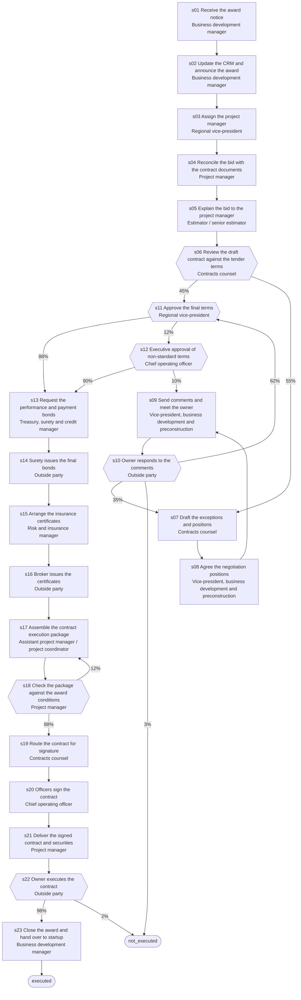

# Negotiate and execute the prime contract

`gc-bd-contract-award` · construction (non-residential general contracting) · business development and legal · part of `general-contractor-co`

When an owner awards a bid or proposal, the company has to turn it into a signed prime contract, usually a CCDC 2 stipulated price contract or a CCDC construction management or P3 agreement, within the short deadline in the award letter. The project manager reconciles the bid with the contract documents, contracts counsel compares the contract with the tendered terms and negotiates any changes through the vice-president of business development, treasury obtains the performance and payment bonds, the risk manager the insurance certificates, and authorised officers sign. Unacceptable risk terms, owners who will not change tendered clauses, slow sureties and missing documents delay signing for weeks.

| | |
|---|---|
| Unit of work | one prime contract |
| Starts when | A public, private or P3 owner issues a letter of award or intent after the company's bid or proposal is selected. |
| Done when | Both parties have signed the prime contract and it is handed to project startup, or the award falls through. |
| Organisation | A Canadian national general contractor with about $1.5B of annual construction revenue, an Ontario head office and regional offices in Western and Atlantic Canada, bidding public and private institutional, commercial and industrial buildings. (2,800 employees, 2019-2022) |
| Volume | 10 cases a month (range 7 to 14) |

## Where it sits

- Starts with **award_notice** from public-owner (60% of cases)
- Starts with **award_notice** from private-owner (37% of cases)
- Starts with **award_notice** from p3-project-co (3% of cases)
- Relies on **bid_submission** from bd-stipulated-bid (a standing input; it does not start a case)
- Relies on **proposal** from bd-cm-proposal (a standing input; it does not start a case)
- Relies on **proposal** from bd-p3-pursuit (a standing input; it does not start a case)
- Relies on **contract_review** from legal-prime-contract-review (a standing input; it does not start a case)
- Sends **draft_contract** to legal-prime-contract-review (outcome: any)
- Sends **bond_request** to fin-surety-bonding (outcome: any)
- Sends **contract** to legal-insurance-claims (outcome: executed)
- Sends **contract** to public-owner (outcome: executed)
- Sends **contract** to private-owner (outcome: executed)
- Sends **contract** to ops-project-startup (outcome: executed)
- Sends **contract** to bd-preconstruction-services (outcome: executed)
- Sends **contract** to bd-design-management (outcome: executed)

## Flow

## Roles

| Role | Department | Layer | FTE on this process | Loaded cost per hour | Evidence |
|---|---|---|---:|---:|---|
| Business development manager | Business development and preconstruction | manager | 0.15 | 90 CAD | C |
| Regional vice-president | Construction operations | director | 0.15 | 160 CAD | C |
| Project manager | Construction operations | manager | 0.9 | 72 CAD | C |
| Estimator / senior estimator | Estimating | senior specialist | 0.2 | 68 CAD | C |
| Contracts counsel | Legal, risk and insurance | senior specialist | 0.7 | 115 CAD | C |
| Vice-president, business development and preconstruction | Business development and preconstruction | director | 0.25 | 150 CAD | C |
| Chief operating officer | Executive office | executive | 0.04 | 250 CAD | C |
| Treasury, surety and credit manager | Finance | manager | 0.07 | 95 CAD | C |
| Risk and insurance manager | Legal, risk and insurance | manager | 0.1 | 88 CAD | C |
| Assistant project manager / project coordinator | Construction operations | individual contributor | 0.45 | 48 CAD | C |

## Steps

Hands-on time and the wait before each step show the most common value. Evidence tier A is a sourced number, B a sourced description, C the author's estimate.

| Step | Who | Kind | Hands-on | Wait before | Control | Evidence |
|---|---|---|---:|---:|---|---|
| **s01 Receive the award notice.** The business development manager receives the owner's letter of award or intent, reads the conditions and deadlines (usually bonds, insurance and signed documents within about ten days), and confirms receipt to the owner. | Business development manager | intake | 30 min | 2.0 h |  | B [ns2017], [oshawa] |
| **s02 Update the CRM and announce the award.** The business development manager marks the opportunity as awarded in the CRM with the contract value, moves it into pending backlog, and emails operations, finance and estimating. | Business development manager | data entry | 20 min | 1.0 h |  | B [bird2021] |
| **s03 Assign the project manager.** The regional vice-president names the project manager and superintendent for the job, considering who is coming free, and books an award meeting with estimating. | Regional vice-president | coordination | 1.0 h | 1.0 d |  | C |
| **s04 Reconcile the bid with the contract documents.** The project manager reads the bid summary, bid form, addenda, accepted alternates and separate prices against the contract documents the owner sends, and lists every difference in scope, price or schedule. | Project manager | analysis | 8.0 h | 1.0 d |  | C |
| **s05 Explain the bid to the project manager.** The lead estimator walks the project manager through the bid summary, carried trades, plugs, allowances and risks, so that the contract and later buyout reflect what was priced. | Estimator / senior estimator | communication | 2.0 h | 0 min |  | C |
| **s06 Review the draft contract against the tender terms.** Contracts counsel compares the agreement, supplementary conditions, insurance, bonding and payment terms in the contract the owner issued with the terms tendered, and flags changes and risk terms such as consequential damages, unlimited liquidated damages and broad indemnities. | Contracts counsel | review | 4.0 h | 2.0 d | Company contract review policy: counsel reviews every prime contract before signature | B [mlt-ccdc2] |
| **s07 Draft the exceptions and positions.** Contracts counsel writes a mark-up of the clauses the company wants changed or clarified, with a fallback position for each, and circulates it to the project manager and vice-president. | Contracts counsel | drafting | 2.0 h | 12.0 h |  | C |
| **s08 Agree the negotiation positions.** The vice-president of business development meets the regional vice-president, project manager and counsel to decide which changes must be won, which can be priced, and how far to push an owner who tendered fixed terms. | Vice-president, business development and preconstruction | judgment | 1.0 h | 1.0 d |  | C |
| **s09 Send comments and meet the owner.** The vice-president sends the mark-up and scope reconciliation to the owner and meets the owner, consultant and owner's counsel to negotiate the clauses, the contract sum and the schedule. | Vice-president, business development and preconstruction | communication | 2.0 h | 1.0 d |  | B [ns2017] |
| **s10 Owner responds to the comments.** The owner and its lawyer consider the mark-up and reply with an accepted, partly accepted or rejected version; public owners often refuse changes to tendered terms. | Outside party | external wait | 0 min | 5.0 d |  | C |
| **s11 Approve the final terms.** The regional vice-president reviews the agreed contract, the remaining risk terms and the reconciled contract sum and approves signing within the regional delegation, or sends it up to the chief operating officer. | Regional vice-president | approval | 45 min | 1.0 d | Delegation of authority for contract signature by value and risk | C |
| **s12 Executive approval of non-standard terms.** The chief operating officer reviews the contract terms outside policy, such as uncapped liability or unusual liquidated damages, with the general counsel's note and approves or sends the team back to the owner. | Chief operating officer | approval | 1.0 h | 2.0 d | Delegation of authority: COO approves prime contracts with terms outside policy | C |
| **s13 Request the performance and payment bonds.** The treasury, surety and credit manager sends the surety broker the contract price, owner and bond forms required, usually a 50% performance bond and a 50% labour and material payment bond, and confirms the surety's approval within the bonding line. | Treasury, surety and credit manager | communication | 45 min | 12.0 h | Owner bonding requirements on award (Oshawa: 50% performance and 50% labour and material bonds) and, for Ontario public contracts of $500,000 or more, the Construction Act mandatory bonds | B [oshawa], [ns2017] |
| **s14 Surety issues the final bonds.** The surety underwrites the final bonds against the agreement to bond given at tender, and the broker issues the performance bond and labour and material payment bond, in digital or paper form. | Outside party | external wait | 0 min | 3.0 d |  | B [oshawa] |
| **s15 Arrange the insurance certificates.** The risk and insurance manager checks the contract's insurance clauses (general liability, builder's risk or wrap-up, limits, additional insureds) against the company program and asks the broker for certificates naming the owner and consultant. | Risk and insurance manager | communication | 1.0 h | 4.0 h |  | B [mlt-ccdc2] |
| **s16 Broker issues the certificates.** The insurance broker issues certificates of insurance and any builder's risk or wrap-up binder for the project and emails them to the risk manager. | Outside party | external wait | 0 min | 12.0 h |  | C |
| **s17 Assemble the contract execution package.** The assistant project manager collects the bonds, insurance certificates, WSIB clearance certificate from the government portal, safety certification (COR), schedule of values and preliminary schedule into the package the award letter requires. | Assistant project manager / project coordinator | data entry | 4.0 h | 12.0 h | Workers' compensation clearance before work starts and owner's safety certification requirement (Nova Scotia guidelines 6.8; Oshawa COR rule) | B [ns2017], [oshawa] |
| **s18 Check the package against the award conditions.** The project manager ticks each item in the award letter and contract against the package, checks the contract sum on the agreement against the reconciliation, and returns missing items to the assistant. | Project manager | validation | 1.0 h | 4.0 h |  | C |
| **s19 Route the contract for signature.** Contracts counsel checks the signing authority matrix, prepares the execution copies with two signature blocks and routes them to the authorised officers. | Contracts counsel | validation | 30 min | 4.0 h | Corporate signing authority: two authorised officers sign prime contracts | C |
| **s20 Officers sign the contract.** The chief operating officer and a second authorised officer sign the agreement, often electronically by 2021, after a final look at the contract sum and approvals. | Chief operating officer | approval | 20 min | 1.0 d | Corporate signing authority | C |
| **s21 Deliver the signed contract and securities.** The project manager sends the signed agreement, bonds, insurance certificates and clearances to the owner or consultant, by courier or upload, before the deadline in the award letter. | Project manager | communication | 30 min | 1.0 h |  | B [oshawa], [ns2017] |
| **s22 Owner executes the contract.** The owner checks the bonds and insurance, verifies digital bonds with the authentication service, and signs; public owners may need a board or council resolution or a second signing officer. | Outside party | external wait | 0 min | 5.0 d |  | B [oshawa] |
| **s23 Close the award and hand over to startup.** The business development manager files the executed contract, marks the opportunity won with the final contract sum in the CRM, and sends the contract to project startup, finance for job set-up and risk for insurance records. | Business development manager | data entry | 30 min | 1.0 d |  | C |

## Exceptions

| Exception | Share of cases | What happens |
|---|---:|---|
| Second round of negotiation | 20% | The owner rejects part of the mark-up and counsel redrafts; a third round happens on private and P3 contracts. |
| Non-standard terms escalated | 12% | Uncapped liability, unusual liquidated damages or very large contracts go to the COO before signature. |
| Incomplete execution package | 12% | A certificate or clearance is missing or expired and is chased before the package goes to the owner. |
| Early start on a letter of intent | 15% | The owner lets the company mobilise on a letter of intent while the contract is still being signed; startup runs in parallel with this process. |
| Award falls through | 5% | The parties cannot agree terms, or the owner cancels for funding or scope before signing. |

## Benchmarks

| Metric | Value | Unit | Population | Evidence |
|---|---|---|---|---|
| cycle_time_days | p50 28, p90 50 | calendar days from award notice to executed contract | Canadian public and private building contracts | C |
| contract_security_deadline | 10 | days after award | Nova Scotia public sector construction contracts; City of Oshawa bids | A [ns2017], [oshawa] |
| bid_acceptance_period | 90 | days (usual time limit for acceptance) | City of Oshawa bids | A [oshawa] |

## Pain points

- Owners issue contracts with supplementary conditions that differ from or add to the tendered terms, and negotiation rounds wait on the owner's lawyers. (steps s06, s07, s10; B [mlt-ccdc2])
- Bonds, insurance certificates and clearances come from three outside parties against a ten-day deadline. (steps s13, s14, s15, s16, s17; B [oshawa], [ns2017])
- Scope agreed after bid (alternates, clarifications) is lost between the bid file and the contract sum. (steps s04, s05; C)

## Assumptions

- The process runs from the award notice to the executed contract; legal-prime-contract-review and fin-surety-bonding are separate processes, and their work for this contract appears here as the counsel and treasury steps.
- Ontario's Construction Act mandatory bond rules (public contracts of $500,000 or more) are named in a control basis, but the statute could not be opened, so the evidence cites the City of Oshawa bond requirements instead.
- Shares of negotiation rounds and failed awards are estimates; public stipulated tenders allow little negotiation, private negotiated and P3 contracts more.
- Waits are calendar time; the main ones are the owner's legal review and execution, and the surety.
- The organisation file lists only vp-bd, contracts-counsel, project-manager and regional-vp for this process; bd-manager, estimator, coo, treasury-manager, risk-insurance-manager and assistant-pm are added from the organisation file's roles.
- No equipment, vehicles or crews are tied up; office roles have no shift pattern.

## Sources

- [ns2017] [Nova Scotia Public Sector Construction Contract Guidelines (June 2017)](https://www.novascotia.ca/sites/default/files/documents/1-1078/construction-contract-guidelines-en.pdf) (Province of Nova Scotia, 2017). Prequalification of bidders with a published minimum score (often 70-80 of 100); solicitation documents list major subcontractors, bid security, CCDC contract form; bonding recommended at $500,000 and over; subcontracts of $250,000 or more should carry contract security; addenda no later than 5 business days (major) or 3 business days (minor) before closing and closing extended at least 1 business day when needed; late bids rejected; amendments and withdrawals allowed up to closing; withdrawal after opening only for serious demonstrable error within 2 business days; within 48 hours of opening bidders may be asked for safety certifications, other subcontractors and price breakouts; bids over the estimate may be negotiated or re-tendered; letter of award binds the contractor to sign; contract security within 10 days of award; bid security of unsuccessful bidders returned within 30 days; international trade agreements may require 40-day postings.
- [oshawa] [Bid Submission Procedure (under Purchasing By-law 80-2020)](https://www.oshawa.ca/media/ih2jhh10/bid-submission-procedure.pdf) (City of Oshawa, 2021). Electronic bids only through the bids&tenders system, late bids not accepted; COR, SOSE or ISO 45001 required for construction bids over $500,000; digital bid bond of 10% of the bid and agreement to bond uploaded with the bid on CCDC forms, verified through a third-party authentication firm; qualified bids, unverifiable bonds and improperly executed agreements to bond are rejected; contract documents due within 10 calendar days after written notice of award; acceptance time limit usually 90 days; performance bond of 100%, or 50% performance and 50% labour and material bonds, on award; only the low bidder's references checked; if the low bidder fails to execute, award to the next bidder and forfeit the deposit. PDF metadata shows the file was last saved in July 2021; the copy opened carries a later revision stamp.
- [mlt-ccdc2] [The new CCDC 2 - 2020: contract changes you need to know](https://www.mltaikins.com/insights/the-new-ccdc-2-2020-contract-changes-you-need-to-know/) (MLT Aikins LLP, 2021). CCDC 2 2020 keeps the delivery framework of the 2008 form; supplementary conditions written for 2008 may need updating; Ready-for-Takeover ends the Contract Time; monthly payment applications with workers' compensation evidence and CCDC 9A declarations; owner payment within 28 days; contractor responsible for health and safety (GC 9.4); indemnity limited to direct loss, no consequential damages (GC 13.1.2); insurance tied to Ready-for-Takeover.
- [bird2021] [Bird Construction Inc. Announces 2021 Fourth Quarter and Annual Financial Results](https://www.newswire.ca/news-releases/bird-construction-inc-announces-2021-fourth-quarter-and-annual-financial-results-885407121.html) (Bird Construction Inc. via Cision Newswire, 2022). 2021 new contract awards and change orders $2,540.0M against revenue $2,220.0M; backlog $3,002.5M and pending backlog $1,624.7M at year-end 2021; growth came despite timing delays in project tenders and awards from clients related to COVID-19; progressive design-build, IPD and alliance contracts.

Written by claude-opus on 2026-11-24.
