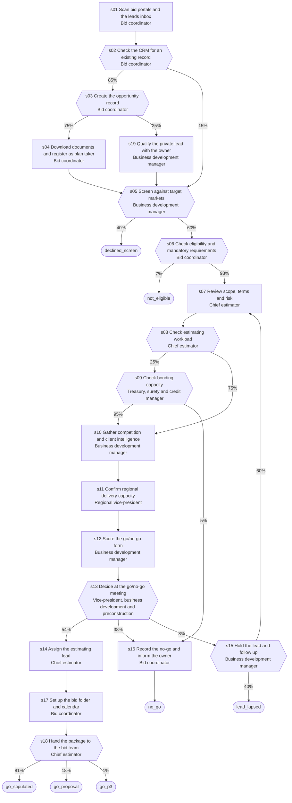

# Track opportunities and decide go or no-go

`gc-bd-opportunity-pipeline` · construction (non-residential general contracting) · business development · part of `general-contractor-co`

Every month about 90 tender notices, invitations and private leads reach the business development and estimating group, and each one needs a quick decision on whether to spend estimating time on it. A bid coordinator logs each opportunity in the CRM and downloads documents, a business development manager screens it against the strategic plan, the chief estimator reads the scope and checks estimator workload, and the vice-president of business development makes the go or no-go call at a weekly meeting. Roughly 30% are pursued. The decision is slow when the documents arrive late, regional managers and the surety have to be consulted, or a private lead has no funding yet, and errors here waste estimating effort on bids the company cannot win.

| | |
|---|---|
| Unit of work | one opportunity screened |
| Starts when | A tender notice appears on a public bid portal, an owner sends an invitation, or a business development manager logs a private lead or a prequalification result. |
| Done when | The opportunity is declined, found ineligible, lapses, or is handed to estimating, proposal or P3 teams with a go decision. |
| Organisation | A Canadian national general contractor with about $1.5B of annual construction revenue, an Ontario head office and regional offices in Western and Atlantic Canada, bidding public and private institutional, commercial and industrial buildings. (2,800 employees, 2019-2022) |
| Volume | 90 cases a month (range 60 to 130) |

## Where it sits

- Starts with **tender_package** from public-owner (65% of cases)
- Starts with **opportunity** from private-owner (15% of cases)
- Starts with **opportunity** from bd-marketing (12% of cases)
- Starts with **opportunity** from bd-prequalification (8% of cases)
- Relies on **strategic_plan** from exec-strategic-plan (a standing input; it does not start a case)
- Sends **tender_package** to bd-stipulated-bid (outcome: go_stipulated)
- Sends **tender_package** to bd-cm-proposal (outcome: go_proposal)
- Sends **tender_package** to bd-p3-pursuit (outcome: go_p3)

## Flow

## Roles

| Role | Department | Layer | FTE on this process | Loaded cost per hour | Evidence |
|---|---|---|---:|---:|---|
| Bid coordinator | Estimating | individual contributor | 1 | 40 CAD | C |
| Business development manager | Business development and preconstruction | manager | 1 | 90 CAD | C |
| Chief estimator | Estimating | manager | 0.8 | 105 CAD | C |
| Vice-president, business development and preconstruction | Business development and preconstruction | director | 0.15 | 150 CAD | C |
| Regional vice-president | Construction operations | director | 0.2 | 160 CAD | C |
| Treasury, surety and credit manager | Finance | manager | 0.05 | 95 CAD | C |

## Steps

Hands-on time and the wait before each step show the most common value. Evidence tier A is a sourced number, B a sourced description, C the author's estimate.

| Step | Who | Kind | Hands-on | Wait before | Control | Evidence |
|---|---|---|---:|---:|---|---|
| **s01 Scan bid portals and the leads inbox.** The bid coordinator opens the daily notice emails and saved searches on MERX, Bids&Tenders, Biddingo and the provincial portals, and the shared leads inbox. She picks out building tenders, invitations and prequalification results that fall in the company's regions and size range. | Bid coordinator | intake | 10 min | 12.0 h |  | C |
| **s02 Check the CRM for an existing record.** The bid coordinator searches the CRM opportunity tracker by owner, project name and address to see whether business development already logged the project as a lead, a prequalification or an earlier cancelled tender. | Bid coordinator | lookup | 4 min | 30 min |  | C |
| **s03 Create the opportunity record.** The bid coordinator types the owner, location, project type, estimated value, delivery model, closing date, site visit and question deadlines into a new CRM record and links the notice. | Bid coordinator | data entry | 12 min | 1.0 h |  | C |
| **s04 Download documents and register as plan taker.** The bid coordinator registers the company as a plan taker on the portal, downloads the drawings, specifications, instructions to bidders and any addenda into the bid folder, and notes the plan takers list. | Bid coordinator | data entry | 20 min | 1.0 h |  | B [oshawa] |
| **s05 Screen against target markets.** The business development manager reads the CRM summary and the scope pages and compares sector, region, contract value, delivery model and owner type with the strategic plan's targets. Work far outside them is declined at once. | Business development manager | judgment | 15 min | 12.0 h |  | B [cc-bidnobid], [vertigraph] |
| **s06 Check eligibility and mandatory requirements.** The bid coordinator checks the instructions to bidders for prequalified-bidder lists, mandatory site meetings, safety certification (COR), bid security and bonding requirements, and whether the closing date leaves enough time to price. | Bid coordinator | validation | 20 min | 2.0 h | Owner's instructions to bidders: only prequalified bidders and holders of COR or equivalent may bid (Nova Scotia guidelines 3.1; Oshawa bid procedure) | B [ns2017], [oshawa] |
| **s07 Review scope, terms and risk.** The chief estimator reads the drawings index, specifications and supplementary conditions and notes the size, schedule, liquidated damages, self-perform concrete content, design completeness and unusual risk terms that affect whether the company can win at a margin. | Chief estimator | analysis | 1.0 h | 12.0 h |  | B [cc-bidnobid] |
| **s08 Check estimating workload.** The chief estimator opens the bid calendar spreadsheet and checks which estimators are free in the tender period and how many bids already close in the same week. | Chief estimator | lookup | 15 min | 0 min |  | B [cc-bidnobid] |
| **s09 Check bonding capacity.** The treasury, surety and credit manager compares the expected bid value with the single-project and aggregate limits of the bonding line and the work on hand, and says whether the surety is likely to support the bid. | Treasury, surety and credit manager | lookup | 30 min | 1.0 d |  | B [cc-bidnobid] |
| **s10 Gather competition and client intelligence.** The business development manager reviews the plan takers list, past bid results with this owner, the owner's payment record and funding status, and calls the consultant or known trades to learn who is bidding. | Business development manager | lookup | 40 min | 12.0 h |  | B [cc-bidnobid], [hedley2008] |
| **s11 Confirm regional delivery capacity.** The regional vice-president checks whether a project manager, a superintendent and self-perform crews will be free at the expected start, and whether the region has trade coverage in that town. | Regional vice-president | coordination | 20 min | 4.0 h |  | C |
| **s12 Score the go/no-go form.** The business development manager fills in the weighted go/no-go sheet for client, project, capacity, competition, market and risk factors, attaches the notes and puts the opportunity on the next meeting agenda. | Business development manager | analysis | 30 min | 4.0 h |  | B [cc-bidnobid] |
| **s13 Decide at the go/no-go meeting.** The vice-president of business development chairs the weekly pursuit meeting with the chief estimator and regional vice-president, reviews the score sheet and decides to bid, decline or hold. Urgent tenders are decided by email between meetings. | Vice-president, business development and preconstruction | judgment | 15 min | 1.0 d | Company bid/no-bid policy: VP business development approves every pursuit | B [cc-bidnobid], [hedley2008] |
| **s14 Assign the estimating lead.** The chief estimator names the lead estimator and support estimators, books the bid in the bid calendar and confirms the plan to handle the closing date alongside other bids. | Chief estimator | coordination | 20 min | 4.0 h |  | C |
| **s15 Hold the lead and follow up.** The business development manager keeps a held private lead open in the CRM and calls the owner or consultant every few weeks about funding, design progress and the selection method until it is ready or dies. | Business development manager | communication | 30 min | 30.0 d |  | C |
| **s16 Record the no-go and inform the owner.** The bid coordinator records the no-go reason code in the CRM, withdraws as plan taker where the portal allows, and for invited tenders emails the owner or consultant that the company will not bid. | Bid coordinator | communication | 10 min | 4.0 h |  | C |
| **s17 Set up the bid folder and calendar.** The bid coordinator creates the bid folder, enters the question deadline, site visit, addendum cut-off and closing time in the shared calendar, and registers attendees for the site visit. | Bid coordinator | data entry | 30 min | 1.0 h |  | B [ns2017] |
| **s18 Hand the package to the bid team.** The chief estimator holds a short kick-off with the lead estimator, and for proposals or P3 work with the proposal or P3 team, passing on the go/no-go notes, risk notes and delivery path. | Chief estimator | communication | 30 min | 4.0 h |  | C |
| **s19 Qualify the private lead with the owner.** The business development manager calls the owner or the consultant to confirm budget, funding approval, timing, the selection method (invited tender, negotiated or proposal) and who else is invited, and notes it in the CRM. | Business development manager | communication | 40 min | 1.0 d |  | B [cc-bidnobid] |

## Exceptions

| Exception | Share of cases | What happens |
|---|---:|---|
| Private lead put on hold | 3% | A private or negotiated lead has no funding or design yet; business development follows up for one to two months before it returns to review or lapses. |
| Bonding capacity exceeded | 1% | A large bid would exceed the single-project bonding limit, so the company declines or looks for a joint venture partner. |
| Ineligible after screening | 4% | The company is not on the owner's prequalified list or missed a mandatory site meeting. |

## Benchmarks

| Metric | Value | Unit | Population | Evidence |
|---|---|---|---|---|
| cycle_time_days | p50 5, p90 14 | calendar days from notice to go or no-go decision | Canadian commercial and institutional general contractors, public and private building work | C |
| share_of_opportunities_pursued | 0.3 | fraction | Opportunities logged by the organisation | C |
| bid_hit_ratio_public_hard_bid | low 6, high 10 | bids submitted per contract won | General contractors, public works (United States averages) | A [hedley2008] |

## Pain points

- Notices are found in several portals and re-keyed into the CRM; duplicates and wrong closing dates creep in. (steps s01, s02, s03; C)
- Go/no-go decisions wait for the weekly meeting and for regional VPs, eating into a short tender period. (steps s11, s13; C)
- Few contractors track hit rate by owner and competitor, so the go/no-go score rests on memory. (steps s10, s12; B [vertigraph], [hedley2008])

## Assumptions

- The process ends at the go or no-go decision; estimating, proposals and P3 pursuits are separate processes.
- Loaded costs and role titles come from the organisation file (1.35 loading factor for salaried staff).
- Go share at the meeting (54% of those reaching it) is set so that about 30% of all opportunities are pursued, which matches the organisation file's downstream bid volumes rather than a published benchmark.
- The treasury manager's bonding check is added; the organisation file does not list treasury-manager among this process's roles.
- Waits are calendar time and include nights and weekends; the weekly go/no-go meeting is the main wait.
- No equipment, vehicles or crews are used, so no resources are listed; office roles have no shift pattern.

## Sources

- [cc-bidnobid] [Bid or No-Bid: How Contractors Choose Which Projects to Pursue](https://www.constructconnect.com/blog/bid-or-no-bid-how-contractors-choose-which-projects-to-pursue) (ConstructConnect, 2026). Go/no-go factors grouped as client, project, contractor (capacity, bonding), bidding (lead time, document quality), market (competition) and economy; client financial capability, project risk, profit potential and number of competitors are the top four; three or more red flags mean no-bid; weighted scoring before estimating begins; hard-bid public work 5:1 to 10:1 and negotiated work 2:1 to 3:1.
- [vertigraph] [Bid management in construction: what it is and why it decides your win rate](https://www.vertigraph.com/learn/bid-management-in-construction) (Vertigraph, 2026). Illustration of 20 estimator hours per bid at $75 loaded ($1,500 per bid); cost per win equals cost per bid divided by hit rate; survey of more than 2,000 contractors found fewer than 10% knew their bid-hit ratio; a bid/no-bid screen on customer history, fit, capacity, competition and risk before opening drawings.
- [hedley2008] [How is Your 'Bid-Hit' Ratio?](https://masoncontractors.org/2008/04/08/how-is-your-bid-hit-ratio) (Mason Contractors Association of America (George Hedley), 2008). Average general contractor bid-hit ratios: public works 6:1 to 10:1, private bid work 4:1 to 6:1, negotiated and design-build work 2:1 to 4:1; ratios above 11:1 on public work cost too much in estimating; tracking ratios by job type, customer and competitors guides which jobs to pursue.
- [ns2017] [Nova Scotia Public Sector Construction Contract Guidelines (June 2017)](https://www.novascotia.ca/sites/default/files/documents/1-1078/construction-contract-guidelines-en.pdf) (Province of Nova Scotia, 2017). Prequalification of bidders with a published minimum score (often 70-80 of 100); solicitation documents list major subcontractors, bid security, CCDC contract form; bonding recommended at $500,000 and over; subcontracts of $250,000 or more should carry contract security; addenda no later than 5 business days (major) or 3 business days (minor) before closing and closing extended at least 1 business day when needed; late bids rejected; amendments and withdrawals allowed up to closing; withdrawal after opening only for serious demonstrable error within 2 business days; within 48 hours of opening bidders may be asked for safety certifications, other subcontractors and price breakouts; bids over the estimate may be negotiated or re-tendered; letter of award binds the contractor to sign; contract security within 10 days of award; bid security of unsuccessful bidders returned within 30 days; international trade agreements may require 40-day postings.
- [oshawa] [Bid Submission Procedure (under Purchasing By-law 80-2020)](https://www.oshawa.ca/media/ih2jhh10/bid-submission-procedure.pdf) (City of Oshawa, 2021). Electronic bids only through the bids&tenders system, late bids not accepted; COR, SOSE or ISO 45001 required for construction bids over $500,000; digital bid bond of 10% of the bid and agreement to bond uploaded with the bid on CCDC forms, verified through a third-party authentication firm; qualified bids, unverifiable bonds and improperly executed agreements to bond are rejected; contract documents due within 10 calendar days after written notice of award; acceptance time limit usually 90 days; performance bond of 100%, or 50% performance and 50% labour and material bonds, on award; only the low bidder's references checked; if the low bidder fails to execute, award to the next bidder and forfeit the deposit. PDF metadata shows the file was last saved in July 2021; the copy opened carries a later revision stamp.

Written by claude-opus on 2026-11-24.
