# Pursue a P3 project as construction partner

`gc-bd-p3-pursuit` · construction (non-residential general contracting) · business development (P3 pursuits) · part of `general-contractor-co`

In a public-private partnership the public sponsor picks a consortium of equity investors, a design-builder and a maintenance provider to design, build, finance and maintain a hospital, school or courthouse for decades. The contractor's P3 director forms the consortium, answers the RFQ and, if shortlisted, leads design development, estimating, scheduling and risk review for a fixed design-build price that must fit the sponsor's affordability cap. Contracts counsel, treasury and the executive team sign off on the risk, security and equity commitments, and the winning team negotiates to commercial and financial close with lenders. It is slow and costly because one pursuit runs for about a year, ties up a design manager and a team of estimators, costs hundreds of thousands to millions of dollars, and is lost two times in three with only an honorarium in return.

| | |
|---|---|
| Unit of work | one P3 pursuit, from screening the opportunity to financial close or loss |
| Starts when | A public sponsor (Infrastructure Ontario, Alberta Infrastructure or similar) announces a P3 project in a market update or posts an RFQ, and the opportunity pipeline flags it. |
| Done when | Financial close is reached and the design-build subcontract is handed to contract award, or the pursuit is closed (declined, not shortlisted, lost with honorarium claimed, or cancelled). |
| Organisation | A Canadian national general contractor with about $1.5B annual revenue that acts as design-builder and minority equity investor in P3 consortia through its capital arm. (2,800 employees, 2019-2022) |
| Volume | 0.2 cases a month (range 0.08 to 0.33) |

## Where it sits

- Starts with **tender_package** from bd-opportunity-pipeline (100% of cases)
- Relies on **bid_approval** from exec-bid-approval (a standing input; it does not start a case)
- Relies on **levelled_trade_prices** from bd-trade-tendering (a standing input; it does not start a case)
- Relies on **cost_database** from bd-cost-database (a standing input; it does not start a case)
- Relies on **bond** from fin-surety-bonding (a standing input; it does not start a case)
- Relies on **cor_certificate** from hse-cor-audit (a standing input; it does not start a case)
- Sends **prequal_submission** to p3-project-co (outcome: not_shortlisted)
- Sends **prequal_submission** to p3-project-co (outcome: lost)
- Sends **prequal_submission** to p3-project-co (outcome: financial_close)
- Sends **bid_submission** to p3-project-co (outcome: lost)
- Sends **bid_submission** to p3-project-co (outcome: financial_close)
- Sends **bid_summary** to exec-bid-approval (outcome: lost)
- Sends **bid_summary** to exec-bid-approval (outcome: financial_close)
- Sends **trade_tender** to bd-trade-tendering (outcome: lost)
- Sends **trade_tender** to bd-trade-tendering (outcome: financial_close)
- Sends **bond_request** to fin-surety-bonding (outcome: lost)
- Sends **bond_request** to fin-surety-bonding (outcome: financial_close)
- Sends **proposal** to bd-contract-award (outcome: financial_close)

## Flow

```mermaid
flowchart TD
    s01["s01 Screen the P3 opportunity and draft a pursuit budget<br/>Director, P3 pursuits"]
    s02{{"s02 Approve the pursuit and its budget<br/>Vice-president, business development and preconstruction"}}
    s03["s03 Form the consortium and agree teaming terms<br/>Director, P3 pursuits"]
    s04["s04 Review teaming and exclusivity agreements<br/>Contracts counsel"]
    s05["s05 Prepare the RFQ response<br/>Proposal and marketing coordinator"]
    s06{{"s06 Wait for RFQ evaluation and RFP issue<br/>Outside party"}}
    s07["s07 Kick off the RFP stage and engage designers<br/>Director, P3 pursuits"]
    s08["s08 Manage design development to the output specifications<br/>Design manager  design-build and P3"]
    s09["s09 Visit the site and existing facilities<br/>Preconstruction manager"]
    s10["s10 Estimate each design iteration<br/>Estimator / senior estimator"]
    s11["s11 Obtain trade pricing and design-assist input<br/>Estimator / senior estimator"]
    s12["s12 Develop construction schedule and phasing<br/>Scheduler  CPM"]
    s13["s13 Attend commercially confidential meetings<br/>Director, P3 pursuits"]
    s14["s14 Review project agreement and design-build subcontract<br/>Contracts counsel"]
    s15["s15 Arrange proposal security and surety support<br/>Treasury, surety and credit manager"]
    s16{{"s16 Review price and risk contingency<br/>Chief estimator"}}
    s17["s17 Run a value engineering round<br/>Design manager  design-build and P3"]
    s18["s18 Prepare bid summary for executive approval<br/>Director, P3 pursuits"]
    s19{{"s19 Obtain executive bid approval<br/>Vice-president, business development and preconstruction"}}
    s20["s20 Assemble the technical submission<br/>Proposal and marketing coordinator"]
    s21["s21 Hand the design-build price to the equity lead and submit<br/>Director, P3 pursuits"]
    s22{{"s22 Wait for sponsor evaluation<br/>Outside party"}}
    s23["s23 Negotiate to commercial close<br/>Director, P3 pursuits"]
    s24{{"s24 Wait for lenders' due diligence and financial close<br/>Outside party"}}
    s25["s25 Sign the design-build subcontract<br/>Vice-president, business development and preconstruction"]
    s26["s26 Hand over to contract award and project startup<br/>Director, P3 pursuits"]
    s27["s27 Claim the honorarium and attend the debrief<br/>Director, P3 pursuits"]
    s01 --> s02
    s02 -->|"85%"| s03
    s02 -->|"15%"| end0
    s03 --> s04
    s04 --> s05
    s05 --> s06
    s06 -->|"55%"| s07
    s06 -->|"45%"| end1
    s07 --> s08
    s08 --> s09
    s09 --> s10
    s10 --> s11
    s11 --> s12
    s12 --> s13
    s13 --> s14
    s14 --> s15
    s15 --> s16
    s16 -->|"68%"| s18
    s16 -->|"32%"| s17
    s17 --> s16
    s18 --> s19
    s19 -->|"92%"| s20
    s19 -->|"8%"| s17
    s20 --> s21
    s21 --> s22
    s22 -->|"35%"| s23
    s22 -->|"65%"| s27
    s23 --> s24
    s24 -->|"97%"| s25
    s24 -->|"3%"| end2
    s25 --> s26
    s26 --> end3
    s27 --> end4
    end0(["not_pursued"])
    end1(["not_shortlisted"])
    end2(["cancelled_at_close"])
    end3(["financial_close"])
    end4(["lost"])
```

## Roles

| Role | Department | Layer | FTE on this process | Loaded cost per hour | Evidence |
|---|---|---|---:|---:|---|
| Director, P3 pursuits | P3 and alternative finance pursuits | director | 0.7 | 150 CAD | C |
| Vice-president, business development and preconstruction | Business development and preconstruction | director | 0.03 | 150 CAD | C |
| Contracts counsel | Legal, risk and insurance | senior specialist | 0.25 | 115 CAD | C |
| Proposal and marketing coordinator | Business development and preconstruction | individual contributor | 0.4 | 45 CAD | C |
| Design manager (design-build and P3) | Preconstruction and design management | senior specialist | 0.8 | 90 CAD | C |
| Preconstruction manager | Preconstruction and design management | manager | 0.03 | 95 CAD | C |
| Estimator / senior estimator | Estimating | senior specialist | 1.6 | 68 CAD | C |
| Chief estimator | Estimating | manager | 0.06 | 105 CAD | C |
| Scheduler (CPM) | Operations support (project controls, scheduling, VDC, quality) | senior specialist | 0.2 | 68 CAD | C |
| Treasury, surety and credit manager | Finance | manager | 0.02 | 95 CAD | C |

## Steps

Hands-on time and the wait before each step show the most common value. Evidence tier A is a sourced number, B a sourced description, C the author's estimate.

| Step | Who | Kind | Hands-on | Wait before | Control | Evidence |
|---|---|---|---:|---:|---|---|
| **s01 Screen the P3 opportunity and draft a pursuit budget.** The P3 director reads the sponsor's market notice and procurement documents, assesses the project size, risk allocation, competition and likely partners, and drafts a pursuit budget covering internal staff, design consultants and advisors and the honorarium recoverable if the bid loses. | Director, P3 pursuits | analysis | 1.2 d | 5.0 d |  | B [dcn-honoraria], [io-progressive-qa] |
| **s02 Approve the pursuit and its budget.** The VP of business development takes the pursuit case to the executive team, which approves the spend, the bonding and letter of credit capacity it will tie up and the proposed equity role of the company's investment arm, or declines. | Vice-president, business development and preconstruction | approval | 4.0 h | 5.0 d | Delegation of authority: executive approval of P3 pursuit budgets and equity commitments | C |
| **s03 Form the consortium and agree teaming terms.** The P3 director negotiates, over several weeks of partner meetings, with the lead equity partner, facility maintenance provider and architect on roles, exclusivity, shared bid costs, the split of any honorarium and key commercial positions, and fixes the team for the RFQ. | Director, P3 pursuits | coordination | 3.3 d | 20.0 d |  | B [renew-ab-rfp], [bird-ab-fc] |
| **s04 Review teaming and exclusivity agreements.** Contracts counsel drafts or marks up the teaming agreement, confidentiality and exclusivity terms and the outline design-build subcontract positions, and flags uncapped liabilities before the company signs. | Contracts counsel | review | 16.0 h | 3.0 d | Corporate contract review policy: legal sign-off on joint venture and teaming agreements | C |
| **s05 Prepare the RFQ response.** Once the sponsor posts the RFQ, the proposal coordinator assembles the consortium's experience, key individuals' resumes, safety record, financial capacity and surety support letters into the sponsor's RFQ format and coordinates partner inputs to the submission deadline. | Proposal and marketing coordinator | drafting | 4.2 d | 14.0 d |  | B [renew-ab-rfq] |
| **s06 Wait for RFQ evaluation and RFP issue.** The sponsor evaluates the RFQ responses, shortlists usually three teams and later issues the RFP and data room to them; teams not shortlisted stop here. | Outside party | external wait | 0 min | 28.0 d |  | A [renew-ab-rfq], [renew-ab-rfp] |
| **s07 Kick off the RFP stage and engage designers.** The P3 director sets up the bid schedule, responsibility matrix and data room access, signs the design consultants on pursuit terms, and starts the weekly design, cost and commercial meetings with the equity lead. | Director, P3 pursuits | coordination | 1.7 d | 1.0 d |  | C |
| **s08 Manage design development to the output specifications.** The design manager runs the architects and engineers through RFP-stage design, waits on each consultant drawing issue, checks every drawing set against the sponsor's output specifications and affordability cap, and logs compliance and open design risks. | Design manager (design-build and P3) | coordination | 31.2 d | 35.0 d |  | B [io-progressive-qa] |
| **s09 Visit the site and existing facilities.** The preconstruction manager travels to the site for the sponsor's scheduled visit, walks the existing buildings, access routes and utility points with the design team, and records constraints for logistics and phasing. | Preconstruction manager | travel | 10.0 h | 3.0 d | Site-specific orientation and personal protective equipment required by the owner for visitors to an operating facility or construction site | C |
| **s10 Estimate each design iteration.** Estimators take off quantities from each design iteration, price self-performed work and budget trade costs, compare the total with the affordability cap and report the gap to the design and commercial teams every few weeks. | Estimator / senior estimator | analysis | 58.3 d | 0 min |  | B [dcn-honoraria] |
| **s11 Obtain trade pricing and design-assist input.** Estimators issue mechanical, electrical, envelope and structural packages through trade tendering for budget prices and design-assist advice, then level the replies by scope. | Estimator / senior estimator | coordination | 6.7 d | 14.0 d |  | C |
| **s12 Develop construction schedule and phasing.** The scheduler builds the design, permit, construction and commissioning schedule to the sponsor's availability date, tests it with the superintendent assigned to the bid, and prepares the schedule narrative. | Scheduler (CPM) | analysis | 6.7 d | 1.0 d |  | B [bird-ab-fc] |
| **s13 Attend commercially confidential meetings.** The P3 director prepares questions and comments on the draft project agreement and output specifications and attends the series of commercially confidential meetings the sponsor holds with each team. | Director, P3 pursuits | communication | 2.1 d | 0 min |  | B [io-progressive-qa] |
| **s14 Review project agreement and design-build subcontract.** Contracts counsel reviews the project agreement flow-down into the design-build subcontract, including liquidated damages, liability caps, relief events and security, and negotiates positions with the equity lead and its lenders' counsel. | Contracts counsel | review | 5.0 d | 3.0 d | Corporate contract review policy: legal sign-off on P3 risk allocation before price submission | C |
| **s15 Arrange proposal security and surety support.** The treasury manager arranges the letter of credit or bid bond the RFP requires and obtains surety letters confirming performance and payment security for the design-build subcontract. | Treasury, surety and credit manager | coordination | 8.0 h | 5.0 d |  | C |
| **s16 Review price and risk contingency.** The chief estimator leads a price review and risk workshop on the cost plan, trade prices, escalation, design development allowance and contingency, and decides whether the price meets the affordability cap or needs another round of value engineering. | Chief estimator | review | 1.0 d | 2.0 d | Estimating department review policy: senior estimator sign-off on every priced submission | C |
| **s17 Run a value engineering round.** The design manager works with the architects, trades and equity lead on design changes that cut cost without breaking the output specifications, and estimators reprice the changed elements. | Design manager (design-build and P3) | analysis | 2.5 d | 1.0 d |  | B [io-progressive-qa] |
| **s18 Prepare bid summary for executive approval.** The P3 director writes the bid summary with the design-build price, margin, contingency, key project agreement risks, security and equity commitments for the executive bid approval meeting. | Director, P3 pursuits | drafting | 8.0 h | 12.0 h |  | C |
| **s19 Obtain executive bid approval.** The VP of business development presents the bid summary to the CEO, COO and CFO, who approve the price and risk position, set conditions or ask for changes; board notice is given for the largest bids. | Vice-president, business development and preconstruction | approval | 4.0 h | 4.0 d | Delegation of authority: all P3 bids require executive bid approval | C |
| **s20 Assemble the technical submission.** The proposal coordinator compiles design drawings, narratives, schedule, construction methodology, quality and safety plans into the sponsor's submission format with the partners' sections. | Proposal and marketing coordinator | drafting | 5.0 d | 0 min |  | C |
| **s21 Hand the design-build price to the equity lead and submit.** The P3 director issues the signed design-build price, schedule and cash flow to the equity lead for the financial model, confirms the committed price matches the approval, and the consortium submits its technical and financial submissions. | Director, P3 pursuits | communication | 16.0 h | 1.0 d |  | B [io-progressive-qa], [renew-ab-rfp] |
| **s22 Wait for sponsor evaluation.** The sponsor evaluates technical compliance and the financial offers, and names a preferred proponent; the losing teams are told and offered debriefs. | Outside party | external wait | 0 min | 35.0 d |  | B [renew-ab-rfp] |
| **s23 Negotiate to commercial close.** The P3 director works with the equity lead, sponsor and lenders to finalise the project agreement, design-build subcontract, schedule and security package, and answers the lenders' technical advisor's due diligence questions on design, schedule and cost. | Director, P3 pursuits | coordination | 5.0 d | 3.0 d |  | C |
| **s24 Wait for lenders' due diligence and financial close.** Lenders, their technical advisor and the sponsor complete due diligence, credit approvals and closing documents, and financial close takes place on the agreed date. | Outside party | external wait | 0 min | 20.0 d |  | A [renew-ab-rfp], [bird-ab-fc] |
| **s25 Sign the design-build subcontract.** The VP of business development signs the design-build subcontract and the company's equity documents after confirming they match the approved bid and the bonding is in place. | Vice-president, business development and preconstruction | approval | 2.0 h | 12.0 h | Signing authority: contracts above a threshold signed by an officer | C |
| **s26 Hand over to contract award and project startup.** The P3 director hands the bid documents, design-build subcontract, schedule and cost plan to the contract award team and the project leadership, and records the win in the CRM. | Director, P3 pursuits | communication | 8.0 h | 1.0 d |  | C |
| **s27 Claim the honorarium and attend the debrief.** The P3 director attends the sponsor's debrief, records scores and lessons, and with the equity lead invoices the honorarium and splits it among partners under the teaming agreement. | Director, P3 pursuits | communication | 8.0 h | 14.0 d |  | B [io-progressive-qa], [dcn-honoraria] |

## Exceptions

| Exception | Share of cases | What happens |
|---|---:|---|
| Price over the affordability cap | 32% | The reviewed price exceeds the sponsor's affordability cap or carries too much risk, so the team runs one or more value engineering rounds before executive approval. |
| Executive asks for further cost reduction | 8% | The executive approves on condition of a lower price or contingency, sending the team back into value engineering days before submission. |
| Not shortlisted | 38% | The consortium is not among the three teams invited to the RFP, so the pursuit stops after the RFQ with only screening, teaming and RFQ costs spent. |
| Close fails or project cancelled | 1% | The sponsor cancels or lenders do not close, leaving the preferred proponent with sunk costs. |

## Benchmarks

| Metric | Value | Unit | Population | Evidence |
|---|---|---|---|---|
| cycle_time_days | p50 100, p90 420 | calendar days from screening to the end of the pursuit, all outcomes | Canadian social-infrastructure P3 pursuits, 2019-2022 | C [renew-ab-rfq], [renew-ab-rfp], [bird-ab-fc] |
| cycle_time_days_to_financial_close | p50 420, p90 520 | calendar days from screening the opportunity to financial close (winning pursuits only) | Canadian social-infrastructure P3 pursuits, 2019-2022 | B [renew-ab-rfq], [renew-ab-rfp], [bird-ab-fc] |
| rfq_to_shortlist_days | 29 | calendar days from RFQ closing to shortlist announcement | One P3 bundle (Alberta high schools, 2020) | A [renew-ab-rfq], [renew-ab-rfp] |
| bid_cost_share_of_project_value | 0.5 | percent of project value (out-of-pocket, about $500,000 on $100 million) | Contractor estimate for Canadian P3 bids, reported 2006 | A [dcn-honoraria] |

## Pain points

- A pursuit ties up a design manager and several estimators for most of a year, and two pursuits out of three are lost with only an honorarium in return. (steps s08, s10, s27; B [dcn-honoraria], [renew-ab-rfp])
- Fixed prices on early designs push teams through repeated value engineering rounds to meet the affordability cap, and risk the design-builder carries after close. (steps s16, s17, s19; A [io-progressive-qa])
- Risk positions must be agreed across the sponsor, equity lead and lenders, so legal review and commercial meetings stretch the schedule. (steps s13, s14, s23; C)

## Assumptions

- The organisation file defines the unit of work as one P3 pursuit-month; this file documents one whole pursuit instead, because the steps (RFQ, RFP, close) happen once per pursuit. One to four new pursuits a year with a 12 to 15 month duration is equivalent to the organisation file's 1 to 3 pursuit-months a month.
- The RFQ response is written inside this process; the organisation file's owner prequalification process (bd-prequalification) only sends prequal submissions to public owners.
- Loaded costs and titles come from the organisation file (wage x 1.35 for salaried staff). Design consultant fees, advisor fees and the equity arm's work are outside the labour cost because they are not company roles in this process.
- Roles needed but not listed for this process in the organisation file: proposal-coordinator, chief-estimator, scheduler, precon-manager and treasury-manager.
- Shortlist share (0.55) and win share after shortlisting (0.35) are estimates for a national contractor that teams with established equity partners; with three shortlisted teams a one-in-three win rate is the neutral expectation.
- Simulated winning pursuits reach financial close in a median of about 380 days against the 420-day benchmark; the gap is within the spread of Canadian P3 timelines (the Alberta RFQ-to-close period alone was 383 days) and was left rather than padding waits.
- Simulated steps run in sequence; design management, site visit and estimating overlap in practice (concurrent_with), and their touch time stands in for the RFP-stage elapsed time.

## Sources

- [renew-ab-rfq] [P3 RFQ released to build Alberta schools](https://www.renewcanada.net/p3-rfq-released-to-build-alberta-schools/) (ReNew Canada, 2020). Article of 11 September 2020: Alberta posted an RFQ for a design-build-finance-maintain bundle of five high schools; the RFQ closed 8 October 2020; up to three proponents to be shortlisted and invited to the RFP stage; contract expected by the end of September 2021.
- [renew-ab-rfp] [Alberta issues RFP for schools to be constructed through P3](https://www.renewcanada.net/alberta-rfp-invitation-for-schools-to-be-constructed-through-p3) (ReNew Canada, 2020). Article of 6 November 2020: three shortlisted consortia, including Concert-Bird Partners (Concert Infrastructure lead, BR2 Architecture design, Bird Construction construction, Ainsworth maintenance, Concert and Bird Capital financing); RFP process to be completed in July 2021 and contract in place by end of September 2021; schools to open September 2024.
- [bird-ab-fc] [Financial close achieved for five Alberta schools under DBFM contract](https://www.newswire.ca/news-releases/financial-close-achieved-for-five-alberta-schools-under-dbfm-contract-885499202.html) (Bird Construction Inc. via Cision Newswire, 2021). Release of 29 September 2021: Concert-Bird Partners (Bird Capital LP, Bird Design-Build Construction Inc., Concert Infrastructure, Ainsworth, BR2 Architecture, Wright Construction Western) reached financial close on a contract of over $300 million; 30-year maintenance term; financing arranged by Bird Capital and Concert; target total availability 31 May 2024.
- [io-progressive-qa] [Progressive Procurement P3: Q&As](https://www.naylornetwork.com/oga-nwl/pdf/Progressive_Procurement_P3_-_Q&As.pdf) (Infrastructure Ontario (hosted by the Ontario General Contractors Association newsletter), 2021). In a traditional P3 proponents must submit fixed price bids at the RFP stage based on early designs; the progressive model was introduced because of affordability, competition and risk-transfer concerns; traditional RFPs require detailed design and demonstrated financing commitments; commercially confidential meetings are held with proponents; an honorarium (proposal fee) is offered to unsuccessful proponents.
- [dcn-honoraria] [The debate over PPP honoraria](https://canada.constructconnect.com/?p=65184) (Daily Commercial News (ConstructConnect), 2006). Honoraria of about $1 million help offset the cost of losing a P3 bid; a contractor estimated out-of-pocket bid costs at about 0.5% of project value ($500,000 on a $100 million job) and about $1 million on a $300 million job.

Written by claude-opus on 2026-11-24.
