# Deliver preconstruction services under a CM agreement

`gc-bd-preconstruction-services` · construction (non-residential general contracting) · preconstruction · part of `general-contractor-co`

When an owner hires a construction manager during design, the contractor's preconstruction team advises the owner and architect stage by stage until the construction price is agreed. At each design stage the estimator prices the drawings, the project manager reviews constructability, the scheduler and VDC coordinator update the schedule and models, and the preconstruction manager reconciles the numbers with the owner's cost consultant and proposes value engineering when the estimate exceeds the budget. Once design is far enough along, trade packages are tendered and the estimator builds a guaranteed maximum price for owner approval. The process is slow because each stage waits on the consultant's drawings and on owners' funding decisions, and error-prone because estimates are made on incomplete design and must be reconciled with another estimator's numbers.

| | |
|---|---|
| Unit of work | one preconstruction engagement, from the signed preconstruction agreement to an agreed construction price |
| Starts when | The contract award process signs a CM or progressive design-build agreement that includes a preconstruction phase. |
| Done when | The owner signs the construction-phase price or GMP amendment and the project is handed to the operations team, or the engagement ends because the owner cancels or does not convert. |
| Organisation | A Canadian national general contractor with about $1.5B annual revenue and a central preconstruction team that serves regional operations. (2,800 employees, 2019-2022) |
| Volume | 1.3 cases a month (range 0.8 to 2.0) |

## Where it sits

- Starts with **contract** from bd-contract-award (100% of cases)
- Relies on **design_package** from consultant (a standing input; it does not start a case)
- Relies on **design_package** from private-owner (a standing input; it does not start a case)
- Relies on **levelled_trade_prices** from bd-trade-tendering (a standing input; it does not start a case)
- Relies on **cost_database** from bd-cost-database (a standing input; it does not start a case)
- Relies on **prequalification_record** from scm-subcontractor-prequal (a standing input; it does not start a case)
- Sends **cost_estimate** to ops-project-startup (outcome: construction_price_agreed)
- Sends **cost_estimate** to public-owner (outcome: any)
- Sends **cost_estimate** to private-owner (outcome: any)
- Sends **trade_tender** to bd-trade-tendering (outcome: construction_price_agreed)
- Sends **trade_tender** to bd-trade-tendering (outcome: not_converted)

## Flow

```mermaid
flowchart TD
    s01["s01 Kick off preconstruction with owner and consultant<br/>Preconstruction manager"]
    s02["s02 Benchmark the owner's budget against the program<br/>Estimator / senior estimator"]
    s03["s03 Walk the site and existing facilities<br/>Site superintendent"]
    s04["s04 Prepare master schedule and phasing plan<br/>Scheduler  CPM"]
    s05["s05 Wait for the consultant's design stage issue<br/>Outside party"]
    s06["s06 Log and distribute the design package<br/>Preconstruction manager"]
    s07["s07 Take off quantities and price the stage estimate<br/>Estimator / senior estimator"]
    s08["s08 Review the design for constructability<br/>Project manager"]
    s09["s09 Run model coordination and clash review<br/>VDC / BIM coordinator"]
    s10["s10 Update the schedule for the design stage<br/>Scheduler  CPM"]
    s11{{"s11 Chief estimator reviews the stage estimate<br/>Chief estimator"}}
    s12["s12 Reconcile the estimate with the owner's cost consultant<br/>Preconstruction manager"]
    s13{{"s13 Present estimate, schedule and value engineering options<br/>Preconstruction manager"}}
    s14["s14 Run a value engineering workshop and reprice options<br/>Estimator / senior estimator"]
    s15{{"s15 Wait for owner decision on budget and design direction<br/>Outside party"}}
    s16["s16 Define trade packages and scopes<br/>Preconstruction manager"]
    s17["s17 Tender trade packages and level the bids<br/>Estimator / senior estimator"]
    s18{{"s18 Wait for owner and consultant review of trade awards<br/>Outside party"}}
    s19["s19 Build the construction price or GMP proposal<br/>Estimator / senior estimator"]
    s20{{"s20 Operations manager approves the GMP and risk<br/>Operations manager  construction manager"}}
    s21["s21 Present and negotiate the construction price with the owner<br/>Preconstruction manager"]
    s22{{"s22 Wait for owner approval of the price amendment<br/>Outside party"}}
    s23["s23 Hand over to the operations team<br/>Project manager"]
    s01 --> s02
    s02 --> s03
    s03 --> s04
    s04 --> s05
    s05 --> s06
    s06 --> s07
    s07 --> s08
    s08 --> s09
    s09 --> s10
    s10 --> s11
    s11 -->|"88%"| s12
    s11 -->|"12%"| s07
    s12 --> s13
    s13 -->|"45%"| s14
    s13 -->|"55%"| s15
    s14 --> s15
    s15 -->|"62%"| s05
    s15 -->|"35%"| s16
    s15 -->|"3%"| end0
    s16 --> s17
    s17 --> s18
    s18 -->|"90%"| s19
    s18 -->|"10%"| s17
    s19 --> s20
    s20 -->|"90%"| s21
    s20 -->|"10%"| s19
    s21 --> s22
    s22 -->|"88%"| s23
    s22 -->|"9%"| s19
    s22 -->|"3%"| end1
    s23 --> end2
    end0(["project_cancelled"])
    end1(["not_converted"])
    end2(["construction_price_agreed"])
```

## Roles

| Role | Department | Layer | FTE on this process | Loaded cost per hour | Evidence |
|---|---|---|---:|---:|---|
| Preconstruction manager | Preconstruction and design management | manager | 2.2 | 95 CAD | C |
| Estimator / senior estimator | Estimating | senior specialist | 5.8 | 68 CAD | C |
| Chief estimator | Estimating | manager | 0.15 | 105 CAD | C |
| Scheduler (CPM) | Operations support (project controls, scheduling, VDC, quality) | senior specialist | 0.6 | 68 CAD | C |
| VDC / BIM coordinator | Operations support (project controls, scheduling, VDC, quality) | senior specialist | 0.8 | 55 CAD | C |
| Project manager | Construction operations | manager | 0.8 | 72 CAD | C |
| Site superintendent | Construction operations | supervisor | 0.1 | 75 CAD | C |
| Operations manager (construction manager) | Construction operations | manager | 0.05 | 115 CAD | C |

## Steps

Hands-on time and the wait before each step show the most common value. Evidence tier A is a sourced number, B a sourced description, C the author's estimate.

| Step | Who | Kind | Hands-on | Wait before | Control | Evidence |
|---|---|---|---:|---:|---|---|
| **s01 Kick off preconstruction with owner and consultant.** The preconstruction manager opens the preconstruction job, sets up the project folders and cost codes, and holds a kick-off meeting with the owner and prime consultant to confirm scope, budget, design schedule, estimate stages and reporting dates. | Preconstruction manager | coordination | 10.0 h | 3.0 d |  | B [oaa-cm-tip] |
| **s02 Benchmark the owner's budget against the program.** The estimator builds a Class D estimate from the functional program using cost per square metre from comparable projects in the cost database, adds escalation and soft-cost allowances, and reports whether the budget fits the funding approval. | Estimator / senior estimator | analysis | 1.0 d | 2.0 d |  | B [ab-cm-cost-services] |
| **s03 Walk the site and existing facilities.** The superintendent drives to the site, walks the existing building or land with the owner's facility staff, and records access, crane positions, utilities, hazardous materials and phasing constraints for an occupied facility. | Site superintendent | travel | 8.0 h | 5.0 d | Owner's site-specific orientation and hazard assessment for visitors (infection control risk assessment in hospitals); OHSA general duty of employers | C |
| **s04 Prepare master schedule and phasing plan.** The scheduler builds the preconstruction and construction master schedule in P6 with design stages, approvals, permit dates, trade package tender dates, long-lead procurement and construction phases, and agrees it with the consultant. | Scheduler (CPM) | analysis | 1.2 d | 3.0 d |  | B [oaa-cm-tip] |
| **s05 Wait for the consultant's design stage issue.** The prime consultant develops the next design stage (schematic, design development, or 50% and 90% construction documents) and issues drawings and specifications to the owner and construction manager. | Outside party | external wait | 0 min | 40.0 d |  | C |
| **s06 Log and distribute the design package.** The preconstruction manager logs the drawing and specification list, sets the estimate and review due dates and distributes the package to the estimator, project manager, scheduler and VDC coordinator. | Preconstruction manager | intake | 2.0 h | 12.0 h |  | C |
| **s07 Take off quantities and price the stage estimate.** The estimator measures quantities in the takeoff software, prices each element and trade division with current unit rates and trade input, adds general conditions, escalation and design contingency, and compares the total with the previous stage. | Estimator / senior estimator | analysis | 4.2 d | 1.0 d |  | B [ab-cm-cost-services], [oaa-cm-tip] |
| **s08 Review the design for constructability.** The project manager assigned to the job marks up the drawings for buildability, sequencing, material choices, long-lead items and coordination gaps between disciplines, and writes the comments log for the consultant. | Project manager | review | 20.0 h | 1.0 d |  | B [oaa-cm-tip] |
| **s09 Run model coordination and clash review.** The VDC coordinator federates the consultants' models, runs clash detection between structure and building services, and records clashes and missing information for the design team. | VDC / BIM coordinator | analysis | 20.0 h | 1.0 d |  | C |
| **s10 Update the schedule for the design stage.** The scheduler updates the master schedule with the latest design, approval and procurement dates, and flags package tender dates and long-lead items that are now at risk. | Scheduler (CPM) | analysis | 8.0 h | 1.0 d |  | C |
| **s11 Chief estimator reviews the stage estimate.** The chief estimator checks the estimate's quantities, rates, contingency and escalation against the cost database and the previous stage, and returns it for correction when changes are unexplained. | Chief estimator | review | 4.0 h | 1.0 d | Estimating department review policy: senior estimator sign-off on estimates issued to clients | C |
| **s12 Reconcile the estimate with the owner's cost consultant.** The preconstruction manager and estimator meet the owner's quantity surveyor, compare the two estimates element by element, explain variances and agree adjustments before the numbers go to the owner. | Preconstruction manager | analysis | 12.0 h | 4.0 d |  | B [ab-cm-cost-services] |
| **s13 Present estimate, schedule and value engineering options.** The preconstruction manager presents the reconciled estimate, schedule and risks to the owner and consultant, compares the total with the construction budget and tables value engineering options from the log. | Preconstruction manager | communication | 10.0 h | 2.0 d |  | B [oaa-cm-tip] |
| **s14 Run a value engineering workshop and reprice options.** The estimator and the design team work through the value engineering log in a workshop, price each option with its effect on schedule and life-cycle cost, and issue a priced options list for the owner's decision. | Estimator / senior estimator | analysis | 1.2 d | 5.0 d |  | B [ab-cm-cost-services] |
| **s15 Wait for owner decision on budget and design direction.** The owner compares the estimate with its funding approval, accepts or rejects value engineering options, and may need board or ministry approval before the consultant starts the next stage. | Outside party | external wait | 0 min | 10.0 d |  | B [ab-cm-cost-services] |
| **s16 Define trade packages and scopes.** The preconstruction manager splits the work into 20 to 35 trade packages, writes the scope sheet, inclusions, exclusions and interface notes for each, and sets the tender list from prequalified trades. | Preconstruction manager | drafting | 1.7 d | 1.0 d |  | B [oaa-cm-tip] |
| **s17 Tender trade packages and level the bids.** The estimator issues the packages through trade tendering, answers trade questions, and receives and levels the bids for scope so each package has a recommended low compliant trade. | Estimator / senior estimator | coordination | 2.0 d | 14.0 d |  | C |
| **s18 Wait for owner and consultant review of trade awards.** The owner and consultant review the bid tabulations and recommendations and approve trade awards or ask for a package to be retendered or reduced. | Outside party | external wait | 0 min | 7.0 d |  | C |
| **s19 Build the construction price or GMP proposal.** The estimator totals the approved trade prices, self-performed work, general conditions, contingency, allowances and fee into the construction price or guaranteed maximum price, with the clarifications and assumptions list. | Estimator / senior estimator | analysis | 1.7 d | 1.0 d |  | B [oaa-cm-tip] |
| **s20 Operations manager approves the GMP and risk.** The operations manager who will deliver the project reviews the price, contingency, schedule and clarifications against the project risk register and approves it within delegated authority or escalates it. | Operations manager (construction manager) | approval | 4.0 h | 2.0 d | Delegation of authority: operations sign-off on guaranteed prices | C |
| **s21 Present and negotiate the construction price with the owner.** The preconstruction manager presents the GMP, schedule and clarifications to the owner and consultant, answers questions and negotiates contingency, allowances and exclusions. | Preconstruction manager | communication | 16.0 h | 5.0 d |  | C |
| **s22 Wait for owner approval of the price amendment.** The owner takes the construction price to its board, ministry or lender for funding approval and signs the amendment converting the agreement to the construction phase, or asks for revisions. | Outside party | external wait | 0 min | 21.0 d |  | C |
| **s23 Hand over to the operations team.** The project manager holds the turnover meeting, receives the GMP breakdown, trade bids, design packages, schedule and preconstruction correspondence, and starts project startup. | Project manager | coordination | 8.0 h | 2.0 d |  | C |

## Exceptions

| Exception | Share of cases | What happens |
|---|---:|---|
| Estimate over budget | 75% | At one or more design stages the estimate exceeds the construction budget and a value engineering workshop is held before the owner decides how to proceed. |
| Estimate returned by chief estimator | 30% | The chief estimator returns a stage estimate for correction at least once during the engagement. |
| Trade package retendered | 10% | Bids for a package come in over the carried amount or with too few bidders, and the owner asks for it to be rescoped and retendered. |
| Project cancelled or not converted | 10% | The owner defers the project for funding or does not accept the GMP, so the construction manager is paid for preconstruction only. |

## Benchmarks

| Metric | Value | Unit | Population | Evidence |
|---|---|---|---|---|
| cycle_time_days | p50 300, p90 480 | calendar days from signed preconstruction agreement to agreed construction price | Canadian CM preconstruction phases on institutional buildings, 2019-2022 | C [ab-cm-cost-services] |
| estimate_stages_per_engagement | 5 | cost estimates (Class D, C, B, 50-90% CD, 97-100% CD) | Alberta Infrastructure CM projects | B [ab-cm-cost-services] |

## Pain points

- Each design stage waits weeks for the consultant's drawings and then for the owner's funding decision, and the preconstruction team cannot speed either. (steps s05, s15, s22; C)
- Two estimators price the same drawings (the construction manager and the owner's cost consultant), and reconciling them takes meetings at every stage. (steps s07, s12; B [ab-cm-cost-services])
- Estimates on incomplete design swing between stages, which triggers value engineering rounds that redo design and repricing work. (steps s13, s14, s15; B [oaa-cm-tip])
- Packaging the work for sequential tenders creates scope gaps and overlaps between trade packages that surface later as change orders. (steps s16, s17; B [oaa-cm-tip])

## Assumptions

- The organisation file defines the unit of work as one project-month of preconstruction; this file documents one whole engagement instead, because the design-stage loop and the GMP happen once per engagement. One to two new engagements a month lasting 8 to 14 months is equivalent to the organisation file's 10 to 22 project-months a month.
- The levelled trade prices from trade tendering are an input inside the engagement, not its trigger; the engagement starts when the preconstruction agreement is signed.
- Loaded costs and titles come from the organisation file (wage x 1.35 for salaried staff).
- Roles needed but not listed for this process in the organisation file: project-manager (constructability and turnover), superintendent (site logistics), chief-estimator and operations-manager (GMP approval).
- Monthly preconstruction invoices and progress reports are left out; they are short tasks inside the precon manager's routine.
- The design-stage loop is geometric (62% chance of another stage after each owner decision), so a few engagements run many more stages than the typical four.
- The simulated median (about 258 days) is below the 300-day estimate because the geometric design-stage loop gives many short engagements and a long tail (p90 about 550 days); both sit within the range of institutional preconstruction phases.
- Model coordination, constructability review and schedule updates run alongside the estimate in practice (concurrent_with) but add to the simulated cycle time.

## Sources

- [oaa-cm-tip] [Practice Tip PT.23.2: CCDC Construction Management Contracts (version 2.1)](https://oaa.on.ca/Assets/Common/Shared_Documents/Practice%20Tips/PT.23.2_V2.1_CCDC_CM-Contracts_20260527.pdf) (Ontario Association of Architects, 2026). Under CCDC 5A and 5B the CM advises the owner and design team during design on constructability, estimated construction costs and scheduling; the CM's services can include preparing or confirming the Construction Cost Estimate at each phase of design and recommending corrective action when it exceeds the Construction Budget; work is split into packages bid by individual trades, some before construction documents are complete; under 5B trade contractors become the CM's subcontractors (often CCA 1); the cost-plus 5B can later be converted to a guaranteed maximum price or stipulated price once design and procurement are further advanced; under 5B the consultant certifies payment for construction but not preconstruction services; the CM often asks for trade-specific drawing packages and proposes substitutions.
- [ab-cm-cost-services] [Schedule of Cost Services for Construction Management (CM) Project Delivery Method](https://www.alberta.ca/system/files/infra-tr-cm-construction-management.pdf) (Government of Alberta, Infrastructure Cost Management, 2026). Public owner's cost consultant services on CM projects: estimates at pre-design (Class D / Class 5), schematic design (Class C / Class 4), design development (Class B / Class 3), 50-60% and 80-90% construction documents for each sequential tender package (Class 2) and 97-100% documents (Class A / Class 1); three-day value and risk workshops at schematic design and design development; reconciling the construction manager's estimates with the cost consultant's estimates at each stage; explaining elemental variances of 10% or more against the budget.

Written by claude-opus on 2026-11-24.
