# Prepare and submit a stipulated price tender

`gc-bd-stipulated-bid` · construction (non-residential general contracting) · estimating · part of `general-contractor-co`

A stipulated price tender is a sealed lump-sum bid for a building designed by the owner's consultant, usually a school, hospital wing, university or municipal building. Over a three to five week tender period estimators read the documents, visit the site, take off and price the self-performed concrete and carpentry, price general conditions, follow addenda, obtain a bid bond and agreement to bond, and on closing day carry the best trade prices and submit a bid that must be complete and unqualified. Most of the price comes from trade quotes that arrive in the last hours, so the final day is rushed and error-prone, and a missed addendum or bond detail makes the bid non-compliant. About one bid in six to ten wins.

| | |
|---|---|
| Unit of work | one stipulated price bid |
| Starts when | The go/no-go meeting approves a stipulated price tender and the tender package is handed to estimating. |
| Done when | The bid is submitted and the result is known: low bidder going to contract award, not low, withdrawn for error, rejected, or not submitted. |
| Organisation | A Canadian national general contractor with about $1.5B of annual construction revenue, an Ontario head office and regional offices in Western and Atlantic Canada, bidding public and private institutional, commercial and industrial buildings. (2,800 employees, 2019-2022) |
| Volume | 22 cases a month (range 15 to 32) |

## Where it sits

- Starts with **tender_package** from bd-opportunity-pipeline (100% of cases)
- Relies on **levelled_trade_prices** from bd-trade-tendering (a standing input; it does not start a case)
- Relies on **cost_database** from bd-cost-database (a standing input; it does not start a case)
- Relies on **bid_approval** from exec-bid-approval (a standing input; it does not start a case)
- Relies on **contract_review** from legal-prime-contract-review (a standing input; it does not start a case)
- Relies on **bond** from fin-surety-bonding (a standing input; it does not start a case)
- Sends **trade_tender** to bd-trade-tendering (outcome: any)
- Sends **tender_package** to legal-prime-contract-review (outcome: any)
- Sends **bond_request** to fin-surety-bonding (outcome: any)
- Sends **bid_summary** to exec-bid-approval (outcome: any)
- Sends **bid_submission** to public-owner (outcome: low_bidder)
- Sends **bid_submission** to public-owner (outcome: not_low)
- Sends **bid_submission** to bd-contract-award (outcome: low_bidder)

## Flow

```mermaid
flowchart TD
    s01["s01 Open the bid file<br/>Bid coordinator"]
    s02["s02 Read the documents and plan the estimate<br/>Estimator / senior estimator"]
    s03["s03 Issue trade packages for pricing<br/>Bid coordinator"]
    s04["s04 Send the tender terms for legal review<br/>Estimator / senior estimator"]
    s05["s05 Attend the site visit<br/>Estimator / senior estimator"]
    s06["s06 Take off self-performed quantities<br/>Estimator / senior estimator"]
    s07["s07 Price self-performed work<br/>Estimator / senior estimator"]
    s08{{"s08 Review self-perform pricing with operations<br/>Director of self-perform operations"}}
    s09["s09 Price general conditions and duration<br/>Estimator / senior estimator"]
    s10["s10 Submit questions to the consultant<br/>Estimator / senior estimator"]
    s11["s11 Receive addenda<br/>Outside party"]
    s12{{"s12 Incorporate addenda<br/>Estimator / senior estimator"}}
    s13["s13 Record legal comments and qualifications<br/>Estimator / senior estimator"]
    s14["s14 Request the bid bond<br/>Bid coordinator"]
    s15["s15 Approve the bond request<br/>Treasury, surety and credit manager"]
    s16["s16 Receive the bid bond and agreement to bond<br/>Outside party"]
    s17["s17 Draft the bid summary<br/>Estimator / senior estimator"]
    s18{{"s18 Review the bid strategy with the regional VP<br/>Regional vice-president"}}
    s19{{"s19 Present the bid at executive review<br/>Chief estimator"}}
    s20["s20 Carry levelled trade prices on bid day<br/>Estimator / senior estimator"]
    s21["s21 Set the final price<br/>Chief estimator"]
    s22["s22 Complete the bid form and attachments<br/>Bid coordinator"]
    s23{{"s23 Check the bid against the checklist<br/>Estimator / senior estimator"}}
    s24{{"s24 Upload the bid before closing<br/>Bid coordinator"}}
    s25{{"s25 Record the bid opening results<br/>Bid coordinator"}}
    s26["s26 Send post-bid documents<br/>Estimator / senior estimator"]
    s27{{"s27 Check for a bid error on a wide margin<br/>Chief estimator"}}
    s28["s28 Record the result and close the bid file<br/>Bid coordinator"]
    s01 --> s02
    s02 --> s03
    s03 --> s04
    s04 --> s05
    s05 --> s06
    s06 --> s07
    s07 --> s08
    s08 -->|"90%"| s09
    s08 -->|"10%"| s07
    s09 --> s10
    s10 --> s11
    s11 --> s12
    s12 -->|"30%"| s11
    s12 -->|"70%"| s13
    s13 --> s14
    s14 --> s15
    s15 --> s16
    s16 --> s17
    s17 --> s18
    s18 -->|"72%"| s20
    s18 -->|"25%"| s19
    s18 -->|"3%"| end0
    s19 -->|"92%"| s20
    s19 -->|"8%"| end0
    s20 --> s21
    s21 --> s22
    s22 --> s23
    s23 -->|"94%"| s24
    s23 -->|"6%"| s22
    s24 -->|"98%"| s25
    s24 -->|"2%"| end1
    s25 -->|"15%"| s26
    s25 -->|"85%"| s28
    s26 --> s27
    s27 -->|"97%"| end2
    s27 -->|"3%"| end3
    s28 --> end4
    end0(["not_submitted"])
    end1(["rejected"])
    end2(["low_bidder"])
    end3(["withdrawn_error"])
    end4(["not_low"])
```

## Roles

| Role | Department | Layer | FTE on this process | Loaded cost per hour | Evidence |
|---|---|---|---:|---:|---|
| Estimator / senior estimator | Estimating | senior specialist | 17 | 68 CAD | C |
| Chief estimator | Estimating | manager | 0.4 | 105 CAD | C |
| Bid coordinator | Estimating | individual contributor | 1 | 40 CAD | C |
| Regional vice-president | Construction operations | director | 0.2 | 160 CAD | C |
| Treasury, surety and credit manager | Finance | manager | 0.05 | 95 CAD | C |
| Director of self-perform operations | Self-perform construction and equipment | director | 0.25 | 140 CAD | C |

## Steps

Hands-on time and the wait before each step show the most common value. Evidence tier A is a sourced number, B a sourced description, C the author's estimate.

| Step | Who | Kind | Hands-on | Wait before | Control | Evidence |
|---|---|---|---:|---:|---|---|
| **s01 Open the bid file.** The bid coordinator opens the bid folder handed over from the go decision, checks that all drawings, specifications and addenda issued so far are downloaded, and sets up the bid summary workbook from the company template. | Bid coordinator | intake | 40 min | 4.0 h |  | C |
| **s02 Read the documents and plan the estimate.** The lead estimator reads the instructions to bidders, bid form, specifications and drawings, lists the trade packages, self-performed scopes, alternates and separate prices, and agrees the estimate plan and deadlines with the chief estimator. | Estimator / senior estimator | analysis | 8.0 h | 1.0 d |  | B [ns2017] |
| **s03 Issue trade packages for pricing.** The bid coordinator sends the trade package list to trade tendering so that invitations go to prequalified subcontractors and suppliers, about 25 to 35 packages per bid. | Bid coordinator | communication | 30 min | 2.0 h |  | B [beck-leveling] |
| **s04 Send the tender terms for legal review.** The lead estimator emails the agreement, supplementary conditions and insurance and bonding requirements to contracts counsel and asks for a short memo on liability, liquidated damages, indemnities and payment terms before the bid is priced. | Estimator / senior estimator | communication | 30 min | 0 min |  | C |
| **s05 Attend the site visit.** The lead estimator drives to the owner's site for the scheduled or mandatory site meeting, signs in, wears the owner's required protective equipment, and notes access, staging space, existing conditions and occupied areas that affect general conditions and phasing. | Estimator / senior estimator | travel | 4.0 h | 2.0 d | Owner site rules and the company health and safety program: sign-in, PPE and escort on occupied sites | B [ns2017] |
| **s06 Take off self-performed quantities.** The estimator measures concrete, formwork, reinforcing, carpentry and general labour quantities from the drawings in the take-off software and checks them against the structural notes and specifications. | Estimator / senior estimator | analysis | 1.2 d | 12.0 h |  | C |
| **s07 Price self-performed work.** The estimator applies crew compositions, productivity rates and unit costs from the historical cost database to the take-off, adds formwork rental or owned-equipment rates, crane time and winter protection, and enters the totals in the bid summary. | Estimator / senior estimator | analysis | 15.0 h | 1.0 d |  | C |
| **s08 Review self-perform pricing with operations.** The director of self-perform operations reviews crew sizes, productivity, sequence, crane and formwork assumptions and any winter work, and adjusts the self-perform price where the field would not meet it. | Director of self-perform operations | review | 1.0 h | 1.0 d |  | C |
| **s09 Price general conditions and duration.** The estimator builds the site staffing, trailers, hoarding, temporary services, cleanup and winter heat budget from a draft schedule and the site notes, and checks the duration against the owner's completion date and liquidated damages. | Estimator / senior estimator | analysis | 8.0 h | 4.0 h |  | C |
| **s10 Submit questions to the consultant.** The estimator collects questions from the take-off and from trades about conflicts, missing details and substitutions, and submits them in writing through the portal or to the named contact before the question deadline. | Estimator / senior estimator | communication | 1.0 h | 12.0 h |  | B [ns2017] |
| **s11 Receive addenda.** The consultant and owner answer bidders' questions and issue addenda on the portal, which sends an automatic notice to registered plan takers. The last major addendum must come out at least five business days before closing. | Outside party | external wait | 0 min | 2.0 d |  | B [ns2017], [oshawa] |
| **s12 Incorporate addenda.** The estimator reads each addendum, revises quantities and prices affected, forwards it to trade tendering for the subcontractors, and records the addendum number for acknowledgement on the bid form. | Estimator / senior estimator | analysis | 3.0 h | 4.0 h |  | C |
| **s13 Record legal comments and qualifications.** The lead estimator reads the contracts counsel memo, notes which risk terms must be priced, which can be accepted, and whether the bid must go to executive review; a qualified bid is not allowed, so risk is priced rather than excluded. | Estimator / senior estimator | review | 1.0 h | 4.0 h |  | B [oshawa] |
| **s14 Request the bid bond.** The bid coordinator fills in the bond request with the owner, project, closing date, estimated bid amount and required bond form, attaching the tender's bid security clause, and sends it to treasury. | Bid coordinator | data entry | 30 min | 12.0 h |  | B [oshawa] |
| **s15 Approve the bond request.** The treasury, surety and credit manager checks the bid value against the bonding line and work on hand and sends the request to the surety broker for a digital bid bond and agreement to bond. | Treasury, surety and credit manager | approval | 20 min | 8.0 h | Treasury authority over all surety requests (company policy) | C |
| **s16 Receive the bid bond and agreement to bond.** The surety, through the broker, issues the digital bid bond and agreement to bond in the owner's required form with a verification link. The bid coordinator checks names, amounts and closing date on both. | Outside party | external wait | 0 min | 2.0 d |  | B [oshawa] |
| **s17 Draft the bid summary.** The lead estimator assembles the bid summary sheet: self-perform, general conditions, trade carries with plugs where coverage is thin, allowances, escalation, contingency and fee, and lists the main risks for review. | Estimator / senior estimator | drafting | 4.0 h | 12.0 h |  | C |
| **s18 Review the bid strategy with the regional VP.** The regional vice-president reviews the bid summary, duration, risk register and proposed fee with the chief estimator and decides whether to bid, at what fee range, and whether the bid needs executive review. | Regional vice-president | approval | 1.0 h | 1.0 d | Delegation of authority: regional VP approves bids within regional limits | C |
| **s19 Present the bid at executive review.** The chief estimator presents the bid summary, contract risks, fee and resourcing to the executive bid review in the last days before closing and records the approved fee floor and conditions. | Chief estimator | communication | 1.5 h | 1.0 d | Executive approval of bids above the threshold set by the board (exec-bid-approval) | C |
| **s20 Carry levelled trade prices on bid day.** On closing day the lead and support estimators take the levelled trade prices from trade tendering as they arrive, enter the carried price for each package into the bid summary and watch the trade coverage list for gaps. | Estimator / senior estimator | analysis | 8.0 h | 1.0 d |  | B [beck-leveling] |
| **s21 Set the final price.** In the last hour the chief estimator reviews the total, compares it with the cost per square metre of similar jobs, makes the final fee and contingency adjustments and fixes the number to submit. | Chief estimator | judgment | 45 min | 30 min | Chief estimator signs off the final number on every bid | C |
| **s22 Complete the bid form and attachments.** The bid coordinator types the price in words and figures, alternates and separate prices, the list of named subcontractors and the addenda acknowledgements into the bid form, and attaches the bid bond and agreement to bond. | Bid coordinator | data entry | 1.0 h | 15 min | Owner's instructions to bidders: unqualified bid, addenda acknowledged, named subcontractors, bid security on the prescribed form | B [ns2017], [oshawa] |
| **s23 Check the bid against the checklist.** A second estimator checks the form against the bid summary and the instructions to bidders: price in words and figures, every addendum, every separate price, bond amount and signatures. | Estimator / senior estimator | review | 20 min | 5 min | Company bid submission checklist with second-person check | C |
| **s24 Upload the bid before closing.** The bid coordinator uploads the bid form and bond files to the portal, confirms the authority checkbox and receipt time, and keeps the confirmation. Late bids are not accepted. | Bid coordinator | data entry | 15 min | 10 min | Tender law and owner rules: bids received after closing are rejected (Nova Scotia guidelines 5.9; Oshawa procedure) | B [ns2017], [oshawa] |
| **s25 Record the bid opening results.** After closing the bid coordinator reads the unofficial results the owner posts on the portal or reads out at the public opening, records all prices and ranks in the CRM and tells the team. | Bid coordinator | lookup | 20 min | 4.0 h |  | B [oshawa], [hedley2008] |
| **s26 Send post-bid documents.** Within 48 hours the estimator sends the owner what it asks the low bidders for: the list of other subcontractors, price breakouts, safety certification and the schedule of values. | Estimator / senior estimator | drafting | 2.0 h | 12.0 h | Owner's tender conditions: post-bid submissions within 48 hours of opening (Nova Scotia guidelines 6.8) | B [ns2017] |
| **s27 Check for a bid error on a wide margin.** The chief estimator compares the company's price with the second bidder; where the gap is large, the team rechecks trade carries and quantities for an omission and decides whether to stand on the bid. | Chief estimator | review | 2.0 h | 4.0 h |  | B [ns2017], [beck-leveling] |
| **s28 Record the result and close the bid file.** The bid coordinator records competitors' prices and the reason for the loss in the CRM, files the bid and asks for a debriefing where the owner offers one; trade bidders are told by trade tendering. | Bid coordinator | data entry | 30 min | 4.0 h |  | B [ns2017] |

## Exceptions

| Exception | Share of cases | What happens |
|---|---:|---|
| Late addenda | 30% | A second or third addendum changes scope late in the tender period; quantities are revised and trades re-priced, sometimes with a closing extension. |
| Executive review | 25% | Bids above the threshold or with unusual terms go to the executive bid review in the last days before closing. |
| Bid form error caught | 6% | The second-person check finds an unacknowledged addendum or a mismatch between words and figures, fixed minutes before upload. |
| Late or non-compliant bid | 2% | The upload misses the closing time or the bond cannot be verified, and the owner rejects the bid. |
| Withdrawal for a serious error | 0% | The company is low by a wide margin, finds an omitted trade and asks to withdraw within two business days. |

## Benchmarks

| Metric | Value | Unit | Population | Evidence |
|---|---|---|---|---|
| cycle_time_days | p50 24, p90 33 | calendar days from go decision to bid result | Public stipulated price building tenders in Canada | C |
| bid_hit_ratio_public_hard_bid | low 6, high 10 | bids submitted per contract won | General contractors, public works (United States averages) | A [hedley2008] |
| bid_security | 10 | % of bid price | City of Oshawa construction bids | A [oshawa] |
| major_addendum_cutoff | 5 | business days before closing | Nova Scotia public sector construction tenders | A [ns2017] |

## Pain points

- Most of the price is trade quotes received in the final hours, so carrying, checking and filling in the form happen in a rush. (steps s20, s21, s22; B [beck-leveling])
- Late addenda force re-take-off and re-pricing of trades with little time left. (steps s11, s12; B [ns2017])
- A small form error (missing addendum acknowledgement, wrong bond) voids weeks of estimating. (steps s22, s24; B [oshawa])
- Estimating effort is spent on bids that mostly lose; at one win in six to ten bids, each win carries the cost of the losing bids. (steps s06, s07, s25; B [hedley2008], [vertigraph])

## Assumptions

- The process runs from the go decision to the bid result; trade solicitation and levelling (bd-trade-tendering), legal review, bonding and executive approval are separate processes and appear here only as handoffs.
- The bid is a public tender for a $5M to $40M building; private invited stipulated tenders follow the same steps with fewer formal rules.
- Waits include days when the bid sits between bursts of work while estimators work on other bids that close the same week.
- Low-bidder share of 15% is set within the 1-in-6 to 1-in-10 public hit ratio (hedley2008); a US source from 2008, so a tier C fit for Canada 2019-2022.
- Estimator FTE covers only this process's steps; trade solicitation and levelling for the same bids is counted in bd-trade-tendering.
- Role costs and titles from the organisation file; spe-director and treasury-manager are organisation file roles that the process map does not list for this process.
- No equipment, vehicles or crews are tied up; the site visit is a travel step in a personal or pool car.

## Sources

- [ns2017] [Nova Scotia Public Sector Construction Contract Guidelines (June 2017)](https://www.novascotia.ca/sites/default/files/documents/1-1078/construction-contract-guidelines-en.pdf) (Province of Nova Scotia, 2017). Prequalification of bidders with a published minimum score (often 70-80 of 100); solicitation documents list major subcontractors, bid security, CCDC contract form; bonding recommended at $500,000 and over; subcontracts of $250,000 or more should carry contract security; addenda no later than 5 business days (major) or 3 business days (minor) before closing and closing extended at least 1 business day when needed; late bids rejected; amendments and withdrawals allowed up to closing; withdrawal after opening only for serious demonstrable error within 2 business days; within 48 hours of opening bidders may be asked for safety certifications, other subcontractors and price breakouts; bids over the estimate may be negotiated or re-tendered; letter of award binds the contractor to sign; contract security within 10 days of award; bid security of unsuccessful bidders returned within 30 days; international trade agreements may require 40-day postings.
- [oshawa] [Bid Submission Procedure (under Purchasing By-law 80-2020)](https://www.oshawa.ca/media/ih2jhh10/bid-submission-procedure.pdf) (City of Oshawa, 2021). Electronic bids only through the bids&tenders system, late bids not accepted; COR, SOSE or ISO 45001 required for construction bids over $500,000; digital bid bond of 10% of the bid and agreement to bond uploaded with the bid on CCDC forms, verified through a third-party authentication firm; qualified bids, unverifiable bonds and improperly executed agreements to bond are rejected; contract documents due within 10 calendar days after written notice of award; acceptance time limit usually 90 days; performance bond of 100%, or 50% performance and 50% labour and material bonds, on award; only the low bidder's references checked; if the low bidder fails to execute, award to the next bidder and forfeit the deposit. PDF metadata shows the file was last saved in July 2021; the copy opened carries a later revision stamp.
- [beck-leveling] [What Is Bid Leveling in Construction?](https://www.beck-technology.com/blog/what-is-bid-leveling-in-construction) (Beck Technology, 2026). Bid leveling steps: log bids, build a scope matrix (included, excluded, alternate, unclear), compare line items, send question lists and document conversations, carry unresolved items conservatively, select on more than price; bids often arrive in the final hours or minutes before the deadline; manual leveling takes 2-4 hours per major scope; a $100M hospital may have 25+ scope packages; a bid 15% below the others warrants scrutiny; ignored qualifications become change orders. Undated vendor page.
- [hedley2008] [How is Your 'Bid-Hit' Ratio?](https://masoncontractors.org/2008/04/08/how-is-your-bid-hit-ratio) (Mason Contractors Association of America (George Hedley), 2008). Average general contractor bid-hit ratios: public works 6:1 to 10:1, private bid work 4:1 to 6:1, negotiated and design-build work 2:1 to 4:1; ratios above 11:1 on public work cost too much in estimating; tracking ratios by job type, customer and competitors guides which jobs to pursue.
- [vertigraph] [Bid management in construction: what it is and why it decides your win rate](https://www.vertigraph.com/learn/bid-management-in-construction) (Vertigraph, 2026). Illustration of 20 estimator hours per bid at $75 loaded ($1,500 per bid); cost per win equals cost per bid divided by hit rate; survey of more than 2,000 contractors found fewer than 10% knew their bid-hit ratio; a bid/no-bid screen on customer history, fit, capacity, competition and risk before opening drawings.

Written by claude-opus on 2026-11-24.
