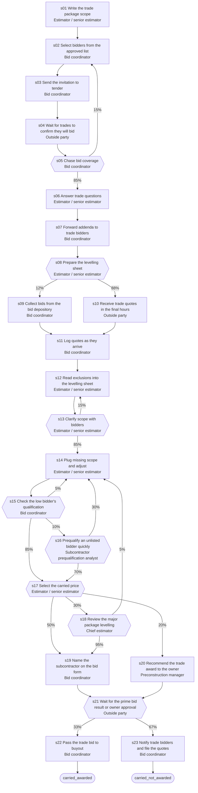

# Solicit and level trade bids

`gc-bd-trade-tendering` · construction (non-residential general contracting) · estimating · part of `general-contractor-co`

A general contractor subcontracts most of a building, so every bid needs firm prices from mechanical, electrical, envelope, steel, drywall and twenty or more other trades. For each trade package an estimator writes a scope sheet, the bid coordinator invites prequalified subcontractors and chases coverage, and on bid day quotes pour in during the last hours with exclusions that must be read, levelled and plugged before the lowest compliant price is carried. On construction management work the preconstruction manager recommends the trade to the owner instead. Missed exclusions and unqualified low bidders are the usual errors, and they surface later as buyout gaps and change orders.

| | |
|---|---|
| Unit of work | one trade package on one bid |
| Starts when | Estimating issues the trade package list for a stipulated bid, a CM or design-build proposal, a P3 pursuit or a preconstruction tender call. |
| Done when | A levelled price is carried in the bid or recommended to the owner, and the trade bid file is passed to buyout or filed after the result. |
| Organisation | A Canadian national general contractor with about $1.5B of annual construction revenue, an Ontario head office and regional offices in Western and Atlantic Canada, bidding public and private institutional, commercial and industrial buildings. (2,800 employees, 2019-2022) |
| Volume | 650 cases a month (range 400 to 900) |

## Where it sits

- Starts with **trade_tender** from bd-stipulated-bid (72% of cases)
- Starts with **trade_tender** from bd-cm-proposal (8% of cases)
- Starts with **trade_tender** from bd-preconstruction-services (17% of cases)
- Starts with **trade_tender** from bd-p3-pursuit (3% of cases)
- Relies on **prequalification_record** from scm-subcontractor-prequal (a standing input; it does not start a case)
- Relies on **trade_bid** from subcontractor (a standing input; it does not start a case)
- Relies on **trade_bid** from supplier (a standing input; it does not start a case)
- Sends **levelled_trade_prices** to bd-stipulated-bid (outcome: any)
- Sends **levelled_trade_prices** to bd-preconstruction-services (outcome: any)
- Sends **levelled_trade_prices** to bd-p3-pursuit (outcome: any)
- Sends **trade_bid** to scm-subcontract-buyout (outcome: carried_awarded)

## Flow

## Roles

| Role | Department | Layer | FTE on this process | Loaded cost per hour | Evidence |
|---|---|---|---:|---:|---|
| Estimator / senior estimator | Estimating | senior specialist | 20 | 68 CAD | C |
| Bid coordinator | Estimating | individual contributor | 8 | 40 CAD | C |
| Chief estimator | Estimating | manager | 0.6 | 105 CAD | C |
| Preconstruction manager | Preconstruction and design management | manager | 1.8 | 95 CAD | C |
| Subcontractor prequalification analyst | Supply chain and subcontracts | individual contributor | 0.6 | 40 CAD | C |

## Steps

Hands-on time and the wait before each step show the most common value. Evidence tier A is a sourced number, B a sourced description, C the author's estimate.

| Step | Who | Kind | Hands-on | Wait before | Control | Evidence |
|---|---|---|---:|---:|---|---|
| **s01 Write the trade package scope.** The estimator lists the specification sections, drawings and addenda in the package, writes a scope sheet of inclusions, exclusions, alternates and separate prices, and notes interfaces with neighbouring trades so quotes can be compared later. | Estimator / senior estimator | drafting | 30 min | 12.0 h |  | B [beck-leveling] |
| **s02 Select bidders from the approved list.** The bid coordinator filters the subcontractor prequalification database by trade, region and approved contract size, skips firms with expired insurance or workers' compensation clearance, and adds local trades who bid this owner before. | Bid coordinator | lookup | 15 min | 4.0 h |  | C |
| **s03 Send the invitation to tender.** The bid coordinator emails each bidder the invitation with the document link, scope sheet, closing date and time for trade prices, and how to submit; trade association plan rooms and online bid platforms carry the same notice. | Bid coordinator | communication | 15 min | 1.0 h |  | C |
| **s04 Wait for trades to confirm they will bid.** Invited subcontractors and suppliers download the documents and reply whether they intend to bid; many do not reply until chased. | Outside party | external wait | 0 min | 2.0 d |  | C |
| **s05 Chase bid coverage.** The bid coordinator phones invitees who have not replied and counts committed bidders for the package. Where fewer than three will bid, she asks the estimator for more names and invites them. | Bid coordinator | communication | 20 min | 4.0 h |  | B [tbs-depository] |
| **s06 Answer trade questions.** The estimator answers trade questions about scope splits from the scope sheet and forwards questions about the design to the consultant through the general contractor's question list. | Estimator / senior estimator | communication | 20 min | 3.0 d |  | B [ns2017] |
| **s07 Forward addenda to trade bidders.** When the owner issues an addendum the bid coordinator emails it to every committed bidder for the affected packages and asks them to acknowledge it in their price. | Bid coordinator | communication | 10 min | 12.0 h |  | C |
| **s08 Prepare the levelling sheet.** Before bid day the estimator sets up the levelling sheet with the scope sheet items down the side and a column per bidder, and enters early quotes from suppliers and trades who price ahead of time. | Estimator / senior estimator | analysis | 30 min | 1.0 d |  | B [beck-leveling], [tbs-depository] |
| **s09 Collect bids from the bid depository.** For packages the tender requires to go through the local construction association's bid depository, the bid coordinator collects the sealed trade bids after the depository closes, normally about two working days before the prime closing, and copies them into the levelling sheet. | Bid coordinator | lookup | 30 min | 2.0 d | Bid depository rules named in the tender: trade bids filed with the depository and used as filed | B [tbs-depository] |
| **s10 Receive trade quotes in the final hours.** Subcontractors and suppliers send their final quotes by email, fax or phone on closing day, most of them within the last hour or two to protect their price, often with exclusions and qualifications attached. | Outside party | external wait | 0 min | 2.0 d |  | B [beck-leveling] |
| **s11 Log quotes as they arrive.** The bid coordinator logs each quote with time, bidder, amount, addenda acknowledged and attached qualifications, and passes it to the estimator for the package. | Bid coordinator | data entry | 10 min | 15 min |  | B [beck-leveling] |
| **s12 Read exclusions into the levelling sheet.** The estimator reads each quote in full, marks every scope sheet item as included, excluded or unclear for that bidder, and highlights qualifications such as hoisting, permits, winter work or addenda not acknowledged. | Estimator / senior estimator | analysis | 40 min | 20 min |  | B [beck-leveling] |
| **s13 Clarify scope with bidders.** The estimator phones the lowest bidders to confirm unclear items, asks for a revised number where an exclusion can be added back, and notes each answer in the sheet. | Estimator / senior estimator | communication | 15 min | 10 min |  | B [beck-leveling] |
| **s14 Plug missing scope and adjust.** The estimator adds an allowance or plug for each item a bidder excluded, using another bidder's price or the company's own unit cost, so that all bids are compared on the same scope. | Estimator / senior estimator | analysis | 15 min | 5 min |  | B [beck-leveling] |
| **s15 Check the low bidder's qualification.** The bid coordinator checks the apparent low bidder in the prequalification database for approved size limit, current insurance and workers' compensation clearance, and whether a subcontract bond will be needed for a package of $250,000 or more. | Bid coordinator | validation | 10 min | 10 min | Company subcontractor prequalification policy; subcontract security for packages of $250,000 or more (Nova Scotia guidelines 4.3) | B [ns2017] |
| **s16 Prequalify an unlisted bidder quickly.** The prequalification analyst reviews the unlisted firm's questionnaire, safety statistics, insurance and workers' compensation certificates and recent work, and sets a provisional limit or rejects it, often within hours on bid day. | Subcontractor prequalification analyst | validation | 1.0 h | 2.0 h | Subcontractor prequalification policy | C |
| **s17 Select the carried price.** The estimator picks the lowest compliant levelled price, or the company's own estimate with a plug where coverage failed, and passes the carried number and bidder name to the bid summary. | Estimator / senior estimator | judgment | 15 min | 5 min |  | B [beck-leveling] |
| **s18 Review the major package levelling.** The chief estimator looks over the levelling sheet for the largest packages, questions plugs and any bid far below the rest, and confirms the carried price before it goes into the final number. | Chief estimator | review | 20 min | 20 min |  | B [beck-leveling] |
| **s19 Name the subcontractor on the bid form.** For trades the owner requires to be listed, the bid coordinator enters the carried bidder's name on the subcontractor list of the bid form so it matches the carried price. | Bid coordinator | data entry | 5 min | 10 min | Owner's instructions to bidders: list of major subcontractors with the bid (Nova Scotia guidelines 4.1) | B [ns2017] |
| **s20 Recommend the trade award to the owner.** On construction management work the preconstruction manager writes a recommendation letter with the levelling sheet and sends it to the owner and consultant, who approve the trade before it is let. | Preconstruction manager | drafting | 1.5 h | 1.0 d |  | C |
| **s21 Wait for the prime bid result or owner approval.** The package waits for the prime bid opening result, or on CM work for the owner's approval of the recommended trade. | Outside party | external wait | 0 min | 12.0 h |  | C |
| **s22 Pass the trade bid to buyout.** The bid coordinator sends the levelling sheet, quotes, clarifications and scope sheet to supply chain and the project manager so the subcontract can be bought out against the carried price. | Bid coordinator | communication | 20 min | 1.0 d |  | C |
| **s23 Notify trade bidders and file the quotes.** The bid coordinator emails trade bidders the prime result and files the quotes and levelling sheet, which estimators later mine for unit prices. | Bid coordinator | communication | 10 min | 1.0 d |  | C |

## Exceptions

| Exception | Share of cases | What happens |
|---|---:|---|
| Thin coverage | 15% | Fewer than three trades commit, so more firms are invited; if coverage still fails the estimator carries an own-estimate plug. |
| Revised quote on bid day | 15% | A bidder adds back an excluded item or revises its price after a clarification call, and the package is re-levelled. |
| Unlisted low bidder | 10% | The low bidder is not prequalified; the analyst approves it provisionally or the next bidder is carried. |
| Bid depository package | 12% | Mechanical or electrical prices come through the local bid depository about two working days before closing. |

## Benchmarks

| Metric | Value | Unit | Population | Evidence |
|---|---|---|---|---|
| cycle_time_days | p50 16, p90 25 | calendar days from package scope to result filed or passed to buyout | Trade packages on Canadian building tenders | C |
| levelling_time_per_major_scope | low 2, high 4 | hours (manual) | Complex projects, vendor estimate | A [beck-leveling] |
| trade_bid_depository_closing | 2 | working days before prime bid closing | Federal government projects using bid depositories (policy to 2006) | A [tbs-depository] |

## Pain points

- Quotes arrive in the final hours, so exclusions are skimmed under time pressure and gaps reach buyout. (steps s10, s12, s14; B [beck-leveling])
- Coverage chasing by phone takes coordinator time for every package on every bid. (steps s04, s05; C)
- Prequalification records go stale (insurance and WSIB certificates), so low bidders need checks on bid day. (steps s02, s15, s16; C)

## Assumptions

- One case is one trade package on one bid; about 25-35 packages run in parallel for each stipulated bid.
- The organisation file lists subcontractor and supplier trade bids as triggers; here they are inputs, because a case starts when estimating issues the package, and shares are split across the four internal triggering processes.
- Estimator and bid coordinator FTE cover trade work only; the bid's own estimating is in bd-stipulated-bid.
- Bid depository use (12% of packages) applies mainly to Western and Atlantic mechanical and electrical trades; the depository rule cited is the federal policy, used to describe practice.
- Role costs and titles from the organisation file; prequal-analyst is an organisation file role not listed for this process.
- Hands-on time implies about 12 FTE of bid coordinator work on trade packages; with the pipeline and stipulated bid steps that exceeds the organisation file's 10 bid coordinators, so the stated 8 FTE assumes estimators do part of the coverage chasing and quote logging themselves.
- No equipment, vehicles or crews are tied up; office roles have no shift pattern.

## Sources

- [beck-leveling] [What Is Bid Leveling in Construction?](https://www.beck-technology.com/blog/what-is-bid-leveling-in-construction) (Beck Technology, 2026). Bid leveling steps: log bids, build a scope matrix (included, excluded, alternate, unclear), compare line items, send question lists and document conversations, carry unresolved items conservatively, select on more than price; bids often arrive in the final hours or minutes before the deadline; manual leveling takes 2-4 hours per major scope; a $100M hospital may have 25+ scope packages; a bid 15% below the others warrants scrutiny; ignored qualifications become change orders. Undated vendor page.
- [tbs-depository] [Contracting Policy, Appendix N: Bid Depositories](https://bac-lac.wayback.archive-it.org/web/20061027044239/http:/www.tbs-sct.gc.ca/Pubs_pol/dcgpubs/Contracting/contractingpol_n_e.asp) (Treasury Board of Canada Secretariat (archived copy, Library and Archives Canada), 2006). Bid depositories run by local construction associations receive sealed trade bids so prime contractors have firm prices in time to compile their bids; used for trade bids on federal projects over $200,000 when named in the tender; trade bids close normally two working days before prime bids; withdrawals up to six hours before prime closing; with two or fewer trade bids the authority may negotiate. Federal policy of 1992-2006, used here as a description of depository practice.
- [ns2017] [Nova Scotia Public Sector Construction Contract Guidelines (June 2017)](https://www.novascotia.ca/sites/default/files/documents/1-1078/construction-contract-guidelines-en.pdf) (Province of Nova Scotia, 2017). Prequalification of bidders with a published minimum score (often 70-80 of 100); solicitation documents list major subcontractors, bid security, CCDC contract form; bonding recommended at $500,000 and over; subcontracts of $250,000 or more should carry contract security; addenda no later than 5 business days (major) or 3 business days (minor) before closing and closing extended at least 1 business day when needed; late bids rejected; amendments and withdrawals allowed up to closing; withdrawal after opening only for serious demonstrable error within 2 business days; within 48 hours of opening bidders may be asked for safety certifications, other subcontractors and price breakouts; bids over the estimate may be negotiated or re-tendered; letter of award binds the contractor to sign; contract security within 10 days of award; bid security of unsuccessful bidders returned within 30 days; international trade agreements may require 40-day postings.

Written by claude-opus on 2026-11-24.
