# Track and release holdback

`gc-fin-holdback-release` · non-residential construction (general contracting) · finance (project accounting) · part of `general-contractor-co`

Owners keep back 10% of every progress payment as holdback, and the contractor keeps back the same from its subcontractors, until the lien period after substantial performance has passed. This process releases that money: the project accountant reconciles owner and trade holdback, collects trade declarations and WSIB clearances, waits out the 60-day lien period, searches for liens, bills the owner and pays each trade. It is slow because of the statutory wait, liens that must be vacated, owners that hold payment for closeout documents and clearances that expire while waiting.

| | |
|---|---|
| Unit of work | one holdback release (one project's substantial performance, or one phased or early trade release) |
| Starts when | The consultant certifies substantial performance (or a phase or a subcontract is certified complete). |
| Done when | The owner has paid the holdback, each trade has been paid its holdback net of set-offs, and the ledger is closed. |
| Organisation | A Canadian national general contractor with about 220 active projects and about 10 projects reaching substantial performance each month, with holdback tracked in the ERP and Excel ledgers. (2,800 employees, 2019-2022) |
| Volume | 16 cases a month (range 10 to 24) |

## Where it sits

- Starts with **substantial_performance_cert** from ops-deficiency-closeout (65% of cases)
- Starts with **completion_notice** from ops-site-coordination (35% of cases)
- Relies on **holdback_ledger** from fin-sub-invoice-payment (a standing input; it does not start a case)
- Relies on **lien_claim** from legal-lien-adjudication (a standing input; it does not start a case)
- Relies on **wsib_clearance** from wcb (a standing input; it does not start a case)
- Sends **holdback_invoice** to public-owner (outcome: any)
- Sends **holdback_invoice** to private-owner (outcome: any)
- Sends **holdback_invoice** to p3-project-co (outcome: any)
- Sends **holdback_invoice** to fin-owner-receivables (outcome: any)
- Sends **holdback_payment** to subcontractor (outcome: released)
- Sends **journal_entries** to fin-month-end-close (outcome: released)

## Flow

```mermaid
flowchart TD
    s01["s01 Log the certificate and holdback dates<br/>Project accountant"]
    s02["s02 Confirm the certificate has been published<br/>Project accountant"]
    s03["s03 Reconcile owner and subcontractor holdback<br/>Project accountant"]
    s04["s04 Confirm final subcontract values and set-offs<br/>Project manager"]
    s05["s05 Prepare the holdback invoice to the owner<br/>Billing and collections specialist"]
    s06["s06 Collect trade declarations and clearances<br/>Project accountant"]
    s07{{"s07 Wait for the lien period to expire<br/>Outside party"}}
    s08["s08 Negotiate the owner's withheld holdback<br/>Project manager"]
    s09{{"s09 Search for registered and served liens<br/>Project accountant"}}
    s10["s10 Arrange to vacate the lien<br/>Contracts counsel"]
    s11["s11 Wait for the lien to be discharged or vacated<br/>Outside party"]
    s12["s12 Submit the holdback invoice<br/>Billing and collections specialist"]
    s13{{"s13 Wait for the owner to pay the holdback<br/>Outside party"}}
    s14["s14 Chase the owner for holdback<br/>Billing and collections specialist"]
    s15["s15 Apply the holdback receipt<br/>Billing and collections specialist"]
    s16{{"s16 Prepare the trade holdback payment list<br/>Project accountant"}}
    s17["s17 Refresh expired clearances and declarations<br/>Project accountant"]
    s18["s18 Project manager approves trade releases<br/>Project manager"]
    s19["s19 Finance manager approves the payment run<br/>Regional finance manager"]
    s20["s20 Pay trade holdback in the AP run<br/>Automated"]
    s21["s21 Close out the holdback ledger<br/>Project accountant"]
    s01 --> s02
    s02 --> s03
    s03 --> s04
    s04 --> s05
    s05 --> s06
    s06 --> s07
    s07 -->|"94%"| s09
    s07 -->|"6%"| s08
    s08 --> s09
    s09 -->|"88%"| s12
    s09 -->|"12%"| s10
    s10 --> s11
    s11 --> s12
    s12 --> s13
    s13 -->|"78%"| s15
    s13 -->|"22%"| s14
    s14 --> s15
    s15 --> s16
    s16 -->|"85%"| s18
    s16 -->|"15%"| s17
    s17 --> s16
    s18 --> s19
    s19 --> s20
    s20 --> s21
    s21 --> end0
    end0(["released"])
```

## Roles

| Role | Department | Layer | FTE on this process | Loaded cost per hour | Evidence |
|---|---|---|---:|---:|---|
| Project accountant | Finance | individual contributor | 1.25 | 48 CAD | C |
| Billing and collections specialist | Finance transactions (AP, billing, payroll) | individual contributor | 0.22 | 39 CAD | C |
| Project manager | Construction operations | manager | 0.25 | 72 CAD | C |
| Regional finance manager | Finance | manager | 0.05 | 88 CAD | C |
| Contracts counsel | Legal, risk and insurance | senior specialist | 0.03 | 115 CAD | C |

## Steps

Hands-on time and the wait before each step show the most common value. Evidence tier A is a sourced number, B a sourced description, C the author's estimate.

| Step | Who | Kind | Hands-on | Wait before | Control | Evidence |
|---|---|---|---:|---:|---|---|
| **s01 Log the certificate and holdback dates.** The project accountant receives the certificate of substantial performance (or the subcontract completion or phased release notice) from the project team, records the certificate date in the holdback ledger and diarises the end of the 60-day lien period and the expected owner payment date. | Project accountant | intake | 20 min | 1.0 d |  | B [dla] |
| **s02 Confirm the certificate has been published.** The project accountant checks the construction trade newspaper listing or the consultant's confirmation that the certificate was published, because the lien and holdback periods run from publication, and asks the consultant or owner to publish if not. | Project accountant | lookup | 15 min | 5.0 d | Ontario Construction Act s. 32: publication of the certificate of substantial performance starts the lien period | C |
| **s03 Reconcile owner and subcontractor holdback.** The project accountant compares holdback retained by the owner on every certified draw with holdback the company retained from each subcontractor in AP, trade by trade, and resolves differences caused by credits, change orders and earlier partial releases. | Project accountant | validation | 2.0 h | 3.0 d |  | C |
| **s04 Confirm final subcontract values and set-offs.** The project manager reviews each trade's final subcontract value, open deficiencies and backcharges, and decides which trades' holdback can be released in full and where an amount must be kept back as set-off for unfinished or defective work. | Project manager | judgment | 1.2 h | 3.0 d |  | C |
| **s05 Prepare the holdback invoice to the owner.** The billing specialist drafts the holdback invoice to the owner for the total holdback retained, attaches a statutory declaration and a current WSIB clearance, and holds it ready to submit once the lien period ends. | Billing and collections specialist | drafting | 45 min | 2.0 d | CCDC 2 GC 5.2 / 5.4: statutory declaration and workers' compensation evidence with the holdback application | B [mlt], [wsib] |
| **s06 Collect trade declarations and clearances.** The project accountant emails each of the 15 to 30 subcontractors for a statutory declaration that their own trades and suppliers are paid and a current WSIB clearance, logs what arrives, and chases the missing ones by phone. | Project accountant | coordination | 4.0 h | 3.0 d | WSIB clearance policy 14-02-19: principal liable for a contractor's unpaid premiums without a valid clearance | B [wsib] |
| **s07 Wait for the lien period to expire.** Holdback cannot be paid until the 60-day lien period after publication has passed; the documents gathered so far wait for the remainder of that period, while the owner may publish a notice refusing part of the holdback. | Outside party | external wait | 0 min | 38.0 d |  | B [dla] |
| **s08 Negotiate the owner's withheld holdback.** The project manager reviews the owner's notice of non-payment of holdback, usually for deficiencies or claimed delay, agrees a reduced set-off or a plan to complete the work, and refers unresolved amounts to legal for adjudication. | Project manager | communication | 2.0 h | 2.0 d |  | B [dla] |
| **s09 Search for registered and served liens.** The project accountant orders a title search through the land registry for private projects, or checks with the owner for written notices of lien on public projects where liens cannot be registered, and checks legal's register of liens and claims. | Project accountant | lookup | 30 min | 1.0 d | Construction Act: no holdback paid while a lien is preserved; lien search before release | C |
| **s10 Arrange to vacate the lien.** Contracts counsel reviews the lien, asks the trade to discharge it if the claim is paid or wrong, or arranges a bond or cash security to vacate it from title by court order so the rest of the holdback can be released. | Contracts counsel | judgment | 2.0 h | 2.0 d |  | B [dla] |
| **s11 Wait for the lien to be discharged or vacated.** The trade discharges the lien after payment or settlement, or the court vacates it on posting of security; the release waits for written confirmation on title or from the owner. | Outside party | external wait | 0 min | 28.0 d |  | C |
| **s12 Submit the holdback invoice.** The billing specialist dates and submits the holdback invoice with the declaration, clearance and lien search to the consultant and the owner, and logs it in the collections tracker with the contract's payment date. | Billing and collections specialist | communication | 20 min | 1.0 d |  | B [mlt] |
| **s13 Wait for the owner to pay the holdback.** The consultant certifies the holdback payment and the owner processes it; CCDC 2-2020 requires payment within 10 working days after the holdback period, but owners often pay later while closeout documents are still being reviewed. | Outside party | external wait | 0 min | 14.0 d |  | B [mlt] |
| **s14 Chase the owner for holdback.** The billing specialist chases the owner's accounts payable and the consultant, finds out what is holding the payment, such as missing as-built drawings or manuals, and asks the project team to deliver it. | Billing and collections specialist | communication | 30 min | 10.0 d |  | C |
| **s15 Apply the holdback receipt.** The billing specialist matches the owner's holdback payment to the holdback invoice in the ERP and tells the project accountant that trade holdback can now be paid. | Billing and collections specialist | data entry | 15 min | 1.0 d |  | C |
| **s16 Prepare the trade holdback payment list.** The project accountant builds the list of trade holdback payments net of set-offs and backcharges and checks for each trade that the statutory declaration is on file and the WSIB clearance is still within its validity period on the payment date. | Project accountant | validation | 1.2 h | 2.0 d | WSIB clearance policy 14-02-19: valid clearance for each contractor at the time of payment | B [wsib] |
| **s17 Refresh expired clearances and declarations.** The project accountant asks the trades with expired WSIB clearances or missing declarations for new ones, downloads clearances from the WSIB portal where possible, and adds them to the file. | Project accountant | communication | 30 min | 3.0 d |  | B [wsib] |
| **s18 Project manager approves trade releases.** The project manager checks the payment list against the release list and the owner's payment, confirms that set-offs are kept back for unfinished work, and approves the trade holdback releases in the AP workflow. | Project manager | approval | 20 min | 1.0 d | Project manager approval of subcontract payments separate from the accountant who prepares them | C |
| **s19 Finance manager approves the payment run.** The regional finance manager reviews the holdback payment batch, checks the total against holdback received from the owner, and releases it under signing authority for the next AP payment run. | Regional finance manager | approval | 15 min | 1.0 d | Signing authority: finance manager release of payment batches above project limits | C |
| **s20 Pay trade holdback in the AP run.** The ERP includes the released holdback payments in the next scheduled AP payment run and sends EFT payments or prints cheques to each subcontractor without further handling. | Automated | system auto | 0 min | 3.0 d |  | B [bj] |
| **s21 Close out the holdback ledger.** The project accountant clears the holdback receivable and payable in the ERP, records any holdback kept back for set-offs, files the release documents and marks the project's holdback as released. | Project accountant | data entry | 25 min | 1.0 d |  | C |

## Exceptions

| Exception | Share of cases | What happens |
|---|---:|---|
| Lien preserved by a trade or supplier | 12% | Legal arranges discharge or vacates the lien with security before the holdback is paid. |
| Owner notice of non-payment of holdback | 6% | The owner publishes a notice keeping part of the holdback for deficiencies; the PM negotiates the set-off. |
| Owner pays holdback late | 22% | The owner holds payment, often for closeout documents, and the billing specialist chases. |
| Expired trade clearances | 15% | Clearances gathered before the lien period expire before payment and must be refreshed. |

## Benchmarks

| Metric | Value | Unit | Population | Evidence |
|---|---|---|---|---|
| cycle_time_days | p50 95, p90 140 | calendar days from substantial performance certificate to trade holdback paid | Holdback releases on Canadian building projects, 2019-2022 | C |
| statutory_minimum_days_to_owner_holdback_payment | 74 | calendar days from publication to latest CCDC owner payment date (60-day lien period + 10 working days) | Ontario contracts on CCDC 2-2020 | B [dla], [mlt] |

## Pain points

- The 60-day lien period is fixed by law, so most of the cycle is waiting. (steps s07; B [dla])
- Collecting declarations and clearances from every trade is manual chasing, and clearances valid for at most 90 days often expire before payment. (steps s06, s16, s17; B [wsib])
- Owners hold holdback until closeout documents arrive even after the lien period, and liens must be vacated before release. (steps s10, s11, s13, s14; C)

## Assumptions

- Loaded costs come from the organisation file (1.35 loading on salaried wages).
- Steps s02 to s06 run inside the 60-day lien period, so s07 holds only the remainder (30 to 46 days).
- The finance manager and contracts counsel are added because the payment batch and lien vacating need them; the organisation file lists only the project accountant, billing specialist and project manager on this process.
- Volume is set at 10-24 a month (mode 16), below the organisation file's 15-40, because substantial performances run at about 10 a month; early trade and phased releases are counted as separate cases.
- Early releases for trades certified complete (35% of cases) follow the same steps with a smaller trade list.
- The simulated median cycle time (94.9 days) matches the 95-day estimate; the simulated p90 (121 days) is shorter than the 140-day estimate because long lien disputes and owners holding holdback for months are rarer than a triangular range can show. Stated FTEs (1.8) match touch time x volume.

## Sources

- [bj] [Prompt Payment for Construction in Ontario](https://www.bennettjones.com/Insights/Blogs/Prompt-Payment-for-Construction-in-Ontario) (Bennett Jones LLP, 2019). Construction Act Part I.1 in force 1 October 2019 for contracts entered after that date; proper invoice monthly unless the contract says otherwise and cannot depend on certifier action; owner pays within 28 days; owner notice of non-payment within 14 days; contractor pays subcontractors within 7 days of receiving payment, or 35 days after the proper invoice unless it gives notice; undertaking to adjudicate within 21 days.
- [dla] [Prompt payment and adjudication have arrived in Ontario](https://www.dlapiper.com/en/insights/publications/2019/10/prompt-payment-and-adjudication-have-arrived-in-ontario) (DLA Piper, 2019). Holdback release mandatory unless the payer publishes a notice of non-payment of holdback; annual or phased release allowed with contract provisions; holdback may be secured by letter of credit or bond; lien preservation 60 days and perfection 90 days; adjudicator decision within 30 days; payment within 10 days of a determination.
- [mlt] [The new CCDC 2 - 2020: contract changes you need to know](https://www.mltaikins.com/insights/the-new-ccdc-2-2020-contract-changes-you-need-to-know/) (MLT Aikins LLP, 2020). Monthly applications for payment to the consultant and owner simultaneously; workers' compensation evidence and a CCDC 9A statutory declaration with each application after the first; owner pays within 28 days (20 days under CCDC 2-2008); holdback paid no later than 10 working days after the holdback period expires; consultant responds to a Ready-for-Takeover application within 10 days.
- [wsib] [Clearance Certificate in Construction (Operational Policy Manual document 14-02-19)](https://www.wsib.ca/en/operational-policy-manual/clearance-certificate-construction) (Workplace Safety and Insurance Board (Ontario), 2020). A principal that retains a construction contractor must have a clearance in place for the whole time the contractor works; a clearance is valid for up to 90 calendar days and is renewable; without one the principal may be liable for the contractor's WSIB obligations up to the labour portion of the contract; records kept 3 years; policy applies from 1 January 2020.

Written by claude-opus on 2026-11-24.
