# Close the books each month

`gc-fin-month-end-close` · construction (non-residential general contracting) · finance (accounting) · part of `general-contractor-co`

Every month finance closes the books for about 220 projects. AP and payroll are cut off, costs not yet invoiced are accrued, and project managers send updated cost-to-complete forecasts. Project accountants then turn those forecasts into percent-complete revenue on the work-in-progress schedule, regional finance and operations leaders review project margins, and the controller and CFO sign off the consolidated results. The close is slow because it waits on project managers' forecasts and review meetings, and the judgments about forecast costs and unapproved change orders drive most of the corrections.

| | |
|---|---|
| Unit of work | one monthly close |
| Starts when | The calendar month ends. |
| Done when | The period is locked, the operations report and job cost reports are distributed, and at quarter end the supporting schedules go to quarterly reporting. |
| Organisation | A TSX-listed Canadian general contractor with about $1.5 billion revenue, three regions and about 220 active projects, using a construction ERP and Excel WIP schedules. (2,800 employees, 2019-2022) |
| Volume | 1 cases a month (range 1 to 1) |

## Where it sits

- Starts with **journal_entries** from fin-supplier-ap (20% of cases)
- Starts with **journal_entries** from fin-sub-invoice-payment (20% of cases)
- Starts with **journal_entries** from fin-owner-receivables (20% of cases)
- Starts with **journal_entries** from fin-union-payroll (15% of cases)
- Starts with **journal_entries** from fin-salary-payroll (15% of cases)
- Starts with **journal_entries** from fin-holdback-release (10% of cases)
- Relies on **cost_forecast** from ops-monthly-cost-forecast (a standing input; it does not start a case)
- Relies on **equipment_charges** from spe-equipment-dispatch (a standing input; it does not start a case)
- Relies on **final_cost_report** from ops-project-closeout-financial (a standing input; it does not start a case)
- Sends **job_cost_report** to ops-monthly-cost-forecast (outcome: any)
- Sends **financial_statements** to fin-quarterly-reporting (outcome: any)
- Sends **trial_balance** to fin-tax-compliance (outcome: any)

## Flow

```mermaid
flowchart TD
    s01["s01 Issue the close calendar and cut-off reminders<br/>Financial reporting analyst"]
    s02["s02 Run the AP and subcontract invoice cut-off<br/>Accounts payable clerk"]
    s03["s03 Post equipment, payroll and burden accruals<br/>Financial reporting analyst"]
    s04["s04 Accrue costs not yet invoiced on each project<br/>Project accountant"]
    s05["s05 Reconcile bank, payroll and holdback accounts<br/>Treasury, surety and credit manager"]
    s06["s06 Soft-close the subledgers<br/>Regional finance manager"]
    s07["s07 Send job cost reports to project managers<br/>Project accountant"]
    s08["s08 Chase late project cost forecasts<br/>Project accountant"]
    s09["s09 Update the WIP schedule and percent-complete revenue<br/>Project accountant"]
    s10{{"s10 Finance manager reviews the regional WIP schedule<br/>Regional finance manager"}}
    s11["s11 Project managers revise challenged forecasts<br/>Project manager"]
    s12["s12 Regional WIP review meeting<br/>Regional vice-president"]
    s13["s13 Post revenue and adjusting entries<br/>Project accountant"]
    s14["s14 Finance manager approves the journal entries<br/>Regional finance manager"]
    s15["s15 Consolidate the regions and run the trial balance<br/>Financial reporting analyst"]
    s16["s16 Prepare the variance analysis and results package<br/>Financial reporting analyst"]
    s17["s17 Regions explain variances<br/>Regional finance manager"]
    s18{{"s18 Controller reviews results and reconciliations<br/>Corporate controller"}}
    s19["s19 CFO reviews and signs off monthly results<br/>Chief financial officer"]
    s20{{"s20 Lock the period and distribute reports<br/>Financial reporting analyst"}}
    s21["s21 Prepare quarter-end supporting schedules<br/>Financial reporting analyst"]
    s01 --> s02
    s02 --> s03
    s03 --> s04
    s04 --> s05
    s05 --> s06
    s06 --> s07
    s07 --> s08
    s08 --> s09
    s09 --> s10
    s10 -->|"80%"| s12
    s10 -->|"20%"| s11
    s11 --> s10
    s12 --> s13
    s13 --> s14
    s14 --> s15
    s15 --> s16
    s16 --> s17
    s17 --> s18
    s18 -->|"85%"| s19
    s18 -->|"15%"| s13
    s19 --> s20
    s20 -->|"67%"| end0
    s20 -->|"33%"| s21
    s21 --> end1
    end0(["month_closed"])
    end1(["quarter_closed"])
```

## Roles

| Role | Department | Layer | FTE on this process | Loaded cost per hour | Evidence |
|---|---|---|---:|---:|---|
| Project accountant | Finance | individual contributor | 6.5 | 48 CAD | C |
| Accounts payable clerk | Finance transactions (AP, billing, payroll) | individual contributor | 0.15 | 33 CAD | C |
| Financial reporting analyst | Finance | senior specialist | 0.6 | 60 CAD | C |
| Treasury, surety and credit manager | Finance | manager | 0.05 | 95 CAD | C |
| Regional finance manager | Finance | manager | 0.35 | 88 CAD | C |
| Project manager | Construction operations | manager | 0.1 | 72 CAD | C |
| Regional vice-president | Construction operations | director | 0.05 | 160 CAD | C |
| Corporate controller | Finance | director | 0.05 | 125 CAD | C |
| Chief financial officer | Finance | executive | 0.02 | 250 CAD | C |

## Steps

Hands-on time and the wait before each step show the most common value. Evidence tier A is a sourced number, B a sourced description, C the author's estimate.

| Step | Who | Kind | Hands-on | Wait before | Control | Evidence |
|---|---|---|---:|---:|---|---|
| **s01 Issue the close calendar and cut-off reminders.** A few days before month end the financial reporting analyst emails the close calendar to regional finance, project accountants and project managers: invoice and receiving cut-off, payroll accrual date, the day cost forecasts are due and the day results go to the CFO. | Financial reporting analyst | communication | 45 min | 0 min |  | C |
| **s02 Run the AP and subcontract invoice cut-off.** On the first working day after month end the AP clerks make sure every supplier and subcontractor invoice received by month end is scanned, coded to job and cost code and in the approval workflow, and list invoices still waiting for project manager approval. | Accounts payable clerk | validation | 15.0 h | 1.0 d |  | C |
| **s03 Post equipment, payroll and burden accruals.** The ERP charges company equipment usage to jobs at internal rates, and the analyst posts the accrual for hourly wages and union fund contributions earned in the days since the last weekly payroll, using the latest timecards. | Financial reporting analyst | data entry | 3.0 h | 0 min |  | C |
| **s04 Accrue costs not yet invoiced on each project.** For each of their projects the project accountants list materials received and subcontract work in place that has no invoice yet, using purchase orders, delivery tickets, subcontractor progress claims and the superintendent's notes, and post accruals by cost code. | Project accountant | analysis | 13.8 d | 0 min |  | B [jmco-wip] |
| **s05 Reconcile bank, payroll and holdback accounts.** The treasury manager and analysts reconcile bank accounts, payroll clearing and deduction accounts, and the holdback payable and receivable ledgers to the general ledger, and post corrections. | Treasury, surety and credit manager | validation | 6.0 h | 1.0 d | Monthly balance sheet account reconciliations (internal control over financial reporting) | C |
| **s06 Soft-close the subledgers.** The regional finance manager closes the AP, payroll and equipment subledgers for the month in the ERP so that job cost for the month stops changing. | Regional finance manager | approval | 1.0 h | 12.0 h | Period close control: subledgers locked before reporting | C |
| **s07 Send job cost reports to project managers.** The project accountants run the month's job cost report for each project (budget, committed, cost to date by cost code) and send it to the project manager with any questions about miscoded or unexpected costs. | Project accountant | drafting | 1.5 d | 4.0 h |  | C |
| **s08 Chase late project cost forecasts.** The project accountants wait for each project manager's updated cost-to-complete forecast and change order log, and chase the late ones by email and phone; a few always come in after the due date. | Project accountant | communication | 18.3 h | 3.0 d |  | C |
| **s09 Update the WIP schedule and percent-complete revenue.** For each project the project accountant enters the revised contract value (approved change orders), cost to date and the forecast cost at completion, and the WIP schedule computes percent complete on costs, earned revenue, gross profit and over- or under-billing against billings to date. Unapproved changes are included only where recovery is probable. | Project accountant | analysis | 9.2 d | 4.0 h | IFRS 15 revenue recognised over time on an input (cost) method; estimates reviewed each period | B [jmco-wip] |
| **s10 Finance manager reviews the regional WIP schedule.** The regional finance manager reviews the WIP schedule project by project for margin fade or gain against last month, loss contracts that need a full provision, large under-billings and unapproved change orders counted as revenue, and challenges forecasts that look optimistic. | Regional finance manager | review | 12.0 h | 8.0 h | Management review of significant estimates (internal control over financial reporting) | B [jmco-wip] |
| **s11 Project managers revise challenged forecasts.** The project managers whose forecasts were challenged re-check costs to complete, pending change orders and risks, and send a revised forecast; the project accountant updates the WIP lines. | Project manager | judgment | 4.0 h | 1.0 d |  | C |
| **s12 Regional WIP review meeting.** The regional vice-president, operations managers and the finance manager go through the projects with the largest changes, agree the forecast margins to book and the actions on projects losing money. | Regional vice-president | review | 6.0 h | 2.0 d | Company policy: regional executive sign-off of project margins each month | B [jmco-wip] |
| **s13 Post revenue and adjusting entries.** The project accountants post the month's revenue adjustment, contract asset and liability entries, loss provisions and other adjustments agreed at the review, with support attached. | Project accountant | data entry | 3.1 d | 4.0 h |  | C |
| **s14 Finance manager approves the journal entries.** The regional finance manager reviews and approves manual journal entries above the threshold, checking support and that the preparer did not approve their own entry. | Regional finance manager | approval | 3.0 h | 8.0 h | Manual journal entries approved by someone other than the preparer | C |
| **s15 Consolidate the regions and run the trial balance.** The financial reporting analyst runs the consolidation of the three regions and head office, posts intercompany eliminations and runs the trial balance. | Financial reporting analyst | data entry | 6.0 h | 4.0 h |  | B [apqc-close] |
| **s16 Prepare the variance analysis and results package.** The analyst compares revenue, gross profit and overhead by region with budget, forecast and last month, and builds the monthly results package with backlog and cash. | Financial reporting analyst | analysis | 12.0 h | 4.0 h |  | C |
| **s17 Regions explain variances.** The regional finance managers answer the analyst's variance questions by email with project-level explanations of revenue, margin and overhead differences, sometimes after checking with project managers or operations managers. | Regional finance manager | communication | 4.0 h | 1.0 d |  | C |
| **s18 Controller reviews results and reconciliations.** The corporate controller reviews the results package, the balance sheet reconciliations and the largest WIP judgments, and sends back entries that need correcting. | Corporate controller | review | 6.0 h | 12.0 h | Controller review of the monthly close (internal control over financial reporting) | C |
| **s19 CFO reviews and signs off monthly results.** The CFO reviews the results and the key project risks with the controller and signs off the month's figures for the operations report. | Chief financial officer | approval | 2.0 h | 1.0 d | Executive sign-off of monthly results | C |
| **s20 Lock the period and distribute reports.** The analyst locks the period in the ERP, publishes the operations report and job cost to the regions and sends the trial balance to tax. | Financial reporting analyst | communication | 1.0 h | 2.0 h |  | C |
| **s21 Prepare quarter-end supporting schedules.** At quarter end the analyst prepares the schedules the quarterly reporting team needs: revenue by market, backlog, contract assets and liabilities, and project-level support for significant estimates. | Financial reporting analyst | drafting | 1.2 d | 0 min |  | C |

## Exceptions

| Exception | Share of cases | What happens |
|---|---:|---|
| Forecasts challenged | 20% | Regional finance challenges optimistic forecasts and project managers revise them. |
| Controller sends back adjustments | 15% | Entries are corrected and re-approved before sign-off. |
| Quarter end | 33% | Extra schedules for quarterly reporting. |

## Benchmarks

| Metric | Value | Unit | Population | Evidence |
|---|---|---|---|---|
| cycle_time_days | p50 12, p90 16 | calendar days from month end to locked period and distributed results | Mid-size listed general contractor | C |
| trial_balance_to_statements_days | p50 6.4, p25 4.8, p75 10 | calendar days from running the trial balance to completed consolidated statements | About 2,300 organisations, APQC Open Standards Benchmarking (all industries) | A [apqc-close] |

## Pain points

- The close waits for project managers' cost-to-complete forecasts, and a few late ones hold up every region. (steps s08; C)
- Percent-complete revenue depends on forecast judgments that finance must challenge every month, causing rework. (steps s09, s10, s11; B [jmco-wip])
- Invoices and field purchases that arrive after cut-off make cost accruals by project slow and error-prone. (steps s02, s04; C)

## Assumptions

- Hands-on time is the total for the whole company (about 220 projects and 40 project accountants working in parallel), so labour cost and staffing are right but the validator's simulated cycle time adds about 33 days of hands-on minutes (about 800 hours) in sequence as if one person did them, giving a simulated median of about 48 days. The waits alone average about 12 to 14 calendar days, close to the benchmark; the elapsed close should be read from the waits, and the remaining warning (4x the benchmark) comes from this aggregation, not from slow steps.
- Accruals, reconciliations and the AP cut-off run in parallel in the first days after month end (concurrent_with).
- The project managers' forecasts are produced in ops-monthly-cost-forecast; here only the chasing and the revisions after challenge are counted.
- The organisation file lists journal entries from transaction processes as triggers; in practice the close is triggered by the calendar and those entries are inputs. Shares in triggered_by are nominal.
- Revenue is recognised over time on a cost-to-cost input method, as is usual for Canadian contractors reporting under IFRS 15.
- Year-end close and audit are not modelled separately.
- Loaded costs come from the organisation file.

## Sources

- [apqc-close] [Metric of the month: cycle time for monthly close](https://www.cfo.com/news/metric-of-the-month-cycle-time-for-monthly-close/) (CFO.com, with APQC Open Standards Benchmarking data, 2018). About 2,300 organisations: median 6.4 calendar days from running the trial balance to completing the consolidated financial statements; top quartile 4.8 days or less; bottom quartile 10 days or more.
- [jmco-wip] [What Is a Work in Progress Schedule? A Guide for Construction Companies](https://www.jmco.com/articles/construction/maintaining-wip-schedule/) (Johnson Miller & Co., CPAs, None). WIP schedule updated monthly as part of the close with contract value, costs and revenue to date, percent complete, billings and contract assets and liabilities; revenue recognised on cost incurred; project managers and accounting meet regularly to review; schedule reconciled to the income statement and balance sheet; sureties may require monthly WIP reports.

Written by claude-opus on 2026-11-24.
