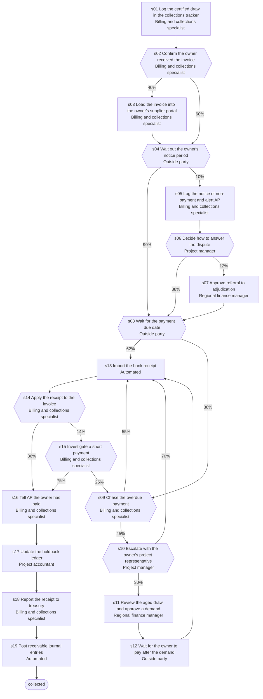

# Collect owner payments

`gc-fin-owner-receivables` · non-residential construction (general contracting) · finance (receivables) · part of `general-contractor-co`

After a monthly progress draw is certified, the contractor's billing and collections specialists make sure the owner pays it. They track the 14-day notice and 28-day payment dates, load invoices into owner portals, chase late payments, involve the project manager and finance manager for disputes and old balances, apply receipts and tell accounts payable so subcontractors are paid within 7 days. Slow public approvals, owner disputes and short payments stretch working capital and can push disputes to adjudication.

| | |
|---|---|
| Unit of work | one certified progress draw (or holdback invoice) collected |
| Starts when | The project accountant hands over a certified progress draw or holdback invoice for collection. |
| Done when | The owner's payment is applied to the invoice, AP has been told so subcontractors can be paid, and the entries are posted. |
| Organisation | A Canadian national general contractor with about 220 active projects, a central billing and collections team in finance transactions and regional finance managers. (2,800 employees, 2019-2022) |
| Volume | 230 cases a month (range 200 to 270) |

## Where it sits

- Starts with **progress_draw** from ops-progress-draw (94% of cases)
- Starts with **holdback_invoice** from fin-holdback-release (6% of cases)
- Relies on **payment_certificate** from consultant (a standing input; it does not start a case)
- Relies on **owner_payment** from public-owner (a standing input; it does not start a case)
- Relies on **owner_payment** from private-owner (a standing input; it does not start a case)
- Relies on **owner_payment** from p3-project-co (a standing input; it does not start a case)
- Sends **owner_payment** to fin-sub-invoice-payment (outcome: collected)
- Sends **cash_receipt** to fin-treasury-cash (outcome: collected)
- Sends **notice_of_non_payment** to legal-lien-adjudication (outcome: any)
- Sends **journal_entries** to fin-month-end-close (outcome: collected)

## Flow

## Roles

| Role | Department | Layer | FTE on this process | Loaded cost per hour | Evidence |
|---|---|---|---:|---:|---|
| Billing and collections specialist | Finance transactions (AP, billing, payroll) | individual contributor | 3 | 39 CAD | C |
| Project manager | Construction operations | manager | 0.4 | 72 CAD | C |
| Regional finance manager | Finance | manager | 0.1 | 88 CAD | C |
| Project accountant | Finance | individual contributor | 0.35 | 48 CAD | C |

## Steps

Hands-on time and the wait before each step show the most common value. Evidence tier A is a sourced number, B a sourced description, C the author's estimate.

| Step | Who | Kind | Hands-on | Wait before | Control | Evidence |
|---|---|---|---:|---:|---|---|
| **s01 Log the certified draw in the collections tracker.** The billing and collections specialist opens the certified draw handed over by the project accountant, enters the invoice, certified amount, holdback and delivery date in the receivables tracker, and diarises day 14 and day 28 under the prompt payment rules or the contract's payment date. | Billing and collections specialist | intake | 15 min | 4.0 h |  | B [bj] |
| **s02 Confirm the owner received the invoice.** The billing specialist checks the owner's acknowledgement email or portal status and, for owners that pay through a supplier portal, checks whether the invoice still has to be loaded there with a purchase order number. | Billing and collections specialist | communication | 10 min | 0 min |  | C |
| **s03 Load the invoice into the owner's supplier portal.** For hospitals, universities and other owners with supplier portals, the billing specialist re-keys the invoice header, purchase order, amount, holdback and tax into the portal and uploads the application, certificate and statutory declaration as PDFs. | Billing and collections specialist | data entry | 20 min | 4.0 h |  | C |
| **s04 Wait out the owner's notice period.** The owner's accounts payable and project staff review the invoice; under Ontario's prompt payment rules they must give a notice of non-payment within 14 days of the proper invoice if they dispute any part of it. | Outside party | external wait | 0 min | 3.0 d |  | B [bj] |
| **s05 Log the notice of non-payment and alert AP.** The billing specialist records the disputed amount and the owner's reasons, sends the notice to the project manager and to accounts payable the same day so that matching notices can go to affected subcontractors within the 7-day window. | Billing and collections specialist | communication | 20 min | 2.0 h | Ontario Construction Act s. 6.5: contractor notice to subcontractors within 7 days of the owner's notice | B [bj] |
| **s06 Decide how to answer the dispute.** The project manager reads the owner's reasons, checks the work and change records, and decides whether to accept the reduction and re-bill it, negotiate it at the next owner meeting, or refer it to adjudication through legal. | Project manager | judgment | 1.0 h | 1.0 d |  | C |
| **s07 Approve referral to adjudication.** The regional finance manager reviews the disputed amount and the project manager's case, approves the referral and the undertaking to adjudicate given to subcontractors, and passes the file to legal for the notice of adjudication. | Regional finance manager | approval | 30 min | 1.0 d | Ontario Construction Act: undertaking to refer the owner's non-payment to adjudication within 21 days | B [bj], [dla] |
| **s08 Wait for the payment due date.** The owner's payment run processes approved invoices; most public owners pay in a weekly or bi-weekly cheque or EFT run close to the due date, while some private owners wait for their own lender's funding. | Outside party | external wait | 0 min | 10.0 d |  | C |
| **s09 Chase the overdue payment.** The billing specialist phones and emails the owner's accounts payable, checks the portal for holds or rejections, resends any missing document and records the promised payment date in the tracker. | Billing and collections specialist | communication | 25 min | 3.0 d |  | C |
| **s10 Escalate with the owner's project representative.** The project manager raises the unpaid draw with the owner's project representative at the site meeting or by phone, finds out whether the delay is funding, approvals or a hidden dispute, and asks for a payment date in writing. | Project manager | communication | 30 min | 7.0 d |  | C |
| **s11 Review the aged draw and approve a demand.** At the monthly aged receivables review the regional finance manager looks at draws more than 45 to 60 days old, decides whether to send a formal demand with interest under the contract or Act, and whether to warn of suspension or lien rights. | Regional finance manager | approval | 30 min | 5.0 d | Credit policy: finance approval before formal demand, interest or suspension notice to an owner | C |
| **s12 Wait for the owner to pay after the demand.** The owner pays after the demand, after its funding arrives or after the dispute settles; a few cases move to adjudication or lien proceedings handled by legal, and the draw is collected when that ends. | Outside party | external wait | 0 min | 14.0 d |  | C |
| **s13 Import the bank receipt.** The bank's EFT and lockbox file is imported into the ERP cash module overnight, creating an unapplied receipt with the owner's remittance reference for the billing specialist to match. | Automated | system auto | 0 min | 1.0 d |  | C |
| **s14 Apply the receipt to the invoice.** The billing specialist matches the remittance advice to the invoice, applies the cash in the ERP receivables ledger, and checks whether the amount equals the certified amount less holdback. | Billing and collections specialist | data entry | 20 min | 4.0 h |  | C |
| **s15 Investigate a short payment.** The billing specialist works out why the owner paid less, such as extra holdback, a backcharge, a tax error or a missed change order, confirms with the owner and the project manager, and either rebills or chases the balance. | Billing and collections specialist | validation | 45 min | 1.0 d |  | C |
| **s16 Tell AP the owner has paid.** The billing specialist emails accounts payable and the project accountant that payment for this draw has arrived, with the date and amount, because subcontractors included in the draw must be paid within 7 days of that receipt. | Billing and collections specialist | communication | 10 min | 1.0 h | Ontario Construction Act s. 6.5: pay subcontractors within 7 days of receiving payment | B [bj] |
| **s17 Update the holdback ledger.** The project accountant updates the project's holdback ledger with the holdback retained on this draw, so owner holdback receivable and subcontractor holdback payable can be compared at substantial performance. | Project accountant | data entry | 10 min | 1.0 d |  | B [dla] |
| **s18 Report the receipt to treasury.** The billing specialist adds the receipt to the daily cash report that treasury uses for the weekly cash forecast and the revolving credit draw, with expected receipts for the coming weeks. | Billing and collections specialist | communication | 5 min | 4.0 h |  | C |
| **s19 Post receivable journal entries.** The ERP posts the cash and receivable entries to the general ledger and the receivable drops off the aged report; month-end receivable balances flow to the close without further handling. | Automated | system auto | 0 min | 0 min |  | C |

## Exceptions

| Exception | Share of cases | What happens |
|---|---:|---|
| Owner notice of non-payment | 10% | The owner disputes part of the invoice within 14 days; AP must notify affected trades within 7 days and the PM decides whether to negotiate or adjudicate. |
| Referral to adjudication | 1% | The finance manager approves an undertaking to adjudicate and legal takes the dispute to ODACC. |
| Late payment escalated | 17% | A chase does not produce payment and the PM escalates with the owner's representative. |
| Aged draw with formal demand | 5% | Draws more than 45 to 60 days old get a finance-approved demand and wait for funding or settlement. |
| Short payment | 14% | The owner pays less than certified and the specialist investigates and rebills or chases. |

## Benchmarks

| Metric | Value | Unit | Population | Evidence |
|---|---|---|---|---|
| cycle_time_days | p50 22, p90 50 | calendar days from the certified draw reaching collections to cash applied | Progress draws of Canadian building contractors, 2019-2022 | C |
| owner_payment_deadline_days | 28 | calendar days from proper invoice to payment | Ontario contracts entered after 1 October 2019 | B [bj] |
| notice_of_non_payment_deadline_days | 14 | calendar days from proper invoice | Ontario contracts entered after 1 October 2019 | B [bj] |
| subcontractor_payment_after_receipt_days | 7 | calendar days from owner payment | Ontario contracts entered after 1 October 2019 | B [bj] |

## Pain points

- Owner supplier portals need the invoice re-keyed with purchase order lines and reject small mismatches. (steps s03, s09; C)
- The 7-day subcontractor deadlines depend on AP hearing promptly about owner notices and receipts, which happens by email. (steps s05, s16; B [bj])
- Late payers take repeated chasing and PM escalation, which uses project time and leaves cash tied up. (steps s09, s10, s11, s12; C)

## Assumptions

- Loaded costs come from the organisation file (1.35 loading on salaried wages).
- The project accountant is included for the holdback ledger update; the organisation file lists only the billing specialist, PM and finance manager on this process.
- P3 Project Co payments are added as an input and holdback invoices as a trigger; the organisation file lacks both links.
- The owner portal step uses the government portals system id as the closest system in the organisation file.
- Hands-on time is only about 1.7 hours per draw, so the process uses about 3.9 FTE; the organisation file's 10 billing specialists also bill holdback, handle change order invoices, credit checks and month-end receivable reporting.
- The simulated median cycle time (21.0 days) matches the 22-day estimate; the simulated p90 (33.2 days) is shorter than the 50-day estimate because a few disputed or unfunded draws wait months, a tail the triangular waits do not reach.

## Sources

- [bj] [Prompt Payment for Construction in Ontario](https://www.bennettjones.com/Insights/Blogs/Prompt-Payment-for-Construction-in-Ontario) (Bennett Jones LLP, 2019). Construction Act Part I.1 in force 1 October 2019 for contracts entered after that date; proper invoice monthly unless the contract says otherwise and cannot depend on certifier action; owner pays within 28 days; owner notice of non-payment within 14 days; contractor pays subcontractors within 7 days of receiving payment, or 35 days after the proper invoice unless it gives notice; undertaking to adjudicate within 21 days.
- [dla] [Prompt payment and adjudication have arrived in Ontario](https://www.dlapiper.com/en/insights/publications/2019/10/prompt-payment-and-adjudication-have-arrived-in-ontario) (DLA Piper, 2019). Holdback release mandatory unless the payer publishes a notice of non-payment of holdback; annual or phased release allowed with contract provisions; holdback may be secured by letter of credit or bond; lien preservation 60 days and perfection 90 days; adjudicator decision within 30 days; payment within 10 days of a determination.

Written by claude-opus on 2026-11-24.
