# Process and pay subcontractor progress invoices

`gc-fin-sub-invoice-payment` · construction - non-residential general contracting · finance · part of `general-contractor-co`

Each month every subcontractor on a project bills for the share of its work done so far. The project team first agrees the percentages on a draft (pencil) bill so that the general contractor can include them in its own progress draw to the owner; the subcontractor then sends a formal invoice with a statutory declaration and proof of workers' compensation coverage. Accounts payable matches the invoice to the subcontract in the ERP, checks the 10% holdback, the WSIB clearance and the declaration, and the project manager approves it. Payment waits for the owner to pay the general contractor and then goes out in the next weekly payment run, within 7 days of the owner's payment on Ontario contracts under prompt payment. The process is slow because of the owner's payment cycle, missing paperwork from subcontractors and approvals that sit with busy project managers.

| | |
|---|---|
| Unit of work | one subcontractor invoice |
| Starts when | A subcontractor sends its draft progress billing for the month to the project team, usually around the 20th to 25th. |
| Done when | The approved amount less holdback is paid to the subcontractor by EFT or cheque, and the ERP has posted the cost, the payable and the holdback. |
| Organisation | A national Canadian general contractor with about 220 active projects and about 3,000 active subcontracts billing each month, using a construction ERP with an invoice scanning and approval workflow. (2,800 employees, 2019-2022) |
| Volume | 3,000 cases a month (range 2,400 to 3,800) |

## Where it sits

- Starts with **subcontractor_invoice** from subcontractor (100% of cases)
- Relies on **subcontract** from scm-subcontract-buyout (a standing input; it does not start a case)
- Relies on **vendor_record** from scm-vendor-master (a standing input; it does not start a case)
- Relies on **subcontract_change_order** from ops-subtrade-change (a standing input; it does not start a case)
- Relies on **owner_payment** from fin-owner-receivables (a standing input; it does not start a case)
- Relies on **lien_claim** from legal-lien-adjudication (a standing input; it does not start a case)
- Sends **subcontractor_payment** to subcontractor (outcome: paid_eft)
- Sends **subcontractor_payment** to subcontractor (outcome: paid_cheque)
- Sends **subcontractor_invoice** to ops-progress-draw (outcome: any)
- Sends **holdback_ledger** to fin-holdback-release (outcome: any)
- Sends **journal_entries** to fin-month-end-close (outcome: any)
- Sends **notice_of_non_payment** to subcontractor (outcome: any)

## Flow

```mermaid
flowchart TD
    s01["s01 Log the draft progress billing<br/>Assistant project manager / project coordinator"]
    s02["s02 Check the billing against the schedule of values<br/>Assistant project manager / project coordinator"]
    s03{{"s03 Review percent complete against the site<br/>Project manager"}}
    s04["s04 Mark up the draft and return it<br/>Project manager"]
    s05["s05 Subcontractor revises the invoice<br/>Outside party"]
    s06["s06 Receive and scan the formal invoice<br/>Accounts payable clerk"]
    s07["s07 Index and match to the subcontract<br/>Accounts payable clerk"]
    s08{{"s08 Check WSIB clearance and insurance<br/>Accounts payable clerk"}}
    s09["s09 Request missing certificates and hold the invoice<br/>Accounts payable clerk"]
    s10["s10 Subcontractor supplies the certificate<br/>Outside party"]
    s11{{"s11 Check holdback and the statutory declaration<br/>Accounts payable clerk"}}
    s12["s12 Check liens and hold funds<br/>Project accountant"]
    s13{{"s13 Approve the invoice in the workflow<br/>Project manager"}}
    s14["s14 Issue a notice of non-payment<br/>Project manager"]
    s15["s15 Reconcile the invoice to the owner draw<br/>Project accountant"]
    s16{{"s16 Owner certifies and pays the draw<br/>Outside party"}}
    s17["s17 Release invoices when the owner pays<br/>Project accountant"]
    s18["s18 Select the invoice for the weekly payment run<br/>Accounts payable clerk"]
    s19["s19 Approve the payment run<br/>Regional finance manager"]
    s20{{"s20 Generate payments and post the holdback<br/>Automated"}}
    s21["s21 Sign and mail the cheque<br/>Accounts payable clerk"]
    s22["s22 Answer the subcontractor's payment chase<br/>Accounts payable clerk"]
    s01 --> s02
    s02 --> s03
    s03 -->|"35%"| s04
    s03 -->|"65%"| s06
    s04 --> s05
    s05 --> s06
    s06 --> s07
    s07 --> s08
    s08 -->|"92%"| s11
    s08 -->|"8%"| s09
    s09 --> s10
    s10 --> s11
    s11 -->|"94%"| s13
    s11 -->|"6%"| s12
    s12 --> s13
    s13 -->|"92%"| s15
    s13 -->|"8%"| s14
    s14 --> s15
    s15 --> s16
    s16 -->|"70%"| s17
    s16 -->|"30%"| s22
    s17 --> s18
    s18 --> s19
    s19 --> s20
    s20 -->|"65%"| end0
    s20 -->|"35%"| s21
    s21 --> end1
    s22 --> s17
    end0(["paid_eft"])
    end1(["paid_cheque"])
```

## Roles

| Role | Department | Layer | FTE on this process | Loaded cost per hour | Evidence |
|---|---|---|---:|---:|---|
| Assistant project manager / project coordinator | Construction operations | individual contributor | 9 | 48 CAD | C |
| Project manager | Construction operations | manager | 12 | 72 CAD | C |
| Accounts payable clerk | Finance transactions (AP, billing, payroll) | individual contributor | 11 | 33 CAD | C |
| Project accountant | Finance | individual contributor | 5.2 | 48 CAD | C |
| Regional finance manager | Finance | manager | 0.2 | 88 CAD | C |

## Steps

Hands-on time and the wait before each step show the most common value. Evidence tier A is a sourced number, B a sourced description, C the author's estimate.

| Step | Who | Kind | Hands-on | Wait before | Control | Evidence |
|---|---|---|---:|---:|---|---|
| **s01 Log the draft progress billing.** The assistant project manager receives the subcontractor's draft billing by email or the project platform, saves it to the project folder and logs it on the monthly billing tracker so the draw can be assembled. | Assistant project manager / project coordinator | intake | 5 min | 4.0 h |  | C |
| **s02 Check the billing against the schedule of values.** The assistant project manager compares each line with the subcontract schedule of values and the approved change orders in the ERP, and checks that the previous billed amount and holdback carried forward match last month. | Assistant project manager / project coordinator | lookup | 15 min | 4.0 h |  | C |
| **s03 Review percent complete against the site.** The project manager walks the work with the superintendent or reads the daily logs and schedule update, and judges whether the percentages claimed for each line match the work actually installed and stored. | Project manager | judgment | 15 min | 2.0 d |  | C |
| **s04 Mark up the draft and return it.** The project manager marks the agreed percentages on the draft, emails it back to the subcontractor and asks for a formal invoice at the revised amount. | Project manager | communication | 10 min | 1.0 h |  | C |
| **s05 Subcontractor revises the invoice.** The subcontractor's office revises its billing to the agreed amount and reissues it, sometimes after a phone call disputing the markdown. | Outside party | external wait | 0 min | 2.0 d |  | C |
| **s06 Receive and scan the formal invoice.** The formal invoice, statutory declaration and WSIB clearance arrive by email or mail at accounts payable; the AP clerk scans paper copies into the invoice workflow. | Accounts payable clerk | intake | 3 min | 1.0 d |  | B [mlt2021] |
| **s07 Index and match to the subcontract.** The AP clerk keys the vendor, job, subcontract number, invoice number, period and amounts in the workflow, and matches the invoice to the subcontract commitment and its billed-to-date total in the ERP. | Accounts payable clerk | data entry | 6 min | 12.0 h |  | C |
| **s08 Check WSIB clearance and insurance.** The AP clerk looks up the subcontractor on the WSIB clearance portal or in the prequalification database and checks that the clearance certificate and liability insurance certificate are current for the billing period. | Accounts payable clerk | validation | 3 min | 30 min | Workplace Safety and Insurance Act: principals check contractor clearance to avoid liability for unpaid premiums | B [mlt2021] |
| **s09 Request missing certificates and hold the invoice.** The AP clerk puts the invoice on hold in the workflow and emails the subcontractor for a current clearance certificate or insurance certificate. | Accounts payable clerk | communication | 10 min | 1.0 h |  | C |
| **s10 Subcontractor supplies the certificate.** The subcontractor logs in to the WSIB portal to obtain a new clearance certificate, or asks its insurance broker for a renewed liability certificate, and emails it to accounts payable. | Outside party | external wait | 0 min | 3.0 d |  | C |
| **s11 Check holdback and the statutory declaration.** The AP clerk checks that 10% holdback has been deducted, that the subcontractor's statutory declaration covers payment of its own trades and suppliers to the previous billing, and that billed-to-date does not exceed the subcontract value plus approved changes. | Accounts payable clerk | validation | 6 min | 1.0 h | Ontario Construction Act holdback; CCDC statutory declaration requirement passed down to subcontracts | B [mlt2021], [dla2019] |
| **s12 Check liens and hold funds.** The project accountant searches the land registry and the legal team's lien list for liens or written notices against the project by this subcontractor's trades, and holds back the claimed amount or asks for a bond to vacate. | Project accountant | lookup | 30 min | 1.0 d | Ontario Construction Act lien and written notice of lien provisions | C |
| **s13 Approve the invoice in the workflow.** The project manager opens the invoice in the approval workflow, compares the amount with the percentages agreed on the draft and the project budget, and approves it, approves part, or rejects it. | Project manager | approval | 4 min | 3.0 d | Company signing authority matrix: project manager approves job costs, AP pays | C |
| **s14 Issue a notice of non-payment.** The project manager, with the project accountant, drafts the notice of non-payment in the prescribed form stating the amount withheld and the reasons, and sends it to the subcontractor before the payment deadline; the undisputed balance continues to payment. | Project manager | drafting | 45 min | 1.0 d | Ontario Construction Act Part I.1: notice of non-payment before the payment deadline | A [bj2019] |
| **s15 Reconcile the invoice to the owner draw.** The project accountant ties the approved subcontractor amount to the line in the general contractor's progress draw to the owner, so that the company can tell when the owner has paid for this work. | Project accountant | analysis | 5 min | 1.0 d |  | C |
| **s16 Owner certifies and pays the draw.** The consultant certifies the general contractor's draw and the owner pays it, within 28 days of a proper invoice under Ontario prompt payment or on the owner's own cycle elsewhere. | Outside party | external wait | 0 min | 21.0 d |  | A [bj2019], [mlt2021] |
| **s17 Release invoices when the owner pays.** The project accountant sees the owner's receipt posted in the ERP, marks the subcontractor invoices included in that draw as released for payment, and notes the 7-day prompt payment deadline where it applies. | Project accountant | validation | 4 min | 12.0 h | Ontario Construction Act s.6.5: pay subcontractors within 7 days of receiving the owner's payment | A [bj2019] |
| **s18 Select the invoice for the weekly payment run.** The AP clerk selects released invoices for the weekly payment run in the ERP, checks the net amount after holdback and any back-charges, and prints the run proposal. | Accounts payable clerk | data entry | 2 min | 2.0 d |  | B [bdo2020] |
| **s19 Approve the payment run.** The regional finance manager reviews the run proposal, checks large or unusual payments and vendors on hold, and approves the run in the ERP. Minutes are the share of a one-hour review per invoice. | Regional finance manager | approval | 0.3 min | 8.0 h | Payment release by a manager independent of invoice entry | C |
| **s20 Generate payments and post the holdback.** The ERP creates the EFT file for the bank or the cheque print file, and posts the payment, the holdback payable and the job cost. | Automated | system auto | 0 min | 30 min |  | C |
| **s21 Sign and mail the cheque.** The AP clerk gets the cheque signed by two signing officers, attaches the remittance advice and mails or couriers it, or holds it for pick-up. | Accounts payable clerk | data entry | 2 min | 1.0 d | Two signing officers on cheques | C |
| **s22 Answer the subcontractor's payment chase.** The subcontractor calls or emails to ask when it will be paid; the AP clerk looks up the invoice status, whether the owner has paid and when the next run is, and replies. | Accounts payable clerk | communication | 8 min | 5.0 d |  | C |

## Exceptions

| Exception | Share of cases | What happens |
|---|---:|---|
| Pencil draft marked down | 35% | The project manager lowers claimed percentages and the subcontractor must reissue its invoice. |
| Expired WSIB clearance or insurance | 8% | The invoice is held until the subcontractor provides a current certificate. |
| Disputed amount | 8% | The project manager issues a notice of non-payment for the disputed part; the undisputed balance is paid. |
| Lien or missing declaration | 6% | A lien or missing statutory declaration leads the project accountant to hold funds. |

## Benchmarks

| Metric | Value | Unit | Population | Evidence |
|---|---|---|---|---|
| cycle_time_days | p50 45, p90 60 | calendar days from the subcontractor's draft billing to payment | Subcontractor progress invoices of a Canadian general contractor, 2019-2022 | C |
| statutory_pay_deadline | 35 | days after the contractor delivered its proper invoice to the owner | Ontario contracts procured after 1 October 2019 | A [bj2019] |

## Pain points

- Subcontractors wait for the owner's payment cycle; before prompt payment and outside Ontario, pay-when-paid terms let delays pass straight down. (steps s16, s22; A [bj2019])
- Invoices sit for days in project managers' approval queues during the month-end crunch. (steps s03, s13; C)
- Expired WSIB clearances and missing statutory declarations put invoices on hold and generate chases. (steps s08, s09, s11; C)
- Notice-of-non-payment deadlines are tracked by hand; a late notice makes the full amount payable. (steps s14; B [bdo2020])

## Assumptions

- The assistant project manager and regional finance manager take part although the process map lists only the AP clerk, project manager and project accountant.
- The owner payment wait (s16) is measured from the end of the GC's internal approval, partway through the owner's 28-day cycle; the range covers Ontario prompt payment contracts and slower pay-when-paid contracts in other provinces.
- The 7-day payment rule after owner payment applies only to Ontario contracts procured after 1 October 2019; other provinces' prompt payment laws were not checked for this period.
- Payment chases (s22) are counted once per invoice that has one, though some subcontractors call several times.
- Loaded costs come from the organisation file.

## Sources

- [bj2019] [Prompt Payment for Construction in Ontario](https://www.bennettjones.com/Insights/Blogs/Prompt-Payment-for-Construction-in-Ontario) (Bennett Jones LLP, 2019). Ontario prompt payment from 1 October 2019: proper invoice monthly; owner pays within 28 days unless notice of non-payment within 14 days; contractor pays subcontractors within 7 days of receiving payment and no later than 35 days after delivering its proper invoice unless it gives notice of non-payment with an undertaking to refer to adjudication within 21 days; contracts procured before 1 October 2019 are grandfathered.
- [dla2019] [Prompt payment and adjudication have arrived in Ontario](https://www.dlapiper.com/en/insights/publications/2019/10/prompt-payment-and-adjudication-have-arrived-in-ontario) (DLA Piper, 2019). Payments down the chain subject to notices of non-payment; contractor relying on an owner's notice must refer its dispute to adjudication; holdback release mandatory unless a notice is published; public contracts above a prescribed value require both a performance bond and a labour and material payment bond.
- [mlt2021] [The new CCDC 2 - 2020: contract changes you need to know](https://www.mltaikins.com/insights/the-new-ccdc-2-2020-contract-changes-you-need-to-know/) (MLT Aikins LLP, 2021). Monthly applications for payment; evidence of workers' compensation compliance and a CCDC 9A statutory declaration with each application after the first; owner pays 28 days after receipt; holdback paid within 10 working days after the holdback period.
- [bdo2020] [Prompt payment and adjudication: spotlight on Ontario construction](https://www.bdo.ca/insights/prompt-payment-and-adjudication-spotlight-on-ontario-construction) (BDO Canada, 2020). Contractor pays subcontractors within 7 days of receiving owner payment; notices of non-payment needed even for partial disputes; advice to track deadlines, pre-populate notice forms and update back-office systems that were not yet configured for the new timelines.

Written by claude-opus on 2026-11-24.
