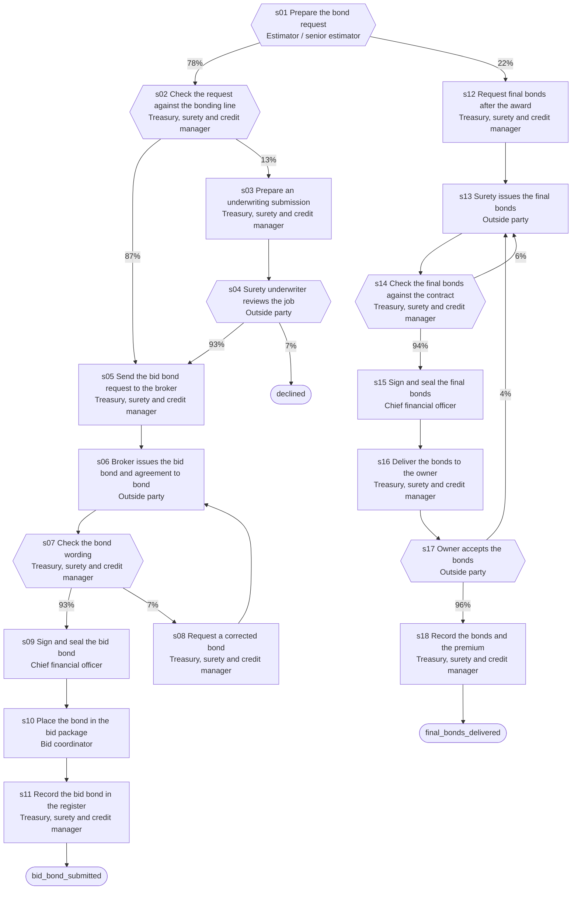

# Obtain bid and performance bonds

`gc-fin-surety-bonding` · construction - non-residential general contracting · finance (treasury) · part of `general-contractor-co`

Public owners in Canada require a contractor to back its tender with a bid bond, usually 10% of the bid, and a surety's agreement to provide performance and labour and material payment bonds if it wins; Ontario requires both final bonds at 50% of the price on public contracts of $500,000 or more. The estimator spots the bonding requirement in the tender and sends a request to the treasury manager, who checks it against the company's bonding line, asks the broker for the bond, checks the wording and has it signed and sealed. After an award the treasury manager obtains the final bonds and delivers them to the owner with the signed contract. Delays come from large or unusual jobs that need the surety's underwriter, from errors in bond wording found late, and from originals that must be signed, sealed and couriered before a tender closes.

| | |
|---|---|
| Unit of work | one bond request |
| Starts when | An estimator finds a bonding requirement in a tender, or a contract award requires the final performance and labour and material payment bonds. |
| Done when | The signed and sealed bond is in the bid package or delivered to the owner, and is recorded in the bond register, or the surety declines the request. |
| Organisation | A national Canadian general contractor bidding about 22 stipulated price tenders a month, with a bonding line from a surety arranged through a broker. (2,800 employees, 2019-2022) |
| Volume | 35 cases a month (range 25 to 50) |

## Where it sits

- Starts with **bond_request** from bd-stipulated-bid (78% of cases)
- Starts with **bond_request** from bd-contract-award (22% of cases)
- Relies on **bond** from surety (a standing input; it does not start a case)
- Sends **bond_request** to surety (outcome: any)
- Sends **bond** to bd-stipulated-bid (outcome: bid_bond_submitted)
- Sends **bond** to public-owner (outcome: final_bonds_delivered)
- Sends **bond** to bd-contract-award (outcome: final_bonds_delivered)

## Flow

## Roles

| Role | Department | Layer | FTE on this process | Loaded cost per hour | Evidence |
|---|---|---|---:|---:|---|
| Treasury, surety and credit manager | Finance | manager | 0.4 | 95 CAD | C |
| Estimator / senior estimator | Estimating | senior specialist | 0.07 | 68 CAD | C |
| Bid coordinator | Estimating | individual contributor | 0.05 | 40 CAD | C |
| Chief financial officer | Finance | executive | 0.02 | 250 CAD | C |

## Steps

Hands-on time and the wait before each step show the most common value. Evidence tier A is a sourced number, B a sourced description, C the author's estimate.

| Step | Who | Kind | Hands-on | Wait before | Control | Evidence |
|---|---|---|---:|---:|---|---|
| **s01 Prepare the bond request.** The estimator reads the tender's instructions to bidders and supplementary conditions, notes the bid security amount, the agreement to bond and the final bond percentages and forms, and fills in the company's bond request form with the owner, project, closing date and estimated price. | Estimator / senior estimator | intake | 15 min | 1.0 h |  | C |
| **s02 Check the request against the bonding line.** The treasury manager logs the request in the bond register and compares the bid price and the work on hand with the single-job and aggregate limits of the bonding line and the type of work and province the surety normally supports. | Treasury, surety and credit manager | lookup | 15 min | 2.0 h | Surety bonding line terms: single-job and aggregate limits | B [ocn2019] |
| **s03 Prepare an underwriting submission.** The treasury manager writes a submission to the surety through the broker with the project description, estimate summary, schedule, contract terms, current work-in-progress schedule and latest financial statements. | Treasury, surety and credit manager | drafting | 2.0 h | 4.0 h |  | B [ocn2019] |
| **s04 Surety underwriter reviews the job.** The surety's underwriter reviews the submission, may ask questions about the estimate, subcontractor bonding or contract risk, and approves the bond, approves it with conditions, or declines. | Outside party | external wait | 0 min | 3.0 d | Surety underwriting authority for jobs above the agent's power of attorney | C |
| **s05 Send the bid bond request to the broker.** The treasury manager emails the broker the request form, the owner's bid bond form if one is prescribed, and the tender closing date and delivery method. | Treasury, surety and credit manager | communication | 10 min | 30 min |  | C |
| **s06 Broker issues the bid bond and agreement to bond.** The broker prepares the bid bond, usually 10% of the bid, and the surety's consent or agreement to provide final bonds, signed and sealed by the surety's attorney-in-fact, and sends originals or an electronic bond. | Outside party | external wait | 0 min | 12.0 h |  | B [pwgsc-bid], [cu2010] |
| **s07 Check the bond wording.** The treasury manager compares the bond with the tender: obligee name, project name and tender number, bond amount or percentage, form, dates, seals and signatures, because a defective bid bond can disqualify the bid. | Treasury, surety and credit manager | validation | 15 min | 1.0 h | Tender instructions: bid security in the required form or the bid is non-compliant | B [pwgsc-bid], [cu2010] |
| **s08 Request a corrected bond.** The treasury manager emails the broker the correction needed and the deadline, and the broker reissues the bond before the tender closes. | Treasury, surety and credit manager | communication | 10 min | 15 min |  | C |
| **s09 Sign and seal the bid bond.** The chief financial officer, as signing officer, signs the bond as principal and applies the corporate seal, with a witness signature where the form requires it. | Chief financial officer | approval | 5 min | 2.0 h | Company signing authority; bond form requires principal's signature and seal | B [pwgsc-bid] |
| **s10 Place the bond in the bid package.** The bid coordinator puts the original bond and agreement to bond in the sealed bid envelope, or uploads the electronic bond to the tender portal, and confirms it on the bid checklist before closing. | Bid coordinator | coordination | 15 min | 2.0 h |  | C |
| **s11 Record the bid bond in the register.** The treasury manager records the bond number, amount, obligee and closing date in the bond register so the broker can track bonds outstanding and release them when the tender is awarded to someone else. | Treasury, surety and credit manager | data entry | 5 min | 1.0 h |  | C |
| **s12 Request final bonds after the award.** The treasury manager sends the broker the award letter, contract price, the owner's performance and labour and material payment bond forms (Ontario Forms 31 and 32 or the owner's own) and the date the owner needs them. | Treasury, surety and credit manager | communication | 25 min | 8.0 h | Ontario Construction Act s.85.1: performance and labour and material payment bonds of at least 50% on public contracts of $500,000 or more | B [ocn2019], [pwgsc-bid], [cu2010] |
| **s13 Surety issues the final bonds.** The broker and surety prepare the performance bond and labour and material payment bond on the required forms, checking the contract against the agreement to bond given at tender, and send the signed and sealed originals. | Outside party | external wait | 0 min | 3.0 d |  | B [ocn2019], [pwgsc-bid], [cu2010] |
| **s14 Check the final bonds against the contract.** The treasury manager checks contract price, percentages, obligee, project description, form and dates on both bonds against the executed contract and the owner's requirements. | Treasury, surety and credit manager | validation | 20 min | 2.0 h | Prescribed bond forms under the Ontario Construction Act and the contract's security requirements | B [ocn2019], [pwgsc-bid], [cu2010] |
| **s15 Sign and seal the final bonds.** The chief financial officer signs both bonds as principal and applies the corporate seal so that the originals can go to the owner with the executed contract. | Chief financial officer | approval | 5 min | 8.0 h | Company signing authority for bonds and contracts | C |
| **s16 Deliver the bonds to the owner.** The treasury manager couriers the original bonds to the owner's contract office with the signed contract or a cover letter and keeps scanned copies in the project file. | Treasury, surety and credit manager | communication | 15 min | 4.0 h |  | B [pwgsc-bid] |
| **s17 Owner accepts the bonds.** The owner's contract administrator checks the bonds and confirms acceptance, or asks for a correction, before releasing the contract for signature or allowing work to start. | Outside party | external wait | 0 min | 2.0 d |  | C |
| **s18 Record the bonds and the premium.** The treasury manager records both bonds in the register, updates the work-on-hand schedule the surety uses to track the line, and codes the broker's premium invoice to the job. | Treasury, surety and credit manager | data entry | 15 min | 1.0 d |  | C |

## Exceptions

| Exception | Share of cases | What happens |
|---|---:|---|
| Job needs surety underwriting | 10% | The bid exceeds the single-job limit or is unusual work, so the surety's underwriter must approve it; a few are declined. |
| Bond wording error | 6% | The bond names the wrong obligee or amount and must be reissued before closing. |
| Final bond correction | 2% | The owner or treasury finds the wrong form or amount on a final bond and the surety reissues it. |

## Benchmarks

| Metric | Value | Unit | Population | Evidence |
|---|---|---|---|---|
| cycle_time_days | p50 2.5, p90 11 | calendar days from bond request to bond in the bid package or delivered to the owner | Bid and final bond requests of a Canadian general contractor with an established bonding line | C |
| bid_bond_amount | 10 | % of the bid price (federal form, capped at $2,000,000) | Government of Canada construction tenders | A [pwgsc-bid] |
| final_bond_coverage | 50 | % of contract price for each of the performance and labour and material payment bonds | Ontario public contracts of $500,000 or more | A [ocn2019] |

## Pain points

- Requests arrive a day or two before tender closing, leaving little time to fix a wrong obligee or amount. (steps s01, s07, s08; C)
- Original bonds must be wet-signed, sealed and couriered, so the CFO's availability and courier times hold up bids and contract execution. (steps s09, s15, s16; C)
- Large or unusual jobs wait days for the surety's underwriter, which can rule out a bid. (steps s03, s04; B [ocn2019])

## Assumptions

- The quarterly and annual reporting of financial statements and work in progress to the surety that keeps the bonding line open is a standing activity, not a per-request step; it is mentioned in s02 and s18 only.
- The bond broker is treated as part of the surety external party; the organisation file has no separate broker.
- The CFO signs bonds and the bid coordinator places them in the bid package, although the process map lists only the treasury manager and estimator.
- Treasury-manager steps run on office hours, so a request that arrives late in the day waits overnight; this is included in the queue waits.
- Loaded costs come from the organisation file.

## Sources

- [pwgsc-bid] [Bid bond: PWGSC-TPSGC 504](https://www.canada.ca/en/public-services-procurement/services/acquisitions/forms/bid-bond-504.html) (Public Services and Procurement Canada, 2026). Federal bid bond for 10% of the bid amount up to $2,000,000; void if the bidder signs the contract and provides 50% performance and 50% labour and material payment bonds within 14 days after the forms are presented (tender acceptance within 60 days); signed and sealed by principal and surety with a witness.
- [ocn2019] [Bonding basics: Sureties can reduce risk and ensure payments to subcontractors and suppliers, says SAC representative](https://ontarioconstructionnews.com/bonding-basics-sureties-can-reduce-risk-and-ensure-payments-to-subcontractors-and-suppliers-says-sac-representative-2) (Ontario Construction News, 2019). Ontario Construction Act requires 50% performance and 50% labour and material payment bonds on public contracts of $500,000 or more signed after 1 July 2018; sureties assess capital, capacity and character; 2018 was the worst year for surety claims with a 105.6% net loss ratio.
- [cu2010] [Building on a promise: construction surety bonds](https://canadianunderwriter.ca/2010/03/31/building-on-a-promise-construction-surety-bonds/) (Canadian Underwriter, 2010). Bid bond binds bidder and surety to enter the formal contract; performance bond and labour and material payment bond bought together after award; labour and material bond example limited to 50% of contract value; claimants can claim directly against the surety.

Written by claude-opus on 2026-11-24.
