# Run weekly hourly payroll

`gc-fin-union-payroll` · construction (non-residential general contracting) · finance (payroll) · part of `general-contractor-co`

Each week the payroll team turns the approved crew timecards of about 1,330 unionised carpenters, finishers, labourers and operators into pay by Thursday, under 15 to 20 collective agreements in several provinces. The ERP calculates pay, but specialists review the register by hand, fix errors, get a rule on agreement questions from labour relations, and have the run approved and released by two people. Source deductions go to the CRA within three working days of each weekly remitting period, and once a month the team reports hours and contributions to every union local and trust fund and pays WSIB. Errors cost money directly: late pay and late fund remittances carry penalties written into the agreements.

| | |
|---|---|
| Unit of work | one weekly payroll run |
| Starts when | The weekly timecard batches close at the Tuesday cut-off. |
| Done when | Workers are paid, the payroll is posted and source deductions remitted; after the month's last run, union, fund and WCB remittances are also paid and reconciled. |
| Organisation | A Canadian national general contractor with about 1,330 unionised hourly trades on weekly pay and about 10 payroll specialists for hourly and salaried payroll. (2,800 employees, 2019-2022) |
| Volume | 4.3 cases a month (range 4.3 to 5) |

## Where it sits

- Starts with **timesheet** from spe-field-timekeeping (100% of cases)
- Relies on **new_hire** from hr-hire-trades (a standing input; it does not start a case)
- Relies on **collective_agreement** from hr-labour-relations (a standing input; it does not start a case)
- Relies on **termination_record** from hr-layoff-recall (a standing input; it does not start a case)
- Sends **pay** to employees (outcome: any)
- Sends **payroll_remittance** to cra (outcome: any)
- Sends **labour_cost** to ops-monthly-cost-forecast (outcome: any)
- Sends **journal_entries** to fin-month-end-close (outcome: any)
- Sends **union_remittance** to unions (outcome: paid_and_remitted_month_end)
- Sends **payroll_remittance** to wcb (outcome: paid_and_remitted_month_end)

## Flow

```mermaid
flowchart TD
    s01["s01 Run the missing-timecard report<br/>Payroll specialist  union and salaried"]
    s02{{"s02 Set up new hires and enter terminations<br/>Payroll specialist  union and salaried"}}
    s03["s03 Labour relations confirms the new wage schedule<br/>Labour relations manager"]
    s04["s04 Load the new rate tables in the ERP<br/>Payroll specialist  union and salaried"]
    s05["s05 ERP calculates gross to net<br/>Automated"]
    s06{{"s06 Review the payroll register for exceptions<br/>Payroll specialist  union and salaried"}}
    s07["s07 Correct errors and recalculate<br/>Payroll specialist  union and salaried"]
    s08["s08 Labour relations rules on an agreement question<br/>Labour relations manager"]
    s09{{"s09 Finance manager approves the payroll register<br/>Regional finance manager"}}
    s10["s10 Create the direct deposit file<br/>Payroll specialist  union and salaried"]
    s11["s11 Treasury releases the payment file<br/>Treasury, surety and credit manager"]
    s12["s12 Courier pay envelopes to sites<br/>Outside party"]
    s13["s13 Foremen hand out pay statements on site<br/>Foreman  concrete, formwork or carpentry crew"]
    s14["s14 Direct deposits arrive on payday<br/>Automated"]
    s15["s15 Answer pay queries and issue manual cheques<br/>Payroll specialist  union and salaried"]
    s16["s16 Post the payroll journal and reconcile clearing accounts<br/>Payroll specialist  union and salaried"]
    s17["s17 Issue records of employment for laid-off workers<br/>Payroll specialist  union and salaried"]
    s18{{"s18 Remit source deductions to the CRA<br/>Payroll specialist  union and salaried"}}
    s19["s19 Prepare union and trust fund remittance reports<br/>Payroll specialist  union and salaried"]
    s20["s20 Finance manager approves remittance payments<br/>Regional finance manager"]
    s21["s21 Report and pay workers' compensation premiums<br/>Payroll specialist  union and salaried"]
    s22["s22 Reconcile remittances to the general ledger<br/>Payroll specialist  union and salaried"]
    s01 --> s02
    s02 -->|"94%"| s05
    s02 -->|"6%"| s03
    s03 --> s04
    s04 --> s05
    s05 --> s06
    s06 -->|"60%"| s07
    s06 -->|"10%"| s08
    s06 -->|"30%"| s09
    s07 --> s09
    s08 --> s07
    s09 -->|"95%"| s10
    s09 -->|"5%"| s07
    s10 --> s11
    s11 --> s12
    s12 --> s13
    s13 --> s14
    s14 --> s15
    s15 --> s16
    s16 --> s17
    s17 --> s18
    s18 -->|"77%"| end0
    s18 -->|"23%"| s19
    s19 --> s20
    s20 --> s21
    s21 --> s22
    s22 --> end1
    end0(["paid_and_remitted"])
    end1(["paid_and_remitted_month_end"])
```

## Roles

| Role | Department | Layer | FTE on this process | Loaded cost per hour | Evidence |
|---|---|---|---:|---:|---|
| Payroll specialist (union and salaried) | Finance transactions (AP, billing, payroll) | individual contributor | 2 | 40 CAD | B [bird-payroll] |
| Regional finance manager | Finance | manager | 0.15 | 88 CAD | C |
| Treasury, surety and credit manager | Finance | manager | 0.03 | 95 CAD | C |
| Labour relations manager | People and labour relations | manager | 0.1 | 95 CAD | C |
| Foreman (concrete, formwork or carpentry crew) | Concrete and formwork crews | supervisor | 0.7 | 65 CAD | C |

## Steps

Hands-on time and the wait before each step show the most common value. Evidence tier A is a sourced number, B a sourced description, C the author's estimate.

| Step | Who | Kind | Hands-on | Wait before | Control | Evidence |
|---|---|---|---:|---:|---|---|
| **s01 Run the missing-timecard report.** On Tuesday at the batch cut-off a payroll specialist runs the ERP report of active hourly employees with no hours this week for each region, and checks each name against layoffs, sick days and crews known to be rained out. Remaining gaps are chased with the general foremen. | Payroll specialist (union and salaried) | validation | 1.0 h | 4.0 h |  | C |
| **s02 Set up new hires and enter terminations.** The payroll specialist keys the week's new hires from the HR packets (TD1 forms, banking, union local, classification, benefit plan, province of work) into ERP payroll, and enters layoffs and terminations with final vacation pay so the records of employment can be issued. | Payroll specialist (union and salaried) | data entry | 6.0 h | 0 min |  | B [bird-payroll] |
| **s03 Labour relations confirms the new wage schedule.** When an increase in a collective agreement takes effect (most ICI agreements move on 1 May), the labour relations manager reads the union's published wage and fringe schedule, confirms the effective date and how the increase is split between wages, vacation pay and funds, and tells payroll which rate tables change. | Labour relations manager | review | 2.0 h | 3.0 d |  | C |
| **s04 Load the new rate tables in the ERP.** The payroll specialist updates the union rate tables for each affected local and classification: base rate, vacation and holiday pay percentage, dues check-off and each employer and employee fund contribution, then prints the table for the finance manager to compare with the schedule. | Payroll specialist (union and salaried) | data entry | 4.0 h | 4.0 h | Rate table changes independently checked before use | C |
| **s05 ERP calculates gross to net.** The ERP payroll calculation applies each worker's union rate, overtime and double time, shift premiums, travel and board allowances, vacation pay, income tax, CPP and EI, union dues check-off and the employer and employee fund contributions, and produces the payroll register. | Automated | system auto | 0 min | 30 min |  | B [bacu-ici] |
| **s06 Review the payroll register for exceptions.** The payroll specialists work through the register region by region: negative or zero nets, more than 60 hours, overtime paid at straight time, board allowance outside the travel zone, missing fund contributions, and totals for hours and gross compared with last week by project. Each query is noted on an exceptions list. | Payroll specialist (union and salaried) | validation | 12.0 h | 1.0 h | Internal control over payroll: register review before release | C |
| **s07 Correct errors and recalculate.** The payroll specialist fixes timecard lines, employee set-ups or rates, phones the general foreman when hours look wrong, and reruns the calculation for the affected workers before the register goes for approval. | Payroll specialist (union and salaried) | data entry | 5.0 h | 1.0 h |  | C |
| **s08 Labour relations rules on an agreement question.** The labour relations manager answers questions such as whether board allowance applies at a site outside the free travel zone, which shift premium applies, or which local's agreement covers a worker transferred between areas, and replies to payroll by email. | Labour relations manager | judgment | 30 min | 8.0 h |  | B [bacu-ici] |
| **s09 Finance manager approves the payroll register.** The regional finance manager compares the register totals with last week and the head count, looks at large changes by project and the exceptions list, and approves the run in the ERP. The approver did not prepare the payroll. | Regional finance manager | approval | 30 min | 4.0 h | Payroll preparer and approver are different people (internal control over financial reporting) | C |
| **s10 Create the direct deposit file.** The payroll specialist generates the EFT file for workers paid by direct deposit and uploads it to the bank portal so funds arrive by 5 p.m. Thursday, and prints cheques with pay statements for workers still paid by cheque. | Payroll specialist (union and salaried) | data entry | 45 min | 1.0 h | Collective agreement: direct deposit in the account by 5 p.m. Thursday (BACU-Guild ICI art. 22.03) | B [bacu-ici], [bird-payroll] |
| **s11 Treasury releases the payment file.** The treasury manager checks the file total against the approved register and the bank balance, and releases the payment in the bank portal as the second authoriser. | Treasury, surety and credit manager | approval | 10 min | 2.0 h | Dual authorisation of bank payments | C |
| **s12 Courier pay envelopes to sites.** Cheques and pay statements in sealed envelopes go by courier or with a yard truck to each site trailer for Thursday, since the agreements require pay on the jobsite during working hours. | Outside party | external wait | 0 min | 18.0 h |  | B [bacu-ici] |
| **s13 Foremen hand out pay statements on site.** On Thursday each foreman hands his crew their envelopes or pay statements and collects any signed timesheet copies due. This is counted for all crews together. | Foreman (concrete, formwork or carpentry crew) | physical | 10.8 h | 4.0 h |  | C |
| **s14 Direct deposits arrive on payday.** The bank credits the workers' accounts by 5 p.m. on Thursday from the file released on Tuesday or Wednesday; a rejected deposit comes back as an exception to payroll. | Automated | system auto | 0 min | 0 min |  | B [bacu-ici] |
| **s15 Answer pay queries and issue manual cheques.** On Thursday and Friday the payroll specialists take calls from workers and foremen about short or missing pay, check the timecard and register, and issue a manual cheque or direct deposit the next working day, because late pay carries a two-hour-a-day penalty in some agreements. | Payroll specialist (union and salaried) | communication | 6.0 h | 12.0 h | Collective agreement late pay penalty: two hours' pay per day after noon of the next working day (BACU-Guild ICI art. 22.05) | B [bacu-ici] |
| **s16 Post the payroll journal and reconcile clearing accounts.** The payroll specialist posts the run to the general ledger and job cost with the labour burden (vacation pay, fund contributions, CPP, EI and WSIB), and reconciles the payroll clearing and deduction liability accounts. | Payroll specialist (union and salaried) | validation | 2.0 h | 1.0 d |  | C |
| **s17 Issue records of employment for laid-off workers.** For each worker laid off in the pay period the payroll specialist prepares the record of employment in ROE Web with insurable hours and earnings by pay period, so the worker can claim employment insurance. | Payroll specialist (union and salaried) | data entry | 2.0 h | 4.0 h | Employment Insurance Regulations: record of employment for every interruption of earnings | B [bird-payroll] |
| **s18 Remit source deductions to the CRA.** The payroll specialist totals income tax, CPP and EI (employee and employer) for the remitting period and pays the CRA through the bank by the third working day after the period ends, as a threshold 2 accelerated remitter. | Payroll specialist (union and salaried) | data entry | 20 min | 1.0 d | Income Tax Act source deduction remittance: threshold 2 due 3 working days after each remitting period | A [cra-when], [cra-types] |
| **s19 Prepare union and trust fund remittance reports.** After the month's last run the payroll specialists compile, for each local and agreement, every member's hours and earnings with dues check-off and each benefit, pension, training and industry fund contribution, fill in the union's remittance forms (three per month under some agreements) and prepare one cheque or EFT per payee. | Payroll specialist (union and salaried) | data entry | 15.0 h | 3.0 d | Collective agreement remittance clause: contributions and dues with the report form by the 15th of the following month (BACU-Guild ICI art. 18.03-18.04) | B [bacu-ici] |
| **s20 Finance manager approves remittance payments.** The finance manager compares each remittance total with the payroll liability accounts and approves the cheques or EFTs before the due date, since remittances more than 10 days late attract liquidated damages. | Regional finance manager | approval | 45 min | 8.0 h | Payment approval by someone other than the preparer | B [bacu-ici] |
| **s21 Report and pay workers' compensation premiums.** The payroll specialist reports the month's insurable earnings by rate group to the WSIB online and pays the premium, and files the equivalent reports for the Alberta, Saskatchewan, British Columbia and Atlantic boards on their own schedules. | Payroll specialist (union and salaried) | data entry | 1.0 h | 1.0 d | Workplace Safety and Insurance Act: monthly premium reporting for insurable earnings of $1,000,000 or more | A [wsib-freq] |
| **s22 Reconcile remittances to the general ledger.** The payroll specialist reconciles the month's dues, fund, CRA and WCB liability accounts to the remittances paid and clears differences, which feeds the month-end close. | Payroll specialist (union and salaried) | validation | 3.0 h | 1.0 d | Monthly balance sheet account reconciliation | C |

## Exceptions

| Exception | Share of cases | What happens |
|---|---:|---|
| Register errors | 60% | Most weeks the register review finds timecard, set-up or rate errors that are fixed before approval. |
| Agreement interpretation | 10% | Board allowance, travel zone or premium question goes to labour relations. |
| Wage schedule change | 6% | A new wage and fringe schedule takes effect and rate tables are reloaded. |
| Month-end remittances | 23% | The month's last run also carries union, trust fund and WCB reporting and payment. |

## Benchmarks

| Metric | Value | Unit | Population | Evidence |
|---|---|---|---|---|
| cycle_time_days | p50 5, p90 13 | calendar days from timecard cut-off to the last remittance of the run | Weekly union payroll, Ontario ICI agreements | B [bacu-ici], [cra-when] |
| pay_days_after_time_books_close | 4 | working days (maximum) | BACU-Guild ICI agreement, Ontario, 2022-2025 | A [bacu-ici] |
| union_remittance_due | 15 | day of the following month | BACU-Guild ICI agreement, Ontario, 2022-2025 | A [bacu-ici] |

## Pain points

- Many agreements, locals and provinces mean the register review and corrections take most of two working days every week. (steps s06, s07, s08; C)
- Late or short pay draws calls from sites and manual cheques, and some agreements add two hours' pay per day of delay. (steps s15; B [bacu-ici])
- Monthly union remittance forms are compiled per local and fund by hand from payroll reports, and late remittances carry 5% a month in liquidated damages. (steps s19, s20; B [bacu-ici])

## Assumptions

- The case starts at the Tuesday timecard cut-off; keying timecards is in gc-spe-field-timekeeping.
- Hands-on time is for the whole run (all regions); the simulation adds it to elapsed time as if one person did it, which lengthens the simulated cycle by about two days compared with the specialists working in parallel.
- About 80% of workers are paid by direct deposit and 20% by cheque on site in 2019-2022 (author's estimate).
- The company is a threshold 2 accelerated remitter: weekly withholding of about $500,000 (1,330 workers x about $1,800 gross x about 25% tax, CPP and EI) is well over the $100,000 monthly threshold.
- WSIB monthly reporting applies because Ontario insurable earnings are far above $1,000,000 a year; the WSIB page opened is the 2023 version of the threshold, which the company exceeds by a wide margin either way.
- Remittances to the union locals are monthly, not weekly; the organisation file shows union_remittance as an output of this weekly process, which is true only of the month's last run (23% of runs).
- Loaded costs come from the organisation file.

## Sources

- [cra-when] [When to remit (pay)](https://www.canada.ca/en/revenue-agency/services/tax/businesses/topics/payroll/remitting-source-deductions/how-when-remit-due-dates.html) (Canada Revenue Agency, 2026). Accelerated threshold 2 remitters remit up to four times a month for the periods 1st-7th, 8th-14th, 15th-21st and 22nd-month end, each due by the 3rd working day after the period ends; a due date on a weekend or holiday moves to the next business day.
- [cra-types] [Types of remitters](https://www.canada.ca/en/revenue-agency/services/tax/businesses/topics/payroll/remitting-source-deductions/how-when-remit-more-information.html) (Canada Revenue Agency, 2026). Threshold 2 accelerated remitters are employers whose average monthly withholding amount two calendar years earlier was $100,000 or more; all payroll accounts of one organisation share the same remitter type.
- [wsib-freq] [Policy in practice: Premium frequency](https://wsib.ca/en/policy-practice-premium-frequency) (Workplace Safety and Insurance Board (Ontario), 2023). Businesses with annual insurable earnings of $1,000,000 or more report and pay WSIB premiums monthly and complete an annual reconciliation by 31 March.
- [bacu-ici] [BACU-Guild Province Wide ICI Collective Agreement (marble, tile, terrazzo, cement masons, resilient floor layers and helpers), 1 April 2022 to 30 April 2025](https://negotech.service.canada.ca/eng/agreements/14/1448404a.pdf) (Brick and Allied Craft Union of Canada and Terrazzo, Tile & Marble Guild of Ontario; filed with Employment and Social Development Canada (Negotech), 2022). Art. 5.01 employer hires from the Local Union office and the union supplies a referral slip; 5.02 recall within 35 days of layoff; 5.03 75% of additional hires may be requested by name; 5.05 hire from other sources as probationary members when the union cannot supply; 7.03 union refers only members with Fall Arrest, WHMIS and Working at Heights training; 18.03 deductions and contributions compiled monthly and remitted with the report form by the 15th of the following month; 18.04 three remittance forms each month; 19.01 5% a month liquidated damages on remittances more than 10 days in arrears; 22.01 timesheets mandatory, paper sheets due by end of business day Monday after the workweek; 22.02 time books closed weekly and Thursday payday within four working days of closing; 22.03 direct deposit by 5 p.m. Thursday; 22.04 pay statement contents; 22.05 two hours' pay per day of late pay; 24.01 normal week of four or five days of 8 to 10 hours.
- [bird-payroll] [Payroll Administrator (Bird Construction job posting)](https://builtincalgary.org/job/payroll-administrator/10374622) (Built In Calgary, 2026). Bird Construction payroll administrator prepares and processes weekly and bi-weekly hourly payroll, calculates pay for new hires, changes and terminations, prepares Records of Employment in ROE Web, produces month-end reports and supports audits.

Written by claude-opus on 2026-11-24.
